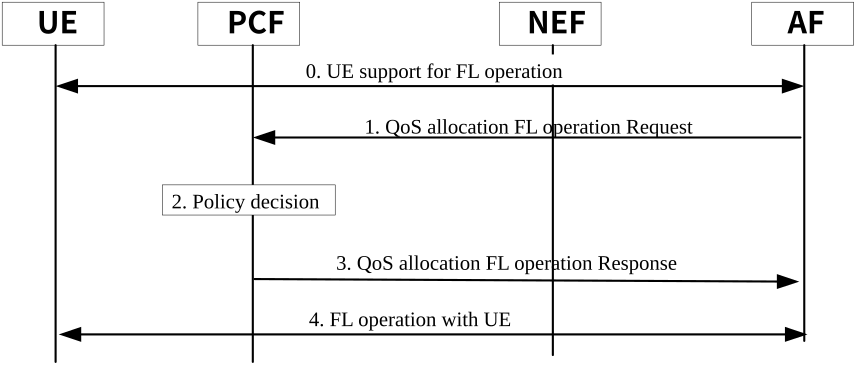

# 6.26 Solution \#26: FL operation with 5GS coordination for UE selection

## 6.26.1 Description

Based on the KI#7 objective, federated learning between the UE and application server (federated server) need to determine and agree on learning via mobile network. In this case, application server needs to coordinate with the mobile network before determining the participate UEs, learning model and learning time.

This solution proposed that application server determine the UE groups for FL operation based on the UE's capability, UE's wishes (if any e.g. time window that UE is available), location, and available QoS. The application server coordinate with the 5GS (e.g. available QoS) to finalize the UE list for FL operation. For instance, if the 5GS cannot provide the agreed QoS for specific UE, the application server does not consider this UE for the FL operation.

When an application server determines to perform the federated learning with UEs in a specific location, the application server request the 5GC via NEF with required QoS, location information and UEs details such as UE ID. In addition, optionally, application server can also provide time window (e.g. start and end time) of FL operation. The NEF checks the authorization of the application server request with local policy or with a UDM. NEF forwards the request to 5GC NF.

## 6.26.2 Procedures

Figure 6.26.2-1: Procedure to coordinate with 5GS for UE selection

0\. Both the UE and application server exchanges the FL operation information such as UE's capability, UE's wishes (if any e.g. time window that UE is available), location information. This operation takes place in the application layer.

NOTE 1: The communication between the AF and UE is outside the scope of SA WG2.

1\. When an AF determines to perform the federated learning with UEs in a specific location, the AF request the PCF via NEF with QoS requirements, location information specific UE ID, external group ID if available. In addition, optionally, AF can also provide time window (e.g. start and end time) of FL operation. The NEF checks the authorization of the application server request with local policy or with a UDM. NEF forwards the request to PCF.

NOTE 2: Based on step 0, the AF determines the UE list and the QoS requirements to perform the FL operation. Also, what triggers the FL operation (e.g. at a specific location, in a specific time window) is AF's internal business logic and is outside the scope of SA WG2.

2\. Based on the policy, the PCF checks the AF request and determine whether the network can provide required QoS in specific location on required time window (if included). The PCF may interact with the NWDAF and request the Network Performance analytics information for the Desired time window in the area of interest and other analytics such as UE related analytics as defined in TS 23.288 \[6\].

3\. If PCF determine that it can allocate the required QoS, then the PCF sends the accept message to the AF with the agreed resources (QoS) information. If PCF determine that it cannot allocate the required QoS on specified time or time window, the PCF rejects the AF request. In addition, PCF may provide alternative time or time window that network can provide required resources (QoS) in the rejection message.

4\. Up on the notification from PCF, AF selects the UEs and sends FL operation request to the UE with agreed time or time window with the network. The UEs determine whether it can join the FL operation or not. If yes, UE sends the accept notification to the AF or else reject notification.

Based on the notification from the UEs, the AF finalizes UE list which participate the federated learning operation.

NOTE 3: It is up to the AF implementation the selection and finalization of the UE list.

## 6.26.3 Impacts on Existing Nodes and Functionality

NOTE: The current mechanism already supports the coordination between the PCF and AF which can be used for the UE selection for FL operation by the AF based on AF implementation logic. Therefore, no new impacts are realized in the solution, since most of the operation takes place in the application layer.
