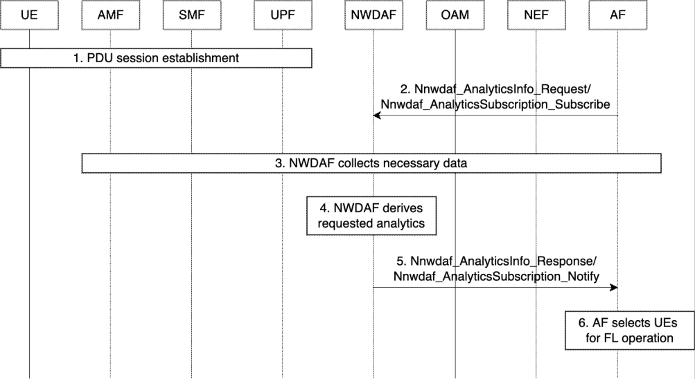

# 6.27 Solution \#27: Assistance to selection of UEs for federated learning operation

## 6.27.1 Description

This solution addresses the issue about assistance to selection of UEs for FL operation defined in Key Issue \#7: 5GS Assistance to Federated Learning Operation.

The key operational characteristics of FL is that UEs play a role as training devices and upload local update information to a central server (we call it "FL server") for global model update. It enables model training in a distributed manner without privacy concern, but it tends to cause poor model performance due to various constraints or characteristics of UEs who are selected as training devices. For example, when most of devices selected for local training tasks have low power or high mobility, model performance can be degraded by incomplete interim updates. It motivates us to investigate on what information is useful for AF to select appropriate UEs for FL operation. In the aforementioned example, prediction of high mobility can be provided by 5GS (i.e. NWDAF in 5GC) while low-power state information can be provided by a UE application, not by 5GS. Note that the latter case is not applicable to 5GS assistance defined in Key Issue \#7. Thus, the solution only deals with how 5GS could provide assistance to AF so that appropriate UEs can be selected for FL operation as in the former case.

This solution proposes a NWDAF-assisted approach where NWDAF in 5GC provides useful analytics information for AF to select appropriate UEs for FL operation. Here, it is assumed that analytics from the NWDAF is requested or subscribed by AF (i.e. Analytics service consumer is AF). The proposed solution is based on existing analytics (e.g. QoS Sustainability, Service Experience, UE mobility, UE Communication, User Data Congestion, and/or Abnormal behavior). For example, QoS Sustainability and/or Service Experience Analytics can be used to select UEs who can provide acceptable QoS sustainability and/or service experience level for FL operation. UE Communication and User Data Congestion Analytics can be also used to select UEs who have regular and light traffic patterns as much as possible during the model distribution and upload phases for FL operation. In addition, UE mobility and/or Abnormal behavior Analytics can be used to exclude UEs with high mobility and/or high abnormality level to achieve better model performance.

Any extension for procedures defined in existing analytics is not required. However, some enhancements are proposed for the following analytics by targeting FL operation.

1\. QoS Sustainability Analytics:

\- Proposal: Extend "Target of Analytics Reporting" including a single UE level granularity without location information as a mandatory parameter in Analytics Filter Information, instead of "any UE" in a location of interest (e.g. TAIs or Cell IDs) as in the existing Analytics. In order to provide the analytics information in the UE level granularity, input data from OAM may also need to be extended such as RAN throughput per UE and QoS flow Retainability per UE.

\- Motivation: "Target of Analytics Reporting" needs to be provided in the UE level granularity to support FL operation because supportable QoS levels from some UEs in the same area (e.g. TAIs or Cell IDs) can be different and thus unreliable prediction information can be provided by the existing Analytics. Finally, poor model performance can be achieved by UEs selected based on the unreliable prediction information.

2\. Service Experience Analytics:

\- Proposal: Extend "customized MOS at AF or QoE metrics at UE (via AF)" including success rates for upload of local update results from UE to AF within a given interval or success rates for model distribution from AF to UE within a given interval to support FL as a new promising AI/ML service type, not just mentioning a general description (e.g. a customized MOS for any kind of service including those not related to video or voice, and ASP specific QoE metrics as agreed in the SLA) as in the existing Analytics.

\- Motivation: The extended "customized MOS at AF or QoE metrics at UE (via AF)" including success rates for model update and distribution need to be explicitly specified because FL is one of new main service types considering that 5GS will be used as a platform to support AI/ML services.

NOTE: Any potential impact towards NWDAF will be coordinated with eNA study in Rel-18.

## 6.27.2 Procedures

Figure 6.27.2-1 shows the procedure for 5GS assistance to AF selecting UEs for FL operation.

Figure 6.27.2-1. Procedure for 5GS assistance to AF selecting UEs for FL operation

1\. It is assumed that PDU session establishment procedures were already complete as follows: UE already established PDU session to the application server of ASP with interested AI/ML application services. As an option, the application server may trigger for UE who provides consent to establish a new PDU session to a central FL server via the user plane (UP) so that the FL server can play a dedicated role for training tasks. On receipt of the trigger, UE may establish the new PDU session to the FL server. The ASP application server or FL server (which is mapped with AF in the figure) can collect necessary information (e.g. computation and network capability and data characteristics) for training from UE via the PDU session.

2\. The AF owned by the ASP may request or subscribe to the NWDAF to collect analytics information for interested UEs such as QoS Sustainability, Service Experience, UE mobility, UE Communication, User Data Congestion, and/or Abnormal behaviour. Here, the NEF is used when the AF is untrusted as 3rd party as usual.

3\. The NWDAF collects necessary data for analysis from NFs (e.g. AMF, SMF, AF) or OAM.

4\. The NWDAF checks the trigger conditions for analytics and derives the requested analytics. The NWDAF also detects notification conditions (e.g. defined by reporting thresholds).

5\. The NWDAF provides response or notification to the AF.

6\. Based on the response or notification information provided by the NWDAF, the AF can (re)select UEs for FL operation. Then, the AF would (re)distribute a global model to the selected UEs via the UP and aggregate local training update results from the UEs to update the global model.

Steps 2 to 6 can be repeated whenever new analytics is requested by the AF.

## 6.27.3 Impacts on services, entities and interfaces

NWDAF:

\- Existing Analytics IDs such as QoS Sustainability and Service Experience need to be enhanced to support FL operation as described in clause 6.27.1.

\- For QoS Sustainability Analytics, input data from OAM need to be extended to include "Throughput for DL and UL per UE, Packet delay for DL and UL per RAB/DRB per UE, Packet loss rate for DL and UL per RAB/DRB per UE in TS 37.320 \[12\]" for the analytics information in the UE level granularity.

\- For Service Experience Analytics, input data from UE (via AF) and AF need to be extended to include success rates for model update and distribution.

UE:

\- New QoE metrics for model distribution dedicated for FL operation need to be measured and provided to NWDAF as described in clause 6.27.1.

AF:

\- New customized MOSs for model update dedicated for FL operation need to be measured and provided to NWDAF as described in clause 6.27.1.
