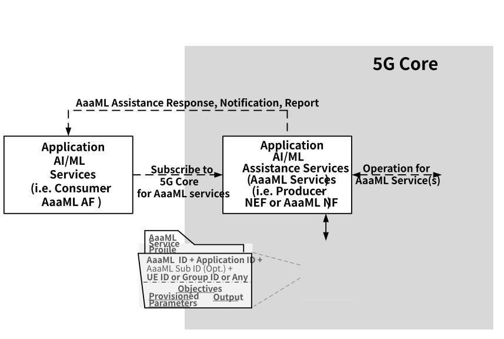
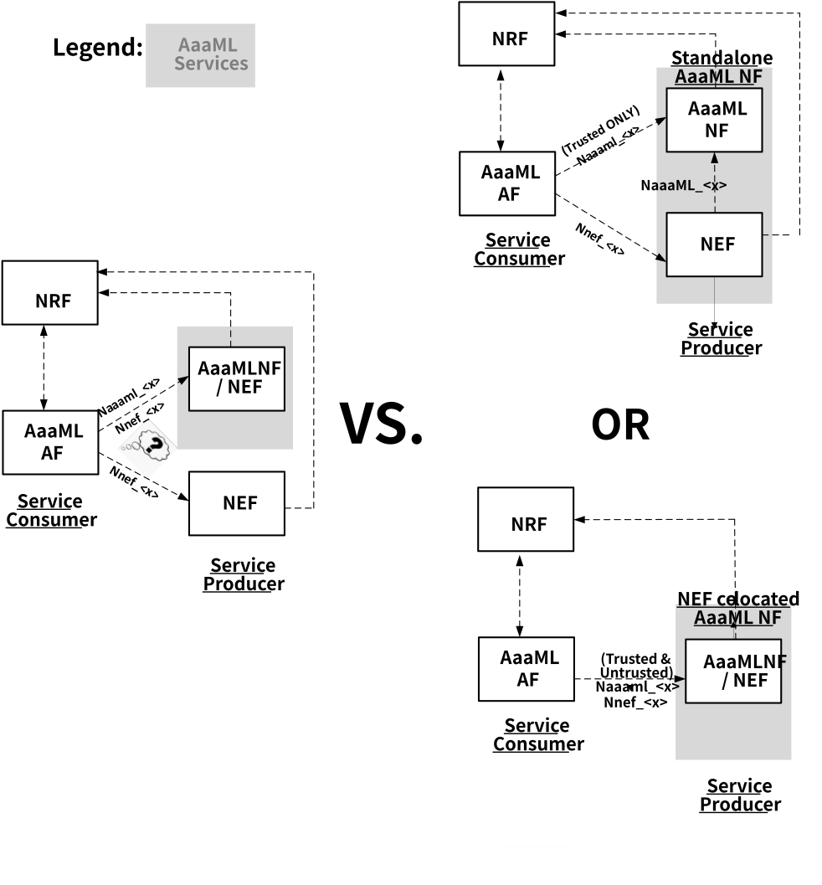
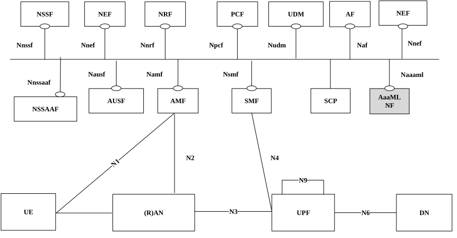
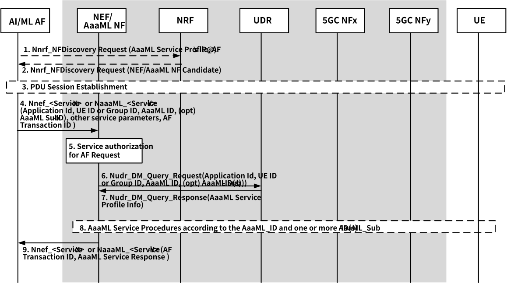

# 6.28 Solution \#28: Application AI/ML Assistance Services

## 6.28.1 Description

This solution has impact to all KIs.

It is observed that, many of the Application AI/ML operation may request similar assistance info and operation support from the 5G Core, the intent of this solution is to take into the considerations of the system requirements as identified by the 7 key issues as captured in clause 5, it proposes a common solution framework to assist various Application AI/ML operations which acquire similar assistance info and procedures from 5G core. In this framework, the similar service requirements and operational behaviours are organized into various Application AI/ML Assistance (AaaML) Service Profiles where each profile defines specific AaaML Service.

Editor's note: Whether a generic and dedicated application AIML service framework or NF is required cannot be determined until other solutions discussions progress and level of visibility to the 5GC of such operations is clarified.

The AaaML Services are a set of collective extensions to the existing 5G Core Services (e.g. NEF services) and the new 5G Core services which are defined specifically to assist the application layer AI/ML operation. With the support of the AaaML Service Profile information that indicates specific service requirements, an AaaML service can then be served by the existing 5G Core NF (e.g. NEF) and the new 5G Core NF, referred as Application AI/ML Assistance Network Function, i.e. AaaML NF, which is introduced by this proposal specifically to support the coordination of the AaaML Service.

An AaaML Service Profile is composed of three main parts of information:

\- Objective of target AaaML operation:

\- e.g. Assuming the objective of this operation is to support "AI/ML member selection for a particular Application AI/ML operation based on per UE's QoS sustainability". In this case, the AI/ML member selection is the main service, and the per UE's QoS sustainability analytics is the sub-service.

\- e.g. To expand the example above, instead of just referring to the UE's QoS sustainability analytic to support "AI/ML member selection, the UE's location mobility event and moving direction event are also part of the selection criteria. As a result, there are composite services which are composed of QoS sustainability analytic, mobility event and moving direction event to meet the objective of this given AaaML Service.

\- Input of provisioned service parameter(s):

\- e.g. minimum one way delay, predicted QoS performance within the next 5 minutes.

\- Output:

\- e.g. list of candidate UEs, event report for the group of UE's bandwidth consumption.

The configuration of an AaaML Service Profile is dependent on the corresponding Application.

Each AaaML Service Profile is identified by the AaaML Profile ID, Application ID, UE ID or Group ID or Any and optionally, one or more AaaML Sub-Profile ID. Each of the IDs above has the following purposes:

\- AaaML Profile ID - It identifies the main service of AaaML Service Profile that defines:

i\. what are the set of input AaaML service parameters required from the consumer and how they may be translated (e.g. GPSI to SUPI, geographical location into cell, TA, QoS requirements into QoS parameters etc.);

ii\. what are the target AaaML service information are to be collected from 5G Core (e.g. network analytic info for a given UE or a group or UEs, UE mobility update etc.); and

iii\. what are the target AaaML assistance operation is to be conducted in 5G Core (e.g. data transmission, service provisioning, performance monitoring, etc.).

\- (Optional) AaaML Sub-Profile ID - It describes the AaaML Service Sub profile for specifying the composite set of service requirement(s) for the target AaaML operation (e.g. AI/ML operation UE member selection based on QoS sustainability performance, AI/ML data transmission based on Time Of Date etc.). More than one Sub-profile can be specified for the given AaaML Service Profile.

\- The Application ID - It identifies the Application that require 5G Core assistance for the AI/ML operation.

\- UE ID or Group ID or any - The identifier of the target UE or a group of target UE or any UE who is/are involved in the target AaaML service.

As part of the AaaML service solution, the new 5GC NF, AaaML NF, is introduced to be the anchor point to coordinate the 5GC control plane and user plane functionalities to assist the Application AI/ML operation. The benefits with this new 5GC NF are:

\- a common point of contact between the Application AI/ML AF and the 5GC which simplifies the external communication interface with the 5G system.

\- an anchor point to conduct the specific tasks which are required to coordinate with other new or existing 5GC NF to assist the Application AI/ML operation and therefore

\- a signalling aggregation, distribution and filtering point which could minimize signalling overhead when supporting the communication between the Application AI/ML AF and the 5GC

\- a AaaML service translator between the 3rd party Application AI/ML AF and the 5GC according to the definitions of the AaaML Service Profile

\- a privacy shield for 5GS when exposing 5GS system information to AF to assist the Application AI/ML operation (e.g. conceal the UE's exact location information)

\- an enabler for mobile operator to provide Application AI/ML as-a-service when continuing to evolve the 5GS assistance to support the Application AI/ML operation

NOTE: AaaML NF is not a data analytics function nor it provides any assistance to support network operation within the 5GC of which NWDAF provides.

Figure 6.28.1-1: 5GC Application AI/ML Service Assistance Framework

AaaML NF can be co-located with NEF or standalone. Note that, the standalone the AaaML NF responds to the AaaML Service request as the Producer of which the AaaML Service is not based on the extension of the existing NEF Service. Such deployment consideration is necessary in order to ensure the integrity of the existing NEF services in 5G Core when they are extended to support the AaaML services so as not to confuse the service consumer(s) which are trying to communicate with their corresponding serving service producer(s) using the similar service based interfaces (i.e. Nnef\_\<x\>).

Figure 6.28.1-2 below explains the standalone configuration considerations for AaaML.

Figure 6.28.1-2: Considerations for Standalone AaaML NF when Leveraging Existing Service Based Interface to support AaaML Services

## 6.28.2 AaaML Service Architecture

This solution introduces new network function, Application AI/ML Assistance Network Function (AaaML NF), to provide necessary coordination support for the AaaML Services as described in 6.28.1 above. The new service based interface for AaaML NF is Naaaml. AaaML NF can be co-located with NEF or be standalone. For standalone AaaML NF configuration, it is only allowed when AaaML NF is the producer to respond to the AaaML Service request of which the service procedure is not based on the extensions of the existing 5G Core Service (i.e. NEF Service).

Figure 6.28.2-1: 5GS Service Architecture

## 6.28.3 AaaML Services

The AaaML Services are a set of collective extensions to the existing 5G Core Services (e.g. NEF services, NWDAF services) and the new 5G Core. AaaML NF which is specified to coordinate the 5G Core assistance to support the Application AI/ML operation.

In this clause, Table 6.28.3-1 describes the new 5G Core Services specifically defined for assisting the Application AI/ML operation of which the AaaML NF is the producer to respond to the AaaML service request and to provide the necessary coordination between various 5G Core Services (e.g. NEF services, NWDAF services etc.) when responding to the AaaML service request.

Table 6.28.3-2 presents the AaaML service mappings which describe the corresponding AaaML Service Profile and the corresponding existing/new 5G Core Service procedures for a specific AaaML Service as described in the appropriate clauses in the corresponding 3gpp specifications.

Table 6.28.3-1: AaaML services provided by AaaML NF (Producer)

<table>
<colgroup>
<col style="width: 33%" />
<col style="width: 28%" />
<col style="width: 23%" />
<col style="width: 14%" />
</colgroup>
<thead>
<tr class="header">
<th>Service Name</th>
<th>Service Operations</th>
<th>
Operation

Semantics
</th>
<th>Example Consumer(s)</th>
</tr>
</thead>
<tbody>
<tr class="odd">
<td>NaaaML_NetworkConsent</td>
<td>Request</td>
<td>Request/Response</td>
<td>AF</td>
</tr>
<tr class="even">
<td></td>
<td>Subscribe</td>
<td>Subscribe/Notify</td>
<td>AF</td>
</tr>
<tr class="odd">
<td></td>
<td>Unsubscribe</td>
<td></td>
<td>AF</td>
</tr>
<tr class="even">
<td></td>
<td>Notify</td>
<td></td>
<td>AF</td>
</tr>
<tr class="odd">
<td>NaaaML_CandidateUESelection</td>
<td>Request</td>
<td>Request/Response</td>
<td>AF</td>
</tr>
<tr class="even">
<td></td>
<td>Subscribe</td>
<td>Subscribe/Notify</td>
<td>AF</td>
</tr>
<tr class="odd">
<td></td>
<td>Unsubscribe</td>
<td></td>
<td>AF</td>
</tr>
<tr class="even">
<td></td>
<td>Notify</td>
<td></td>
<td>AF</td>
</tr>
<tr class="odd">
<td>NaaaML_NWDAFAnalyticsCollection</td>
<td>Subscribe</td>
<td>Subscribe/Notify</td>
<td>AF</td>
</tr>
<tr class="even">
<td></td>
<td>Unsubscribe</td>
<td></td>
<td>AF</td>
</tr>
<tr class="odd">
<td></td>
<td>Notify</td>
<td></td>
<td>AF</td>
</tr>
</tbody>
</table>

Table 6.28.3-2: Application AI/ML Assistance Information provided by NEF/AaaML NF

<table style="width:100%;">
<colgroup>
<col style="width: 12%" />
<col style="width: 20%" />
<col style="width: 17%" />
<col style="width: 19%" />
<col style="width: 28%" />
</colgroup>
<thead>
<tr class="header">
<th>
Application AI/ML 5GC Assistance Operation

(see Note-1)
</th>
<th>
AaaML Service Profile

(see Note-2)
</th>
<th>
AaaML Service

Sub-profile

(Optional)

(see Note-3)
</th>
<th>
Corresponding

NEF/AaaML

NF Services

(see Note-4)
</th>
<th>
AaaML Service

Descriptions

(see Note-5)
</th>
</tr>
</thead>
<tbody>
<tr class="odd">
<td>Network Consent</td>
<td>AaaML Profile ID: Network Consent</td>
<td>AaaML Sub- Profile ID: (see Editor's Note-1)</td>
<td>
TBD

(see Editor's Note-2)
</td>
<td>Network Consent for accessing target UE or Group of UEs related information for a specific application.</td>
</tr>
<tr class="even">
<td>Network Resource Monitoring</td>
<td>AaaML Profile ID: Network Resource Monitoring</td>
<td>AaaML Sub- Profile ID: (see Editor's Note-1)</td>
<td>
TBD

(see Editor's Note-2)
</td>
<td>Network resource performance monitoring (e.g. network load, QoS sustainability etc.) to support application AI/ML model and data distribution, transfer and/or training</td>
</tr>
<tr class="odd">
<td>UE-related Network Performance Monitoring</td>
<td>AaaML Profile ID: UE-related Network Performance Monitoring</td>
<td>AaaML Sub- Profile ID: (see Editor's Note-1)</td>
<td>
TBD

(see Editor's Note-2)
</td>
<td>UE-related network performance information (e.g. QoS monitoring, UE Mobility prediction etc.) to assist UE selection for Application AI/ML operation</td>
</tr>
<tr class="even">
<td>5G Core Network Exposure to UE</td>
<td>AaaML Profile ID: Network Exposure to UE</td>
<td>AaaML Sub- Profile ID: (see Editor's Note-1)</td>
<td>
TBD

(see Editor's Note-2)
</td>
<td>5GC exposes network information to the UE which is used to facilitate UE's Application AI/ML operation (e.g. Model Training, Splitting and inference feedback etc.).</td>
</tr>
<tr class="odd">
<td>5G Core Network Exposure to AI/ML AF</td>
<td>AaaML Profile ID: Network Exposure to AI/ML AF</td>
<td>AaaML Sub- Profile ID: (see Editor's Note-1)</td>
<td>
TBD

(see Editor's Note-2)
</td>
<td>5GC exposes network information to the UE which is used to facilitate Application AI/ML operation (e.g. Model download, Splitting and inference feedback etc.).</td>
</tr>
<tr class="even">
<td>
Candidate UE(s)

Selection
</td>
<td>AaaML Profile ID: Candidate UE(s)</td>
<td>AaaML Sub- Profile ID: (see Editor's Note-1)</td>
<td>
TBD

(see Editor's Note-2)
</td>
<td>5GC assistance to select candidate UE(s) to support Model Splitting, Training (either for FL or non-FL), inference feedback etc.</td>
</tr>
<tr class="odd">
<td>Application AI/ML Traffic Transport</td>
<td>AaaML Profile ID: Application AI/ML Traffic Transport</td>
<td>AaaML Sub- Profile ID: (see Editor's Note-1)</td>
<td>
TBD

(see Editor's Note-2)
</td>
<td>The 5GC data transfer/traffic routing mechanisms to support the transmission of the Application AI/ML traffic(s) between AI/ML endpoints (i.e. UE and AF)</td>
</tr>
<tr class="even">
<td colspan="5">
NOTE 1: This column is to describe the one or more 5G core services (i.e. composite services) that assist the application layer AI/ML operation.

NOTE 2: This column is to describe the AaaML Service Profile ID that maps to the main AaaML Service.

The AaaML Service Profile defines (i) what are the set of input AaaML service parameters required from the consumer and how they may be translated (e.g. GPSI to SUPI, geographical location into cell, TA, QoS requirements into QoS parameters etc.), (ii) what are the target AaaML service information are to be collected from 5G Core (e.g. network analytic info for a given UE or a group or UEs, UE mobility update etc.) and (iii) what are the target AaaML operation is to be conducted in 5G Core (e.g. data transmission, service provisioning, aggregation performance monitoring, etc.).

NOTE 3: This column is to depict the optional AaaML Sub-profile ID that describes the sub-service of the AaaML Service Profile by providing the additional service requirement(s) for the target AaaML operation (e.g. AI/ML operation UE member selection based on QoS performance, AI/ML data transmission based on Time Of Date etc.).

NOTE 4: This column is to capture the AaaML service mappings which describe the corresponding AaaML Service Profile and the corresponding existing/new 5G Core service for a specific AaaML Service.

NOTE 5: This column is to provide the high-level descriptions of the given AaaML service.
</td>
</tr>
</tbody>
</table>

Editor's note: It is FFS for the list of Sub-AaaML Services to be defined for the given AaaML Service when this study is reaching conclusion. For example, the clause n.m,x TS 23.xxx describes the Group QoS Monitoring, is the Sub-AaaML Service of the Network Resource Monitoring of AaaML Service.

Editor's note: It is FFS to finalize the corresponding NF services to support the given AaaML Service when this study is reaching conclusion. For example, the clause n.m TS 23.xxx describes the Network Resource Monitoring of AaaML Service.

Editor's note: It is FFS for more AaaML services to be defined or if just one service can be defined with use of AaaML Profile IDs.

## 6.28.3 Procedures for AaaML Services

### 6.28.3.1 AaaML Service Profile support for AaaML Service Procedures

This clause explains how to retrieve the AaaML Service Profile to support the AaaML service procedures.

Figure 6.28.3.1-1: AaaML Service Profile support for AaaML Service Operation

1-2. If the AF has not discovered its serving NEF or AaaML NF, it queries NRF to retrieve its serving NEF or AaaML NF that supports its target AaaML Service Profile.

3\. A PDU Session between the UE and the AF may have been established.

4\. AF subscribe or requests the AaaML service by sending NEF service request or AaaML service request with the required parameters and AF Transaction ID, more specifically, AF includes the Application Identifier, UE ID or Group ID, AaaML Profile ID and optionally AaaML Sub-Profile ID.

5\. NEF verifies the authorization of the AF Request.

6-7. NEF or AaaML NF sends request to UDR to retrieve the AaaML service profile by providing the Application Identifier, UE ID or Group ID, AaaML Profile ID and optionally AaaML Sub-Profile ID in case of the composite set of 5GC services is requested for the given AaaML service.

NOTE: Whether the AaaML service profile is stored locally to the AaaML NF or in the UDR is to be determined.

8\. By referring to the service parameters and based on the information of the AaaML service profile and the AaaML Sub-Profile, if requested, NEF or AaaML NF proceeds with the AaaML service procedures which may involve a composite set of 5GC service procedures corresponding to a set of 5GC events, analytics and/or notifications.

9\. Based on the outcome of the AaaML service procedures, NEF or AaaML NF replies to AF with the service response or notification which may be based on the collective outcomes of a composite set of 5GC service procedures..

## 6.28.3 Impacts on services, entities and interfaces

NRF:

\- Recognize the new service parameter, AaaML Profile ID, to support the NEF and AaaML discovery.

AF, NEF, AaaML:

\- Recognizes new service parameters, AaaML Profile ID, AaaML Sub-Profile ID to support the AaaML service procedure which may be composed of a set of 5GC service procedures (i.e. 5GC events, analytics and/or notifications).
