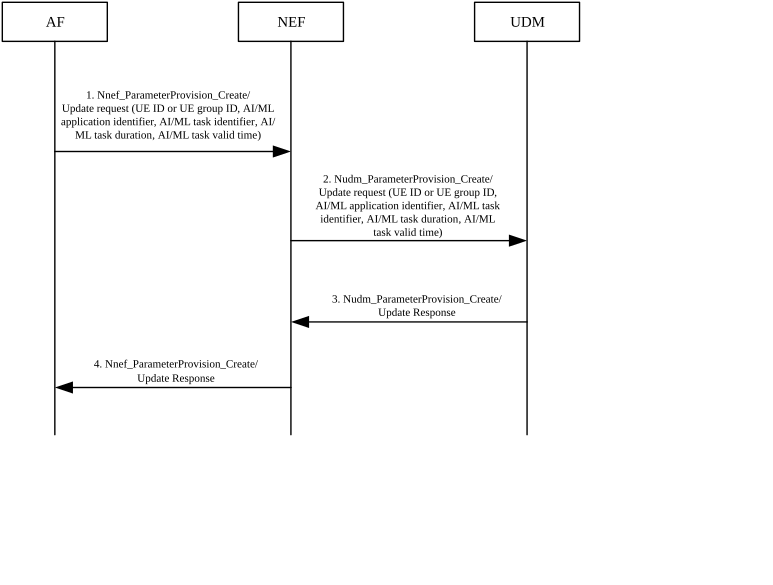
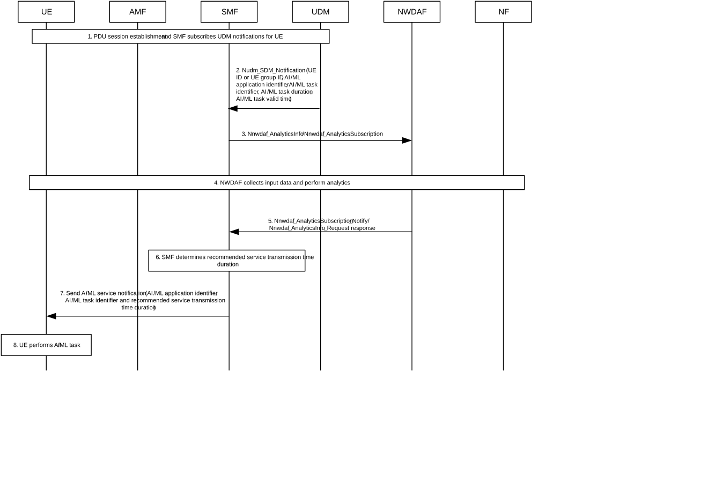
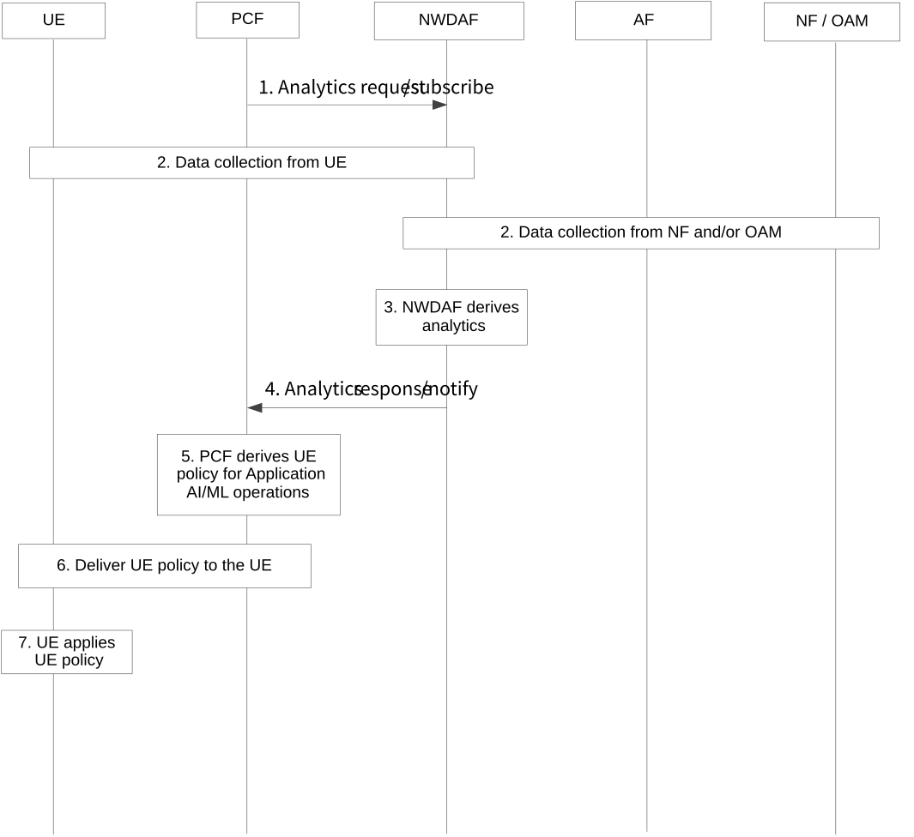

# 6.29 Solution \#29: 5GC assistance to UE on performing AI/ML task

## 6.29.1 Description

This solution is proposed to address Key Issue \#2: 5GC information exposure to UE and Key Issue \#4: Enhancing External Parameter Provisioning.

In some scenarios, AI/ML based services need stable network quality to ensure service sustainability, for example, as described in TS 22.261 \[2\], UE may upload or download AI/ML models or learning data from application servers (i.e. online model distribution is needed). If UE can get information about when the network can provide sufficient network resource, it can make better decisions on AI/ML operations (e.g. whether begin to perform an AI/ML service). It is helpful to expose some information to UE.

However, network information exposure directly to UE may cause security issues and some network information is not useful for UE to make decisions on AI/ML operations since how to allocate the network resource is determined by network rather than UE. Thus, it is important to study what information is valuable to be exposed to UE.

On the other hand, network tends to provide service for each UE according to the QoS requirement. However, when many AI/ML applications are running over 5G mobile network, these applications may generate large data traffic and give heavy load to network.

To reduce the impact on other services in the network and guarantee the quality of AI/ML based service, this solution proposes that the 5GC exposes a ***recommended service transmission time duration*** for UE to suggest when to perform AI/ML tasks, which means the network is more likely to provide sufficient network resources in this time duration. 5GC will consider AI/ML task related information and network resource to select a relatively idle time duration of both network and UE as ***recommended service transmission time duration***, so that UE can perform these AI/ML tasks in this time duration.

In this solution, the two main functionalities are proposed to take into consideration:

\- UE and AI/ML application servers negotiate AI/ML task in application layer and provision following AI/ML task related information to 5GC (UDM):

\- AI/ML application identifier: identifies the AI/ML application.

\- AI/ML task identifier: identifies AI/ML task to be performed by UE. It is AI/ML related traffic which needs to be transferred over 5GS and used to distinguish different tasks for the same application.

\- AI/ML task duration: defines the estimated time duration how long the task will take.

\- AI/ML task valid time: defines the time period during which the task is valid.

\- In addition to above information, 5GC (SMF) considers network performance by requesting analytics from NWDAF to determines ***recommended service transmission time duration***. SMF exposes ***recommended service transmission time duration*** to UE. The analytics ID can be requested from NWDAF includes:

\- Network Performance.

\- NF load information.

\- Service Experience.

\- UE communication.

## 6.29.2 Procedures

### 6.29.2.1 Procedure for AF provisioning information to 5GC

Figure 6.29.2-1 illustrates the procedure for AF provisioning information to 5GC.

Figure 6.29.2-1: Procedures for AF provisioning information to 5GC

1\. UE and AI/ML application servers negotiate the AI/ML task to be performed and the task related parameters in 6.29.1. AF provides AI/ML task related parameters (UE ID or UE group ID, AI/ML application identifier, AI/ML task identifier, AI/ML task duration, AI/ML task valid time) to be created or updated in a Nnef_ParameterProvision_Create or Nnef_ParameterProvision_Update Request to the NEF.

2\. If the AF is authorised by the NEF to provision the parameters, the NEF requests to create, update and store provisioned parameters as part of the subscriber data via Nudm_ParameterProvision_Create, Nudm_ParameterProvision_Update or Nudm_ParameterProvision_Delete Request message.

If the AF is not authorised to provision the parameters, then the NEF continues in step 4 indicating the reason to failure in Nnef_ParameterProvision_Create/Update Response message.

3\. UDM responds the request with Nudm_ParameterProvision_Create/Update Response. If the procedure failed, the cause value indicates the reason.

4\. NEF responds the request with Nnef_ParameterProvision_Create/Update Response. If the procedure failed, the cause value indicates the reason.

### 6.29.2.2 Procedure for 5GC exposing information to UE

Figure 6.29.2-2 illustrates the procedure for 5GC determining ***recommended service transmission time duration*** and exposing it to UE.

Figure 6.29.2-2: Procedures for 5GC exposing information to UE

1\. The PDU session between UE and AI/ML application server has been established and SMF subscribes to be notified when the subscriber data for the UE is changed from UDM. If UE has ability to perform AI/ML service, it will indicate to request AI/ML service notification.

2\. When the subscriber data is changed by the procedure as 6.29.2.1, the UDM notify SMF in a Nudm_SDM_Notification including AI/ML task related parameters (UE ID or UE group ID, AI/ML application identifier, AI/ML task identifier, AI/ML task duration, AI/ML task valid time).

3\. The SMF considers AI/ML task related parameters and requests analytics (Network Performance, NF load information, Service Experience, UE communication) from NWDAF by setting time when analytics information is needed within the AI/ML task valid time.

4\. The NWDAF collects input data and derives analytics output as TS 23.288 \[6\].

5\. The NWDAF sends the output to the SMF.

6\. The SMF considers the output of analytics, AI/ML task duration, AI/ML task valid time and operator configuration to determine recommended service transmission time duration.

7\. The SMF sends the AI/ML service notification including AI/ML application identifier, AI/ML task identifier and recommended service transmission time duration to UE by NAS layer.

8\. UE may perform AI/ML task during the recommended service transmission time duration by using existing PDU session or establishing a new PDU session.

### 6.29.2.3 Procedure for 5GC exposing information to UE via UE policy

The procedure for 5GC exposing information to UE for Application AI/ML operation via UE policy is depicted in Figure 6.29.2-3.

Figure 6.29.2-3: Procedures for 5GC exposing information to UE via UE policy

1\. The PCF sends an Analytics request/subscribe (Analytics ID = Service Experience, Target of Analytics Reporting = UE ID or UE Group ID or any UE, Analytics Filter Information (Application ID, S-NSSAI, DNN, Area of Interest, RAT type(s)), Analytics Reporting Information) to NWDAF by invoking a Nnwdaf_AnalyticsInfo_Request or a Nnwdaf_AnalyticsSubscription_Subscribe.

The PCF may decide to send the analytics request/subscribe message based on local configuration (e.g. specific S-NSSAI and/or DNN for Application AI/ML operation traffic), AF request (e.g. AF request for Application AI/ML operation traffic monitoring which contains the Application ID and may also contain other information (e.g. UE ID or a list of UE IDs)) or triggers from other 5GC NFs (e.g. notifications from the UDM/UDR on Application AI/ML operation traffic related data change).

NOTE 1: Other network analytics (e.g. UE Communication, Network Performance) can also be requested from the NWDAF, with the same enhancements to the input data and output analytics as described in the following steps.

2\. NWDAF collects network data or service data from the UE, 5GC NF(s) (including the AF) and the OAM as specified in TS 23.288 \[6\].

In addition to the existing input data as defined in TS 23.288 \[6\] for Service Experience analytics, the input data also includes AI information of the UE, which describes the Application AI/ML operation in the UE per application (e.g. whether AI/ML operation is enabled or not for the application, the Application AI/ML operation type) and can be collected from UE applications via the AF.

3\. Using these input data, the NWDAF derives the service experience analytics for the application.

4\. The NWDAF provides the analytics information of the observed Service Experience to the PCF by means of either Nnwdaf_AnalyticsInfo_Request response or Nnwdaf_AnalyticsSubscription_Notify, depending on the service used in step 1.

In addition to the existing output analytics as defined in TS 23.288 \[6\] for Service Experience analytics, the output analytics also includes AI information of the UE, which describes the Application AI/ML operation in the UE per application. The output analytics (i.e. statistics and/or predictions information) are about the Service Experience of the UE per application when the Application AI/ML operations apply.

5\. The PCF decides on UE policy with regards to the Application AI/ML operations, based on AF request and/or the output analytics if available, which may include:

\- recommended Time Window and/or Location Criteria for the UE to apply the Application AI/ML operation and transmit the Application AI/ML traffic per Application. This can be indicated via the URSP rules.

\- whether the Application AI/ML operation(s) is/are recommended for the application(s) in the UE.

\- whether the Application AI/ML operation type(s) is/are recommended for the application(s) in the UE.

NOTE 2: Based on the conclusion of the study, if the network is not aware of the Application AI/ML operation type(s), the Application AI/ML operation type(s) will not be provided in step 2 and step 5.

NOTE 3: Whether the above UE policy is indicated in the URSP or in a new type of UE policy is to be decided during the normative phase.

Editor's note: How the parameters are passed to UE application layer is FFS. The exact parameters are to be decided during conclusion.

6\. The PCF delivers the UE policy to the UE via the AMF.

7\. The UE applies the UE policy received in step 5, i.e. performing Application AI/ML operation(s) for the application(s) accordingly.

## 6.29.3 Impacts on Existing Nodes and Functionality

AF:

\- Support on provisioning AI/ML based service information to 5GC.

UDM:

\- Support on modifying AI/ML related subscriber data by AF.

\- Support on notifying AI/ML related subscriber data to SMF.

SMF:

\- Support on determining recommended service transmission time duration by getting notification form UDM and requesting analytics from NWDAF.

\- Support on sending AI/ML service notification to UE.

UE:

\- Support on receiving AI/ML service notification from 5GC via NAS.

\- Support performing Application AI/ML operations based on the relevant UE policy.

PCF:

\- Support providing UE policy on the Application AI/ML operations based on network analytics from the NWDAF.

NWDAF:

\- Support collecting additional input data, i.e. information about the Application AI/ML operations in the UE per application (e.g. whether AI/ML operation is enabled or not for the application, the Application AI/ML operation type), and including the information in the output analytics.
