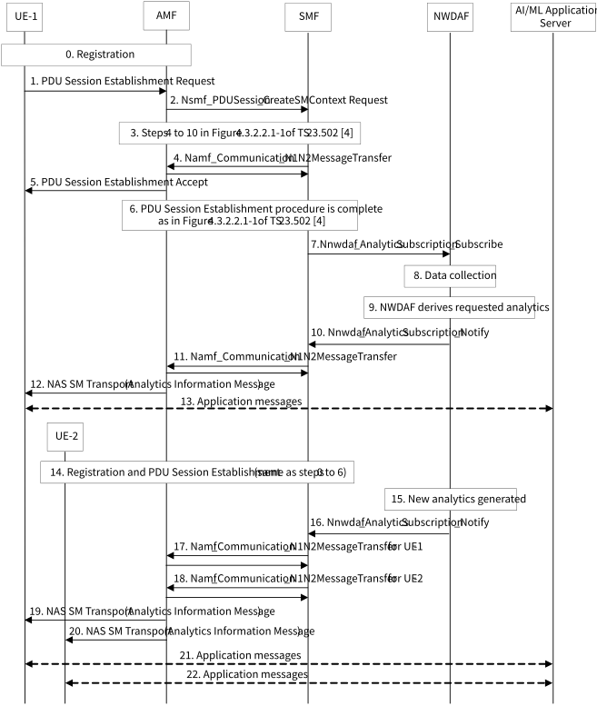
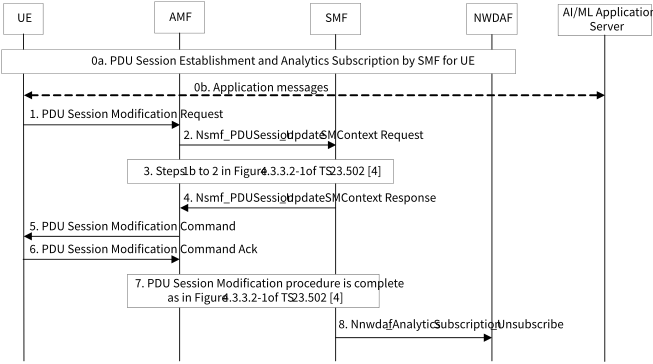

# 6.3 Solution \#3: 5GC information exposure to UE by SMF

## 6.3.1 Description

This is a solution for key issue \#2 "5GC information exposure to UE".

The AF can obtain various data analytics provided by NWDAF as specified in TS 23.288 \[6\]. When requesting or subscribing to NWDAF analytics, the AF needs to provide Target of Analytics Reporting and Analytics Filter Information required for Analytics ID that the AF requests or subscribes to. For example, for QoS Sustainability analytics, the Target of Analytics Reporting is set to any UE. For the Analytics Filter Information, QoS requirements and Location information need to be provided as mandatory. The Location information could reflect a list of waypoints for UE(s) that the AF can collect from the UE(s), e.g. via application layer messages.

For operating AI/ML based services/applications, there may be the case that the AF (i.e. AI/ML Application Server) does not know or has not yet decided which UEs will be involved. For example, the case may exist that the AI/ML Application Server has not decided candidate UEs for FL Operation that it plans to perform. In this case, it might be difficult for the AI/ML Application Server to decide the input parameters such as Target of Analytics Reporting and Analytics Filter Information related to UEs, required to request or subscribe to NWDAF analytics.

On the other hand, the UE may decide whether it is interested in operating AI/ML based services/applications or it intends to participate in the AI/ML related operation, e.g. FL Operation, AI/ML model/data distribution. In this case, if the UE can obtain analytics information from 5GC, it would be useful for the UE to decide whether it can perform the AI/ML related operation or when downloading large AI/ML models is appropriate, or for the AI/ML Application Server to manage the AI/ML related operation, e.g. FL member selection by acquiring the analytics related information/report from the UE.

The AI/ML models may need to be changed if the environmental conditions are not stable (light distribution in the scene, background noise, time of the day, number and type of objects in the view-field, etc.). New AI/ML models may need to be downloaded as environmental conditions change or when new AI/ML models become available. If the application/UE knows that there is a potential QoS change in the DL data rate in the future, it can decide to pre-fetch in-advance a higher number of AI/ML models to be used for different sets of environmental conditions, or to choose more general AI/ML models that can work under different sets of environmental conditions.

Editor's note: Pros and cons of UE providing analytics related information/report to the AI/ML application server after it received the analytics information from 5GC compared to the AI/ML application server getting these network data analytics directly from 5GC needs to be evaluated.

If the 5GC can expose analytics information to the UE, it would be beneficial for operating AI/ML based services/applications, for example:

\- If the UE is provided from the 5GC regarding the QoS Sustainability analytics information that RAN UE Throughput threshold or QoS Flow Retainability threshold cannot be met, the UE's application layer can perform the following based on the information provided by the UE's NAS layer:

\- UE's application layer decides not to participate in FL Operation; or

\- UE's application layer reports to the AI/ML Application Server that RAN UE Throughput threshold or QoS Flow Retainability threshold cannot be met, or network condition is not good. Based on the report from the UE, the AI/ML Application Server can decide not to select this UE for FL Operation.

\- If the UE is provided from the 5GC regarding the User Data Congestion analytics information that the Congestion Level indicates 'congested', the UE's application layer can perform the following based on the information provided by the UE's NAS layer:

\- UE's application layer decides not to participate in FL Operation; or

\- UE's application layer reports to the AI/ML Application Server that network is congested or network condition is not good. Based on the report from the UE, the AI/ML Application Server can decide not to select this UE for FL Operation.

\- If the UE is provided from the 5GC regarding the QoS Sustainability analytics and the User Data Congestion analytics information that RAN UE Throughput threshold or QoS Flow Retainability threshold can be met and the Congestion Level indicates 'not congested', the UE's application layer can perform the following based on the information provided by the UE's NAS layer:

\- UE's application layer decides to download new AI/ML models to be used for AI/ML model/data distribution such as real time media editing.

The outline of the proposed solution for 5GC information exposure to UE by SMF is as below:

\- The SMF serving the PDU Session for AI/ML based services/applications provides analytics information obtained from the NWDAF to the UE.

\- The UE can enable analytics information exposure to UE during PDU Session Establishment procedure and PDU Session Modification procedure. The UE is capable of requesting to the network for analytics information exposure and obtaining analytics information from the network.

\- The UE can disable analytics information exposure to UE during PDU Session Modification procedure so that the SMF stops the analytics information exposure to the UE.

\- The enabled analytics information exposure to UE can be also disabled when the PDU Session is released.

\- The SMF may subscribe or request to analytics information provided by the NWDAF when receiving the enabling request for analytics information exposure sent by the UE.

\- When the SMF receives the enabling request for analytics information exposure from a UE, the SMF checks whether it has already subscribed to the Analytics ID related to the analytics information exposure with same input parameters to the NWDAF. If so, the SMF does not have to subscribe to the Analytics ID again. Otherwise, the SMF subscribes to the Analytics ID for the UE.

\- When the analytics information exposure is not needed anymore for any UE, the SMF checks whether the subscription to the Analytics ID related to the analytics information exposure needs to be kept for other UE(s). If not, the SMF unsubscribes to the Analytics ID.

The above SMF operations related to the (un)subscription to analytics information provided by the NWDAF can be considered as shared (un)subscription.

## 6.3.2 Procedures

### 6.3.2.1 Procedure for enabling analytics information exposure to UE

Figure 6.3.2.1-1 shows the procedure for enabling analytics information exposure to UE.

Figure 6.3.2.1-1: Procedure for enabling analytics information exposure to UE

0\. UE-1 performs registration.

In steps 1 to 5, UE-1 enables analytics information exposure to UE during the PDU Session Establishment procedure as defined in clause 4.3.2.2.1 of TS 23.502 \[4\] with the following differences.

1\. If UE-1 wants to obtain analytics information from 5GC due to need or request of the application layer, UE-1 includes the following information in the PDU Session Establishment Request:

\- Enabling request for analytics information exposure per Analytics ID;

\- (optional) Analytics ID(s) and related input parameters for each requested Analytics ID.

The DNN and S-NSSAI for the PDU Session is for AI/ML based services/applications, i.e. Application AI/ML operations. The AMF selects an SMF based on the DNN and S-NSSAI, locally configured data or a corresponding SMF profile stored in the NRF.

NOTE 1: This solution assumes that the PDU Session used for AI/ML based services/applications is different than the PDU Session used for non-AI/ML based services/applications.

NOTE 2: In this solution, both separate PDU Session for each AI/ML based service/application and common PDU Session for all AI/ML based services/applications can be supported up to operator. For the latter case, if multiple AI/ML based services/applications need or request analytics information in the UE, the UE obtains the analytics information from the SMF and provides it to each application. Regarding how the UE's NAS layer knows/determines which analytics information it needs to provide to which application, the UE's application layer can provide the requested Analytics ID(s) to the UE's NAS layer in this step; otherwise (i.e. not provided), the UE can determine this as UE implementation.

2\. The SMF receives the PDU Session Establishment Request including the enabling request for analytics information exposure per Analytics ID, and (optional) Analytics ID(s) and related input parameters for each requested Analytics ID.

If the SMF does not support analytics information exposure to UE, the SMF ignores the above information.

3\. Session Management subscription data related to the DNN and S-NSSAI for AI/ML based services/applications in the UDM contains the following data regarding analytics information exposure to UE.

\- Analytics information exposure to UE allowed: indicates whether the UE is authorized to enable the analytics information exposure to UE.

\- Analytics ID(s) and related input parameters: identifies the Analytics ID(s) that are allowed to be exposed to the UE and input parameters for each Analytics ID (e.g. Analytics Filter Information, Target of Analytics Reporting, Analytics target period, etc) as defined in clause 6.1.3 of TS 23.288 \[6\].

\- Analytics ID="QoS Sustainability" and input parameters as defined in clause 6.9.1 of TS 23.288 \[6\].

\- Analytics ID="User Data Congestion" and input parameters as defined in clause 6.8.1 of TS 23.288 \[6\].

4\. The SMF received the enabling request for analytics information exposure from UE-1 determines whether UE-1 is authorized to enable the analytics information exposure to UE taking into account the SM subscription data received from the UDM, if the SMF supports analytics information exposure to UE. The SMF also checks the user consent information from UDM to determine if the analytics information exposure is granted or not.

If authorization check succeeds, the SMF includes an Accept to the enabling request for analytics information exposure in the PDU Session Establishment Accept. Otherwise, the SMF includes a Reject to the enabling request for analytics information exposure in the PDU Session Establishment Accept.

NOTE 3: This solution assumes that if the SMF supports analytics information exposure to UE, the SMF supports all Analytics IDs to be exposed to the UE. This means that the NWDAF also supports all these Analytics IDs.

If the SMF does not support analytics information exposure to UE, the SMF does not include Accept/Reject to the enabling request. In this case, steps 7 to 13 are not performed.

5\. UE-1 receives the PDU Session Establishment Accept.

6\. PDU Session Establishment procedure is complete as specified in Figure 4.3.2.2.1-1 of TS 23.502 \[4\].

7\. If authorization check succeeded in step 4, the SMF subscribes to analytics information provided by NWDAF on the Analytics ID(s) requested from UE-1based on the subscription data described in step 3 if the SMF has not subscribed to "QoS Sustainability" analytics yet for other UE with the same input parameters. For input parameters included in the subscription request, the SMF may use the subscription data and local configuration. The SMF can determine the location information that is one of input parameters for "QoS Sustainability" analytics and Area of Interest that is one of input parameters for "User Data Congestion" analytics based on e.g. the UE location information, its Service Area. If UE-1 provided the input parameters for the requested analytics in step 1, the UE provided parameters supersede the subscription data and local configuration.

The SMF selects an NWDAF that supports requested analytics information as specified in clause 5.2 of TS 23.288 \[6\].

More than one NWDAF can be selected because single NWDAF does not support all the analytics. In this case, the SMF interacts with each selected NWDAF.

The SMF stores that UE-1 requested this analytics information.

8\. The NWDAF collects the data specified in clause 6.9.2 of TS 23.288 \[6\].

9\. The NWDAF derives the requested analytics as specified in clause 6.9.3 of TS 23.288 \[6\].

10\. The NWDAF provides notification on the requested analytics to the SMF.

The SMF determines which UE(s) the SMF needs to provide this analytics information to, based on the information stored in step 7, i.e. UE-1.

11\. The SMF invokes the Namf_Communication_N1N2MessageTransfer service operation on the AMF to transfer the analytics information within N1 SM information sent towards UE-1.

NOTE 4 To provide the analytics information to the UE, the existing SM NAS message with new information element (e.g. PDU Session Modification Command) or new SM NAS message can be used.

12\. The AMF sends the N1 NAS message including the analytics information to UE-1. UE-1's NAS layer provides the analytics information to the application layer.

13\. UE-1's application layer may take the provided analytics information into account for AI/ML related operation, e.g. to report its resources for Federated Learning Operation to the AI/ML Application Server, decide not to participate in FL Operation so not to interact with the AI/ML Application Server, etc.

14\. Same as steps 0-6. As a result, UE-2 enables analytics information exposure to UE during the PDU Session Establishment procedure.

The SMF stores that UE-2 requested this analytics information.

In Figure 6.3.2.1-1, the SMF does not subscribe to analytics information provided by NWDAF on " the Analytics ID(s) requested from UE-2 after receiving the enabling request for analytics information exposure from UE-2 because the SMF has subscribed it already in step 7.

However, if any input parameter such as the location information is different to that for the subscription already made, the SMF subscribes to analytics information on the Analytics ID(s) requested from UE-2for UE-2, or for both UE-1 and UE-2 in a combined manner, e.g. the location information covering both UE-1 and UE-2.

15\. The NWDAF derives new analytics taking into account the most recent data collected.

16\. The NWDAF provides notification on the requested analytics to the SMF.

The SMF determines which UE(s) the SMF needs to provide this analytics information to, based on the information stored in steps 7 and 14, i.e. UE-1 and UE-2.

17\. Same as step 11.

18\. The SMF invokes the Namf_Communication_N1N2MessageTransfer service operation on the AMF to transfer the analytics information within N1 SM information sent towards UE-2.

19\. Same as step 12.

20\. The AMF sends the N1 NAS message including the analytics information to UE-2. UE-2's NAS layer provides the analytics information to the application layer.

21\. Same as step 13.

22\. UE-2's application layer may take the provided analytics information into account for AI/ML related operation, e.g. to report its resources for Federated Learning Operation to the AI/ML Application Server, decide not to participate in FL Operation so not to interact with the AI/ML Application Server, etc.

NOTE 5: Steps 21 and 22 can be executed in parallel.

The UE can also enable analytics information exposure to UE during the PDU Session Modification procedure.

NOTE 6: The UE can use the PDU Session Modification procedure only to enable analytics information exposure to UE.

NOTE 7: Different SMFs can be selected for UE-1 and UE-2. Figure 6.3.2.1-1 shows the case that the same SMF is selected for both UEs to explain how this solution works.

The UE can enable analytics information exposure to UE as one-time report type by indicating this to the SMF when enabling analytics information exposure during PDU Session Establishment procedure or PDU Session Modification procedure. In this case, the SMF requests to analytics information by invoking Nnwdaf_AnalyticsInfo_Request service operation.

### 6.3.2.2 Procedure for disabling analytics information exposure to UE

Figure 6.3.2.2-1 shows the procedure for disabling analytics information exposure to UE.

Figure 6.3.2.2-1: Procedure for disabling analytics information exposure to UE

0a. For the UE, the PDU Session is established and subscription to analytics information to the NWDAF by the SMF is made as described in clause 6.3.2.1.

0b. The UE and the AI/ML Application Server may exchange application messages related to Application AI/ML operations.

In steps 1 to 5, UE-1 disables analytics information exposure to UE during the PDU Session Modification procedure as defined in clause 4.3.3.2 of TS 23.502 \[4\] with the following differences.

1\. If the UE wants to stop obtaining analytics information from 5GC, the UE includes a disabling request for analytics information exposure in the PDU Session Modification Request.

2\. The SMF receives the PDU Session Modification Request including the disabling request for analytics information exposure.

The SMF determines to stop the analytics information exposure to the UE.

3\. No difference in steps 1b to 2 in Figure 4.3.3.2-1 of TS 23.502 \[4\].

4\. The SMF includes an ACK to the disabling request for analytics information exposure in the PDU Session Modification Command.

5\. The UE receives the PDU Session Modification Command including the ACK to the disabling request for analytics information exposure.

6\. The UE sends the PDU Session Modification Command Ack to the SMF.

7\. PDU Session Modification procedure is complete as specified in Figure 4.3.3.2-1 of TS 23.502 \[4\].

8\. The SMF checks whether the subscription to the Analytics ID(s) requested by the UE needs to be kept for other UE(s). If so, the SMF determines to keep the subscription. Otherwise, the SMF unsubscribes to the Analytics ID(s) to the NWDAF.

The UE can also disable analytics information exposure to UE during the PDU Session Release procedure. Although the UE does not provide the disabling request to the SMF, the enabled analytics information exposure to UE can be disabled by the SMF when the PDU Session is released.

## 6.3.3 Impacts on services, entities and interfaces

UE:

\- supports enabling analytics information exposure to UE via SM NAS messages with new information element.

\- supports disabling analytics information exposure to UE via SM NAS messages with new information element.

\- obtains analytics information from the SMF via SM NAS messages (i.e. existing SM NAS message with new information element or new SM NAS message).

\- supports interaction between NAS layer and application layer.

SMF:

\- handles enabling request and disabling request for analytics information exposure sent by the UE.

\- provides analytics information to the UE via SM NAS messages (i.e. existing SM NAS message with new information element or new SM NAS message).

UDM:

\- stores Session Management subscription data related to analytics information exposure to UE.
