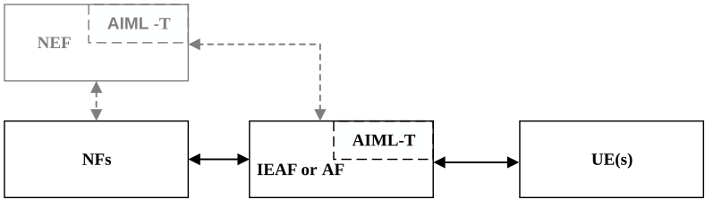
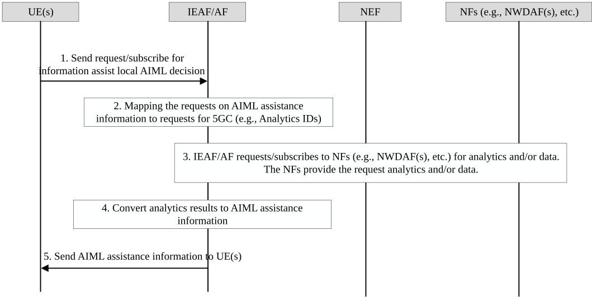

# 6.30 Solution \#30: AI/ML Translator (AI/ML-T) for 5GC Information Exposure to UE

## 6.30.1 Description

Key Issue \#2: 5GC information exposure to UE is to study whether and how to enhance the 5GC to expose information to the UE to facilitate its Application AI/ML operation (e.g. Model Training, Splitting and inference feedback, etc.). This document covers the following bullets.

\- Whether and for which purpose there is a need for 5GC to expose information or data analytics to the UE, and what are the information or data analytics that can be provided by 5GC to the UE to assist the Application AI/ML operation at the UE side.

\- How the 5GC exposes such information or data analytics to the UE.

To solve the above problems, an AI/ML translator (AIML-T) is proposed. The AIML-T is responsible for translating (mapping) the Application layer AI/ML related assistance requests received from UE(s) to the analytics requests for 5GC (i.e. from assistance request to analytics request to 5GC), and converting the information or analytics produced at 5GC to AI/ML assistance information for UE(s) (i.e. from 5GC information/analytics to AI/ML assistance information).

The AI/ML translator could be integrated into IEAF or AF. The IEAF or AF is responsible for receiving the requirements from UE(s), and for exposure the required assistance information to the UE(s) to assist its local Application layer AI/ML operations. If the IEAF or AF is in trusted domain, it interacts with the NFs in 5GC directly. If the AF is in untrusted domain, it interacts with the NFs in 5GC via NEF. Alternatively, the AIML-T can be placed in NEF.

Figure 6.30.1-1: AIML-T integrated into DCAF or AF or NEF

Figure 6.30.1-1 shows the AIML-T integrated into IEAF or AF or NEF. The assistance requests from UE(s) could be obtained and processed by the integrated AI/ML-T at the IEAF or AF or NEF.

After the assistance request is translated (mapped) to 5GC request at the AIML-T, the IEAF or AF (or via NEF) sends request or subscribes to the other NFs (e.g. NWDAF, etc.) in 5GC for analytics and/or information. The integrated AIML-T at the IEAF or AF (or NEF) processes the received analytics and information, converts them into AI/ML assistance information required by UE(s). After the converting is completed, the IEAF or AF responses or notifies to the UE(s) with its required assistance information. Based on the AI/ML assistance information, the UE(s) make decision and performs corresponding AI/ML operations.

NOTE: If AIML-T is integrated into AF or NEF, how AF exposes the 5GC information to the UE is outside the scope of 3GPP. If AIML-T is integrated with IEAF, then this solution can be merged into Solution#2.

## 6.30.2 Procedures

Figure 6.30.2-1: 5GC information preparation and exposure to assist AI/ML operations at UE side, with AIML-T integrated at DCAF/AF or NEF

Figure 6.30.2-1 illustrates the procedure of interactions among UE(s), IEAF/AF (or via NEF), and the other NFs (e.g. NWDAF(s)) in 5GC for assistance information preparation and exposure.

1\. UE(s) requests or subscribes to IEAF or AF for AI/ML assistance information to assist local AI/ML decisions/operations at UE side. UE(s) may request the following assistance information:

\- Information of UE service experience

\- Information of UL/DL latency, data rate, and packet loss rate

UE(s) may specify:

\- Type of assistance information in need, i.e. statistics, and/or predictions.

\- Time window (for one-time) or time interval (for periodically) requirement to AF to provide the assistance information

NOTE 1: The parameter details of the information will be decided in normative phase.

2\. \[If AIML-T is integrated at IEAF or AF\] After receiving the request (for request information or subscription request) from the UE(s), the IEAF/AF translates (maps) the assistance request to request for 5GC (e.g. requests to analytics (statistics, predictions) for one or multiple Analytics IDs) according to the requirements/parameters in the request from UE(s).

For example: If receive assist AI/ML splitting operation request, this request may be translated to request to analytics and Analytics IDs "DN Performance", "Service Experience". The mapping between the assistance request from UE to the analytics request to 5GC could be based on a preconfigured mapping table stored at the AF/IEAF or up to the AF/IEAF implementation.

3\. AF/IEAF requests or subscribes to one or multiple NFs (e.g. NWDAF, etc.) for analytics and/or data. The NFs perform corresponding operations to produce analytics or collect data, and responses/notifies to the IEAF /AF with the analytics and/or data.

If AIML-T is integrated at NEF, the AF/ IEAF forwards the assistance request from UE to NEF, where the request will be translated (mapped) to request for 5GC at NEF. Then NEF will requests or subscribes to one or multiple NFs (e.g. NWDAF, etc.) for analytics and/or data.

4\. \[If AIML-T is integrated at AF\] The AF translates (converts) the received analytics/information to AI/ML assistance information according to the type of assistance information required. One AI/ML assistance information may be produced based on one or multiple analytics/information.

Alternatively, if AIML-T is integrated at NEF, the received analytics/information will be translated (converted) to AI/ML assistance information at NEF and NEF sends the information back to AF/ IEAF.

The AI/ML assistance information to UE(s) might be:

\- Predictions on UE service experience, latency, bitrate, packet loss rate, and corresponding time window.

\- Predictions on network condition changes and corresponding time

\- Predictions on the need of downloading ML model or certain amount of data

\- Information of resource utilization (e.g. monitoring information or analytics information), etc.

5\. The AF responses or notifies to the UE(s) with the required AI/ML assistance information.

Editor's note: Whether and how the UE can use 5GC information for AI/ML operations is FFS and needs to be describe with valid justification before solution can be adopted, considering also that the same information will be used by the AI/ML application server as well.

## 6.30.3 Impacts on Existing Nodes and Functionality

AF or IEAF:

\- If AIML-T is integrated at IEAF or AF. The AIML-T integrated at the IEAF/AF translates (maps) the Application layer AI/ML related requests received from UE(s) to the requests for 5GC (i.e. from assistance request to analytics request to 5GC), and converts the information or analytics produced at 5GC to AI/ML assistance information for UE(s) (i.e. from 5GC information/analytics to AI/ML assistance information).

\- Receive assistance requests from UE(s).

\- Check about authorization information of UE(s) based on local policy.

\- Expose AI/ML assistance information to UE(s).

NEF:

\- If AIML-T is integrated at NEF. The AIML-T integrated at NEF translates (maps) the Application layer AI/ML related requests received from UE(s) to the requests for 5GC (i.e. from assistance request to analytics request to 5GC), and converts the information or analytics produced at 5GC to AI/ML assistance information for UE(s) (i.e. from 5GC information/analytics to AI/ML assistance information).

\- (If AIML-T is placed in NEF) Receive assistance requests from IEAF or AF.

\- (If AIML-T is placed in NEF) Check about authorization information of UE(s) based on local policy.

\- (If AIML-T is placed in NEF) Expose AI/ML assistance information to IEAF or AF.

NOTE: If AIML-T is integrated into AF or NEF, how AF exposes the 5GC information to the UE is outside the scope of 3GPP. If AIML-T is integrated with IEAF, how UE/ IEAF are configured and expose 5GC information to the UE is outside the scope of this solution.

UE:

\- UE should be able to communicate with AIML-T.
