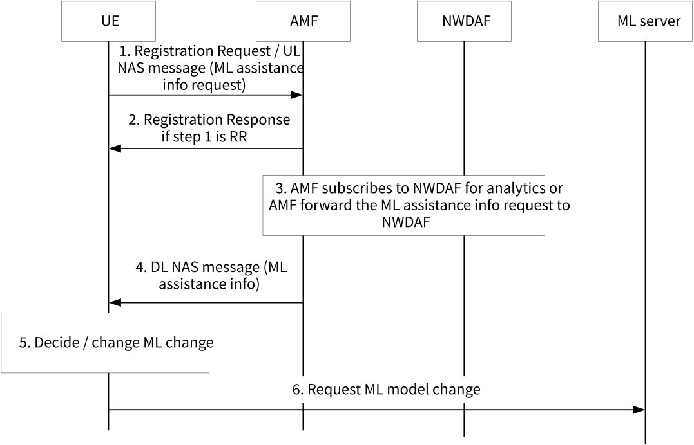

# 6.31 Solution \#31: Network information exposure to UE

## 6.31.1 Description

This solution is for KI#2.

The AI/ML applications at the UE can rely on the application server in the data centre to overcome its limited computational capability for complex AI/ML operations, e.g. model training, inference, etc. In the case, the performance of the AI/ML application becomes vulnerable to the varying network conditions. For example, improper model selection based on inaccurate assessment of network conditions can seriously degrade the performance of AI/ML applications. It is known by several researches that the performance of AI/ML applications, including split computing and model transfer cases, can be improved significantly when the estimation on the network conditions can be given to the AI/ML applications before/during the operations.

In the solution, the 5G network provides a UE with assistance information on the network congestion level. The UE can utilize the received analytics on network congestion prediction to decide, e.g. its ML model for training and inference, selection of ML models to transfer from/to the model server in the network, etc.

Editor's note: Whether and how the UE can use 5GC information for AI/ML operations is FFS and needs to be describe with valid justification before solution can be adopted, considering also that the same information will be used by the AI/ML application server as well.

## 6.31.2 Procedures

The procedure is depicted in 6.31.2-1.

Figure 6.31.2-1: Procedure for network information exposure to UE

1-2. The UE requests AI/ML assistance information on network congestion during the registration procedure. The UE may include conditions for periodical provisioning of the information, e. g. S-NSSAI, DNN, reporting period, etc..

Alternatively, UE sends UL (Up Link) NAS message to AMF, in the message it includes an Analytics container including the Analytics request to NWDAF. The Analytics container can be either read by the AMF if AMF subscribes network analytics to NWDAF on behalf of the UE, or read by NWDAF if UE interacts with NWDAF directly. AMF discovers and selects NWDAF according to clause 5.2 in TS 23.288 \[6\], where AMF may get the Analytics IDs in the Analytics container. Otherwise, AMF can forward the Analytics container to one of the discovered NWDAF, that NWDAF can do NWDAF selection and ask the analytics from the NWDAF who can support the requested analytics from the UE.

3\. The AMF subscribes to the NWDAF to request analytics for network congestion prediction, e. g. (Slice) Load Level, NF load, Network Performance, and receives analytics output from the NWDAF. The AMF may set the Analytics Filter information based on the parameters received from the UE in the step 1 and additionally stored UE context information, e.g. UE ID, Registration Area, allowed S-NSSAIs for the UE, etc. if some parameters are not indicated by the UE. The AMF checks if analytics can be allowed to the UE based on the subscription information from UDM. Alternatively, AMF forwards the Analytics request (i.e. Analytics container) from UE to the NWDAF. NWDAF maintains which UE requests which Analytics ID(s) and all the related information in the UE analytics exposure context. When there is analytics result, NWDAF embeds the result into an Analytics container and call Namf_Communication_N1N2MessageTransfer service of AMF.

4\. The AMF sends analytics information to the UE via DL NAS message.

5-6. The UE forwards the received information to the AI/ML applications that require AI/ML assistance information on network congestion prediction. The AI/ML application at the UE decides/changes AI/ML model based on the received network congestion information, and sends selected AI/ML model information to the application server using an application signalling.

NOTE: The step 5 and 6 are out of scope of 3GPP.

## 6.31.3 Impacts on Existing Nodes and Functionality

UE:

\- Support indication to request AI/ML assistance information , e.g. via Analytics container, in the registration request or UL NAS message.

\- Support providing received congestion prediction information to the application.

\- Support DL NAS message to deliver congestion prediction information.

AMF:

\- Support subscription to NWDAF for a UE.

\- Support a NAS message to deliver congestion prediction information.

NWDAF:

\- Support receiving Analytics container from UE.

\- Maintaining UE analytics request context.

\- Support sending Analytics container to UE via AMF through a Namf_Communication_N1N2MessageTransfer service.
