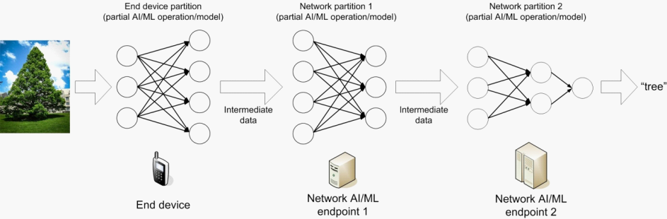
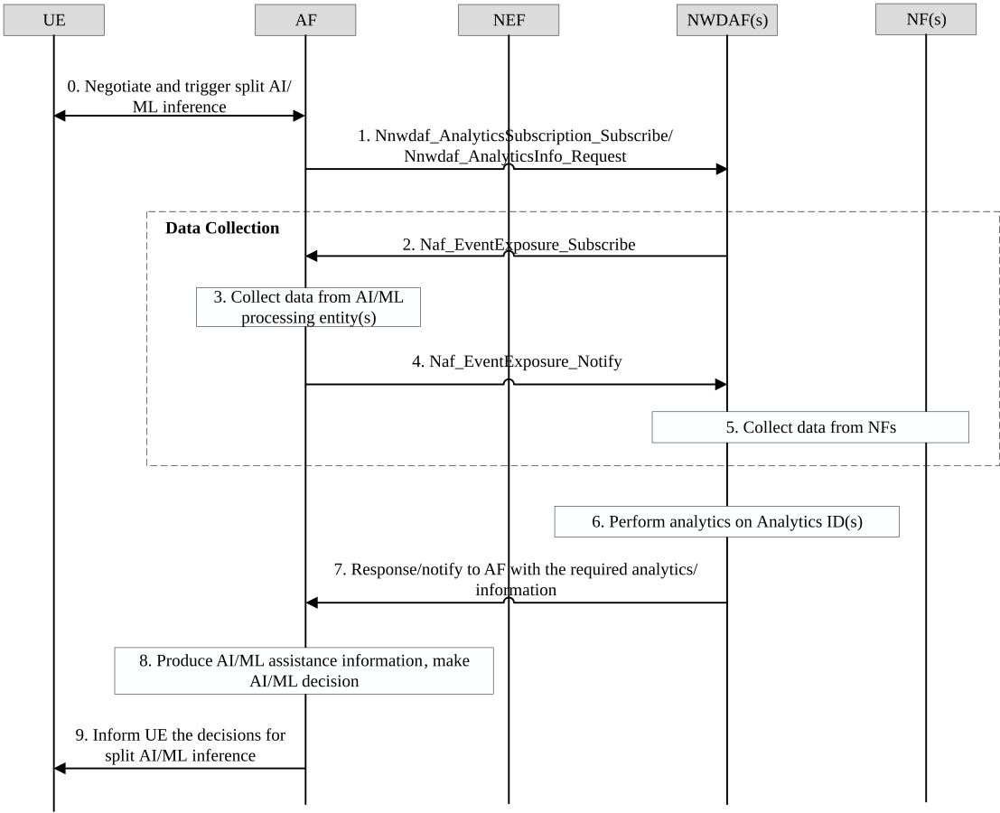

# 6.32 Solution \#32: 5GC Information Exposure to Authorized 3rd Party for Assisting AI/ML Operation Splitting between AI/ML Endpoints

## 6.32.1 Description

This solution is proposed to address Key Issue \#3: 5GC information exposure to authorized 3rd party for application layer AI/ML operation. The study bullet of this Key Issue includes:

\- Whether and what assistance information and events are exposed from 5GS to AF, more specifically, the prediction of UE and/or network conditions and performance (e.g. location, QoS, load, Congestion, etc.) as described in TS 22.261 \[2\]? How?

To address the challenges in above study aspects for split inference, the following problems need be solved

\- What assistance information is required to expose from 5GS to AF?

\- Which Analytics ID could be reused for generating the AI/ML assistance information?

\- Whether new inputs are required for the analytics on the Analytics ID? And how to use the new inputs?

As introduced in TS 22.261 \[2\], AI/ML operation splitting between AI/ML endpoints is one of the three types of AI/ML operation that the 5G system can support. One use case of AI/ML operation splitting between AI/ML endpoints given in TR 22.874 \[8\] is split AI/ML inference, as shown in Figure 6.32.1-1 is an example of split AI/ML inference. The network AI/ML endpoint in Figure 6.32.1-1 is AI/ML processing entity, e.g. edge/cloud server, etc. but excluding UE.

Figure 6.32.1-1: Example of split AI/ML inference

UE triggers split inference. UE and an AI/ML server negotiate over application layer for the split inference operations. Assistance information from 5GC is needed to assist the AI/ML server to make corresponding decisions for the split inference, e.g. the AI/ML processing entities (e.g. cloud/edge servers) and the number of layers for dealing with the split tasks (e.g. AI/ML operations) from UE, etc.

The AF requests/subscribes to one or multiple NWDAF(s) for analytics to generate AI/ML assistance information. NWDAF(s) collects information from the AF on e.g. (if multiple layers) end-to-end performance between the AI/ML processing entities in two adjacent layers, etc. The collected information is used at the NWDAF(s) as new inputs to the analytics of one or multiple Analytics IDs, e.g. DN Performance, Observed Service Experience. During the analytics process, NWDAF(s) also interact with other NFs in 5GC for data collection.

The analytics results from NWDAF(s) could be converted to the required assistance information at the AF. Based on the assistance information and the current system environmental factors such as communications data rate, resource at UE, the AI/ML server AF makes decisions on split inference.

## 6.32.2 Procedures

Figure 6.32.2-1: The procedure for interactions between AF and NWDAF(s) for generate AI/ML assistance information. Interaction between AF and NWDAF may be via NEF

Figure 6.32.2-1 illustrates the procedure for interactions between AI/ML server/AF and NWDAF(s) in 5GC to generate AI/ML assistance information. The corresponding procedure in detail is as follows:

0\. UE and AI/ML server/AF negotiate for split inference.

NOTE 1: How UE negotiate with the AIML server/AF is out of the scope of this solutions.

1\. The AF requests or subscribes to NWDAF(s) for analytics with the following parameter in its request:

\- Analytics IDs (i.e. "DN Performance", "Observed Service Experience").

\- Area of Interests.

\- DNAI and the IP addresses or the FQDNs of AI/ML processing entities.

NOTE 2: The application server (or AF) could choose which AI/ML processing entities (e.g. cloud/edge servers) as the candidates to select for split tasks, and provide the DNAI and the IP addresses or the FQDNs of the AI/ML processing entities as the input parameters of the analytics.

2\. The NWDAF(s) subscribes to AF (or via NEF) for event exposure of the information from AI/ML processing entity(s). The information required may include:

\- The data of end-to-end network performance (e.g. latency, throughput, packet loss rate) between each pair of AI/ML processing entities in two adjacent layers.

3\. The AF collects data from AI/ML processing entity(s). AI/ML processing entities inform their information to the AF, the information may include:

\- The data of end-to-end network performance (e.g. latency, throughput, packet loss rate) between each pair of AI/ML processing entities in two adjacent layers.

NOTE 3: Step 3 is out of 3GPP scope.

4\. The AF provides to the NWDAF(s) (or via NEF) with the network performance data among the AI/ML processing entities.

5\. The NWDAF(s) collects data from other NFs in 5GC according to the Analytics ID(s) received in step 1.

6\. The NWDAF(s) performs analytics on the Analytics ID, i.e. "DN Performance", "Observed Service Experience", and produces analytics (statistics and/or predictions). The collected information from the AI/ML processing entities in step 3 are new inputs to the analytics.

The produced analytics results may include:

\- Statistics/predictions on end-to-end network performance (e.g. latency, throughput, packet loss rate) between each pair of AI/ML processing entities in two adjacent layers

\- Statistics/predictions on traffic rate for UL from the UE to each AI/ML processing entity(s).

\- Statistics/predictions on packet delay for UL from the UE to each AI/ML processing entity(s).

\- Statistics/predictions on packet loss rate for UL from the UE to each AI/ML processing entity(s).

7\. The NWDAF(s) responses or notifies to the AF (or via NEF) the analytics results.

8\. The AF produces AI/ML assistance information based on the received analytics, as well as the information received from UE. One AI/ML assistance information may be produced based on one or multiple analytics/information. The AI/ML assistance information may be, for example, statistics/predictions on network conditions (e.g. latency, bitrate, communication service availability, reliability, etc.).

Based on the assistance information and the system environmental factors such as resource at UE (obtained in step 0), the AI/ML server makes AI/ML decisions for split inference.

9\. The AI/ML server informs the UE over application layer with the AI/ML decisions for split inference.

NOTE 4: How UE negotiates with the AIML server/AF is out of the scope of this solution.

## 6.32.3 Impacts on services, entities and interfaces

AF:

\- Negotiate with UE for split inference.

NOTE 1: How UE negotiates with the AIML server / AF is out of the scope of this solutions.

\- Collect data from AI/ML processing entities (e.g. cloud/edge servers).

\- Expose the above collected data to NWDAF.

NWDAF:

\- New inputs for Analytics ID, e.g. "DN Performance", "Observed Service Experience", the new inputs may include:

\- The data of end-to-end network performance (e.g. latency, throughput, packet loss rate) between each pair of AI/ML processing entities in two adjacent layers.

\- New analytics results for Analytics ID, e.g. "DN Performance", "Observed Service Experience", the new analytics results may include:

\- Statistics/predictions on network performance (e.g. latency, throughput, packet loss rate) between each pair of AI/ML processing entities in two adjacent layers

\- Statistics/predictions on traffic rate for UL from the UE to each AI/ML processing entity(s).

\- Statistics/predictions on packet delay for UL from the UE to each AI/ML processing entity(s).

\- Statistics/predictions on packet loss rate for UL from the UE to each AI/ML processing entity(s).

\- Service Experience when some specific endpoints are in the splitting ML operations.
