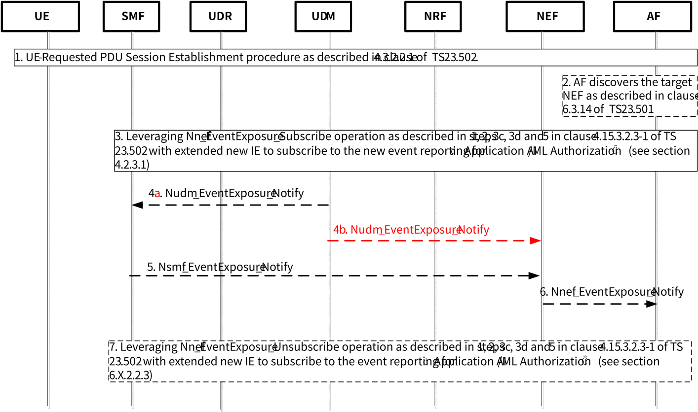
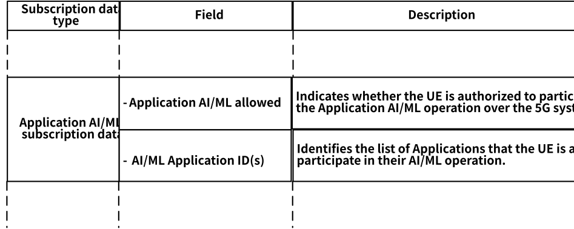
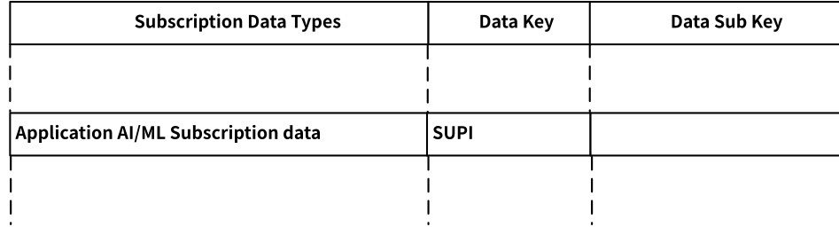
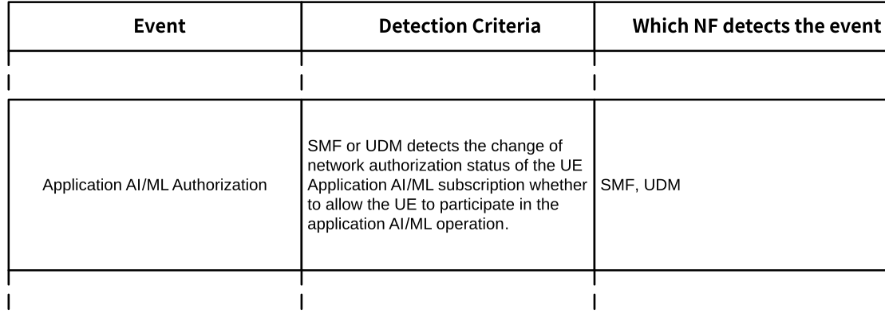

# 6.33 Solution \#33: 5GC Exposure of Network Authorization for UE to participate in the Application AI/ML operation

## 6.33.1 Description

This solution addresses Key Issue \#3 on 5GC information exposure to authorized 3rd party for Application Layer AI/ML operation.

The intent of this solution is to propose a mechanism to enable the network operator to have the control for which UE is allowed for participation in the Application layer AI/ML operation. The 5G system can expose the network authorization status of the UE to the AF for the UE participation in the corresponding Application AI/ML operation. Such awareness of the network authorization status for the UE can assist the AF's decision for the UE selection for the corresponding Application AI/ML operation.

The overall design of this solution is as follows:

Once the PDU session established, before the AF initiating its Application AI/ML operation, the AF can subscribe to the SMF or UDM anytime for the event monitoring to receive the network authorization status of the given UE for its participation in the AF's Application AI/ML operation. Likewise, the AF can unsubscribe to the SMF or UDM anytime for such event monitoring when the AF is no longer interested in the given UE.

Such awareness of the network authorization status for the UE can assist the AF's decision for the UE selection for the corresponding Application AI/ML operation.

## 6.33.2 Procedure

### 6.33.2.1 Procedure for 5GC Exposure of Network Authorization Status of UE for Application AI/ML operation

Figure 6.33.1-1: Procedure for 5GC Exposure of the network authorization status of the UE for participation in Application Layer AI/ML operation

The following procedures describes how AF receives the notification of the network authorization status of the UE to be able to participate in the Application AI/ML operation:

1\. UE successfully completes the PDU Session Establishment procedures as described in clause 4.3.2.2.1 of TS 23.502 \[4\], for UE-requested PDU Session Establishment procedure for non-roaming scenarios the SMF receives the Session Management Subscription data which is corresponding to SUPI, DNN and S-NSSAI provided by the UE. More specifically, the Secondary Authentication/Authorization as described in step 6 in clause 4.3.2.2.1 of TS 23.502 \[4\], which is defined in clause 4.3.2.3 of TS 23.502 \[4\] and in clause 5.6.6 of TS 23.501 \[3\], may be triggered during the PDU Session Establishment procedures.

2\. The AF selects the appropriate NEF via pre-configuration or via the support from NRF by providing its Application Identifier or {S-NSSAI, DNN} as described in clause 6.3.14 of TS 23.501 \[3\].

3\. In order to determine if the given UE is authorized by the 5G system to be able to participate in the Application AI/ML operation, the AF sends Nnef_EventExposure_Subscribe Request to SMF or UDM via NEF as described in clauses 4.15.3.2.3 and 5.2.6.2.2 of TS 23.502 \[4\] together with its Application Identifier or {S-NSSAI, DNN}in order to subscribe to the notification from SMF for the new event "Application AI/ML Authorized" introduced by this solution as described in clause 6.33.2.2.3 below.

4a-5. SMF receives notification from UDM regarding the information of the "Application AI/ML subscription data" which is introduced by this solution as described in clause 6.33.2.2 below, and relays the notification to the associated notification endpoint NEF by Nsmf_EventExposure_Notify.

The "Application AI/ML subscription data" for a UE is part of the UE subscription data.

The AF may continue to monitor the event to keep track of the subscription info of the "Application AI/ML subscription data" which reflects UE authorization status for participation in the Application AI/ML operation.

4b. The UDM detects the event occurs and sends the event report, by means of Nudm_EventExposure_Notify message to the associated notification endpoint of the NEF. If UDM notifies AF directly, step 5 can be skipped.

6\. NEF forwards to the AF the reporting event received by Nsmf_EventExposure_Notify or Nudm_EventExposure_Notify.

7\. The AF sends Nnef_EventExposure_Unsubscribe Request to SMF via NEF as described in clauses 4.15.3.2.3 and 5.2.6.2.2 of TS 23.502 \[4\] if the AF is no longer interest in the corresponding UE for participation in its Application AI/ML operation.

### 6.33.2.2 New Subscription Data of Authorized Application AI/ML services

#### 6.33.2.2.1 General Descriptions

The UDM stores the subscription information to indicate the network authorization status for the UE to be able to participate in the Application AI/ML operation. The subscription information includes the "Application AI/ML subscription data" for a UE which is introduced by this solution and is part of the UE subscription data.

At any time, the subscription for the Application AI/ML services could be changed in the UDM.

The Application AI/ML subscription data in the UE subscription data contains the following information:

\- Whether the UE is authorized to be participated in the Application AI/ML operation.

\- Application Identifier or {DNN, S-NSSAI} corresponding to the AF that requests the Application AI/ML operation.

The Application AI/ML subscription data is provided by the UDM to the SMF during or after the establishment of the PDU session associated with the AF by using the Nudm_SDM service for the subscription data type "Application AI/ML subscription data" during the PDU session establishment.

The UDR stores the Application AI/ML data, which may be updated by UDM.

#### 6.33.2.2.2 Application AI/ML subscription data in UDM

This solution proposes the following the changes to the SDM services as defined in clause 5.2.3.3.1 of TS 23.502 \[4\] to describe the subscription data type that is used to store the "Application AI/ML subscription data" in the UDM and is used to determine whether the given UE is authorized by the 5G system for the participation in the Application AI/ML operation. The following descriptions focus on the changes to the existing tables which are shown in "***bold italic***".

<table>
<colgroup>
<col style="width: 100%" />
</colgroup>
<thead>
<tr class="header">
<th>
This solution proposes the following updates to the clause 5.2.3.3.1 of TS 23.502 [4] for the two tables 5.2.3.3.1-1 and 5.2.3.3.1-3 to describe the Application AI/ML subscription data that are stored in the UDM.

<em><strong>- Application AI/ML subscription data for a UE as part of the UE subscription data.</strong></em>

Table 5.2.3.3.1-1: UE Subscription data types

Table 5.2.3.3.1-3: UE Subscription data types keys

</th>
</tr>
</thead>
<tbody>
</tbody>
</table>

#### 6.33.2.2.3 Extension to Nnef_EventExposure Services for New Event Monitoring for 5G system authorization for UE to support Application AI/ML operation

This solution extends the existing Monitoring Events leveraging NEF event exposure as defined in clause 4.15.3 of TS 23.502 \[4\] to monitor if the given UE is authorized by the 5G system to participate in the Application AI/ML operation requested by the corresponding AF. The following descriptions focus on the changes to Nnef_EventExposure Service as defined in clause 4.15.3 of TS 23.502 \[4\].

This solution proposes to add a new event to Table 4.15.3.1-1 in TS 23.502 \[4\] for "Application AI/ML Authorization" and the SMF or UDM is responsible for the event detection. For this new event proposed by this solution, if the 5G system decides to revoke the permission to allow the UE to participate in the Application AI/ML operation, the SMF or UDM will notify the AF via the support of NEF. AF will then release the associated PDU session, if any, to terminate the corresponding Application AI/ML operation, or, AF will negotiate with UE at application layer and the UE will avoid initiating related data traffic.

The description of the new NEF monitoring event as introduced by this solution is to be captured in Table 4.15.3.1-1 of TS 23.502 \[4\] as shown below.

<table>
<colgroup>
<col style="width: 100%" />
</colgroup>
<thead>
<tr class="header">
<th>
New event to Table 4.15.3.1-1 of TS 23.502 [4].

Table 4.15.3.1-1: List of events for monitoring capability

</th>
</tr>
</thead>
<tbody>
</tbody>
</table>

## 6.33.3 Impacts on existing services, entities and interfaces

SMF:

\- Support a new event for monitoring network authorization status for a given UE to participate in a given Application AI/ML operation.

UDM:

\- Support a new event for monitoring network authorization status for a given UE to participate in a given Application AI/ML operation.

UDR:

\- New application subscription for the UE regarding the network authorization status for UE to participate in a given Application AI/ML operation.

AF:

\- Ability to subscribe to the event for tracking UE"s subscription status for the UE participation in its Application AI/ML operation.
