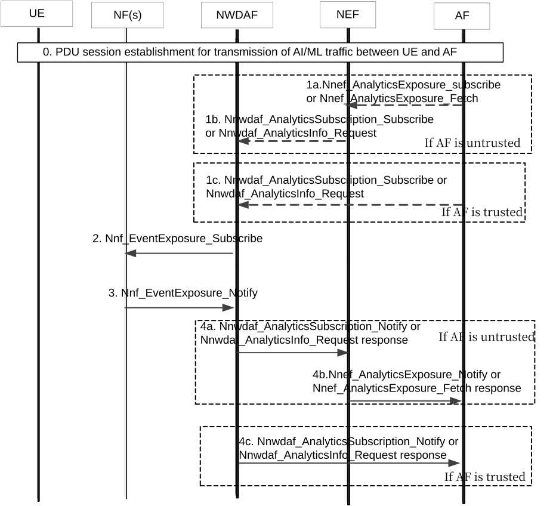

# 6.34 Solution \#34: Expose AI/ML traffic transmission status to the authorized 3rd party for Application Layer AI/ML Operation

## 6.34.1 Description

This solution addresses KI#3 and KI#1.

Based on the collected data for monitoring network resource, the prediction/statistics of UE and/or network conditions and performance (e.g. location, QoS, load, Congestion, etc.) for Application AI/ML traffic transmission can be derived by the NWDAF. Then the NWDAF can expose the prediction/statistics to the AF.

## 6.34.2 Procedures

Figure 6.34.2-1 shows the procedure of the Application AI/ML traffic transmission status information exposure to the AF.

Figure 6.34.2-1: Application AI/ML traffic transmission status information exposure to the AF

0\. The PDU session is established/modified for Application AI/ML traffic transmission between the UE and the AF as specified in TS 23.502 \[4\].

1\. The AF sends an Analytics request/subscribe (Analytics ID ="User Data Congestion" (or "Service Experience", or "NF load information"), Target of Analytics Reporting =(a UE or a group of UEs), Analytics Filter Information =(Application ID, S-NSSAI, DNN, Application Server Address(es), Area of Interest, QFI(s)), Analytics Reporting Information= Analytics target period), to the NWDAF as specified in TS 23.288 \[6\] clause 6.1, where:

\- the Application ID indicates the application that transmits the AI/ML traffic;

\- the DNN and S-NSSAI indicates the DNN and S-NSSAI of the PDU Session for Application the AI/ML traffic transmission;

\- the AoI indicates the network area where the UE(s) receiving the Application AI/ML traffic locate；

\- the Application Server Address(es) indicates the list of IP address(s)/FQDN(s) of the Application Server(s) which transfers the Application AI/ML traffic to the UE(s);

\- the QFI(s) for the QoS flow of the Application AI/ML traffic transmission are in the Analytics Filter Information;

\- the Target of Analytics Reporting for "User Data Congestion" can be a group of UEs;

2\. The NWDAF subscribes the network data from the 5GC NF(s) in Table 6.8.2-2 (Table 6.4.2-1a, Table 6.4.2-2, or Table 6.5.2-1) by invoking Nnf_EventExposure_Subscribe service operation, where:

\- the Throughput UL/DL in Table 6.8.2-2 indicates the UL/DL data throughput of the Application AI/ML traffic, where the IP Packet Filter Set identifies the QoS flow for Application AI/ML traffic transmission;

\- the UE Location in Table 6.4.2-1a indicates the location of the UE that transmits/receives the AI/ML traffic;

\- the QoS flow level network data (QFI, QoS flow Bit Rate, QoS flow Packet Delay, Packet transmission, Packet retransmission) in Table 6.4.2-2 indicates the observed QoS information about the Application AI/ML traffic transmission, where the IP filter information identifies the QoS flow for Application AI/ML traffic transmission;

\- the NF resource usage in Table 6.5.2-1 indicates the virtual resources currently in use for specific NF instance(s) (mean usage of virtual CPU, memory, disk) for Application AI/ML traffic transmission;

\- the NF load in Table 6.5.2-1 indicates the load of specific NF instance(s) for Application AI/ML traffic transmission in their NF profile.

NOTE 1: The specific NF could be UPF, the NWDAF may collect the UPF resource usage from the OAM for NF load analytics and may collect the UPF load from the NRF for NF load analytics.

3\. With these data, the NWDAF derives the analytics information for User Data Congestion, Observed Service Experience and/or NF load for the Application AI/ML traffic transmission.

4\. The NWDAF provides the analytics information in Table 6.8.3-1 (Table 6.8.3-2, Table 6.4.3-1, Table 6.4.3-2, Table 6.5.3-1 or Table 6.5.3-2) to the AF based on the service used in step1, with the following enhancements:

\- the Network Status Indication in Table 6.8.3-1 and Table 6.8.3-2 indicates the statistics/prediction of Congestion Level for the Application AI/ML traffic transmission;

\- the UE Location in Table 6.4.3-1 and Table 6.4.3-2 indicates the statistics/prediction location of the UE that transmits the AI/ML traffic;

\- the NF resource usage in Table 6.5.3-1 and Table 6.5.3-2 indicates the statistics/prediction of average usage of assigned resources (CPU, memory, disk) for the Application AI/ML traffic transmission;

\- the NF load in Table 6.5.3-1 and Table 6.5.3-2 indicates the statistics/prediction of average load of the NF instances for Application AI/ML traffic transmission.

The following new output data for Application AI/ML traffic transmission are added in the statistics/predictions:

\- QoS flow level data (QFI, QoS flow Bit Rate, QoS flow Packet Delay, Packet transmission, Packet retransmission), as the statistics/prediction of QoS for the Application AI/ML traffic transmission.

## 6.34.3 Impacts on services, entities and interfaces

This solution reuses the current specification in TS 23.288 \[6\] for providing data analytics and exposing the information to the AF, with the following enhancements:

\- AF: requests the Application AI/ML traffic transmission status information (e.g. location, QoS, load, Congestion, etc.) from the NWDAF.

\- NWDAF: provides analytics information of Application AI/ML traffic transmission status to the AF.
