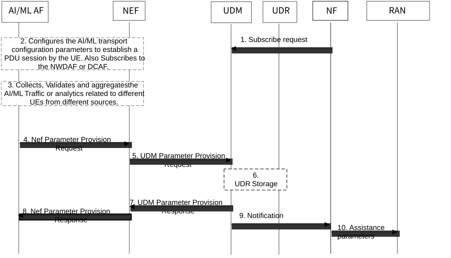

# 6.36 Solution \#36: Enhancing External Parameter Provisioning

## 6.36.1 Description

As outlined in clause 4.15.6 of TS 23.502 \[4\], provisioning capability allows an external party to provision the information, such as expected UE behaviour and service specific parameters to 5G network functions. As part of this, currently the AF may subscribe to the NWDAF for UE mobility and/or UE communication analytics for a UE or group of UEs.

The AI/ML AF may additionally leverage other sources of data in order to update or refine existing parameters provisioned (see clause 4.15.6 of TS 23.502 \[4\]). To do so, the AI/ML AF may use AI/ML traffic from the UE(s) (e.g. intermediate data, local training data, inference results or model performance) that are exchanged over the User Plane PDU session established between AI/ML AF and the UE (or the AI/ML application client on the UE) to derive AI/ML-assisted parameters. The AI/ML AF may also subscribe to the NWDAF for existing collective behaviour information as part of NF load analytics (see clause 6.5.2, TS 23.288 \[6\]).

The AI/ML AF may provide AI/ML assisted parameters i.e. a new (set of) parameter(s) as shown in Table 6.36.1-1. An enhanced external parameter provisioning procedure is depicted in clause 6.36.2.

NOTE 1: The AI/ML traffic from the UE(s) are not consumed by 5GC. The AI/ML AF extracts (or derives) a set of one or more parameters that can be consumed by 5GC NFs (e.g. AMF or SMF).

Table 6.36.1-1: Description of AI/ML assisted UE Behaviour data

<table>
<colgroup>
<col style="width: 38%" />
<col style="width: 61%" />
</colgroup>
<thead>
<tr class="header">
<th>AI/ML assisted parameters</th>
<th>Description</th>
</tr>
</thead>
<tbody>
<tr class="odd">
<td>A (set of) Expected UE Behaviour parameters</td>
<td>Each value within set is associated to an entry in clause 4.15.6.3, Table 4.15.6.3-1, TS 23.502 [4] (NOTE 1).</td>
</tr>
<tr class="even">
<td>Expected Inactivity Time</td>
<td>Expected time during which the UE will not be providing AI/ML related data</td>
</tr>
<tr class="odd">
<td>Expected CP-UP Switch</td>
<td>Expected time where the UE may request to switch from data transmission over the CP to data transmission over the UP</td>
</tr>
<tr class="even">
<td colspan="2">
NOTE 1: When a set of parameters are provided, each entry can be associated with a probability assertion (i.e. confidence) and optionally other parameters (e.g. the level of accuracy).

NOTE 2: UE communication analytics can be leveraged by the AF to provide more accurate Expected Inactivity Time parameter for different AI/ML types of traffic.

NOTE 3: The primary use of the CP-UP switch parameter is to inform the network about the time when the application expects that a UE's traffic (which may be being transferred using control plane CIoT 5GS optimization, see TS 24.301 [13]) is switched to UP (N3) data transfer. The parameter may be derived based on the application prediction on the expected AI/ML traffic.
</td>
</tr>
</tbody>
</table>

NOTE 2: Whether CP/UP related information is useful or not will be determined in the conclusion clause.

## 6.36.2 Procedures

Figure 6.36.2-1: External Parameter Provisioning via AI/ML AF

1\. The NF (e.g. AMF, SMF) can subscribe to Group Subscription data from UDM. The NF may request externally provisioned AI/ML assisted individual parameters or as a set of AI/ML assisted parameters.

If a parameter subscription is provided by the NF, the subscription may include a threshold indicating that certain confidence and/or level of accuracy must be met for the parameter(s) to be notified by UDM to the NF. The NF may decide such a threshold e.g. to prevent AI/ML assisted parameters being notified without certain minimum level of confidence. Meeting the threshold condition may mean that a parameter is equal to a certain threshold, or less than a certain threshold, or greater than a certain threshold, or less than or equal to a certain threshold, or greater than or equal to a certain threshold. The threshold may be in the form of a range (e.g. minimum value to maximum value, where each may be inclusive or exclusive).

2\. The AI/ML AF may configure the AIML transport configuration information using partly the procedure to influence the traffic routing as defined by clause 4.3.6 of TS 23.502 \[4\] (see also enhancements in Solution \#13). This is to establish User Plane PDU session(s) by UE or by group of UEs to the AI/ML AF. The PDU session can be used by AI/ML AF to collect AI/ML traffic from the UE(s) (e.g. intermediate data, local training data, inference results or model performance). This is in addition to the subscription to the NWDAF for UE mobility and/ or UE communication analytics for a UE or group of UEs.

The AI/ML AF may also subscribe to the NWDAF for existing collective behaviour information as part of NF load analytics (e.g. by setting an area of interest for the group of UEs as part of analytics filters).

3\. The AI/ML AF collects, validates, aggregates and normalises the collected AI/ML traffic and analytics related to different UEs from multiple sources (e.g. AI/ML application client on the UE, NWDAF or DCAF).

4\. The AI/ML AF provides one or more AI/ML assisted parameter(s), to be created, updated or deleted at the UDR using existing NEF services (e.g. in case of untrusted AI/ML AF). Alternatively, a trusted AI/ML AF may directly interact with UDM / UDR without NEF intervention.

(When applicable) NEF checks whether the requestor is allowed to perform the requested service operation by checking requestor's identifier (e.g. the AI/ML AF Identifier). The payload of the request is covered in Table 6.36.1-1 in addition to other existing parameters from clause 4.15.6.3 of TS 23.502 \[4\].

5\. If the AI/ML AF is authorised by the NEF to provision the parameter(s), the NEF requests to create, update and store, or delete the provisioned parameter(s) as part of existing UDM services.

If the AI/ML AF is not authorised to provision the parameter(s), then the NEF continues in step 8 indicating the reason for failure in NEF response message. Steps 9 and 10 can also be skipped.

The NEF can translate the AI/ML AF Identifier to DNN and/or S-NSSAI of the AI/ML AF or any associated AI/ML Application Server(s) when applicable for an untrusted AF.

6\. UDM interacts with UDR to create, update, or delete the AI/ML assisted parameters based on the existing services (subject to authorisation). The UDM classifies the received AI/ML assisted parameters into e.g. AMF associated, SMF associated, (including validity time) and then stores them under the corresponding data within the UDR.

Based on local configuration, UDM may determine if there is any requirement in terms of threshold conditions that need to be met by the provisioned parameter before storing it in UDR. If satisfied, UDM may proceed seamlessly. If not satisfied, step 7 is triggered as a failed procedure and a cause value is provided e.g. "confidence level not sufficient". In that case the rest of step 6 is skipped.

7\. UDM responds the request with existing UDM services. If the procedure fails, the cause value indicates the reason.

8\. NEF responds the request with existing NEF services. If the procedure fails, the cause value indicates the reason, which may have been indicated to NEF by UDM.

9\. UDM notifies to the subscribed Network Function (e.g. AMF, SMF) of the updated UE and/or Group subscription data via UDM Notify message.

If the NF subscription in step 1 included a threshold, UDM may determine if there is any requirement in terms of threshold conditions that need to be met by the provisioned parameter before sending a notification with the parameter value to the NF. If satisfied, UDM may proceed seamlessly. If not satisfied, the provisioned parameter is not sent to the NF.

10a. If the NF is AMF, the AMF identifies whether there are overlapping parameter set(s) and merges the parameter set(s), e.g. in the AI/ML assisted Expected UE Behaviour parameters, if necessary. The AMF uses the received AI/ML assisted parameters to derive the appropriate UE configuration of the NAS parameters and to derive Core Network assisted RAN parameters.

In one alternative, if the AMF receives more than one parameter per entry (i.e. a set of parameters), the AMF may choose one of the parameters based on the associated probability assertion/confidence (e.g. the one with the highest probability is chosen) or based on the evaluation metrics that are received for each case (e.g. level of accuracy). The AMF may also choose a parameter out of the set based on local policies and/or subscription information. The AMF may then act as described above once a parameter has been selected.

If the NF is SMF, the SMF stores the received AI/ML assisted parameters and associates them with a PDU Session based on the DNN and S-NSSAI included in the message from UDM. The SMF identifies whether there are overlapping parameter set(s), e.g. in the AI/ML assisted Expected UE behaviour parameters and merges the parameter set(s), if necessary. The SMF may use the received AI/ML assisted parameters as follows:

\- SMF configures the UPF accordingly. The SMF may use the Communication Duration Time and/or Battery Indication and/or Expected Inactivity Time and/or Expected CP-UP Switch combined with probability assertion per entry to determine an individual or collective pattern of activating or deactivating UP connection for AI/ML traffic (e.g. for a UE or across a group of UEs for FL operation) and to perform CN-initiated selective deactivation of UP connection of an existing PDU Session when necessary. If the Expected CP-UP Switch parameter is provisioned by the AF and Control Plane CIoT 5GS Optimisation is enabled, the SMF may leverage the provisioned parameter (as well as additional information such as amount of data to be transferred or congestion) to optimize the timing of the switch to user plane transmission by following the descriptions in clause 5.31.4.2 of TS 23.501 \[3\] and clause 4.2.10.2 of TS 23.502 \[4\] to trigger a N3 data transfer establishment procedure.

If the SMF receives more than one parameter per entry (i.e. a set of parameters), the SMF may choose one of the received parameters based on an associated probability assertion (e.g. the one with the highest probability is chosen) or based on the evaluation metrics that are received for each case (e.g. the level of accuracy). The SMF may also choose a parameter out of the set based on local policies and/or subscription information. The SMF may then act as described above once a parameter has been selected.

\- The SMF may derive SMF derived CN-assisted RAN information for the PDU Session. The SMF provides the SMF derived CN assisted RAN information to the AMF as described in PDU Session establishment procedure or PDU Session modification procedure.

## 6.36.3 Impacts on services, entities and interfaces

AI/ML AF:

\- To collect AI/ML-related traffic from the UE(s).

\- To derive AI/ML assisted parameters.

\- To provision AI/ML assisted parameters to 5GC.

UDM:

\- To classify, request to store in UDR or notify AI/ML assisted parameters in addition to other existing parameters.

\- To determine if there is any threshold conditions that need to be met by the provisioned AI/ML assisted parameter(s).

UDR:

\- To store AI/ML assisted parameters.

AMF:

\- To request or subscribe for AI/ML assisted parameters.

SMF:

\- To request or subscribe for the AI/ML assisted parameters.
