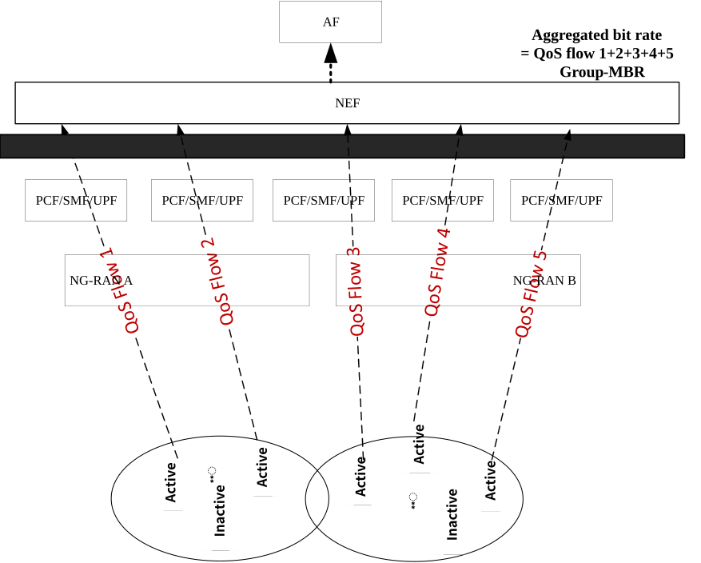
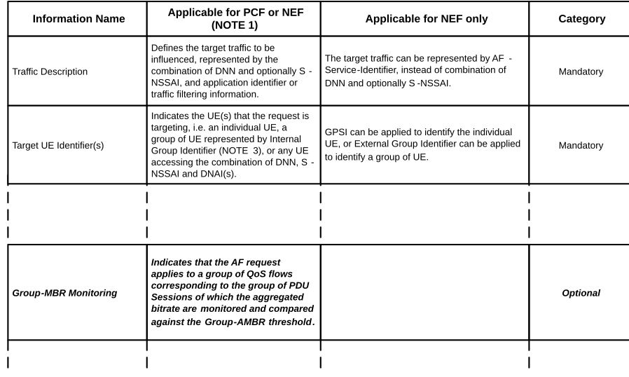
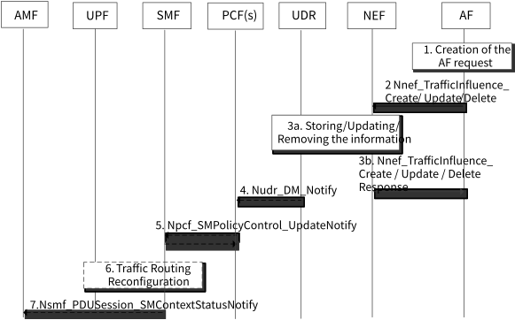
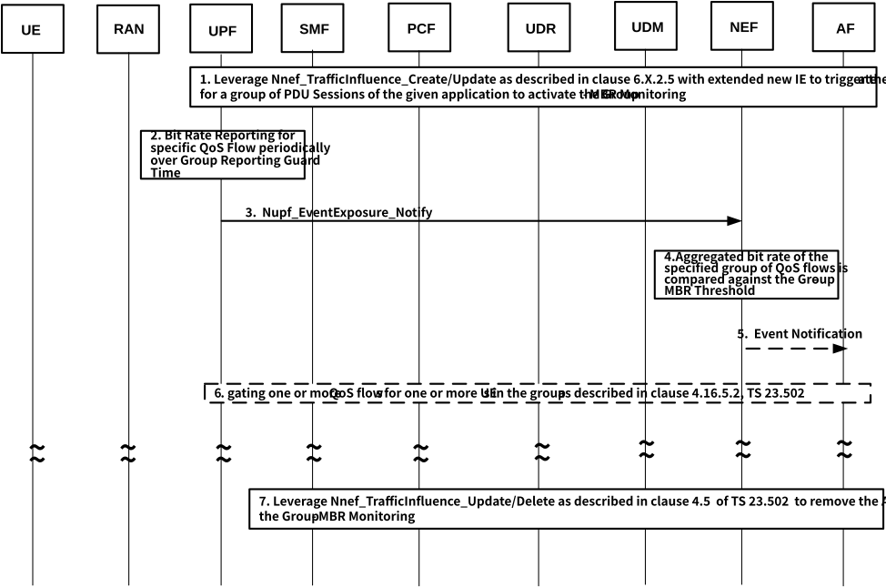

# 6.37 Solution \#37: Solution for 5GC Assistance to support Group-MBR Monitoring

## 6.37.1 Description

This solution touches on KI \#1 and \#7.

NOTE: The Sol#16 with overlapping contents and similar concept is merged into this solution.

Federated learning (FL) is a group-based learning method and there will be many files and multiple rounds of interactions between the UEs and the FL server over 5GS during the FL process. Just like any other services, there should be SLA between the MNO and ASP to agree on the allowance of the maximum throughput that can be consumed between the end points (i.e. the group of UEs and the AS) of the given FL operation. Therefore, it is necessary to introduce a system monitoring parameter to assist the AF to keep track of the status of the aggregated throughput usage for the given federated learning operation.

During the FL operation, the application server can be connected to one or more NG-RAN nodes through one or more UPFs, and each NG-RAN node could be serving multiple UEs participating in FL operation. Figure 6.37.1-1 below, illustrates an example of 7 UEs in total within the service area of a given FL operation. In a specific round, AF selects 5 of them to be participated in the FL training. In order to ensure that the resources consumed by the 5 UEs are within the specified throughput limit, the UPF(s) report(s) the actual bit rate for the 5 corresponding QoS flows that support the FL operation periodically to the serving NEF. The serving NEF then aggregates the bit rates for the 5 QoS flows and compares aggregated bit rate against the Group-MBR for the given FL operation. The aggregated bit rate shall not exceed the provisioned Group-MBR for the given FL operation. The following figure presents the high-level representation of the descriptions above.

Figure 6.37.1-1: The definition of the aggregated bit rate and the Group-MBR

In order to support the Group-MBR monitoring as described above, this solution proposes to extend the Application Function (AF) Influence on traffic routing functionality to enable 5GC assistance to support the Group-MBR monitoring for the group transmission operation (e.g. FL operation) when such operation is activated by the Application AI/ML AF.

It is beneficial to leverage existing AF Influence for Traffic Routing to support Group-MBR monitoring, because it is capable of triggering the group policy management in PCFs, SMFs and UPFs that serve the UEs who participate in the Application AI/ML operation.

In order to assist the Application Function (AF) to supervise the total aggregated bit rate consumed by the group of the transmissions for the given Application AI/ML operation (e.g. FL operation) to be in compliance with the SLA between the MNO and the ASP, this solution proposes the Group-MBR monitoring operation to provide the assistance to the AF as follows:

The Group-MBR monitoring is initiated by the Application AI/ML AF to request 5G system which supports the group transmission operation for the Application AI/ML traffic (e.g. FL operation). The Group-MBR monitoring is applied separately for uplink and downlink Application AI/ML traffic. This is to accommodate the case of asymmetric bitrate for UL and DL directions. The following presents the high-level descriptions of this solution on how 5G system assists the Application AI/ML AF to perform the Group-MBR monitoring:

\- Prior to the start of the group transmission operation of user plane traffic initiated by the Application AI/ML AF, the Group-MBR threshold should have been provisioned in the 5G Core related to the application subscription data which is identified by Application Identifier and/or traffic filtering information. network slice (i.e. S-NSSAI) and DNN.

\- The Application Function (AF), which controls and operates the given application AI/ML operation, initiates the Group-MBR monitoring request to 5G Core for a given set of QoS flows corresponding to a group of PDU sessions that support a group transmission operation (e.g. FL operation). The AF request includes the AF Transaction Id, the AF own identifier (i.e. AF Identifier), the Group Identifier, the Application Identifier and/or the traffic filtering information, as well as the Maximum Duration of Reporting and Group Reporting Guard Time as specified in clause 4.15.1 of TS 23.502 \[4\].

\- When the NEF receives the AF request, it ensures the necessary authorization for the incoming AF request. NEF may have to perform mapping for the information from the AF request. NEF will then store the information received from the AF request into the UDR.

\- The Policy Control Functions (PCFs) which serve the group of UEs for their corresponding PDU sessions that support the group transmission operation (e.g. FL operation) for the given application will be notified by the UDR about the policy impacts towards those PDU sessions as the outcome of the AF request.

\- The PCFs updates the corresponding Session Management Functions (SMFs) that provision the PSA UPFs which control the affected PDU sessions with the Bit Rate Reporting policy for the target QoS flows. In addition, the Group Reporting Guard Time and the Maximum Duration of Reporting are provided to each of the PSA UPFs. The PSA UPFs are then activated for the Bit Rate Reporting of the QoS flows that supports the Application AI/ML group transmission operation (e.g. FL operation). The consumer of the Bit Rate Reporting is associated with the address of the NEF.

\- Between the Group Reporting Guard Times, the PSA UPF for a given UE, who participates in the group transmission operation (e.g. FL operation), reports the bit rate of the QoS flow corresponding to the specified Application Identifier or Traffic Filtering information. The given QoS flow could be either GBR or Non-GBR. The UPF reports the bit rate of the given QoS Flow to the AF's serving NEF based on the address that is provisioned by the PCF.

\- When the NEF receive a set of bit rates reports from the group of PSA UPFs, the NEF will aggregate the set of bit rates and compare the aggregated value against the Group-MBR threshold. If the aggregate bit rate exceeds the Group-MBR threshold, the NEF will notify the AF for the event about the excess traffic over the Group-MBR threshold together with the AF Transaction Identifier.

\- The NEF sums up the bit rates for the active QoS flows per uplink and downlink separately NEF sums up the bit rate of the active QoS flows for the uplink and for the downlink traffic. NEF compares the aggregated bit rate for the uplink or downlink traffic against the provisioned Group-MBR threshold for the uplink or downlink traffic, respectively.

\- Whether the AF exerts any traffic mediation action when it receives the Group-MBR monitoring report (e.g. requesting 5G Core to apply traffic gating on specific QoS flow), it is beyond the scope of this solution.

\- Until the expiration of the Maximum Duration of Reporting which was specified by the AF, the time left until the Maximum duration of reporting is less than the Group Reporting Guard Time, or AF explicitly terminates the Group-MBR monitoring, the Group Reporting Guard Timer will restart and the PSA UPF continues to perform the Bit Rate Reporting for the given QoS flow to the NEF periodically.

## 6.37.2 Procedures

### 6.37.2.1 Defining Group-MBR Traffic Monitoring Parameter

This solution defines Group-MBR as follows:

Group Maximum Bit Rate (Group-MBR)

\- The Group-MBR threshold provides the upper bound of the aggregated bit rate across a set of QoS flows which are either a group of GBR or Non-GBR QoS flows corresponding to a group of PDU Sessions for a group of UEs who participate in a specific group transmission operation (e.g. Federated Learning (FL) operation) with active user planes. In general, the Group-MBR threshold is provisioned as part of the Application Subscription data based on the Service Level Agreement (SLA) between the Mobile Network Operation (MNO) and the Application Service Provider (ASP) for a given application. In the case when the application with asymmetric uplink and downlink traffic, Separate Group-MBR thresholds are provisioned for uplink and downlink accordingly.

### 6.37.2.2 Extensions to AF Influence Information Element in AF request to monitor and report aggregate bit rate among the specific group of PDU sessions

This solution proposes to update Table 5.6.7-1 of TS 23.501 \[3\]: Information element to be included in AF request, with a new optional AF Influence information element introduced by this solution in AF request, Group-MBR Monitoring, to indicate the AF request for monitoring the aggregated bit rate of a group of QoS flows, that are used to support the Application AI/ML group transmission, against the Group-MBR threshold which is also introduced by this solution and is to be part of the Application Subscription data provisioned in the UDR. In addition, the two existing Event Reporting Information Parameters - Group Reporting Guard Time and Maximum Duration of Reporting, as described in clause 4.15.1 of TS 23.502 \[4\], should also be provisioned in the UDR with the proper values for the given Application AI/ML group transmission operation. The Group-MBR Monitoring threshold is determined based on the Service Level Agreement (SLA) between the Mobile Network Operator (MNO) and Application Service Provider (ASP). The changes to Table 5.6.7-1 of TS 23.501 \[3\] for the new information element that is introduced by this solution to indicate the Group-MBR Monitoring request is shown in "bold italic" in the table below.

Note that, the "Traffic Description" information element in the table below is the "existing" information that has been defined in Table 5.6.7 of TS 23.501 \[3\] and is contained in the AF request. This existing information element is used to indicate the target QoS flow(s) that are applicable to the Group-MBR monitoring.

<table>
<colgroup>
<col style="width: 100%" />
</colgroup>
<thead>
<tr class="header">
<th>
Proposed example changes to Table 5.6.7-1 of TS 23.501 [3]:

Table 5.6.7-1: Information element contained in AF request

</th>
</tr>
</thead>
<tbody>
</tbody>
</table>

### 6.37.2.3 Extensions to AF Influence Network Function Service Procedure to enable the support for Group-MBR monitoring

This solution proposes to extend the AF traffic influence for traffic routing service procedure as defined in clause 5.2.6.7.2 of TS 23.502 \[4\] to include the new optional information element, Group-MBR monitoring, to indicate the AF request for Group-MBR monitoring that was described in clause 6.37.2.2 above for the Table 5.6.7-1 of TS 23.501 \[3\]: Information element contained in AF request. The changes are shown below in "***bold italic***".

Table 6.37.2.3-1: Proposed added parameters for AF Influence to support Group-MBR monitoring

<table>
<colgroup>
<col style="width: 100%" />
</colgroup>
<thead>
<tr class="header">
<th>
Proposed example changes to clause 5.2.6.7.2 of TS 23.502 [4]:

<strong>5.2.6.7.2 Nnef_TrafficInfluence_Create operation</strong>

<strong>Service operation name:</strong> Nnef_TrafficInfluence_Create

<strong>Description:</strong> Authorize the request and forward the request for traffic influence.

<strong>Inputs, Required:</strong> AF Transaction Id, AF Identifier.

The AF Transaction Id refers to the request.

<strong>Inputs, Optional:</strong> The address (IP or Ethernet) of the UE if available, GPSI if available, DNN if available, S-NSSAI if available, External Group Identifier if available, External Application Identifier or traffic filtering information, AF-Service-Identifier, a list of DNAI(s) and corresponding routing profile ID(s) or N6 traffic routing information, Indication of traffic correlation, Indication of application relocation possibility, Indication of UE IP address preservation, Early and/or late notifications about UP path management events, Notification Target Address, Temporal validity condition, Spatial validity condition, User Plane Latency Requirements, Information for EAS IP Replacement in 5GC<em><strong>,</strong></em> AF indication for simultaneous connectivity over source, <em><strong>and</strong></em> target PSA at edge relocation <em><strong>and Group-MBR Monitoring</strong></em> as described in clause 5.6.7 of TS 23.501 [3].

<strong>Outputs, Required:</strong> Operation execution result indication.

<strong>Outputs, Optional:</strong> None.
</th>
</tr>
</thead>
<tbody>
</tbody>
</table>

### 6.37.2.4 Extensions to UPF Services to support Group-MBR monitoring

This solution proposes to extend the UPF Services as defined in clause 5.2.6 of TS 23.502 \[4\] to enable UPF reporting of the Bit Rate for specific QoS flow. The proposed extensions are shown in the table below in "***bold italic***".

Table 6.37.2.4-1: Proposed Extensions for UPF Services as defined in clause 5.2.6 of TS 23.502 \[4\]

<table>
<colgroup>
<col style="width: 100%" />
</colgroup>
<thead>
<tr class="header">
<th>
<em>Example of Proposed extensions to clause 5.2.6 for the UPF services.</em>

<strong>5.2.26 UPF Services</strong>

<strong>5.2.26.1 General</strong>

The following table shows the UPF Services and UPF Service Operations.

Table 5.2.8.1-1: NF services provided by the UPF

<table>
<colgroup>
<col style="width: 30%" />
<col style="width: 28%" />
<col style="width: 22%" />
<col style="width: 18%" />
</colgroup>
<thead>
<tr class="header">
<th>Service Name</th>
<th>Service Operations</th>
<th>Operation Semantics</th>
<th>Example Consumer(s)</th>
</tr>
</thead>
<tbody>
<tr class="odd">
<td>Nupf_EventExposure</td>
<td>Notify</td>
<td>Subscribe/Notify</td>
<td>NEF, AF</td>
</tr>
</tbody>
</table>

<strong>5.2.26.2 Nupf_EventExposure Service</strong>

<strong>5.2.26.2.1 General</strong>

<strong>Service description:</strong> This service can expose UPF related information to other NFs. There is one operation for this service:

- Notifying events on the PDU Session to the NFs.

The following events can be notified to a NF consumer:

- QoS Monitoring for URLLC: the event notification may contain the QoS Monitoring report as described in clause 5.33.3.2 of TS 23.501 [3].

The event notification may contain following information:

- QoS monitoring result e.g. end to end delay for specific QoS flow or for specific PDU session.

<em><strong>- Bit Rate Reporting per QoS Flow.</strong></em>

<em><strong>The event notification contains the Bit Rate Reporting per QoS Flow for GBR or non-GBR QoS flow. The SMF may provision the following information in UPF to support the reporting:</strong></em>

<em><strong>- QFI information to indicate the target QoS flow required for the reporting.</strong></em>

<em><strong>- Group Reporting Guard Time.</strong></em>

<em><strong>- Maximum Duration of Reporting.</strong></em>

<em><strong>- Address of Target Consumer.</strong></em>

<strong>5.2.26.2.2 Nupf_EventExposure_Notify service operation</strong>

<strong>Service operation name:</strong> Nupf_EventExposure_Notify

<strong>Description:</strong> This service operation reports the event and information to the consumer that has subscribed implicitly.

<strong>Input Required:</strong> Event ID, UE address (i.e. IP address or MAC address).

<strong>Input, Optional:</strong> Event specific parameter as described in clause 5.2.26.2.1.

<strong>Output Required:</strong> Result Indication.

<strong>Output, Optional:</strong> None.
</th>
</tr>
</thead>
<tbody>
</tbody>
</table>

### 6.37.2.5 Extensions to AF Influence on traffic routing negotiation procedure to enable the group service provisioning and the activation for Group-MBR monitoring

This solution proposes to extend the procedure "Processing AF requests to influence routing for Session not identified by a UE address" as defined in clause 4.3.6.2 of TS 23.502 \[4\] to update the N4 policy to trigger the Group-MBR monitoring operation as described in clause 6.37.2.6 below. The following descriptions focus only on the changes to the existing procedure as described in clause 4.3.6.2 of TS 23.502 \[4\].

*Reference to clause 4.3.6.2 of TS 23.502 \[4\]:*

Figure 4.3.6.2-1: Processing AF requests to influence traffic routing for Sessions not identified by an UE address

Figure 6.37.2.5-1: Reference to clause 4.3.6.2 of TS 23.502 \[4\] on the example extensions to trigger Group-MBR Monitoring

1\. Application AI/ML AF includes the new information element, Information for Supporting Group-MBR Monitoring, as described in Table 5.6.7-1 in clause 6.37.2.1 of TS 23.501 \[3\] in the AF request to NEF. The information element indicates the Group-MBR monitoring request for the given Application AI/ML group transmission operation (e.g. FL operation). More specifically, the AF request includes the AF Transaction Id, the AF own identifier (i.e. AF Identifier), the Group Identifier, the Application Identifier and/or the traffic filtering information.

2\. Prior to AF sends its request to the NEF, it includes the new information element provided in step 1. Above to NEF in case of Nnef_TrafficInfluence_Create or Update. Then the existing procedures as described in step 2 in clause 4.3.6.2 of TS 23.502 \[4\] proceed.

3\. In the case of Nnef_TrafficInfluence_Create or Update, in additional of the set of AF request information to be stored, the NEF stores also the new information element provided in step 1. above by the AF in the UDR together with the address of the AIML NF/NEF which is to trigger the Group-MBR monitoring for the group of QoS flows of the future and the existing PDU sessions that are identified by the tuple {S-NSSAI, subscribed DNN}, Application Identifier and/or the traffic filters. It is expected that the two existing Event Reporting Information Parameters - Group Reporting Guard Time and Maximum Duration of Reporting, as described in clause 4.15.1 of TS 23.502 \[4\], should also have been provisioned in the UDR with the proper values for the given Application AI/ML group transmission operation.

5\. In the Npcf_SMPolicyControl_UpdateNotify in the current step 5. in clause 4.3.6.2 of TS 23.502 \[4\], the PCF includes the Group-MBR Monitoring request in the PCC rule(s) the information required for reporting the event, including the Notification Target Address pointing to the NEF and the Notification Correlation ID containing the AF Transaction Internal ID.

6\. Based on the current step 6 in clause 4.3.6.2 of TS 23.502 \[4\], when the updated policy information about the Group-MBR monitoring request is received from the PCF, the SMF responds to the request by taking the appropriate action to trigger the Bit Rate Reporting per QoS Flow in PSA UPF over N4. The N4 policy enables SMF to provision the PSA UPF to report the current bit rate for the specific QoS flow to the NEF periodically between the Group Reporting Guard Times until Maximum Duration of Reporting is expired. The Nupf_EventExposure service as previously described in clause 6.37.2.4 above is then implicitly subscribed by NEF to receive the report from PSA UPF for the Bit Rate Reporting per QoS Flow.

### 6.37.2.6 The procedure of Group-MBR monitoring

After the PDU session establishment/modification, and the policy negotiation and provisioning as described in previous clause of 6.37.2.6 above between the UEs and the AF, the PSA UPFs of a group of PDU sessions are activated by their respective SMFs to report the current bit rates of the active QoS flows corresponding to the given Application Identifier, DNN and S-NSSAI periodically to the specified NEF. The NEF will then aggregate the bit rates and compare the aggregated bit rate against the Group-MBR threshold. If the aggregated bit rate exceeds the Group-MBR threshold, the NEF notifies the AF.

Figure 6.37.2.6-1: Group-MBR Monitoring via AF request

1\. By extending the AF Influence Routing procedures to enable the policy negotiation and provisioning to support the Group-MBR monitoring as described in previous clause 6.37.2.5, the corresponding group of PCFs, SMFs and PSA UPFs are triggered to activate the Bit Rate Reporting per QoS Flow for the group of QoS flows that is used to support the given Application AI/ML group transmission operation (e.g. FL operation) as requested by the AF.

2\. The PSA UPF performs the Bit Rate Reporting per QoS Flow of the active QoS flow which is used to support given Application AI/ML group transmission periodically between the Group Reporting Guard Times. The QoS flow is identified by Application Identifier and/or Traffic Filter. The reported QoS flow could be either GBR or Non-GBR.

3\. The PSA UPF sends Nupf_EventExposure_Notify to report the current bit rate of the given QoS Flow to the target NEF based on the address that has been provisioned by the PCF as described in clause 6.37.2.5, step 5.

4\. The NEF sums up the bit rates of all the active QoS flows which are reported by the UPFs. If the given Application AI/ML traffic is asymmetric, the bit rate aggregation is done per uplink and downlink separately; otherwise, the bit rate aggregation is done per either uplink or downlink. NEF compares the aggregated bit rate of the uplink or downlink against the provisioned Group-MBR threshold for the uplink or downlink, accordingly.

5\. If the aggregate bit rate exceeds the Group-MBR threshold, the NEF will notify the Application AI/ML AF of such event with the AF transaction Identifier.

6\. AF may apply traffic mediation action in responding to the Group-MBR monitoring report (e.g. requesting 5G Core to apply traffic gating on specific QoS flow such as asking 5GC to block some of the flows) or may decide not to take any action other than use it for its own statistics or charging.

7\. Until the time for Maximum Duration of Reporting is expired, the time left until the Maximum duration of reporting is less than the Group Reporting Guard Time, or AF terminates the Group-MBR monitoring, the Group Reporting Guard Timer will restart and the UPF continues to perform the Bit Rate Reporting for the given QoS flow to the NEF periodically as described in steps 2 to 6 above. If AF wants to terminate the Group-MBR monitoring, AF sends either Nnef_TrafficInfluence_Update or Delete as described in clause 4.3.6.2 of TS 23.502 \[4\].

## 6.37.3 Impacts on services, entities and interfaces

NEF:

\- Recognizes the new IE for Group-MBR Monitoring for the existing feature of AF Influence Traffic Rerouting.

\- Supports the Bit Rate Reporting event notification from UPF.

\- Performs the aggregation for the bit rates that are reported by the UPFs.

PCF:

\- Subscribes to the application subscription data corresponding the Application Identifier and/or the Traffic Filters.

\- Generates the new PCC rules corresponding to the Group-MBR Monitoring.

SMF:

\- Responds to the new PCC rules related to the Group-MBR Monitoring and determines the N4 rules to trigger UPF to activate Bit Rate Reporting per QoS Flow towards NEF.

UPF:

\- Support the new event reporting for Bit Rate Reporting per QoS Flow towards the target NEF.

\- Responds to the N4 rules to activate periodic Bit Rate Reporting per QoS Flow towards the target NEF between the Group Reporting Guard Times until Maximum Duration of Reporting is expired, the time left until the Maximum duration of reporting is less than the Group Reporting Guard Time, or AF terminates the Group-MBR monitoring.
