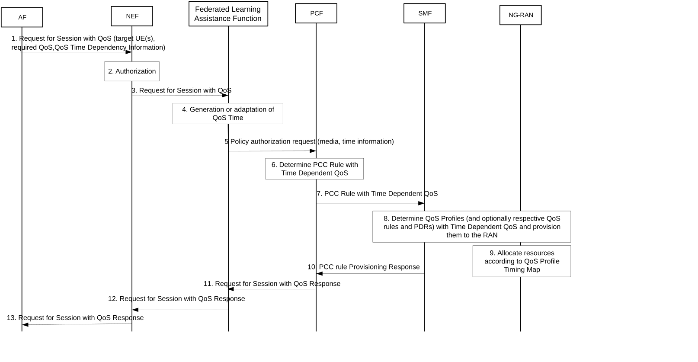
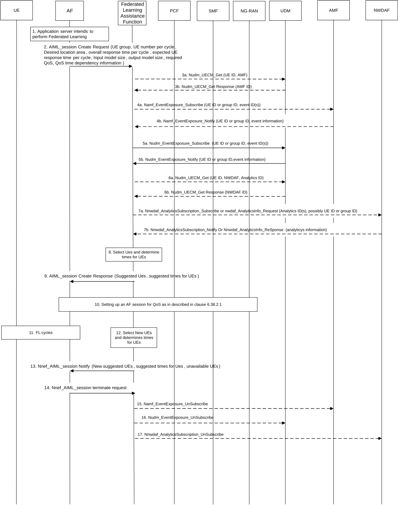

# 6.38 Solution \#38: Time dependent QoS for ML model distribution in federated learning

## 6.38.1 Description

This solution addresses aspects of key issue \#6 on QoS and Policy enhancements and key issue \#7 on 5GS Assistance to Federated Learning Operation.

The time dependent QoS, whereby resources can be reserved for prescribed periods in the 5GS, can meet the needs of AI/ML model transfer, which requires brief and periodic use of significant 5GS resources. Reserving resources at specific times allows more efficient multiplexing of groups of UEs that need to transfer AI/ML models.

The solution is based on the following steps:

1\. An AF (AI/ML application server acting as AF) sends to the 5GS a QoS request containing traffic pattern information for model transfer (e.g. model size, transfer direction, model transfer periodicity, start time(s), stop time(s)) or QoS timing information indicating the period when the QoS should be applied. The AF may also specify QoS requirements for periods when a model is not being transferred to the application clients on the UEs but other AI/ML operations could take place, e.g. a model update is provided by the application client on the UE to the AF, or inference feedback is sent by the application client on the UE to the AF. An AI/ML service may rely on different types of AI/ML operations, which would require different QoS patterns for the same AI/ML service.

2\. The 5GS (NEF or Federated Learning Assistance Function) verifies and potentially converts the request to a time-dependent QoS request that the PCF can in turn provide as one or several PCC rule(s) to the SMF together with timing information. The SMF maps the information received from the PCF to one or several QoS Profiles which are applicable only at times which are indicated by the PCF (e.g. via start time, duration, and possible repetition period). For example, there can be one QoS Profile applicable for the time during which model(s) are transferred and a second QoS profile applicable for the time when models are not transferred.. As an option, the PCF also includes information about the data volume to be expected during a time period in the QoS profile, based on model size information.

3\. The SMF sends the QoS profiles to the NG-RAN and the QoS Profile Timing Map. If the Traffic Pattern Information is received, the NG-RAN formulates QoS Profile Timing Map.

4\. The NG-RAN alternates between the different QoS Profiles provided by the SMF according to the QoS Profile Timing Map. The QoS Profile Timing Map may, for example, specify alternating QoS between:

\- QoS 1: Time 2:30:30 to 2:30:35 (five seconds).

\- QoS 2: Time 3:30:00 to 3:40:00 (10 minutes).

Where QoS 1 provides resources for model transfer while QoS 2 provides resources for low bandwidth background traffic (i.e. when no model transfer occurs).

When the requested QoS cannot be provided in the specific time slot, the AF is notified that QoS targets can no longer be fulfilled, as per TS 23.503 \[5\] clause 6.1.3.18.

The existing procedures for resources reservation and QoS fulfilment apply, i.e. there is no additional mechanism proposed by this solution in this respect. Approach in NG-RAN is similar to alternative QoS handling.

The solution allows switching between different QoS profiles at NG-RAN, thus avoiding signalling at each QoS change, between PCF and SMF, and between SMF and NG-RAN.

## 6.38.2 Procedures

### 6.38.2.1 Procedure based on setting up an AF session for QoS

Procedure as depicted in figure 6.38.2.1-1 is based on enhancing the procedure for setting up an AF Session for specific QoS.

Figure 6.38.2.1-1: Procedure for time dependent QoS

1\. An AF sends QoS requirements (e.g. bandwidth required, PER, 5GS Delay, GBR) with QoS timing information (e.g. Model transfer periodicity etc.) to the NEF. Time dependency information indicates time for which these requirements shall apply (e.g. required QoS1 applies for when an ML model data transfer is taking place and, as an option, required QoS2 applies for the rest of the time).

Alternatively (not shown in the Figure), the AF may send traffic pattern information (e.g. model size, model transfer periodicity, start time(s), duration(s), stop time(s)), so that traffic pattern information can be translated to time-dependent QoS requirements in the 5GC.

The AF may provide the information for a single UE or for a list or group of UEs. If the AF provides a list of UEs, it may indicate different periods during which these requirements shall be valid or time of model transfer for different UEs within the list.

NOTE 1: The AF can send this request to an NEF (as shown in the figure, if the AF is untrusted), or to a Federated Learning Assistance Function, or a PCF.

NOTE 2: The AF can use the External Parameter Provisioning procedure as shown in clause 4.15.6 of TS 23.502 \[4\] to provide this information via NEF and UDM towards the PCF (not shown in Figure 3),

2\. In the case of untrusted AF, the NEF authorizes the AF request as per the standard procedures. Regular NEF behaviour applies, e.g. converting external identifiers into internal 5GS identifiers.

3\. The NEF forwards the request to Federated Learning Assistance Function, to perform the functions described in steps 4 to select PCF(s), authorize QoS and provide time and periodicity for time dependent QoS. Alternatively, if the PCF is contacted directly, it authorizes QoS and uses the information in the request from the AF/NEF to determine QoS timing and periodicity for use in step 6.

4\. The Federated Learning Assistance Function may map the possibly provided information for model transfer to QoS information for the UEs provided in step 3.

5\. The Federated Learning Assistance Function selects PCFs handling involved UEs, and requests those PCFs to authorize the QoS required for the model transfer separately for each involved UE. It provides QoS information and time information (start time(s), stop time(s), periodicity) to the PCF.

6\. The PCF determines PCC rule(s) that include QoS applicability time(s) (e.g. start time(s), duration(s), and repetition period(s)) that are to be transferred to the NG-RAN. The PCF may provide several QoS Parameter sets with applicability times associated to these QoS Parameter sets. The PCF may also include information about the data volume to be expected during applicable QoS time periods.

7\. The PCF sends the PCC rule(s) with the information determined in step 6 to the SMF.

8\. The SMF determines based on the PCC Rule(s) QoS profiles with QoS Profiles' Timing Map and optional data volume(s) and provisions them to the NG RAN. The PCF may also provide time dependent PDRs to the UPF.

9\. NG RAN executes time dependent QoS as per the specified QoS profiles in the specified QoS Profiles' Timing.

NOTE: Coordination is needed with RAN for the NG RAN impacts aspects.

10-13. Responses to the requests of steps 1, 3, 5, and 7 are sent back to the respective NF service consumers.

### 6.38.2.2 Procedure for UEs' staggering with notification to the AI/ML application server

Procedure as depicted in figure 6.38.2.2-1 is based on enhancing the procedure for solution \#23 while introducing UEs' staggering functionality.

When the Federated Learning Assistance Function provides suggested UEs to the AF, it also provides suggested times for the federated learning cycles with those UEs back to the AF. AF select UEs and times from the list of suggested UEs and suggested times, and request QoS to 5GC for those UEs with QoS timing information as described in clause 6.38.2.1. The Federated Learning Assistance Function selects PCFs handling involved UEs, and requests those PCFs to authorize the QoS required for the model transfer separately for each involved UE. The Federated Learning Assistance Function provides time(s) and optionally periodicity when the model transfer to/from the UE will occur to the PCF. The actions triggered by the PCF are as described for procedure in clause 6.38.2.1.

Figure 6.38.2.2-1: UEs' staggering with notification to AF

The procedure follows the procedure depicted for solution \#23 with the following additions:

1\. The AF provides QoS requirements (e.g. bandwidth required, PER, 5GS Delay, GBR) with time dependency information (e.g. bandwidth required, PER, 5GS Delay, GBR, Model transfer periodicity etc.) to the NEF. Alternatively (not shown in the Figure), the AF may send traffic pattern information (e.g. model size, model transfer periodicity, Start time(s), duration(s), stop time(s)).

8\. The Federated learning Assistance Function select UEs for the federated learning from the group of UEs and determines the times for models download for the different UEs to be suggested to AF.

9\. The Federated Learning Assistance Function provides a list of suggested UEs to the AF together with suggested times for the different UEs.

10\. AF select UEs and times from the list of suggested UEs and suggested times, and request QoS to 5GC for those UEs with QoS timing information as described in clause 6.38.2.1.

12-13. The Federated Learning Assistance Function determine times for new suggested UEs and provide the information to the AF.

## 6.38.3 Impacts on services, entities and interfaces

AF:

\- Provides time dependency information to the NEF in addition to existing QoS requirements. Alternatively, provides traffic pattern information.

Federated Learning Assistance Function: Maps traffic pattern information to QoS profile and time information.

PCF:

\- Derives PCC rules with QoS applicability times, based on different QoS profiles with different time information.

SMF:

\- Provisions the PCC rules with QoS applicability time to the NG-RAN and time dependent PDRs to the UPF.

NG-RAN:

\- Schedules time dependent QoSs.

NOTE: Coordination is needed with RAN for the NG RAN impacts aspects.

UPF:

\- Enforces time dependent PDRs.
