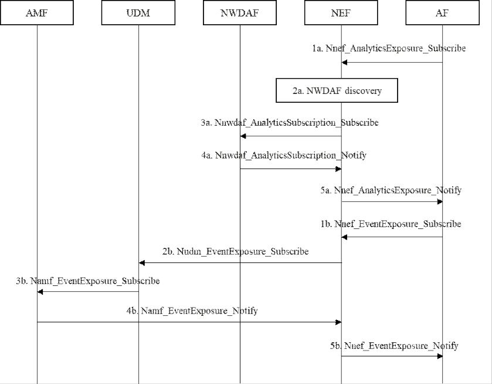
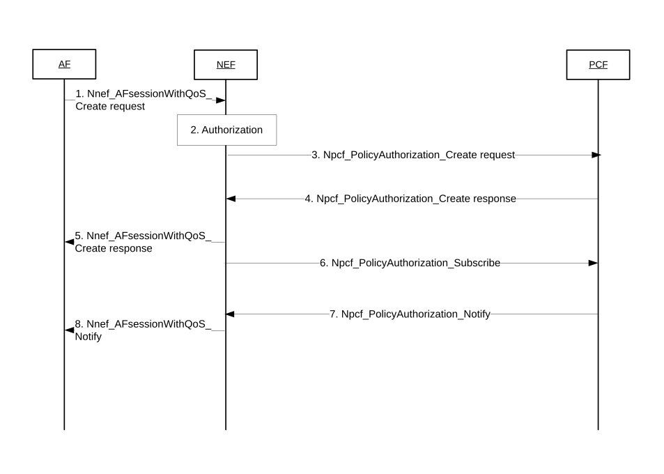

# 6.39 Solution \#39: 5GC information assistance to FL members' selection

## 6.39.1 Description

This solution addresses Key Issue \#7 "5GS Assistance to Federated Learning Operation" on assistance to selection of UEs for FL operation and on how to monitor and expose a UE performance for the purpose of FL operations or to support performance KPIs defined in clause 7.10 of TS 22.261 \[2\], that is part of KI#6.

This solution is based on the principles as follows:

\- The FL group management is under the control of the AF; and

\- The 5GC NF just provides some network information to help the AF to select and manage the group of UEs which will be part of FL operation; and

\- How the AF selects and manages the group of UEs which will be part of FL operation based on the network information is out of 3GPP scope.

To request the network information from the 5GC NF, the AF may provide an Area of Interest and/or a UE group ID to reduce the signalling of network information exposure. Take the FL assisted Word Query Suggestion Model as an example, the AF for Gboard on Android (i.e. the Google Keyboard) may provide TAC (Type Allocation Code) as an External UE group ID to 5GC NF to request the UE's network information if the UE is an Android terminal. Furthermore, there are hundreds of millions of Android UEs in the 5G network, so to save the signalling of network information exposure, the AF may also provide an AoI to 5GC NF to request the UE's network information if the UE is located in the AoI or about to enter the AoI.

The assistance network information which can be provided by 5GC NFs to assist FL members' selection by AF is shown in Table 6.39.1-1.

Table 6.39.1-1: Information which can be provided by 5GC NFs for FL members' selection

| Network Information                                                                                                                                       | 5GC NF | Description                                                                                                | Actions of AF (examples)                                                                                                                  |
|-----------------------------------------------------------------------------------------------------------------------------------------------------------|--------|------------------------------------------------------------------------------------------------------------|-------------------------------------------------------------------------------------------------------------------------------------------|
| UE locations (1..max)                                                                                                                                     | AMF    | UE positions                                                                                               | AF only selects the UEs which are located in the requested AoI to join the FL group.                                                      |
| \>UE location                                                                                                                                             |        | TA or cells that the UE enters (NOTE 1)                                                                    |                                                                                                                                           |
| \>Timestamp                                                                                                                                               |        | A time stamp when the AMF detects the UE enters this location                                              |                                                                                                                                           |
| CM state                                                                                                                                                  | AMF    | The NAS signalling Connection state of the UE with the AMF, including CM-IDLE state and CM-CONNECTED state | AF only selects the UEs which are in CM-CONNECTED state to join the FL group.                                                             |
| UE Reachability                                                                                                                                           | AMF    | Whether the UE is reachable                                                                                | When the number of the connected UEs is not enough, AF may select the UEs which are in IDLE state but are reachable to join the FL group. |
| UE Mobility                                                                                                                                               | NWDAF  | Statistics or predictions on UE Mobility.                                                                  | AF only selects the UEs which are about to enter (UE mobility predictions) the requested AoI to join the FL group.                        |
| UE Abnormal behaviour                                                                                                                                     | NWDAF  | Statistics or predictions on UE Abnormal behaviour.                                                        | AF does not select the UEs with abnormal behaviour to join the FL group.                                                                  |
| NOTE 1: UE location includes either the last known location or the current location, under the conditions defined in Table 4.15.3.1-1 in TS 23.502 \[4\]. |        |                                                                                                            |                                                                                                                                           |

To subscribe to the UE locations, CM state and UE Reachability from AMF, the Event IDs "Location Report", "Connectivity state changes", "UE reachability status" as defined in clause 5.2.2.3.1 of TS 23.502 \[4\] are used respectively. Instead of the "Location Report", the "UE moving in or out of a subscribed "Area Of Interest"" event can also be used to monitor if a UE is located in the requested AoI.

To subscribe to the UE Mobility analytics and Abnormal behaviour related network data analytics from NWDAF, the Analytics ID "UE Mobility" as defined in clause 6.7.2 of TS 23.288 \[6\] and "Abnormal behaviour" as defined in clause 6.7.5 of TS 23.288 \[6\] are used respectively.

NOTE: Which network information is requested by the AF depends on the FL member selection criteria at the AF.

Table 6.39.1-2. Information that 5GC NFs can provide to the AI/ML server for performance monitoring of a UE involved in an AI/ML operation

<table>
<colgroup>
<col style="width: 20%" />
<col style="width: 10%" />
<col style="width: 39%" />
<col style="width: 30%" />
</colgroup>
<thead>
<tr class="header">
<th>Network Information</th>
<th>5GC NF</th>
<th>Description</th>
<th>Actions of AF (examples)</th>
</tr>
</thead>
<tbody>
<tr class="odd">
<td>Notification control</td>
<td>PCF</td>
<td>
The AF request for QoS for the AI/ML operation on e.g. AI/ML model split or AI/ML model download or AI/ML model generation by the FL member. The AF request notifications when the GBR, the PDB or the PER of the QoS profile can no longer be (or can be again) be guaranteed by NG-RAN.

The NG-RAN needs to send a notification then checks if GFBR, PDB and PER matches any Alternative QoS Profile in the priority order and notifies SMF, PCF and the AF.
</td>
<td>
AF receives QoS Notification Control then use it a) decide on AI/ML model split; or b) select the model to download to the UE; or c) for re-selection of those UEs that contribute to ML model generation.

Calculate the communication service availability, for this the AF checks the GBFR, PDB and PER of the Alternative QoS profile, e.g. PER set to 10-3 corresponds to 99.999 communication service availability according to the require QoS.
</td>
</tr>
</tbody>
</table>

To subscribe to Notification control, the AF provides Alternative QoS profile in the AF request with requested QoS to the PCF, may be via NEF when the AF is untrusted, that triggers the subscription to the Notification on QoS targets can no longer (or can again) be fulfilled. This subscription also triggers the request for notifications of Resource allocation outcome, either successful or unsuccessful, when the resource allocation is unsuccessful the notification on QoS targets is not subscribed either.

## 6.39.2 Procedures

Figure 6.39.2: Procedure for 5GS assistance to FL members' selection

The AF ensures that the UEs associated to the UE group ID have application users consent in place and then follows the following procedure.

1a-5a. The procedure in clause 6.1.1.2 of TS 23.288 \[6\] for UE-related analytics subscribe by AFs via NEF are re-used.

1b-5b. The procedure in clause 4.15.3.2.3 of TS 23.502 \[4\] for UE-related event notifications subscribe by AFs via NEF are re-used.

After having notification from the 5G network, the AF selects AI/ML user members for FL operation. Then the AF initiates the Nnef_AFSessionWithQoS_Create/Notify/Update/Revoke procedure in TS 23.502 \[4\] clause 4.15.6.6 for selected UEs for AI/ML operation.

In step 1a or step 1b, AF can include user consent indication and the UE filtering policy (e.g. UE group ID, Expected number of UE for reporting, validity conditions of areas of interest and time) in the subscription service operation, and NWDAF or AMF can derive the notifications based on the UE filtering policy.

With user consent indication and the UE filtering policy (e.g. UE group ID), the NEF checks with UDM for the user consent of the requested Analytics and Events Exposure Notifications before proceed step 3a and 2b. The NEF only indicates the list of UEs with granted user consent to NWDAF or UDM. The NEF also subscribes to the UDM with user consent change notification. If user consent changes for the UE, the NEF notifies the AF indicating the UE ID with proper cause value.

In step 3a and step 2b, the user consent indication is indicated to NWDAF and UDM, respectively. With the user consent indication and target list of UEs for Analytics and Event Exposure, the UDM does not check user consent again. If target list of UEs is not indicated, i.e. for any UEs, the user consent indication triggers requested NF, e.g. NWDAF, UDM, to check user consent of UEs that meet the validity conditions, e.g. Area of Interest, time.

Alternatively, the AF can request to check user consent for Event/Analytics Exposure before proceeding step 1a-5a and step 1b-5b by subscribing to a new Event notification of user consent change by using the procedure in clause 4.15.3.2.3 of TS 23.502 \[4\] for UE-related event notifications.

NOTE 1: Whether and how the AF can indicate one or more purpose(s) needs to cooperate with SA WG3.

NOTE 2: The user consent checking for the UE related 5GC information or analytics exposure to 3rd party AF when there are potentially more than one user consent enforcement points would need to be investigated by SA WG3. Whether a user consent indication or one or more purposes from AF or a new AF request message can be used to trigger user consent checking would need to be investigated by SA WG3.

The procedure for AF request for QoS is reused as defined in TS 23.502 \[4\] clause 4.15.6.6, the steps below describe how AI/ML AF consumes the Nnef_AFSessionwithQoS or Npcf_PolicyAuthorization services. When the AI/ML server requests QoS maps the performance requirements described in clause 7.10 of TS 22.261 \[2\] as follows:

\- Experience Data Rate UL/DL into Requested Guaranteed Bitrate, Requested Maximum Bitrate,

\- Calculate from the maximum end to end latency the latency in 5GS then map it into Requested 5GS Delay.

\- Reliability into Requested Packet Error Rate.

The AI/ML AF requests QoS Notification Control that is used to help the AF to manage the communication with the UE. The AF subscribes to "QoS targets can no longer (or can again) be fulfilled", the AF may provide a list of Alternative QoS parameter for example:

\- If the UE communication with the AI/ML mode is for decisions on the AI/ML model split, then the AF will provide one Alternative QoS parameter for each different split point between the UE and the AI/ML server.

\- If the UE communication with the AI/ML model is for decisions on the AI/ML model to be downloaded, then the AF will provide one Alternative QoS parameter for each different AI/ML model that can be used for image-recognition.

Figure 6.39.2-2: Procedure for 5GS assistance to AI/ML operations

1\. The AF sends a request to reserve resources for an AF session using Nnef_AFsessionWithQoS_Create request message (UE IP address, AF Identifier, Flow description(s) or External Application Identifier, QoS reference, QoS parameters, Alternative Service Requirements) to the NEF. The AF may, instead of a QoS Reference, map the experience data rate UL/DL into the Requested Guaranteed Bitrate, Requested Maximum Bitrate, the maximum e2e latency is split to the UE to UPF latency then mapped into the Requested 5GS Delay, Reliability mapped into Requested Packet Error Rate and Requested Alternative QoS Parameter Set(s) or Alternative Service Requirements.

2\. The NEF authorizes the AF requests, then contact the PCF that serves the SM Policy association for the provided UE IP address, triggering the Npcf_PolicyAuthorization_Create request and provides the UE address, AF Identifier, Flow description(s), the individual QoS parameters, QoS Reference and the Alternative Service Requirements. If the AF is trusted, the the AF uses the Npcf_PolicyAuthorization_Create request message to interact directly with PCF to request reserving resources for an AF session. The PCF that serves the SM policy association is found by querying BSF using the UE IP address.

3\. If the request is authorized, the PCF derives the required QoS parameters based on the information provided by the NEF and notifies the result to the NEF using Npcf_PolicyAuthorization_Create request, The PCF derives the Alternative QoS parameter set(s) from the one or more QoS reference parameters or the Requested Alternative QoS Parameter Set(s) contained in the Alternative Service Requirements in the same prioritized order. The PCF sends PCC rules to the SMF with the QoS parameters including the Alternative QoS parameter set(s).

4\. The PCF sends the Npcf_PolicyAuthorization_Update response message directly to the AF

5\. The NEF sends a Nnef_AFsessionWithQoS_Create response message to the AF. Result indicates whether the request is granted or not.

6\. The NEF shall send a Npcf_PolicyAuthorization_Subscribe message to the PCF to subscribe to notifications of Resource allocation status and to QoS targets can no longer (or can again) be fulfilled.

7\. When the the establishment of the transmission resources corresponding to the QoS succeeded or failed, the PCF sends Npcf_PolicyAuthorization_Notify message to the NEF notifying about the event.

8\. The NEF sends Nnef_AFsessionWithQoS_Notify message wto indicate that resources are reserved, this includes provisioning of Alternative QoS Profiles to NG-RAN.

## 6.39.3 Impacts on services, entities and interfaces

AF:

\- Support to subscribe the Event IDs "Location Report", "Connectivity state changes", "UE reachability status", and/or "UE moving in or out of a subscribed "Area Of Interest"" by AMF, via NEF.

\- Support to subscribe the Analytics IDs "UE Mobility" and "Abnormal behaviour" by NWDAF, via NEF.

\- Including the UE filtering policy in the subscription service operation.

\- AF request for QoS including subscription to resource allocation outcome and QoS targets can no longer (or can again) be fulfilled.

\- AF maps performance KPIs into QoS parameters exposed by NEF or by PCF, i.e. Requested GBR, MBR, PDB and PER.

\- Including user selection indication for AnalyticsExposure_Subscribe/EventExposure Subscribe.

NEF:

\- Support to check user consent if receiving user selection indication in AnalyticsExposure_Subscribe or EventExposure Subscribe from AF.

\- Support to subscribe the new Event ID "user consent changes" from UDM for Event Exposure.

\- Support to notify the AF with the UE ID and the proper cause of notification when user consent of a UE is changed.

UDM:

\- Support to store user consent for Event/Analytics Exposure in subscription information.
