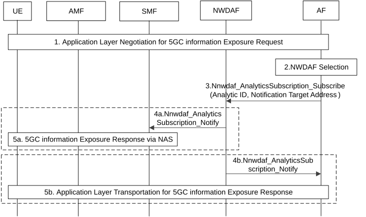

# 6.4 Solution \#4: 5GC Analytics exposure to UE

## 6.4.1 Description

This solution is proposed to address Key Issue \#2: 5GC information exposure to UE.

To facilitate its Application AI/ML operation between the UE and the AF, it will be helpful for the UE to perform the AI/ML operation if the NWDAF can expose the UE-related analytics data. The UE and the AF may exchange the intermediate result to complete the E2E AI/ML operation over application layer, which may require large bandwidth, low latency or sustainable QoS for the AI/ML operation traffic. For example, the NWDAF can expose "QoS Sustainability", for V2X application to make AI/ML operation decision locally.

This solution aims at studying how to enhance the 5GC, i.e. NWDAF, to expose 5GC information to the UE to facilitate its Application AI/ML operation (e.g. Model Training, Splitting and inference feedback etc.).

The procedure for the NWDAF to expose analytics data (e.g. UE Mobility) to the UE is as illustrated in Figure 6.4.2-1.

## 6.4.2 Procedures

Figure 6.4.2-1: Procedure for analytics exposure to UE

1\. The UE negotiates with the AF though application layer on analytics subscription.

2\. The AF selects the NWDAF (possibly via NEF) either by local configuration or querying the NRF according to Analytics ID, Area of Interest etc.

3\. The AF subscribes to the NWDAF via Nnwdaf_AnalyticsSubscription_Subscribe (UE identifier, Analytics ID, Area of Interest, Notification Target Address (+Notification Correlation ID, +callback URI), Target UE IP Address,) for analytics exposure to the UE.

NOTE 1: In the case that the AF first gets the serving SMF address via UDM, then subscribes to the NWDAF on behalf of UE via SMF, the AF includes the Notification Target Address (+Notification Correlation ID, +callback URI) of SMF which is to be notified, and also includes Target UE IP address, and the AF sends the Notification Correlation ID to the UE for the subscription through application layer, then performs the following step 4a-5a.

4a. The NWDAF may return analytics data with Notification Correlation ID to the serving SMF according to the Notification Target address from AF, and instructs the notification message is to be exposed to which UE by Target UE IP address.

5a. The SMF forwards the Analytics data together with Notification Correlation IDto UE via NAS by invoking Namf_Communication_N1N2MessageTransfer to AMF as defined in clause 4.2.3.3 of TS 23.502 \[4\].

4b. alternatively, the NWDAF may return analytics data to the AF, by invoking Nnwdaf_AnalyticsSubscription_Notify.

5b. sends the analytics data to the UE over application layer.

NOTE 2: It will be considered in the evaluation phase that whether 5GC Analytics exposure to UE via the network could be efficient compared to the GBR flow.

## 6.4.3 Impacts on services, entities and interfaces

AMF/SMF:

\- Supporting analytics exposure from NWDAF to UE.

NWDAF:

\- Supporting analytics exposure to UE via SMF.

UE:

\- Supporting analytics exposure from NWDAF via NAS.
