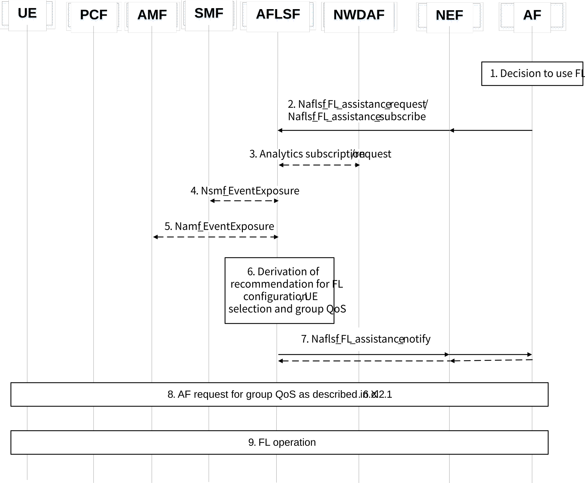
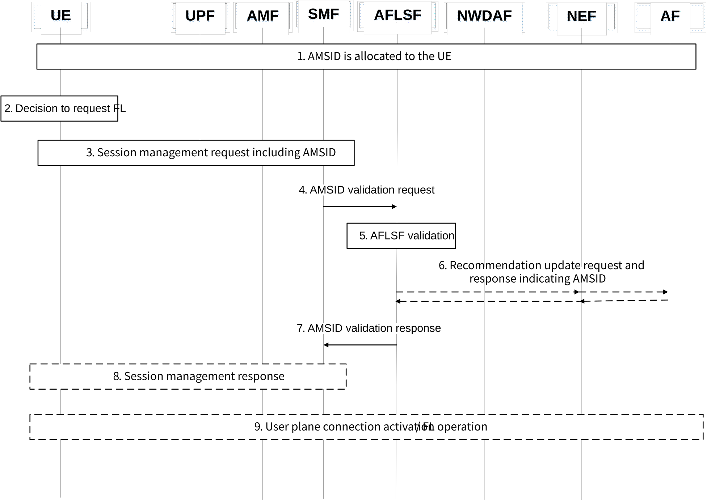
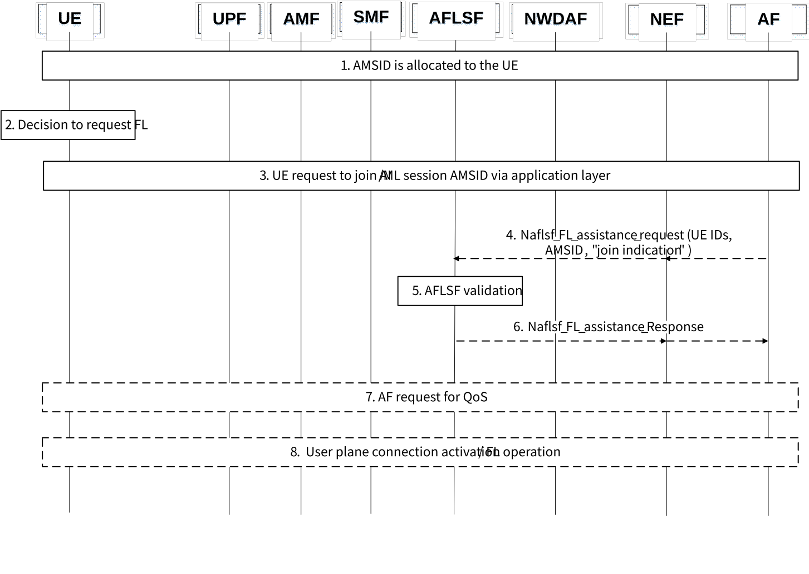

# 6.40.2 Procedures

## 6.40.2.1 Procedure for group QoS request for FL by AF

The signalling flow for the AF to request the network to provide group QoS for a list of UEs (e.g. request to provide a same QoS for a list of UEs) is based on the signalling flow in Figure 4.15.6.6-1 of TS 23.502 \[4\] with the following differences and clarifications:

\- In step 1, AF may include group QoS request indicator, a list of UE addresses, Group identifier (either Internal Group Identifier or External Group Identifier), the group QoS requirements in Nnef_AFsessionWithQoS_Create request message to request the QoS setup for UEs in the list of UE addresses based on the group QoS requirements for UEs in the list of UE addresses.

\- In step 3, if the NEF received group QoS request indication and the list of UE addresses with more than one UEs from the AF, the NEF discovers PCF(s) for the list of UE addresses from BSF as defined in 6.40.2.4. NEF sends Npcf_PolicyAuthorization_Update request to each PCF with the list of UEs served by the PCF in addition to group QoS request indicator, AF Identifier, Flow description(s), the QoS Reference or individual QoS parameters and the optional Alternative Service Requirements received from the AF.

\- In step 4, if the PCF received the request with group QoS request indication and the list of UE addresses from the NEF in step 3, the PCF processes the request as a multiple request from NEF with a single UE address. The PCF notifies the result per UE to the NEF.

## 6.40.2.2 Procedure for enabling FL operation configuration recommendation by AFLSF

Figure 6.40.2.2-1: Procedure for enabling FL operation configuration recommendation by AFLSF

The procedure for enabling FL operation configuration recommendation by AFLSF in Figure 6.40.2.2-1 is described step-by-step below.

1\. The application server acting as AF determines to use FL to train a global model to be distributed and used by multiple UEs.

2\. The AF requests 5GC assistance for FL operation (via NEF if AF is untrusted for the operator) using services provided by the AFLSF or NEF (e.g. Naflsf_FL_assistance_request/Nnef_FL_assistance_request or Naflsf_FL_assistance_subscribe/ Nnef_FL_assistance_subscribe). The request message (or subscription request message) may optionally include FL configuration parameters relevant to the 5GS as described in clause 6.40.1.1. These parameters may include a list of UEs or group of UEs for the complete FL operation (i.e. one list for all FL iterations) or one list per FL iteration, the maximum number of allowed iterations, a time window for model aggregation, QoS requirements, AMSID, target area(s), time validity, a minimum number of awaited models before global model update, UE continuous training flag. 
The description of potential input parameters to the service requesting 5GC assistance for FL can be found in the following:

\- List/Group of UEs: external or internal ID of the UEs participating in the application FL operation. The same list/group can be provided for the complete FL operation, or a different list may be provided for each iteration of the FL operation.

\- Maximum number of learning iterations: the maximum iterations of model exchanges from the UEs to the application server and vice versa. The maximum number of iterations may not be reached if e.g. the training error criterion is met before the maximum number of iterations is reached.

\- A time window for model aggregation: maximum time that an application server can wait to receive local models from UEs to provide an update of the global model. If the time window is zero, then the application server operates in fully asynchronous mode.

\- Minimum number of awaited models: number of local UE models the application server requires to receive within the model aggregation time window to provide an update of the global model.

\- Continuous training flag: flag indicating whether UEs are allowed to continue performing training once they have shared their local model and before they receive an update of the global model.

\- QoS requirements: QoS requirements being requested by the AF for the FL operation to meets its performance.

\- AMSID: identification of AI/ML session identifier to be used for the application FL operation.

\- Target area(s): area(s) where UEs should be located to be selected for FL operation.

\- Operation time validity: time during which the FL operation may be performed

3\. The AFLSF subscribes to or requests NWDAF analytics to get assistance on the determination of the FL configuration recommendation. Those analytics include but may not be restricted to UE communication analytics and DN performance analytics, which provide statistics and/or predictions on user plane traffic that may help profiling UEs by the AFLSF and determine if and how they can be part of a FL group.

4\. The AFLSF may consume the event exposure service Nsmf_EventExposure from SMF to collect available information relevant to the UE and the user plane status, which may help profiling UEs by the AFLSF and determine if and how they can be part of the FL group. Hence, the AFLSF may subscribe to user plane status information event, UE communications trends event, UE session behaviour trends event. The AFLSF may also subscribe to the QoS Monitoring report event, which should be made available in the context of AI/ML-based services in addition to the previously supported URLLC.

5\. The AFLSF may consume the event exposure service Namf_EventExposure from AMF to collect available information relevant to the UE, which may help profiling UEs by the AFLSF and determine if and how they can be part of a FL group. Hence, the AFLSF may subscribe to UE location trends event, UE moving in or out of area of interest event, UE loss of communication event, UE reachability status event.

6\. Based on the collected inputs, the AFLSF derives a FL configuration recommendation based on the assistance request from the AF in step 2. The AFLSF may also derive an AMSID according to clause 6.40.1.2 if it doesn't have a suitable one yet. The AMSID is associated with the UEs which have been recommended for FL operation.

7\. A response is provided by the AFLSF notify service operation (e.g. Naflsf_FL_assistance_notify) to the AF via NEF if needed with a notification indicating the FL configuration parameters suggested by the AFLSF. The notification may contain some or all of the parameters mentioned in step 2 and described in clause 6.40.1.1. The AF may confirm whether the AFLSF recommendation has been accepted.

8\. AF requests the network to provide group QoS for a list of UEs as described in clause 6.40.2.1.

9\. The application FL operation takes place between the application server at the AF and the UE.

## 6.40.2.3 Procedure for UE-initiated request to join an AI/ML session for FL

### 6.40.2.3.1 Using a session management request

Figure 6.40.2.3.1-1: Procedure for UE-initiated request to join an AI/ML session for FL

The procedure for UE-initiated request to join an AI/ML session for FL in Figure 6.40.2.3.1-1 is described step-by-step below.

1\. An AMSID is allocated to the UE according to the description of clause 6.40.1.2 when the AF selects the UE for application FL operation.

2\. The UE decides to request to join an AI/ML session for FL. The decision is made by the application, thus it is out of 3GPP scope. The decision may be done if the UE has been allowed to participate in FL operation using asynchronous aggregation mode.

3\. The UE sends a session management request message including the AMSID towards the SMF indicating the request to use FL.

4\. The SMF sends a validation request to the AFLSF for the AMSID to be used by the UE in order to determine whether the UE is allowed to engage in FL using the AMSID.

5\. When the AFLSF receives an AMSID from the SMF, the AFLSF validates if the AMSID can be used for the UE:

\- The AFLSF may indicate whether the request should be granted or not. The AFLSF may also indicate the QoS parameters to use for the session and provide that to the SMF.

\- The above may require the AFLSF checking whether the AMSID can be used based on previous interactions of the AFLSF with the AF.

6\. The AFLSF may provide an updated recommendation to the AF to select the UE for the FL operation indicating the AMSID, and the AF may confirm if the recommendation is accepted.

7\. The AFLSF provides a validation response to the SMF indicating whether the UE request to join the FL operation using the AMSID is authorized. If the request is authorized, the validation response may include the AMSID, required QoS, etc.

8\. If the SMF determines that the UE is allowed to use FL as per the AMSID being allowed, then the SMF may accept the PDU session management request with the QoS that is indicated by the AFLSF.

9\. The UE starts the FL process after the establishment of the user plane resources.

### 6.40.2.3.2 Using an application layer request

Figure 6.40.2.3.2-1: Procedure for UE-initiated request to join an AI/ML session for FL

The procedure for UE-initiated request to join an AI/ML session for FL in Figure 6.40.2.3.2-1 is described step-by-step below.

1\. An AMSID is allocated to the UE according to the description of clause 6.40.1.2 when the AF selects the UE for application FL operation.

2\. The UE decides to request to join an AI/ML session for FL. The decision is made by the application, thus it is out of 3GPP scope. The decision may be done if the UE has been allowed to participate in FL operation using asynchronous aggregation mode.

3\. The UE sends a request to join AI/ML session including AMSID towards the AF via application layer.

4\. The AF sends a validation request to the AFLSF for the AMSID to be used by the UE in order to determine whether the UE is allowed to engage in FL using the AMSID. The AF requests to the 5GC using services provided by the AFLSF or NEF (e.g. Naflsf_FL_assistance_request/Nef_FL_assistance_request). The request message includes an AMSID from the UE, a list of UEs, and join indication. There may be more than one UE to want to join the same AMSID when the AF sends the request.

5\. When the AFLSF receives the request from AF, the AFLSF validates if the AMSID can be used for the UE:

\- The AFLSF may indicate whether the request should be granted or not. The AFLSF may also indicate the QoS parameters to use for the session to the AF.

\- The above may require the AFLSF checking whether the AMSID can be used based on previous interactions of the AFLSF with the AF.

6\. The AFLSF provides response to the AF whether the AMSID can be used for the UE. The response may include the AMSID, required QoS, etc.

7\. The AF confirms that the request from UE to join the AI/ML session for FL with the AMSID is authorized. The AF may request the network to provide QoS for the newly joined UE.

8\. The UE starts the FL process after the establishment of the user plane resources.

## 6.40.2.4 Procedure for multiple PCF discovery

BSF supports PCF discovery for multiple UEs, which can be used for AF to create or update QoS for the multiple UEs (e.g. for FL operation). The support of PCF discovery for multiple UEs can be achieved by the following enhancements:

\- (Consumer NF registration to BSF) When registering to the BSF, the PCF includes in Nbsf_Management_Register request message group identifier of the UE in addition to UE ID and PCF address. The BSF stores the group identifier, UE ID, PCF address.

\- (PCF Discovery of BSF) When Consumer NF wants to discover PCF address based on the group identifier or the list of UE IDs, Consumer NF provides in Nbsf_Management_Discovery request message a group identifier or a list of UE IDs. When the Nbsf management discovery request contains group identifier or a list of UE IDs, the BSF finds the PCF address(es) for each UE within the group identified by the group identifier or the PCF address(es) for each UE within the list of UE IDs. Then, the BSF returns to the Consumer NF with the PCF address per UE(s).
