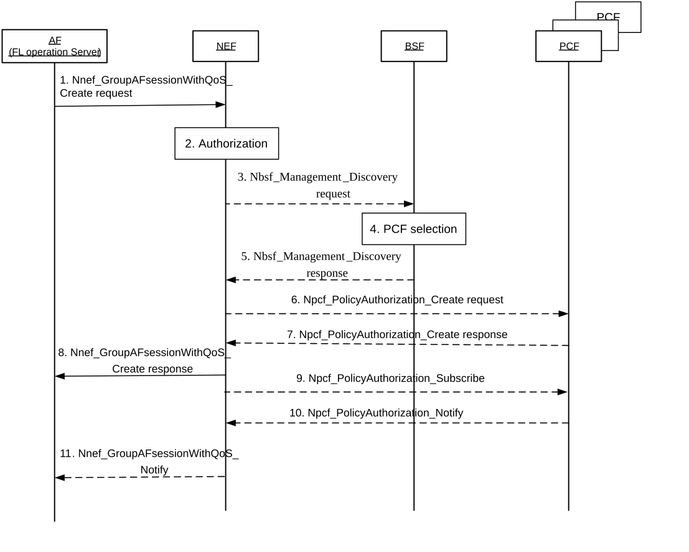

# 6.42 Solution \#42: FL operation support by 5GS based on AF session with required QoS provided by Application Server

## 6.42.1 Description

This solution maps to KI#7 and KI#6 described in clause 5.

Based on KI#7 objective, Federated Learning between UE(s) and Application Function requires significant computation both on UE and Model provider Application Function to execute one round/iteration of the FL task. For each iteration the server selects FL members (UEs) that will participate in this iteration, perform relevant configuration, download the global model, relevant model parameters and then wait for the UE(s) to report back with the updated local model. Only if enough UE(s) report back, the iteration will be considered successful else the iteration may be abandoned. Given this, to ensure most of the iteration are successful to in turn generate an optimum global model i.e. to avoid straggling devices (devices which do not report back in time or do not respond on configuration by the server) it is beneficial if 5GS can expose relevant network status/information to aid the Application Function to select the FL members with best chance for a successful iteration. The selection of devices for a given iteration is in the scope of AF. However, the 5GS can aid the AF to make intelligent decisions (best chance for a successful iteration within a given period) regarding FL member selection.

The following is the assumption in this solution:

\- How the candidate list of UE(s) is selected to participate in each iteration of Federated Learning is in scope of the Application Function.

The following outlines the salient features of this solution:

\- The AF sends a request to reserve resources for AF session to the NEF which includes AIML group information, AIML group performance information. The AIML group information consists of External Group ID or list of candidate UEs selected by the AF to participate in an FL iteration, Area of Interest. The AIML group performance information includes Maximum latency for the AIML group, Maximum packet loss rate in UL, Maximum packet loss rate in DL, Duration for the requested QoS, Minimum number of UEs in the AIML group.

\- If multiple UE(s) from the AF group is served by the same PCF, the NEF may trigger a Npcf_GroupPolicyAuthorization_Create request towards the PCF with UE address(es), AF Identifier, Flow description(s), AIML Group performance information, AIML session indicator as input parameters. The NEF includes AIML session indicator if the Nnef_GroupAFsessionWithQoS_Create request in step 1 includes the AIML Group Performance container.

\- If the PCF determines that the SMF serving the UE needs updated policy information, the PCF issues a Npcf_SMPolicyControl_UpdateNotify request with updated policy information about the PDU Session. The QoS flow binding shall ensure that, when the PCF provisions the PCC rule in SMF which contains the AIML group performance information and AIML session indicator, the PCC rule is bound to a new QoS Flow and no other PCC rule is bound to this QoS Flow.

The procedure for AF request for required QoS for the potential list of UE(s) that are selected by AF for participation in an iteration of Federated Learning is illustrated in Figure 6.42.2-1.

## 6.42.2 Procedures

Figure 6.42.2-1: Procedure for AF request for required QoS for the potential list of UE(s) that are selected by AF

1\. The AF sends a request to reserve resources for AF session using Nnef_GroupAFsessionWithQoS_Create request message (AF Identifier, Flow description(s) or External Application Identifier, QoS reference, DNN, S-NSSAI, AIML group information, AIML group performance information) to the NEF. The AIML group information consists of External Group ID or list of candidate UEs selected by the AF to participate in an FL iteration, Area of Interest. The AIML group performance information includes Minimum and Maximum latency for the AIML group, Minimum and Maximum packet loss rate in UL, Minimum and Maximum packet loss rate in DL, Duration for the requested QoS, Minimum number of UEs in the AIML group. Maximum Requested bandwidth DL/UL is the maximum bandwidth in DL/UL for all the UEs included in the AIML group information. Maximum latency for the AIML group is the maximum reporting delay acceptable for all the UEs included in the AIML group information. Maximum packet loss rate in UL/DL is the maximum packet loss rate acceptable for all the UEs included in the ALML group information. Duration for the requested QoS is the time for which requested QoS is required for all the UEs included in the AIML group information. Minimum number of UEs in the AIML group indicates the minimum number of UEs which for which the requested QoS can be provided for the list of UEs included in the AIML group information.

Editor's note: It is FFS whether additional parameters are sent from AF as AIML group performance information.

2\. The NEF assigns a Transaction Reference ID to the Nnef_GroupAFsessionWithQoS_Create request. The NEF authorizes the AF request and may apply policies to control the overall amount of QoS authorized for the AF. If the authorization is not granted, the NEF replies to the AF with a Result value indicating that the authorization failed.

3\. The NEF uses the External Group ID or list of UE addresses in step 1 to sends a Nbsf_Management_Discovery request to BSF to discover the PCF(s) serving the UEs of the indicated group in the AF request.

If the AF is considered to be trusted by the operator, the AF uses the Npcf_PolicyAuthorization_Create request message to interact directly with PCF(s) to request reserving resources for an AF session or sends a Nbsf_Management_Discovery request to BSF to discover the PCF(s) serving the UEs.

4\. The BSF performs PCF discovery based on the input provided by the NEF in step 3.

5\. The BSF sends a Nbsf_Management_Discovery response including the list of PCF(s) serving the UEs of the indicated in AIML group information provided by the AF.

If the AF is trusted by the operator, the BSF sends a Nbsf_Management_Discovery response including the list of PCF(s) associating to the UEs of the AIML group provided by the AF, in which each PCF may be associated to different UEs of the indicated group.

6\. If multiple UE(s) from the AF group is served by the same PCF, the NEF may trigger a Npcf_GroupPolicyAuthorization_Create request towards the PCF with UE address(es), AF Identifier, Flow description(s), AIML Group performance information, AIML session indicator as input parameters. The NEF includes AIML session indicator if the Nnef_GroupAFsessionWithQoS_Create request in step 1 includes the AIML Group Performance container.

7\. For request received from the NEF in step 6, the PCF determines whether the request is authorized and notifies the NEF if the request is not authorized. If the request is authorized, PCF derives the required QoS parameters based on the information provided in the ALML group performance container and determines whether this QoS is allowed (according to the PCF configuration) and notifies the result to the NEF.

When the PCF authorizes the service information from the AF, it generates a PCC rule by deriving the QoS parameters of the PCC rule based on the service information, AIML Group performance information and includes the AIML session indicator.

If multiple UE(s) from the AF group is served by the same PCF, the PCF sends Npcf_GroupAuthorization_Create response with the result (success or failure) associated with the list of UEs for which policy authorization was successful and reason for failure for the list of UEs for which policy authorization failed.

If the AF is trusted by the operator, the PCF sends the Npcf_GroupPolicyAuthorization_Create response message directly to the AF.

If the PCF determines that the SMF serving the UE needs updated policy information, the PCF issues a Npcf_SMPolicyControl_UpdateNotify request with updated policy information about the PDU Session. The QoS flow binding shall ensure that, when the PCF provisions the PCC rule in SMF which contains the AIML group performance information and AIML session indicator, the PCC rule is bound to a new QoS Flow and no other PCC rule is bound to this QoS Flow.

Steps 6 and 7 are repeated for all the PCFs identified in step 5.

8\. The NEF keeps track of the result included step 7 from all the PCFs identified in step 5. If minimum UEs in the group with requested QoS parameter is provided in step1, and the results from all PCFs matches or exceeds the minimum UEs in the group with requested QoS parameter, the NEF sends a Nnef_GroupAFsessionWithQoS_Create response message (Transaction Reference ID, Result, list of UEs in the AIML group for which the requested QoS is allowed) to the AF where the Result indicates that the request is granted. The UEs in the AIML group for which the QoS is allowed is included in the response only when the response from PCF(s) to NEF in step 7 indicates requested QoS for UE(s) is not allowed for all the UEs belonging to the AIML group provided as input in step 1.

9\. The NEF shall send a Npcf_PolicyAuthorization_Subscribe message to the PCF(s) to subscribe to notifications of Resource allocation status. The PCF responds with a Subscription Corelation ID which allows the NEF to track all the subscription notification unique to each UE in step 8.

10\. When the event condition is met, e.g. the establishment of the transmission resources corresponding to the QoS update succeeded or failed, the QoS target can no longer be fulfilled, QoS monitoring parameters the PCF sends Npcf_PolicyAuthorization_Notify message to the NEF notifying about the event. The PCF includes the event information and Notification correlation information which identifies the AIML group AF session.

If the operator trusts the AF, the PCF(s) sends the Npcf_PolicyAuthorization_Notify message directly to AF.

11\. When the NEF receives the Npcf_PolicyAuthorization_Notify for all the UEs for the request was granted in step 8, the NEF sends Nnef_GroupAFsessionWithQoS_Notify message with the event reported by the PCF(s) to the AF i.e. QoS resource allocated for all the UEs for which the request was granted in step 8 with the Transaction Reference ID.

## 6.42.3 Impacts on services, entities and interfaces

NEF:

\- New service operation to assist resource reservation for list of UEs provided by the AF.

\- Provides AIML session indicator to the PCF.

BSF:

\- Extend support for BSF management discovery service operation to discover the serving PCF(s) to include list of UEs provided by the AF.

PCF:

\- New service operation for group policy authorization when multiple UEs are served by the same PCF.

\- Handles the policy authorization request from the NEF and generates PCC rule by deriving the QoS parameters of the PCC rule based on the service information, AIML Group performance information and includes the AIML session indicator.
