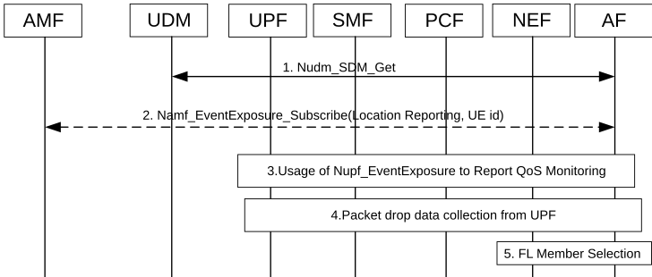

# 6.43 Solution \#43: FL member selection

## 6.43.1 Description

This solution is proposed to address Key Issue \#7: 5GS Assistance to Federated Learning Operation.

This solution proposed that application server determine the UE groups for FL operation based on the user consent subscription information, UE's location, end to end delay and packet drop for the UE.

## 6.43.2 Procedures

### 6.43.2.1 Procedure for AF directly collection information for FL member selection

Figure 6.43.2.1-1: Procedure for FL member selection

1\. The AF retrieves the user consent subscription data, indicating whether the network is allowed to expose UE related 5GC information, for the UEs in the candidate list from the UDM (via NEF if AF is untrusted) by invoking Nudm_SDM_Get service operation.

2\. \[Optional\]The AF requests the location reporting of the UEs from the AMF (via NEF if AF is untrusted) by invoking Namf_EventExposure_Subscribe (Location Reporting).

The AF should maintain the candidate UE list itself before FL member selection, and include the Target UE Identifier(s) for the UEs in the candidate list in the request as described in clause 5.6.7 of TS 23.501 \[3\], which is same for step 2 and step 3.

3\. The AF initiates direct notification of Qos Monitoring procedure for delay information for the UEs in the candidate list, as defined in steps 1a-5 of clause 6.4.2.1 of TS 23.548 \[10\].

4\. The AF requests user plane information, e.g. Throughput UL/DL, Packet transmission, Packet retransmission, for the UEs in the candidate list from UPF.

NOTE 1: How to collect data from UPF will depend on the outcome of FS-UPEAS SID.

5\. The AF selects FL members based on user consent subscription data from UDM, UE location from AMF, and delay and packet drop information reporting from UPF.

NOTE 2: AF may keep monitoring the information from AMF/UPF/UDM to update FL members.

## 6.43.3 Impacts on services, entities and interfaces

AF:

\- Supporting user consent subscription data collection from UDM.

\- Supporting FL member selection based on the information from AMF, UDM and UPF.

UDM:

\- Supporting user consent information of whether the network is allowed to expose UE related 5GC information.

UPF:

\- Supporting to report user plane information to AF.
