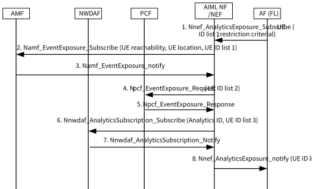

# 6.44 Solution \#44: 5G assisted FL member selection for application request

## 6.44.1 Description

This solution is applied to KI#7: 5GS Assistance to Federated Learning Operation.

This solution supports AF sends request to 5GS for a list of UEs with one or multiple restriction criterial, for example:

\- UEs in Connected state.

\- UEs in different location information.

\- UE QoS monitoring threshold.

\- Service Experience threshold.

The AIML function maybe co-located with NEF or deployed standalone and used for external exposure to assist 5G AIML service. AIML function / NEF sends assistance information request to 5GC according to the restriction criterial that received from AF and determines / reduces the UE list according to the feedback from 5GC. For example, AIML function / NEF requests AMF to provide the UEs activated status and location information, AIML function / NEF requests PCF to provide the QoS monitoring information and NWDAF to provide Service Experience analytics, AIML function / NEF reduces the UE list step by step based on all these received information from AMF and NWDAF, and sends the final potential UE list to AF.

## 6.44.2 Procedures

Figure 6.44.2-1: 5G assisted FL member selection for application request with restriction criterial

1\. AF sends the request to the AIML NF / NEF with the Target of reporting set as UE ID list 1 and the restriction criterial as described in clause 6.44.1.

2\. AIML NF / NEF may send Namf_EventExposure_Subscribe message to AMF(s) and the event type sets to UE reachability and UE location for the UE ID list 1 that received from AF.

3\. AMF(s) send the UE reachability and UE location information to AIML NF / NEF. AIML NF / NEF filters the UE ID list 2 from UE ID list 1 based on the received UE reachability and UE location information from AMF(s) and the restriction criterial from AF.

4\. AIML NF / NEF sends Npcf_EventExposure_Subscribe message to PCF(s) to request to QoS monitoring information (e.g, the UL and DL Packet delay) for UE ID list 2.

5\. PCF responses the QoS monitoring information for UE ID list 2 to AIML NF / NEF. AIML NF / NEF filters the UE ID list 3 from UE ID list 2 based on the received QoS monitoring information and the restriction criterial from AF.

6\. AIML NF / NEF sends Nnwdaf_AnalyticsSubscription_Subscribe to NWDAF(s) to request the UE QoS monitoring prediction for the UE ID list 2.

7\. NWDAF sends the requested analytics result to AIML NF / NEF for UE list 3. AIML NF / NEF filters UE ID list 4 from UE ID list 3 based on the received Analytics result and the restriction criterial from AF.

NOTE 1: Steps 2-3, steps 4-5 and steps 6-7 may be performed in different sequence which depends on AIML NF / NEF implementation.

NOTE 2: This solution can also applied to other restriction criterial that requested by AF.

8\. AIML NF / NEF sends the UE ID list 4 to AF.

## 6.44.3 Impacts on services, entities and interfaces

AI ML NF:

\- receive request from AF for a list of UE with the restriction criterial.

\- determines the UE list based on the received information from 5GC and the restriction criterial from AF.

\- expose the potential UE list to AF.
