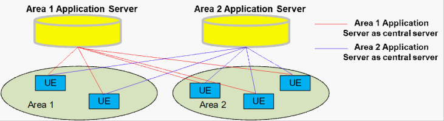
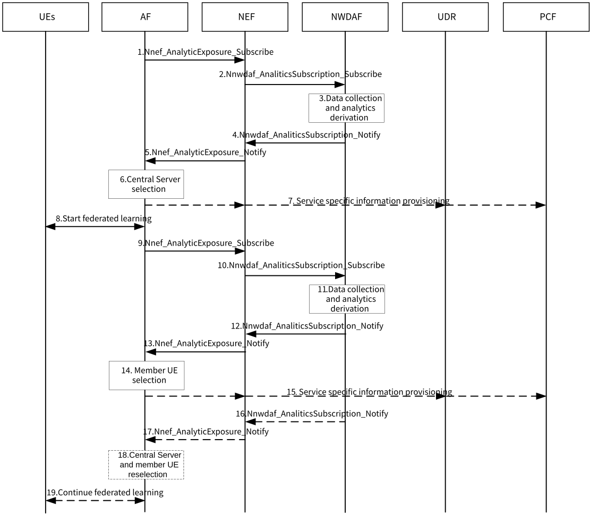

# 6.45 Solution \#45: Improving FL performance by selecting central application server with 5GC's assistance

## 6.45.1 Description

This solution addresses the following aspect of Key Issue \#7 "5GS Assistance to Federated Learning Operation".

\- How to assist AF to increase the FL performance (e.g. to manage latency divergence) among UEs when the application server receives the local ML model training information from different UEs in order to perform global model update.

In federated learning, an increase of communication delay for anyone of member UE will cause a delay for overall FL progress. In application AI/ML based FL, the member UEs may be served by different application servers. Figure 6.45.1-1 presents an example that FL central server may distributed in different area.

Figure 6.45.1-1: Using Different Application Server as Central Server

NOTE: It is assumed that there is only one central server in each round of FL.

It is obvious that using different application server as FL central server will achieve different performance (e.g. overall packet delay, traffic rate, etc.). To improve the overall performance of FL, how to select appropriate central server of application AI/ML based FL should be considered. The AF should be able to determine the best central server for one or multiple rounds of FL with 5GC's assistance to improve the overall FL performance. During FL operation, due to the member UE's mobility, the AF should be able to change the central server dynamically. On the other hand, due to UE mobility, UE status and application behavior changes, it is not optimal if some member UEs are still served by the chosen central server, the AF may change the member UE(s) dynamically and change central server in parallel.

## 6.45.2 Procedures

Figure 6.45.2-1: Procedure of FL Central Server Selection

1-2. The AF sends Analytics subscription to the NWDAF via NEF. The parameters should include:

\- Analytics ID(s) ("DN Performance" is mandatory, "UE Mobility", "Network Performance" and others are optional);

\- Member UE(s);

\- Application ID(s);

\- Application server instance address(es);

\- The target time period;

\- A flag indicating that whether suggested server list is required;

\- Other parameters related to the Analytics ID(s);

3\. The NWDAF collects data from related NF(s) and derives the analytics. The input data of "DN performance" are mainly provided by the AF. The input data of other Analytics ID (e.g. "UE Mobility", "Network Performance" ) may be provided by other NFs (e.g. AMF, NRF). This may include:

\- Time delay between member UE(s) and the application servers;

\- Maximum latency divergence between member UE(s) and different application server;

\- Traffic rate for member UE(s) communicating with the application servers;

\- Packet loss rate of communications between member UE(s) and the application servers;

\- Other results related to the analytics ID(s);

Optionally, the NWDAF derives the suggested list of application server(s) (sorting in descending order) according to the above analytics based on the AF's requirement in step 1.

NOTE 1: How the AF assists NWDAF to do "DN performance" analytics is out of the scope of this study.

4-5. The NWDAF sends the analytics report or the suggested list of application server(s) to the AF via NEF.

6\. The AF selects the best application server as the FL central server based on local internal logic and the analytics results or the suggested list received from NWDAF. The AF may update the subscription to NWDAF based on the final decision.

7\. Optionally, the AF may send policy related information (e.g. AM or SM policies related information) to PCF.

8\. The AF sends notify to the selected central server with the FL related information. The central server starts FL with the member UE(s).

9-10. The AF sends Analytics subscription to the NWDAF via NEF for the member UE(s). The parameters may include:

\- Analytics ID(s) ("DN Performance", "UE Mobility", "Abnormal behaviour", "Network Performance");

\- Member UE(s);

\- Application ID(s);

\- Application server instance address(es);

\- The target time period;

\- Other parameters related to the Analytics ID(s).

11\. The NWDAF collects data from related NF(s) (e.g. AF, AMF, NRF, SMF) and derives the analytics.

12-13. The NWDAF sends the analytics report to the AF via NEF.

14\. The AF selects the best member UE(s) as the FL clients based on local internal logic and the analytics results received from NWDAF. The AF may update the subscription to NWDAF based on the final decision.

15\. Optionally, the AF may send policy related information (e.g. AM or SM policies related information) to PCF.

16-17. The NWDAF may continuously send new analytics report or new suggested list of application server(s) based on the subscription of the AF in step 1 and 9.

18\. The AF may reselect the central server and member UE(s) based on local internal logic and information received from NWDAF.

19\. If the central server changed, the AF sends notification to the original server and the new central server. The original central server then may send the FL context to the new central server. The new central server continues the FL with member UE(s). Similarly, if the member UE(s) changed, the AF sends notification to the original member UE(s) and the new member UE(s). The original member UE(s) then may send the FL context to the new member UE(s). The new member UE(s) continues the FL with central server.

NOTE 2: How the new central server and the new member UE(s) get the FL context should be determined by AF.

## 6.45.3 Impacts on services, entities and interfaces

NWDAF:

\- Derive the latency divergence in "DN Performance".

\- \[OPTIONAL\] Derive the suggested list of application server based on the analytics result.

AF:

\- Determine the best application server based on internal logic and information received from NWDAF.

\- Determine the best member UE(s) based on internal logic and information received from NWDAF.
