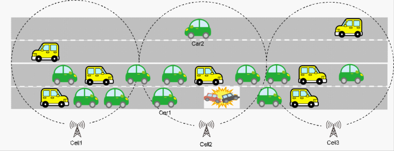
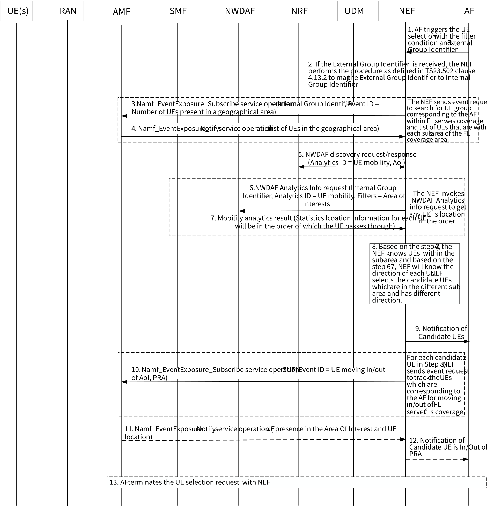

# 6.46 Solution \#46: 5GS assistance for FL member selection based on UE's location and direction

This contribution addresses KI#7 on "5GS Assistance to Federated Learning Operation" by providing 5GS assistance for FL member selection based on UE's location and direction.

## 6.46.1 Description

The example shown in Figure 6.46.1-1 is very common for vehicles since they can only move on the road which makes that geographically close vehicles tend to have similar data sets from in-vehicle cameras or sensors. To avoid to select these nodes with similar data sets for FL training, 5GC needs to ensure that the distance between each candidate UE provided to the FL server is adequately apart.

Moreover, in Figure 6.46.1-1, car1 and car2 have the same location information from 5GC point of view since they are in the same cell, however they are running at different direction on the road and may have different data sets from in-vehicle camera. For location based FL member selection, this situation need to be considered which means finer granularity (e.g. cell level instead of TA level) and more specifically defined (e.g. same or opposite direction) of location information is needed.

Figure 6.46.1-1: Recognition of traffic accident

## 6.46.2 Procedures

Figure 6.46.2-1: 5GS assistance for FL member selection based on UE's location and direction

NOTE: The functionality of the NEF has been extended in this solution in order to support the assistance of the FL member selection for the given FL operation.

**Step 1:**

In order to select the UEs with different data sets which are within the FL coverage area, the AF requests 5GS assistance to support the UE selection by considering the UE's current location and direction. AF includes the External Group Identifier and the following filtering info as part of the FL UE selection request:

**FL Coverage Area:** The FL training server's coverage area, i.e. the coverage area of the FL training server where the selected UEs participate in the FL operation.

When providing a target area for FL, the AF may provide sub-areas (e.g. cell 1,2,3), and provide a maximum number of UEs (e.g. 2) that should take part in FL from each sub-area.

\- Direction: Select the UE with the different direction in the FL coverage Area.

**Step 2:**

NEF translates the External Group Identifier to Internal Group Identifier (the procedure as defined in clause 4.13.2 of TS 23.502 \[4\]).

**Steps 3-4:**

In order to locate the group of UEs which are associated with the AF and are within the FL training server coverage (i.e. FL coverage area), and more specifically, they can be identified to be located at the sub-area of the FL coverage area, for each sub-area of the FL coverage area, the NEF invokes Namf_EventExposure_Subscribe service operation with the Internal Group Identifier, event ID = Number of UEs present in a geographical area. AMF will provide a list of UEs that are within the sub-area of the FL coverage area to the NEF using the Namf_EventExposure_Notify service operation.

**Step 5:**

In order to identify the appropriate NWDAF which can provide UE mobility analytic output in order to get the UE direction, the NEF needs to select the suitable NWDAF by initiating the NWDAF discovery request (Analytics ID = UE mobility, AOI = Target AOI) with Internal Group Identifier.

**Steps 6-7:**

The NEF invokes NWDAF Analytics Info request (Internal Group Identifier, Analytics ID = UE mobility, Filters include "AOI (e.g. cell 1, 2, 3))"). NWDAF will then provide a list of UEs and UE's location in the order of which the UE passes through to the NEF. Then the NEF gets the corresponding statistics of UE mobility and the UE's direction (as defined in clause 6.7.2 of TS 23.288 \[6\]).

**Steps 8-9:**

Based on the step 3-4, the NEF knows the list of UE in the FL coverage area and each UE's location within the sub-area. Based on the step 6-7, NEF will know the direction of each UE. NEF selects the candidate UEs based on the request from AF. For example, the NEF selects two UEs in each cell and the NEF selects the UE with the different direction within the FL coverage Area. The NEF notifies AF for such UE candidate list.

NOTE: Example of how NWDAF can retrieve UE's direction can be found in solution \#26 from TR 23.700‑81 \[11\].

**Steps 10:**

The NEF also needs to consider the list of UEs which are now within the FL coverage area, but may move out of the FL coverage area. Therefore, for each UE in the candidate list in steps 8-9, the NEF invokes the Namf_EventExposure_Notify service with UE ID = SUPI, Event ID=UE moving in/out of AOI (PRA) to keep track the movement of the UE(s) in/out of the AOI.

**Steps 11-12:**

If step 10 identifies any UE which is moving out of the FL coverage area, the NEF may further notify AF of the given UE which is moving out the coverage.

**Step 13:**

When AF completes the FL operation, it terminates the 5GS assistance support for the UE selection based on the UE's location and direction.

## 6.46.3 Impacts on services, entities and interfaces

NEF:

\- New service operation to provide the candidate UE selection function.

\- Select the candidate UE list based on the Interested area information, maximum number of UEs in sub-area and UE direction request provided by AF.

AF:

\- Request NEF to provide the candidate UE list based on the Interested area information, maximum number of UEs in sub-area and UE direction.

NWDAF:

\- If multiple UE locations are provided, they will be in the order of which the UE passes through.
