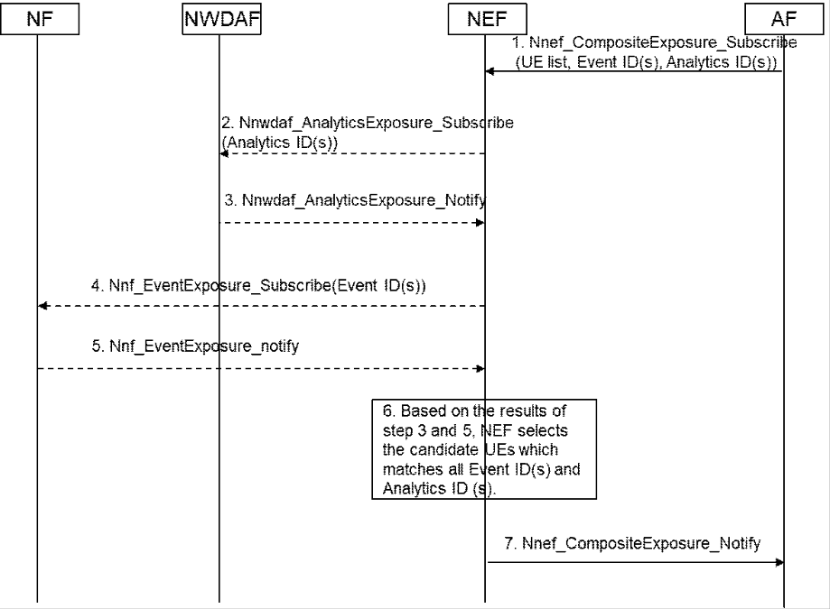

# 6.47 Solution \#47: Composite exposure service for 5GS assistance to FL member selection

## 6.47.1 Description

Editor's note: Trusted AF scenario (to perform this functionality at existing NFs or a new NF) is FFS.

Several kinds of 5GS exposure information have been proposed to assist FL member selection in TR 23.700-80 such as EventExposure from AMF, PCF, SMF/UPF and AnalyticsExposure from NWDAF in solution \#17, \#18, \#19, \#21 and \#24. A combination of these exposures are often necessary according to various FL member selection policies of actual use cases.

This solution proposes a new service (CompositeExposure) of NEF which combines current EventExposure service and AnalyticsExposure service. AF can indicate multiple Event ID(s) and Analytics ID(s) according to different FL member selection policies. For each Event ID and Analytics ID, NEF provides the service as defined in clause 5.2.6 of TS 23.502 \[4\] to gather the information from the corresponding NFs. Then NEF replied to AF with UE information that has matched all indicated Event ID(s) and Analytics ID(s).

## 6.47.2 Procedures

Figure 6.47.2-1: Composite exposure service for 5GS assistance to FL member selection

**Step 1:**

AF requests to subscribe Nnef_CompositeExposure service indicating parameters as follows:

\- UE list (GPSIs, SUPIs, External Group Identifiers, IP addresses).

\- Analytics ID(s), Analytics Filter Information and etc. as defined in clause 5.2.6.16.2 of TS 23.502 \[4\].

\- Event ID(s), Event Filter(s) and etc. as defined in clause 5.2.6.2.2 of TS 23.502 \[4\].

\- Area info (TA/Cell ID, geographical area).

\- Expiry time.

**Steps 2-3:**

NEF operates Nnef_AnalyticsExposure service as defined in clause 5.2.6.16 of TS 23.502 \[4\].

NOTE: If AF sends UE ID set as IP addresses, NEF retrieves the corresponding SUPIs using the procedure in clause 4.15.10 of TS 23.502 \[4\].

**Steps 4-5:**

AF operates Nnef_EventExposure service as defined in clause 5.2.6.16 of TS 23.502 \[4\].

**Step 6:**

NEF selects candidate UEs based on the results of steps 2-5.

**Step 7:**

NEF replies to AF with the following information.

\- Candidate UE list.

\- Event information (defined on a per Event ID basis).

\- Analytic information (defined on a per Analytic ID basis).

## 6.47.3 Impacts on Existing Nodes and Functionality

NEF:

\- Provide new service operation of composite exposure.

AF:

\- Request NEF to provide the candidate UE list by indicating necessary Event ID(s) and Analytics ID(s).
