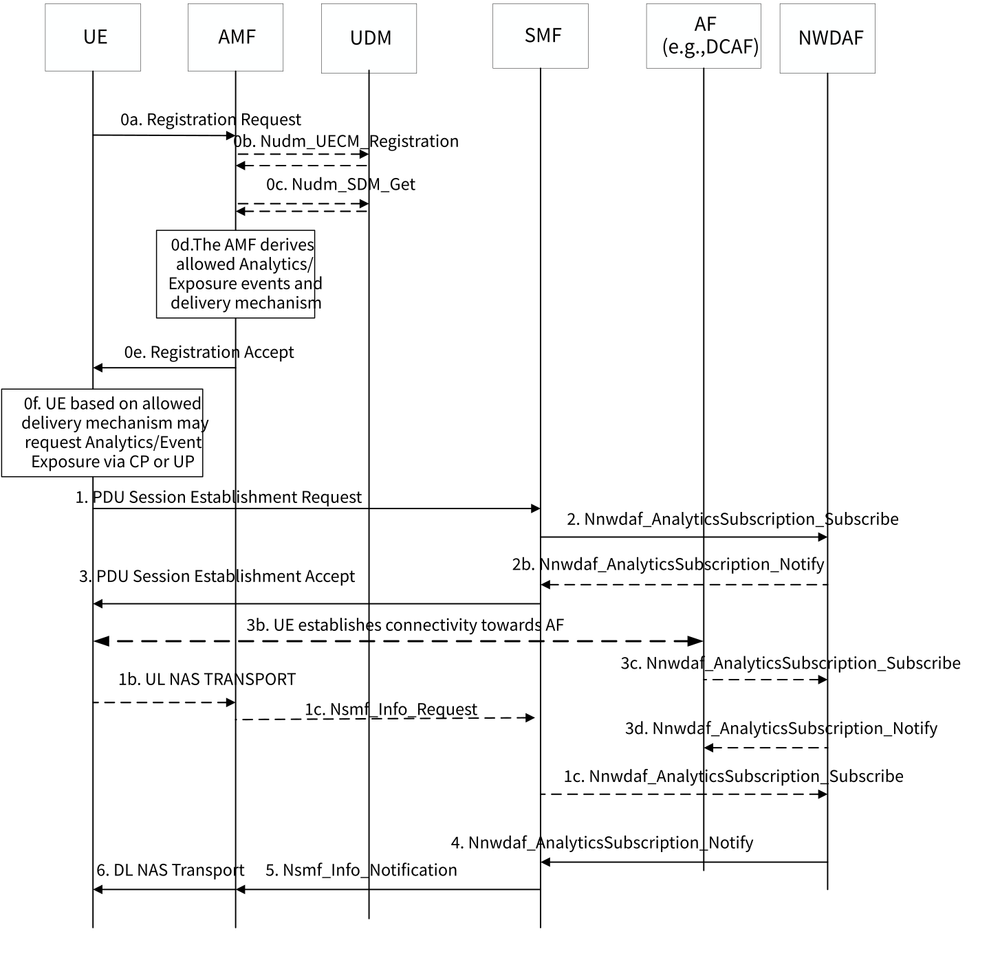

# 6.5 Solution \#5: 5GC information exposure to UE

## 6.5.1 Description

This solution addresses Key Issue \#2, in particular this solution addresses:

\- "Whether and for which purpose there is a need for 5GC to expose information or data analytics to the UE, and what are the information or data analytics that can be provided by 5GC to the UE to assist the Application AI/ML operation at the UE side"; and

\- "How the 5GC exposes such information or data analytics to the UE".

Current 3GPP System support for Event exposure is intended for authorized 3rd parties, in particular monitoring of specific events for a UE in the 5G System, which are provided via NEF, and these include Monitoring capability, Provisioning capability, Policy/Charging capability and Analytics reporting capability.

In addition, Network Functions (NFs) can subscribe to UE related event notifications, e.g. Analytics information generated by the System. Note that the Event Notification service is neither available for Access Networks nor for UEs, this means that the availability of system information is limited to the Core Network. Nevertheless, application AI/ML operations are distributed in nature, e.g. AI/ML operation splitting between AI/ML endpoints, where these points are distributed at both the AF and UE side. The same occurs with other AI/ML operations such as AI/ML model/data distribution and sharing or Distributed/Federated Learning. Furthermore, some of these applications require quick access to System Performance locally, this means that system information needs to be available in both at the AF and the UE. E.g. Application AIML operations, e.g. Federating Learning may require knowing planned change of bitrate, latency, or reliability. This is further supported by both, TS 22.261, clause, 6.40 and the approved FS_AIML with Use Cases and motivation as to why it is advantageous for the UE to use exposed Network capabilities to aid AIML operations running on the 5GS. E.g. In TS 22.261, clause 6.40, it is stated that "an AI/ML model can be distributed from an NW endpoint to the devices when they need it to adapt to the changed AI/ML tasks and environments", the effect of these tasks and environments has a different impact on UE and AF and therefore it is clear that both AF and UE may benefit from exposed Network information.

The 5GS is already capable of providing System performance Prediction event notification to an authorized External party, hereafter referred to as AF, and the current mechanism relies on NWDAF and Network Exposure functionality to generate such predictions and expose them to 3rd parties via the NEF.

Therefore, System Performance predictions and System Performance Statistics may also be provided to the UE by extending existing mechanism. Clause 6.5.1.1 describes new enhancements to 5G System Exposure procedures to provide Systems Performance Statistics and Prediction the UE.

### 6.5.1.1 New capabilities to support UE System Performance and Predictions requests

As described in clause 6.2.8 of TS 23.288 \[6\], the AF collects data from the UE, based on an SLA that determines amongst other things, the information the UE Application shares with the AF. When applications in the UE collect data from the Network, however, the end-to-end request goes beyond UE-to-AF, as the data is collected from several other Network Functions in the network. Furthermore, there might be cases where, while the UE is allowed to collect information on some Network services/capabilities, it might not be allowed to collect information on other Network capabilities, e.g. the UE may be allowed to collect User Data Congestion, but not DN performance without the explicit consent of the DN Service Provider. Therefore, there should be a Network controlled mechanism to enable the UE access to data collection as a whole or more specific data collection, through data collection policies, that pertains to certain Network capabilities/services,e.g. the UE may be allowed to collect Analytics or subscribe to notifications providing Analytics or Monitoring events only for delivery over the User Plane but not the Control Plane. Operator policies may be used to determine which analytics a UE is allowed to collect. While the UE may be allowed to collect certain analytics and predictions, the UE may not be capable or configured to collect analytics via User Plane or Control Plane. Therefore the UE may provide its capability upon registration.

If the UE is capable and configured to receive System Performance Statistics and Prediction information, the UE may indicate its capability during the Registration procedure by including a new IE, e.g. "Network Exposure capability. The UE may also indicate whether it is capable of receiving Network Exposure Capability Notifications and or Analytics over the CP, UP or both". The UE capability may be used by the AMF/UDM to determine whether to check if the UE is allowed to request and get Network Exposure information, and whether notifications/responses can be sent over the CP, UP or both. With this information along with the AIML operation type the UE is interesting about, the Network may fetch relevant Analytic ID(s).

To control whether the UE is allowed to access Network Exposure information,, the network operator may enable "Network Exposure Access" permission as part of the UE's subscription record stored in the UDM. During the registration procedure, the AMF checks whether the UE is allowed to request/subscribe to Network Exposure events, which Analytics and Network Exposure information the UE is allowed to collect, and applicable information delivery mechanism (i.e. UP, CP or both). The AMF fetches the allowed Analytic IDs based on the AI/ML Operation Types, the correlation ID provided by the UE and the DCAF address if applicable, from the UDM. The mapping from AI/ML operation type is provided/updated by the AF to the UDM, either directly (if the AF is in the operator's trusted domain) or via the NEF (if the AF is outside the operator's trusted domain). What Network Analytics are associated to what AIML operation types is Application Layer specific and outside 3GPP scope. The AMF may provide in the Registration accept message whether the UE is allowed to collect Analytics and/or Network Exposure event notifications. Furthermore, the AMF may indicate a specific information delivery mode, and if the information delivery mode is either "UP" or "Both", the AMF may also provide the address of the AF providing access to Analytics and Event Notification (e.g. FQDN or IP address of the DCAF), if the AF is allowed to access the AF (e.g. based on SLA). The AIML AF may provide the address of a relevant DCAF using existing External Parameter Provisioning procedures.

If the information delivery mode indicates the UE may use only "UP" or "Both", the UE may request a PDU Session Establishment to enable connectivity toward an AF (e.g. DCAF) and request Analytics and/or Event Notification and have those Analytics and Event Notification delivered over the UP, using the DCAF as an anchor.

If the information delivery mode indicates "CP" or "Both", and the UE is allowed according to its subscription and policy, the UE may request, during a PDU Session Establishment procedure, System Performance Statistics and Predictions through a NF such as the SMF. The UE request the establishment of a PDU Session using an S-NSSAI associated to the application AIML operation the UE is requesting Analytics for.

The SMF may subscribe, on behalf of the UE, to specific Analytics and AI/ML operation types. Two alternatives are provided, the SMF may get the list of allowed Analytics/Network Exposure events that the UE may request from the UDM by providing the AIML operation type and correlation ID, or the SMF may send this information to the NDWAF and the NWDAF can get the relevant Analytics from the UDM. The UE provides the input parameter required for these Analytics during the PDU Session Establishment Request, e.g. within the PCO IE, or it may provide the input parameters using UL NAS TRANSPORT message, through the AMF. The AMF may convey this information to the NWDAF or it may forward it to the SMF controlling the AI/ML PDU Session.

The UE may provide, in addition to the parameters specified in clause 6.1.3 of TS 23.503 \[5\], the PDU Session ID, AI/ML operation type(s) and mapping of AI/ML operation types to relevant Analytic IDs. If the UE does not have the mapping of AI/ML operation type(s) to Analytic IDs, the UE may provide a Correlation ID shared by the AF endpoint counterpart, which the UE may obtain through the application layer. During the PDU Session Establishment procedure, the SMF may, based on Operator Policy and/or Analytics, provide in the PDU Session Establishment Accept message, e.g. within the PCO IE, the relevant Analytics IDs that are supported by the selected NWDAF (the one available in the AI/ML Network Slice the AI/ML operation is registered to).

Alternatively, if e.g. based on policy or Network Analytics, e.g. showing high CP load, the SMF may route Analytics of Network Exposure notification through the UP, either directly through the UPF (via N4) or through an AF such as DCAF, over N4, using existing packet forwarding functionality.

The NWDAF may use the AI/ML operation type(s) and mapping of AI/ML operation types to relevant Analytic IDs or the AIML operation type and the Correlation ID to fetch relevant trained ML Models to generate Analytics requested by the UE.

The NWDAF uses the PDU Session ID and SMF ID to notify relevant Analytics to the UE.

## 6.5.2 Procedures

Figure 6.5.2-1 Operation specific System Performance Statistics and Predictions requested by UE

0a-c: During the Registration procedure, the AMF checks whether the UE is allowed to request/subscribe to Network Exposure events, which Analytics and Network Exposure information the UE is allowed to collect, and applicable information delivery mechanism (i.e. UP, CP or both). The AMF may get the allowed Analytic IDs and relevant Network Exposure event, based on the AI/ML Operation Types and the correlation ID provided by the UE, from the UDM. If the UE is configured with an Analytics list, the UE may provide the list as an alternative to the AIML operation type. The mapping from AI/ML operation type is provided/updated by the AF to the UDM, either directly (if the AF is in the operator's trusted domain) or via the NEF (if the AF is outside the operator's trusted domain). The AMF may provide in the Registration accept message an indication of whether the UE is allowed to collect Analytics and/or Network Exposure event notifications. Furthermore, the AMF indicates information delivery mode, and if the information delivery mode is either "UP" or "Both", the AMF may also provide the address of the AF providing access to Analytics and Event Notification (e.g. FQDN or IP address).

If the information delivery mode indicates the UE may use only "UP" or "Both", the UE may request a PDU Session Establishment to enable connectivity toward an AF (e.g. DCAF) and request Analytics and/or Event Notification.

0d. Based on the allowed delivery mechanism, the UE may determine whether it requests subscription to Analytics and/or Event Notifications, via UP, CP or Both.

1\. If the UE is allowed to request Analytics and/or Event Notifications, via CP, the UE subscribes to analytics information either using a PDU Session Establishment or PDU Session Modification procedure and it provides input parameters e.g. within the PCO IE, including AI/ML Operation Type, e.g. "Model Distribution", "Operation Split", "Federated Learning". The SMF may use the application AI/ML Operation type, and correlation ID to correlate associated AF request and generate the list of Analytic IDs:

1b. Alternatively, the UE may use a UL NAS TRANSPORT message to convey inputs, indicating the PDU Session ID, S-NSSAI and DNN this request is intended for. The AMF uses this information to select the correct SMF.

1c. The AMF uses a Nsmf_info_Request Service operation to relay the request to the SMF identified in 1b.

2\. The SMF subscribes, on behalf of the UE, to Analytics associated specific AI/ML operation type (s) provided by the UE. Two alternatives are provided, the SMF may get the list of allowed Analytics/Network Exposure events the UE may request from the UDM by providing the AIML operation type and correlation ID, or the SMF may send this information to the NDWAF and the NWDAF can get the relevant Analytics from the UDM. The NWDAF uses the correlation ID to identify Analytics relevant to specific application.

2b. The NWDAF may provide an immediate response to the NWDAF Service consumer, providing an Event Notification or relevant Analytics.

3 The NWDAF notifies the NWDAF service consumer (i.e. the SMF acting on behave of the UE) with the analytics information by invoking Nnwdaf_AnalyticsSubscription_Notify service operation, based on the request from the NWDAF service consumer, e.g. Specific AI/ML Operation Type).

4\. The SMF uses a Nsmf_info_Notification Service operation to relay the "Nnwdaf_AnalyticsSubscription_Notify" message to the UE via the AMF. Alternatively, based on policy or access to Network Analytics, e.g. showing high CP load, the SMF may route Analytics of Network Exposure notification through the UP, either directly through the UPF (via N4) or through and AF such as DCAF.

5\. The AMF uses a DL NAS TRANSPORT message to relay the "Nnwdaf_AnalyticsSubscription_Notify" message carrying the System Performance Statistics and Predictions requested by the UE. Alternatively, the message may carry a Endpoint address where the UE could fetch the System Performance Statistics and Predictions, via the User Plane.

## 6.5.3 Impacts on services, entities and interfaces

UE:

\- Support for subscription to Network Performance Analytics and Predictions.

\- Support sending relevant Performance Measurement to the relevant Application AIML operation.

SMF:

\- Support for relaying UE subscription to Network Performance Analytics and Predictions.

\- Support delivery mechanism and forwarding of packets to UPF or DCAF.

AMF/UDM:

\- Support for UE authorization to request and obtain Network Performance Analytics and Predictions.

\- Provide in the Registration accept message whether the UE is allowed to collect Analytics and/or Network Exposure event notifications.

\- Provide in the Registration accept message whether the UE is allowed to collect Analytics and/or Network Exposure event notifications.

DCAF:

\- Support relaying of Analytics and Predictions forwarded by SMF.
