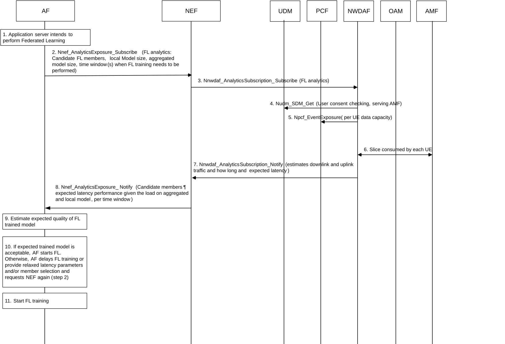

# 6.6 Solution \#6: Federated learning analytics as assistance to AI/ML application server

## 6.6.1 Description

This solution addresses aspects of key issue \#7 on 5GS Assistance to Federated Learning Operation and key issue \#3 on 5GC Information Exposure to authorized 3rd party for Application Layer AI / ML Operation.

The solution allows 5GS to assist the FL application server to decide on which UEs should be part of FL process.

The 5GS assistance process to FL operation is explained in 4 key steps, and detailed procedures are available in clause 6.6.2:

1\. AI/ML application server prepares for running FL training by collecting information such as FL aggregated model size, potential FL members, model aggregation latency target in each iteration, expected number of iterations and time interval between each iteration, local model (i.e. model at learner side) size, time window when FL training needs to be performed. FL application server can run an initial candidate selection algorithm to derive an initial list of candidate FL members.

2\. Based on the above information, the AI/ML application server requests 5GS assistance, by providing the following input information to 5GS about local FL model training:

\- Candidate FL members.

\- Local model (i.e. model at learner side) size and aggregated model (i.e. model at server side) size (to determine what kind of latency could be provided for the model size).

\- Expected number of iterations and time interval for each iteration.

\- Optionally, Preferred time window when FL training needs to be performed.

\- Optionally, FL transmission start time indicates when FL training operation prefers to start.

\- QoS requirements(e.g. includes 5QI, QoS Characteristics) indicates the QoS requirements of the QoS flow of the FL transmission.

\- Optionally, a request for geographical distribution of the UEs.

\- S-NSSAI.

3\. 5GS collects candidate FL members' data:

\- Radio link quality (RSRP) for each candidate FL member.

\- Expected QoS estimate in the area for FL training.

\- QoS configuration in PCF / capability for the FL transmission QoS flow (if UEs can meet the required QoS (2MBPS) in the specified areas).

\- User Consent check for each member. The user consent checking is enhanced to verify whether user corresponding to each member authorizes the AF to consume its data or analytics for AIML operations.

4\. 5GS estimates and provides following analytics / predictions to the application server:

\- For each candidate member, expected latency performance given aggregated and local model size, in the form of an estimate of latency per iteration and/or an average latency over the duration for the FL process.

\- A suggested time window for a better result for the FL operation, e.g. when network is going to be congested at the preferred time window when FL training needs to be performed, or when the NWDAF estimates that latency could be drastically reduced by delaying the FL training process to a later point in time.

\- Geographical distribution information for the candidate members, if requested by the AI/ML application server for further processing its FL member candidate selection algorithm.

\- QoS flow level data (QFI, QoS flow Bit Rate, QoS flow Packet Delay, Packet transmission, Packet retransmission), as the statistics/prediction of QoS for the FL traffic transmission.

## 6.6.2 Procedures

The procedure for federated learning analytics as assistance to AI/ML application server is depicted in figure 6.6.2-1.

Figure 6.6.2-1: Federated learning analytics as assistance to AI/ML application server

1\. The AF prepares for running FL training by collecting information such as FL aggregated model size, potential FL members, model aggregation latency target in each iteration, expected number of iterations and time interval between iterations, local model size, time window(s) when FL training needs to be performed. It determines an initial list for candidate FL members.

NOTE 1: This step happens at AI/ML application layer and is out of 3GPP scope.

2\. Based on the information collected in step 1, the AF requests 5GS assistance and request for analytics with Analytics ID set to FL analytics, and provides the following input information to 5GS about FL model training:

\- Candidate FL members: a list of candidate FL members Ids, i.e. one or more SUPI(s) or Internal Group Identifier(s), as derived in step 1.

\- Local model size: to determine uplink traffic requirements for the UEs participating to FL operation and which kind of latency could be provided for this model size.

\- Aggregated model size: to help 5GS to determine the QoS requirements and what kind of latency could be provided for this model size.

\- Expected number of iterations (e.g. 5000, 10000) and time interval between iterations. These two information will then determine the overall time needed by FL training operation.

\- Optionally, preferred time window(s) when FL training operation for the group needs to be performed.

\- Optionally, FL transmission start time indicates when FL training operation prefers to start.

\- S-NSSAI.

\- Optionally, a request for geographical distribution of the UEs.

\- QoS requirements (e.g. includes 5QI, QoS Characteristics) indicates the QoS requirements of the QoS flow of the FL transmission.

NOTE 2: Privacy issues need to be addressed by SA WG3.

3\. NEF forwards the request to NWDAF.

4-6. NWDAF collects data about candidate FL members from NFs:

\- Radio link quality (RSRP) for each candidate UE/member, via OAM.

\- Network capacity (to support expected traffic) estimate in the area for FL training. This could require additions to network performance analytics such as e.g. maximum load that a gNB (absolute available throughput) can accept.

\- QoS configuration in PCF / capability for the FL transmission QoS flow (if UEs can meet the required QoS (2MBPS) in the specified areas).

\- User consent checking for each member, from UDM. The user consent checking is enhanced to verify whether user corresponding to each member authorizes the AF to consume its data or analytics for AIML operations.

7-8. NWDAF estimates and informs AF, via NEF, about analytics and predictions, per time window:

\- Candidate members' expected latency performance given aggregated and local model size, per iteration and/or on average. This is needed for the AF to determine the number of members meeting latency target per iteration, as well as the expected number of members not able to meet the latency target during the overall FL training process.

\- Geographical distribution of the member UEs (if requested by the AF in step 2 for further processing in candidate selection algorithm), e.g. list of UEs per tracking areas.

\- QoS flow level data (QFI, QoS flow Bit Rate, QoS flow Packet Delay, Packet transmission, Packet retransmission), as the statistics/prediction of QoS for the FL traffic transmission;

9-11. Based on the received information, the AF can estimate latency performance of FL model training and can take some decision on FL training, such as start or delay FL model training, or increase targeted latency per iteration and start FL, or decide to add FL members and request again assistance from the 5GS for new candidate members, or decide to use another FL selection algorithm.

NOTE 3: These steps happen at AI/ML application layer and are out of 3GPP scope.

## 6.6.3 Impacts on services, entities and interfaces

NWDAF providing new FL analytics on expected latency for candidate FL members, with input parameters provided by AI/ML application server.
