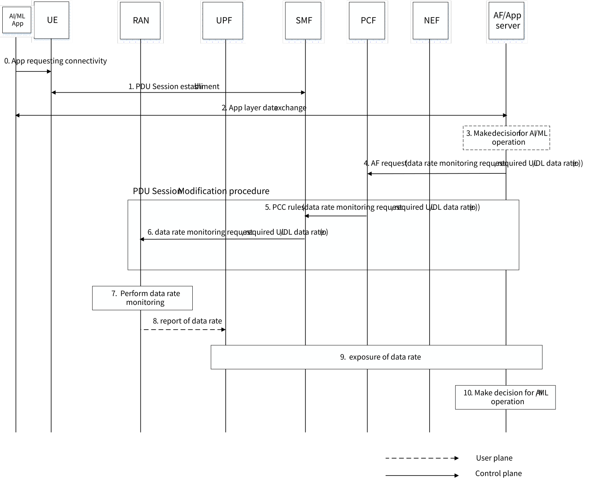

# 6.7 Solution \#7: 5GS information exposure for AI/ML operation

## 6.7.1 Description

Awareness of UE UL/DL data rate at AI/ML application server is beneficial for it to make decision on AI/ML operation. AI/ML application server needs 5GS to provide the supported UL/DL data rate to make the decision on AI/ML operation, e.g. to determine the splitting point for AI/ML model splitting, or to determine the AI/ML model and the size of parameter for AI/ML model downloading. RAN node estimates the supported UL/DL data rate based on the channel condition between RAN node and UE, the bandwidth available for the UE and other factors. That is, the supported/available UL/DL data rate can be treated as the prediction of data rate for the near-future, which is not the mesurement of current data rate. Besides, after AI/ML application server makes decision for AI/ML operation, it may provide 5GS the required UL/DL data rate as the QoS requirement.

If the AI/ML operation last for a short time, e.g. 1s, then one single report of UL/DL data rate from 5GS is enough. Otherwise, data rate monitoring should be performed and feedback to AI/ML application server in order to enable adaptive AI/ML operation, which reflects the changing network conditions in a timely manner. In order to enable 5GS to perform data rate monitoring for AI/ML operation, AF provides 5GS data rate monitoring request information. Data rate monitoring request information may include the following parameters:

\- The direction of data rate monitoring, e.g. UL, DL, or both.

\- Data rate reporting levels.

\- Data rate reporting periodicity.

\- Temporal Validity.

Where Temporal Validity indicates the time interval(s) during which the data rate monitoring request is to be applied. If no data rate reporting periodicity and Temportal Validity are provided, it implies that one shot of reporting is requested by AF. Besides, the required UL/DL data rate may be optionally provided as the QoS requirement, which may be contained in data rate monitoring information or not.

## 6.7.2 Procedures

### 6.7.2.1 Data rate monitoring scheme based on AF session with required QoS

The solution relies on the Setting up an AF session with required QoS procedure and PDU Session Modification procedure in clauses 4.15.6.6 and 4.3.3.2 of TS 23.502 \[4\] respectively, to provision the data rate monitoring request informaiton to the RAN node. Besides, the existing QoS monitoring scheme can be reused for data rate monitoring configuration and reporting.

Figure 6.7.2.1 data rate monitoring procedure

0\. The AI/ML application of UE requests for connectivity.

1\. UE triggers PDU session establishment procedure according to clause 4.3.2.2.1 of TS 23.502 \[4\].

2\. The AI/ML application of UE communicates with AF/App server, e.g. UE may provide the requested AI/ML model, the available AI/ML model in UE, the available computation and energy resource, memory limitation etc.

3\. (Optional) AF/App server makes decision on AI/ML operation based on UE's input and its own conditions. E.g. AF/App server determines the splitting point for AI/ML model splitting, or determine the AI/ML model and the size of parameter for AI/ML model downloading.

4\. Based on the AI/ML operation, AF/App server provision data rate monitoring request information and optionally the required UL/DL data rate (provided if step 3 exists) as the QoS requirement to PCF via NEF based on Setting up an AF session with required QoS procedure in clause 4.15.6.6 of TS 23.502 \[4\]. The data rate monitoring request can be regarded as the AF subscribes to events of DATA_RATE_MONITORING. Alternatively, AF shall subscribe to events of DATA_RATE_MONITORING in AF request separately.

5\. PCF initiates SM Policy Association Modification procedure as defined in clause 4.16.5.2 of TS 23.502 \[4\] to notify SMF about the modification of policies, which further triggers PDU session modification procedure. PCF includes the data rate monitoring request information (and optionally the required UL/DL data rate) in the PCC rules provided to SMF.

6\. SMF configures RAN node to perform data rate monitoring request (or provides RAN node with the required UL/DL data rate) via AMF. The N2 SM information contains QFI(s), the data rate monitoring request ( or the required UL/DL data rate optionally). The data rate monitoring request (together with the required UL/DL data rate optionally) can be associated with PDU session or QoS flow.

7\. RAN node performs data rate monitoring for the PDU session or QoS flow as requested by the network.

8\. Similar as the existing QoS monitoring scheme, RAN node reports data rate monitoring results to PSA UPF in the UL data packets or UL dummy packets.

9\. UPF sends the data rate monitoring results to SMF based on N4 Session Level Reporting procedure. SMF exposes the data rate monitoring results to PCF or local NEF as configured by PCF. E.g. SMF triggers Nsmf_EventExposure_Notify with data rate monitoring results. New event should be defined for data rate monitoring.

10\. AF/App server makes decision on AI/ML operation based on 5GS's input. E.g. AF/App server may change the splitting point for AI/ML model splitting, or change the size of parameter for AI/ML model downloading.

NOTE: If the SMF receives the indication of direct event notification from the PCF and the SMF determines that the L-PSA UPF supports such reporting, the SMF sends data rate monitoring parameters and associated them with the target local NEF or local AF address to the L-PSA UPF via N4 rules. L-PSA UPF obtains data rate monitoring results from NG-RAN node and sends the notification related with data rate monitoring results over Nupf_EventExposure_Notify service operation to local NEF/AF.

### 6.7.2.2 Data rate monitoring scheme based on service information provision

An alternative way for AF to subscribe data rate monitoring is to reuse clause 4.16.5.2 in TS 23.502 \[4\], where AF/NEF provides service information to the PCF without other mandatory parameters (e.g. QoS reference). E.g. AF/NEF may invokes Npcf_PolicyAuthorization_Create Request or Npcf_PolicyAuthorization_Update request or Npcf_PolicyAuthorization_Subscribe Request service operation to provide data rate monitoring information.

## 6.7.3 Impacts on services, entities and interfaces

The proposed solution is based on Rel-17 procedures but some enhancements may be needed to make it possible for the data rate monitoring scheme, such as:

AF:

\- Include data rate monitoring request information in AF request.

PCF:

\- Include data rate monitoring request information in PCC rules.

SMF:

\- Include data rate monitoring request information in N2 SM information towards RAN node.

\- Expose data rate monitoring results to PCF or AF or local NEF.

UPF:

\- Expose data rate monitoring results to SMF or local NEF/AF.

RAN:

\- Send data rate monitoring results to UPF over user plane.
