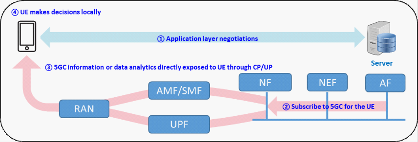
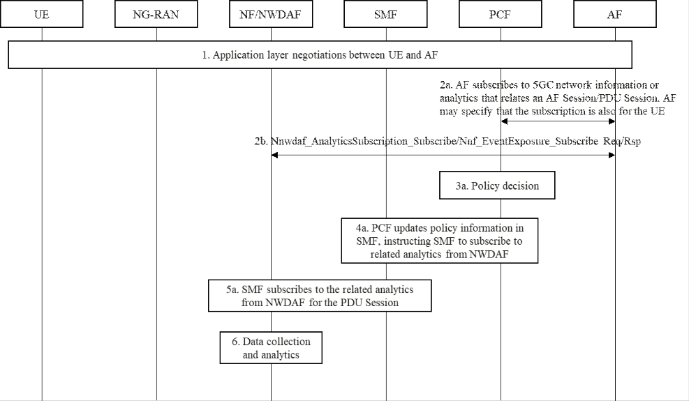
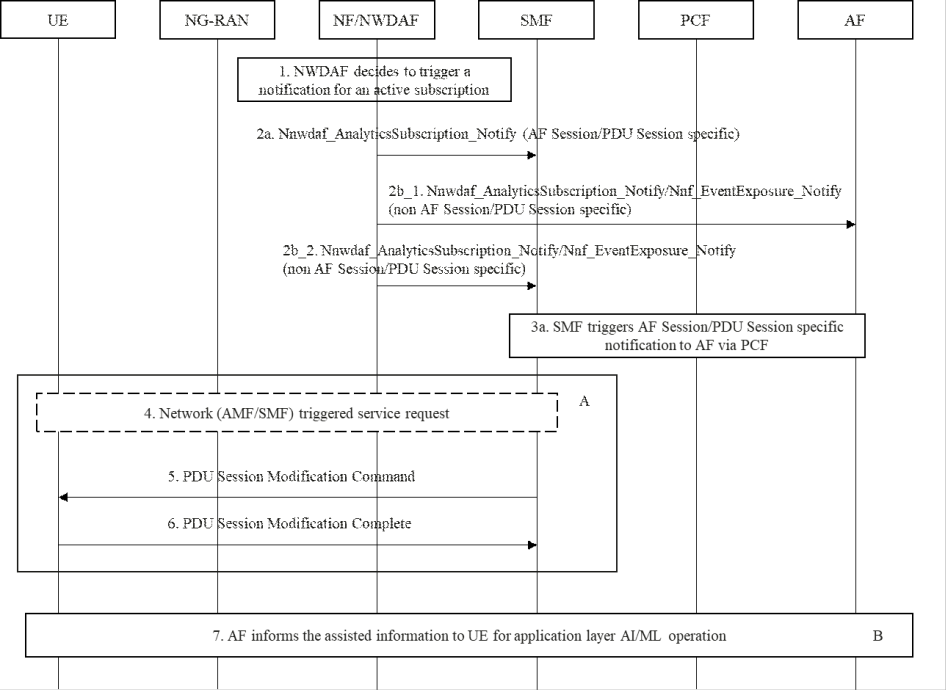

# 6.8 Solution \#8: 5GC information/analytics notification to the AF and the UE

## 6.8.1 Introduction

This solution addresses Key Issue \#2 "5GC information exposure to UE" and Key Issue \#3 "5GC Information Exposure to authorized 3rd party for Application Layer AI / ML Operation".

UE and AF may be notified on 5GC information or analytics with the purpose of triggering decisions on AI/ML operation or application adaptation. Notifications can be related to specific AF Sessions/PDU Sessions, in such case the AF can subscribe to such information via the PCF when the AF Session is created or modified and receive the notification via the PCF. New direct UE notifications on 5GC information or analytics are introduced via SMF/AMF.

## 6.8.2 Description

As described in clause 6.2.1 of TR 22.874 \[8\], AI accelerators are expected to enable the execution of complex AI/ML models directly on UE. The AI/ML models may need to be changed if the environmental conditions are not stable (light distribution in the scene, background noise, time of the day, number and type of objects in the view-field, etc.). Downloading new ML models may be needed as environmental conditions change and also when new ML models become available. AI/ML model size, maximum latency and user experienced DL data rate can be different across different models. If the UE starts to download a model and the DL data rate suddenly decreases after the decision has been made, the download of the new model may be affected with impact on the latency and overall performance of the application. If the application/UE knows that there is a potential QoS change in the DL data rate in the future, it can decide to instruct the UE to pre-fetch in-advance a higher number of AI/ML models to be used for different sets of environmental conditions, or to choose more general AI/ML models that can work under different sets of environmental conditions. The information that is needed in this case is the likelihood of a potential QoS change in the future and information on the estimated upcoming DL data rate in relation to the DL data rate requirements of the different AI/ML models that are supported.

As described in clause 7.4.3 of TR 22.874 \[8\], 5GS can adjust the QoS policies of individual UEs in a Flock to allocate more resources to the UEs that lag and less resources for those that are ahead of the flock, so that the overall result is more efficient for the Synchronous Federated Learning service and for the network operator. The UE can benefit of knowing about the upcoming QoS change due to policy change, for example by anticipating specific tasks that require the current QoS conditions so that they can be finished before the planned QoS change. The information that is needed in this case is the likelihood of a potential QoS change in the future and optionally the information on the QoS profile that the network is planning to apply in the future.

In addition to the QoS Sustainability analytics, the AF may subscribe to the UE Mobility analytics from NWDAF to determine if the UE moves out of an AoI or the Network Performance analytics for an AoI to determine when it is suitable to train ML model in the AoI. The UE may subscribe to the QoS monitoring result from UPF to help UE determine if it can join the FL group.

For all these reasons the UE and 3rd party applications (close to the UE and/or in the cloud) may need to obtain 5GC information or data analytics by subscribing or requesting e.g. QoS Sustainability Analytics from NWDAF to assist its local decision on application AI/ML operations. For example, UE may download V2X AI/ML model from V2X AF/AS. To perform real-time AI/ML inference operations locally to determine application parameters (e.g. automatic driving level, inter-vehicle distance), the UE may need to obtain 5GC information or data analytics, e.g. QoS Sustainability analytics from NWDAF. The problem is how to subscribe 5GC information to the 5GC for the UE, and how the 5GC exposes such information or data analytics to the UE and to the AF. In this solution AF subscribes for both the AF and the UE on the 5GC information and analytics that relate to an AF Session/PDU Session. AF subscribes by operating on the specific AF Session.

The potential solution for 5GC information exposure to UE is shown in Figure 6.8.2-1:

\- UE and AF make some negotiations in the application layer and potentially may determine that:

\- 5GC information (such as network data analytics from NWDAF, UE Location from AMF, etc.) is required for the UE's local decision on application AI/ML operations;

\- UE allows AF to subscribe the 5GC information on behalf of itself.

NOTE: The negotiation between UE and AF is out of 3GPP scope.

\- AF subscribes 5GC information to 5GC for the UE based on application layer negotiation between UE and AF.

\- 5GC information or data analytics can directly be exposed to UE through control plane (i.e. AMF/SMF) or user plane (i.e. UPF).

\- The UE can use 5GC information to make decisions on application AI/ML operations locally.

Figure 6.8.2-1: 5GC information exposure to UE for the subscription by AF

## 6.8.3 Procedures

### 6.8.3.1 AF Subscription for 5GC information or analytics

When the AF wants to subscribe on the 5GC information or analytics for the AF and the UE it triggers the subscription with a request which is addressed to the PCF.

In case the AF is not trusted, the request can reach the PCF or NF/NWDAF through NEF.

Figure 6.8.3.1-1: Procedure of 5GC information/analytics exposure to UE and AF: AF subscription

1\. UE and AF make some negotiations in the application layer.

2a-2b. AF subscribes to network analytics/network information or data analytics.

a\. In case of 5GC information that relate to an AF Session/PDU Session (e.g. Analytics on potential QoS change for a specific AF Session/PDU Session), AF can subscribe via PCF in order to set up or modify an AF application session context for the service (e.g. as in clause 4.2.2.2 of TS 29.514 \[9\]). The AF shall include the information that is requested. As an example, for the analytics on potential QoS change for a specific AF Session/PDU Session, the AF shall include the information needed to identify the specific AF Session/PDU Session, the QoS flows in the AF Session and relevant QoS KPIs for which analytics are requested. The AF may include additional relevant information in this request such as the time interval for the analytics notifications or information that can be used to determine the location(s) for the analytics subscription.

b\. In case of other 5GC information (apart from potential QoS change notification), the AF may directly subscribe the 5GC information for itself or for the UE. The AF may find the NF or NWDAF serving the UE by first querying the UDM.

\- If the notification endpoint is the AF, the subscription procedure is the same as in clause 6.1.1.2 of TS 23.288 \[6\] or clause 4.15.6 of TS 23.502 \[4\].

\- If the notification endpoint is the UE, according to the request of UE, AF subscribes network information to NF using Nnf_EventExposure_Subscribe (Notification Indication(GPSI)) or data analytics to the NWDAF using Nnwdaf_AnalyticsSubscription_Subscribe(Notification Indication(GPSI)). The subscription service operation contains a notification indication (including UE ID, i.e. GPSI) which indicates the NF or NWDAF to send the 5GC information (i.e. network information or data analytics) to the corresponding UE.

3\. PCF decides to update the policy of the PDU Session associated with the AF Session, including also the information provided by the AF in the previous step.

4\. PCF updates policy information to SMF, and instructing also the SMF to subscribe to related network analytics from NWDAF for the PDU Session.

5\. SMF subscribes to the related analytics from NWDAF for the PDU Session. The SMF can use the information in the PDU Session (e.g. 5QIs of related QoS flows, GFBR, MFBR) and the information provided by the AF in step 2 to determine the analytics filter information and/or the analytics target period for the subscription and the relevant thresholds for the QoS Sustainability Analytics.

6\. NWDAF starts to collect and process data for the received request and derives data analytics.

NOTE: SMF may need to update the subscription to NWDAF when the PDU Session is modified and cancel the subscription when the PDU Session or the related QoS flow for which the 5GC information/analytics have been requested is released.

### 6.8.3.2 5GC information or analytics notification to the AF and the UE

Figure 6.8.3.2-1: Procedure of 5GC information exposure to UE and AF: notification to AF and UE

1\. NWDAF or NF decides to trigger a notification for an active subscription, according to collected 5GC information.

2a. In the case of AF Session/PDU Session specific subscription, the NWDAF notifies SMF, e.g. using potential QoS change notification as in clause 6.9 of TS 23.288 \[6\] or according to a notification related to other analytics. The SMF can match the information in the subscription for analytics and the notification received by the NWDAF (e.g. 5QI, QoS KPI information or prediction, time interval information) with the managed PDU Sessions and QoS flows to determine the PDU Sessions for which the analytics apply and the UE that needs to be notified.

2b. In the more general case (e.g. non-AF Session/PDU Session specific subscription):

\- If the notification endpoint is the AF, the NF/NWDAF notifies the AF directly by using Nnf_EventExposure_Notify or Nnwdaf_AnalyticsSubscription_Notify according to the subscription.

\- If the notification endpoint is the UE, the NF/NWDAF notifies the SMF who serves the UE by using Nnf_EventExposure_Notify or Nnwdaf_AnalyticsSubscription_Notify according to the subscription.

3a. The SMF sends an AF Session/PDU Session specific notification to the AF via the PCF. For example in case of potential QoS change notification which is specific for an AF Session/PDU Session, it could be a QoS Prediction Information with the prediction of a specific QoS change event, according to the information received by the NWDAF and the initial subscription performed by SMF on the specific GBR QoS flows, using relevant 5QI, thresholds and other analytics filter information.

UE is notified about the assistance information by either option A or option B. Option A includes step 4 to step 6 and option B includes step 7.

**Option A:**

4\. \[Conditional\] If UE is to be notified and it is in IDLE state, the network will trigger service request, and page the UE.

5\. If the UE needs to be notified, SMF carries the 5GC information received from step 2a (i.e. AF Session/PDU Session specific information) or step 2b_2 (i.e. non-AF Session/PDU Session specific information) for the UE in the PDU Session Modification Command. As an example, in case of a QoS change prediction notification which is specific for a PDU Session, the SMF may send to the UE a PDU SESSION MODIFICATION COMMAND with an additional flag "predicted" indicating a potential change to the PDU Session which may happen in the immediate future. The information in this message may include (e.g. for a GBR flow) the information that the GBR could not be fulfilled in the near future and the information on the QoS that is predicted to be fulfilled. Other information can include an indication of the likelihood of the change to happen and time-related information of when the change is expected to happen. This message can trigger potential AI/ML operation or adaptation in the UE and in the application close to the UE if the UE can use this message to trigger the application. The flag "predicted" allows UE to know this is for the moment "just a prediction" and actual modification may happen in the future.

6\. UE responds with a PDU SESSION MODIFICATION COMPLETE to confirm the reception of the above message.

The UE and the AF may use the information received respectively in step 5 and 3 to trigger AI/ML specific operations in the UE or in the application. As an example, as described in clause 6.2.1 of TR 22.874 \[8\], the UE or the application may decide to pre-fetch in-advance a higher number of AI/ML models to be used for different sets of environmental conditions, or to choose more general AI/ML models that can work under different sets of environmental conditions, if the DL data rate is predicted to drop at some point in the future. These decisions may be implemented because the predicted potential QoS change may prevent UE or application to download new models after the QoS change takes place.

**Option B:**

7\. The AF may inform the UE, via application layer communication, about the assistance information based on the received information from step 2b_1 (i.e. non-AF Session/PDU Session specific information) or step 3a (i.e. AF Session/PDU Session specific information) and local configuration. The application layer communication between the AF and the UE is out of scope of 3GPP.

## 6.8.4 Impacts on services, entities and interfaces

UE:

\- Need to negotiate with AF to enable the AF to subscribe network information or data analytics to 5GC for the UE.

\- Can now receive analytics via a PDU SESSION MODIFICATION COMMAND. In case of potential QoS change notification, the flag "predicted" allows the UE to know this is for the moment "just a prediction" and actual modification may happen in the future.

\- Need to identify the application running over the Packet Filter or the QoS flow for which the predicted QoS change notification is received in NAS message, and notify the corresponding application. Since applications are already notified of QoS change events (as in clause 10.1.19 of TS 27.007 \[14\]), the same existing mechanism can be extended to support additional notifications such as those related to AF Session/PDU Session specific information (e.g. potential QoS change events).

SMF/PCF:

\- For AF Session/PDU Session specific information, support subscription to analytics from NWDAF and sending the network information or data analytics to the corresponding UE according to the notification indication.

AF:

\- Support subscribing for network information or data analytics from 5GC for the UE, and need to carry notification indication for the UE in the subscription service operation.

NF/NWDAF:

\- Notify AMF/SMF about network information or data analytics.

\- Notify AF or SMF about the non-AF Session/PDU Session specific network information or data analytics.
