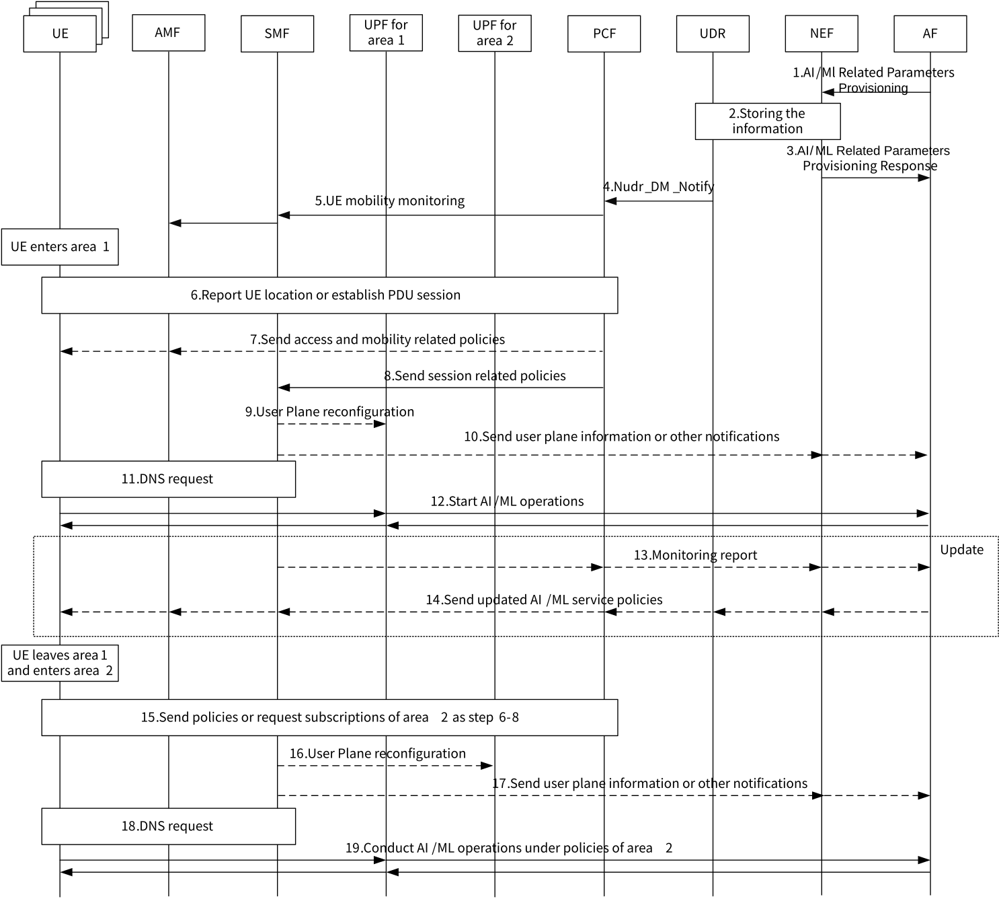

# 6.9 Solution \#9: AF influence on AI/ML operations related policies

## 6.9.1 Description

This solution addressed Key Issue \#4 "Enhancing External Parameter Provisioning ".

Application AL/ML related services are sensitive to network perception capability and network condition. For example, AI/ML model inference needs to perceive UE mobility. Different inferences have different requirements to latency and bandwidth. To achieve group training of multiple UEs, AI/ML training has higher requirements to network condition and stability. Due to the uncertainty of UE mobility and other behaviours and the instability of network condition (e.g. bandwidth, latency, jitter, etc.) in mobile communication network, on the one hand, a better network condition is required; and on the other hand, it is also needed to flexibly configure and adjust AI/ML related policies when the application layer conducts AI/ML model inference or model training.

In this solution, AF can provide configuration information required for AI/ML operations related policies and dynamically update it with assistance of monitoring, network condition and UE behaviours, etc. The configuration information required for AI/ML operations related policies can be provisioned based on different aspects (e.g. different area, different time period, different network condition etc.). Based on the configuration information, network can choose UE members dynamically (e.g. to choose whoever enter the particular area).

The NEF event exposure service is enhanced by providing a unified parameter provisioning service API dedicated for AI/ML operations, which may add the policy related parameters of AI/ML operations based on Nnef_TrafficInfluence or Nnef_ServiceParameter, including routing, QoS related policies and network resource monitoring subscription, etc.

For example, there is a big sports game going on in area 1 and the network is congested while there are just a few UEs in area 2 and the network is smooth. It seems more appropriate to make specific policies for area 1 that to offload some AI/ML operations to local network and servers when UE enters area 1, and specific policies for area 2 that put more AI/ML operations to the default server.

In the procedure section, we provide the procedures of AF influence on area-based AI/ML operations related policies as an example. In the procedure of AF influence on area-based AI/ML operations related policies, the network assists in discovering UEs that enter the specific area. When the UEs leave the area, the policy will be removed or updated based on the parameters of the new area and the monitoring results.

## 6.9.2 Procedures

### 6.9.2.1 Procedure of AF influence on area-based AI/ML operations related policies

Figure 6.9.2.1-1 shows the procedure of AF influence on AI/ML operations related area-based policies.

Figure 6.9.2.1-1: Procedure of AF influence on area-based AI/ML operations related policies

1\. The AF sends configuration information required for AI/ML operations. The NEF event exposure service is enhanced by providing a unified parameter provisioning service API dedicated for AI/ML operations, which may add the policy related parameters of AI/ML operations based on Nnef_TrafficInfluence as described in clause 4.3.6.2 of TS 23.502 \[4\] or Nnef_ServiceParameter as described in clause 4.15.6.7 of TS 23.502 \[4\], including routing, QoS related policies and network resource monitoring subscription, etc. The AF may indicate in the request:

\- Area (1…max);

\- Spatial Validity Condition (cell or TAI list);

\- Filter information that may include one or more than one of the following parameters:

\- Application ID;

\- S-NSSI;

\- DNN;

\- Time duration: Start time and end time;

\- Target UE(s) (any UE);

\- One or more than one of the following information:

\- IP address of AI/ML server;

\- \[Optional\] AI/ML operation related subscription (e.g. network resource monitoring, QoS monitoring);

\- \[Optional\] Traffic Routing requirements (e.g. traffic filtering information, UP path management event subscription, etc.);

\- \[Optional\] QoS requirements (e.g. QoS reference, QoS parameters, etc.);

2\. The NEF stores the AF request information in the UDR.

3\. The NEF responds to the AF.

4\. The PCF receives a Nudr_DM_Notify notification of data change from UDR. The service Nudr_DM_Notify need to be extended according to the policy related parameters received in step 1.

5\. The PCF subscribes to SMF to receive notification about change of UE location in the Spatial Validity Condition. The SMF then sends location monitoring to the AMF to obtain the UE location presence in Spatial Validity Condition (i.e. Presence Reporting Area). Or, the PCF may provide Policy Control Request Triggers to the AMF indicating a specific UE for e.g. location change.

6\. When the UE(s) enter area 1, the AMF reports that the UE(s) have entered area 1, or the PCF may determine the UE(s) are in area1 when the UE(s) establish PDU session.

7\. The PCF, based on the information received from the AF, sends access and mobility related policies received from the AF to the AMF and the UE(s) using the procedure defined in clause 4.2.4.3 of TS 23.502 \[4\].

8\. The PCF, based on the information received from the AF, sends session related policies to the SMF that may include routing rules, related QoS rules, charging rules and resource monitoring related information and AI/ML related subscription.

NOTE: In this solution, external parameters (e.g. AM policy information, SM policy information) are only supported to provision to same PCF.

9\. The SMF may take appropriate actions to reconfigure the User plane of the PDU Session, such as determining a target DNAI and adding, replacing or removing a UPF in the data path to e.g. act as an UL CL or a Branching Point.

10\. The SMF may send a notification to the AF that User Plane has changed or other notifications based on the subscription from the AF.

11\. The UE(s) initiate DNS request to get IP address of AI/ML server of area 1.

12\. The UE(s) start AI/ML operations with AI/ML server under the policies of area 1. For example, with better policy assurance, the UE(s) can get more network resources to assist in training and inference.

13\. The SMF sends a notification to PCF based on the subscription in step 1 and step 8. The PCF forwards the notification to the AF.

14\. The AF may update the configuration information based on the information received in step 13 and send the updated configuration to the PCF.

15\. The UE(s) leave area 1 and enter area 2. The PCF removes the policies of area 1 or updates the policies of area 1 to area 2 based on the information received from the AF in step 1.

16\. The SMF may take appropriate actions to reconfigure the User plane of the PDU Session, such as determining a target DNAI and adding, replacing or removing a UPF in the data path to e.g. act as an UL CL or a Branching Point.

17\. The SMF may send a notification to the AF that User Plane has changed or other notifications based on the subscription from the AF.

18\. UE(s) initiate DNS request to get IP address of AI/ML server of area 2.

19\. UE(s) start AI/ML operations with AI/ML server under the policies of area 2.

## 6.9.3 Impacts on services, entities and interfaces

PCF:

\- Support receiving additional parameters provisioned by AF for AI/ML service policies.

NEF:

\- Provide a unified parameter provisioning service API for AI/ML operations;

\- Support receiving AI/ML operations related parameters from AF including routing, QoS and network resource monitoring, etc.;

UDR:

\- The services (e.g. Nudr_DM_Notify) are extended according to the AI/ML operations related parameters.
