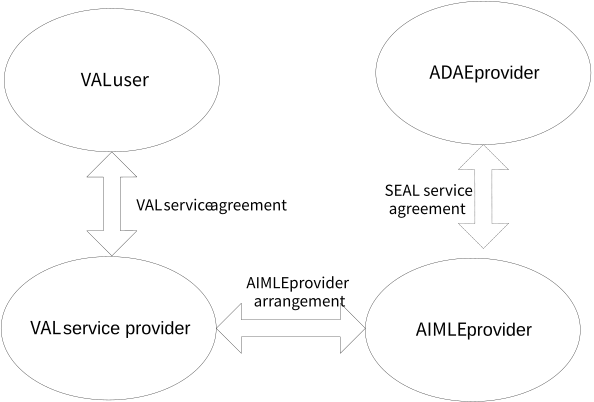

# 10 Business Relationships

Figure 5-1 shows the business relationships that exist for the AIMLE functionality and that are needed to support a single VAL user.

Figure 5-1: Business relationships for VAL services

The VAL user belongs to a VAL service provider based on a VAL service agreement between the VAL user and the VAL service provider. The VAL service provider can have VAL service agreements with several VAL users. The VAL user can have VAL service agreements with several VAL service providers.

The VAL service provider can have AIMLE provider arrangements with multiple AIMLE providers and the AIMLE provider can have PLMN operator service arrangements with multiple home PLMN operators. The AIMLE provider and the VAL service provider or the home PLMN operator can be part of the same organization, in which case the business relationship between the two is internal to a single organization.

The AIMLE provider can have SEAL service agreements with other SEAL service providers and in particular ADAE provider if needed for utilizing AIMLE services for ADAE analytics. Such arrangements allow the ADAE provider to support the ML training and management related to ADAE analytics services via utilizing AIMLE provider services. The AIMLE provider and the ADAE service provider can be part of the same organization, in which case the business relationship between the two is internal to a single platform.

NOTE: The ADAE provider can have further arrangements with PLMN operator and VAL service provider; however, this is not shown in the figure.
