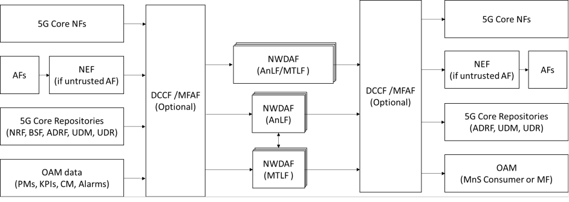

# 4 Analysis of AI/ML support in 3GPP

## 4.1 AI/ML related use cases and requirements in 3GPP

### 4.1.1 Description

3GPP SA1 has identified use cases (3GPP TR 22.874 \[12\]) and requirements (in 3GPP TS 22.261 \[10\]) for the support of AI/ML model distribution, transfer, training for various applications (e.g., video/speech recognition, robot control, automotive), also covering the support for Distributed AI training/inference based on direct device connection.

The use cases provided in 3GPP TS 22.261 \[10\] are covering:

\- AI/ML operation splitting between AI/ML endpoints: The AI/ML operation/model is split into multiple parts according to the current task and environment.

\- AI/ML model/data distribution and sharing over 5G system: multi-functional mobile terminals might need to switch the AI/ML model in response to task and environment variations. Hence, 5GS needs to support the distribution and sharing of the model.

\- Distributed/Federated Learning over 5G system: The cloud server trains a global model by aggregating local models partially trained by each end devices.

Based on these use cases, there are Stage 1 requirements which are relevant for application enablement..

### 4.1.2 Analysis

Table 4.1.2-1 lists the 3GPP specifed AI/ML service requirements which may have impact on application enablement layer. The requirements are grouped by functional areas.

Table 4.1.2-1: 3GPP AI/ML related requirements from 3GPP TS 22.261 \[10\] which may have impact on application enablement layer

| Sl. | Requirements                                                                                                                                                                                                                                                                                                                                                                                                                                                                                                                                        | Application enabler layer relevance                                                                                                                                                                                                                                                                                                                             |
|-----|-----------------------------------------------------------------------------------------------------------------------------------------------------------------------------------------------------------------------------------------------------------------------------------------------------------------------------------------------------------------------------------------------------------------------------------------------------------------------------------------------------------------------------------------------------|-----------------------------------------------------------------------------------------------------------------------------------------------------------------------------------------------------------------------------------------------------------------------------------------------------------------------------------------------------------------|
| 1   | Direct Network Connection                                                                                                                                                                                                                                                                                                                                                                                                                                                                                                                           |                                                                                                                                                                                                                                                                                                                                                                 |
| 1.1 | Based on operator policy, 5G system shall be able to provide means to predict and expose predicted network condition changes (i.e. bitrate, latency, reliability) per UE, to an authorized third party.                                                                                                                                                                                                                                                                                                                                             | The exposure of predicted network condition changes may require enhancements of the enablement layer (which may consume NEF / OAM services and provide abstraction on top).                                                                                                                                                                                     |
| 1.2 | Subject to user consent, operator policy and regulatory constraints, the 5G system shall be able to support a mechanism to expose monitoring and status information of an AI-ML session to a 3rd party AI/ML application.                                                                                                                                                                                                                                                                                                                | The AI-ML session is an application layer session between two or more AI/ML endpoints. Such monitoring / exposure has impact on application enablement layer.                                                                                                                                                                                                   |
| 2   | Direct Device Connection                                                                                                                                                                                                                                                                                                                                                                                                                                                                                                                            |                                                                                                                                                                                                                                                                                                                                                                 |
| 2.1 | Based on user consent, operator policy and trusted 3rd party request, the 5G system shall be able to dynamically add or remove specific UEs to/from the same service (e.g. a AI-ML federated learning task) when communicating via direct device connection.                                                                                                                                                                                                                                                                                        | The 5GS support to add or remove group members from the same “application service” is a task within AIML enablement scope since the ML/FL members of the group are application layer entities (e.g. application client at VAL UE side).                                                                                                                         |
| 2.2 | Based on user consent, operator policy and trusted 3rd party request, the 5G system shall be able to support means to monitor the QoS characteristics (e.g. data rate, latency) of traffic transmitted via direct device connection or relayed by a UE, and 5G network expose the monitored information to the 3rd party.                                                                                                                                                                                                                           | The AI-ML session is an application layer session between two or more AI/ML endpoints (VAL UEs in direct connection). QoS monitoring, prediction negotiation and exposure to the 3rd party has impact on application enablement layer since it involves monitoring/predicting and exposing application or e2e QoS parameters for the AI-ML sessions. |
| 2.3 | Subject to user consent, operator policy and trusted 3rd party request, the 5G system shall be able to provide means the network to predict and expose QoS information changes for UEs’ traffic using direct or indirect network connection (e.g., bitrate, latency, reliability).The 5G system shall be able to support a mechanism for a trusted third-party to negotiate with the 5G system for a suitable QoS for direct device connections of multiple UEs exchanging data with each other (e.g. a group of UEs using the same AI-ML service). |                                                                                                                                                                                                                                                                                                                                                                 |
| 2.4 | Subject to user consent, regulation, trusted 3rd party’s request and operator policy, the 5G network shall be able to expose information to assist the 3rd party to determine candidate UEs for data transmission via direct device connection (e.g. for AIML model transfer for a specific application).                                                                                                                                                                                                                                | The assistance of 5GS to the 3rd party (ASP/vertical) to determine candidate UEs lies within SA6 scope for the case since the ML/FL member UEs are application layer entities (e.g. application client at VAL UE side).                                                                                                                              |
| 2.5 | Subject to user consent, operator policy, regulation and trusted 3rd party’s request, the 5G network shall be able to expose information of certain UEs using the same service to the 3rd party (e.g. to assist a joint AIML task of UEs in a specific area using direct device communication)                                                                                                                                                                                                                                | The assistance of 5GS to the 3rd party (ASP/vertical) to expose information of members of a certain service may be within SA6 scope for the case where the ML/FL members of the group are application layer entities (e.g. application client at VAL UE side).                                                                                       |

## 4.2 AI/ML related stage 2 work in 3GPP

### 4.2.1 Description

#### 4.2.1.1 3GPP SA2

3GPP SA2 started from Rel-16 to investigate the AI/ML support focusing on the main two aspects.

1\) AI-ML support in NWDAF

Network analytics and AI/ML is deployed in the 5G core network via the introducing of NWDAF consider the support of various analytics types that can be distinguished using different Analytics IDs, e.g., “UE Mobility”, “NF Load”, etc. as elaborated in 3GPP TS 23.288 \[2\]. Each NWDAF may support one or more Analytics IDs and may have the role of: (i) AI/ML inference called NWDAF AnLF, or (ii) AI/ML training called NWDAF MTLF or (iii) both.

Figure 4.2.1.1-1: NWDAF architecture for analytics generation based on trained models

Figure 4.2.1.1-1 illustrates the various NWDAF deployment flavours and their respective input data sources and the potential consumer for analytics output results. Specifically, NWDAF relies on various sources of data input including data from 5G core NFs, AFs, 5G core repositories, e.g., NRF, UDM, etc., and OAM data, including performance measurements (PMs), KPIs, configuration management data and alarms. An NWDAF may provide in turn analytics output results to 5G core NF, AFs, and OAM. Optionally, DCCF and MFAF may be involved to distribute and collect repeated data towards or from various data sources.

For FL use cases, in Release 18, 3GPP defined federated learning amongst different NWDAF MTLFs where ML model training is running in multiple local MTLFs.

2\) Network assistance for AI-ML services

As part of AIMLSys, enhancements to 5GC (as specified in 3GPP TS 23.501 \[5\] clause 5.46) are specified for assisting the AI/ML operations in the application layer (between one or more AI/ML users and AI/ML server). In this direction, NEF may assist the AI/ML application server in scheduling available UE(s) to participate in the AI/ML operation (e.g. Federated Learning). Also, 5GC may assist the selection of UEs to serve as FL clients, by providing a list of target member UE(s), then subscribing to the NEF to be notified about the subset list of UE(s) (i.e. list of candidate UE(s)) that fulfil certain filtering criteria.

#### 4.2.1.2 3GPP SA4

SA4 has an ongoing study on AI and ML for Media (3GPP TR 26.927 \[11). This study aims to identify relevant interoperability requirements and implementation constraints of AI/ML in 5G media services. This study includes media-based AI/ML use cases and architecture considerations related to media services.

#### 4.2.1.2 3GPP SA5

3GPP SA5 in Rel-17 has provided a work on AI/ML management (3GPP TS 28.105 \[9\]) focusing on AI/ML capabilities (e.g. ML training MnS/MF) at OAM side. 3GPP TS 28.105 \[9\] specifies the AI/ML management capabilities and services for 5GS where AI/ML is used, including management and orchestration (e.g. MDA, see 3GPP TS 28.104 \[3\]). In this work, an ML training Function (MLT) playing the role of ML training MnS producer is introduced which may consume various data from 5GS for ML training purpose and provides the training outputs to other management functions in OAM.

### 4.2.2 Analysis

Both 3GPP SA2 and 3GPP SA5 have investigated the use of AI/ML for either enhancing core and management domain operations, or for providing assistance for 3rd party AI/ML services. Current solutions from other WGs do not cover:

\- Support application layer aspects on top of 5GC/OAM, where the ML models and the ML/FL member are application layer entities at the server or UE side.

\- Support for vertical use cases, by providing support capabilities for the application-layer AI/ML endpoints at the vertical/enterprise domains.

\- Support for AI/ML operations, where the ML entities belong to different domains (e.g. edge/cloud, vertical premises) and networks (PLMNs/NPNs).

\- Support cases where the VAL UE plays role in the AI/ML model lifecycle/ workflow. As example, the VAL UE can be selected as FL client which is not considered in other 3GPP workgroups.

\- Support AIML application service continuity (e.g. undisrupted FL service continuity)and adapting to dynamic changes (e2e QoS downgrades, app mobility, ML member availability change).

\- Support for ML model splitting and distribution.
