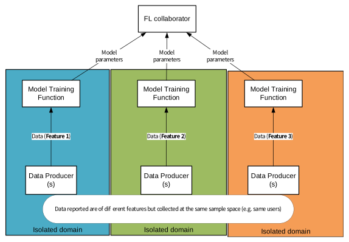
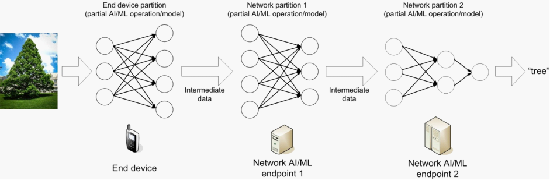

# 5 Key issues

## 5.1 Key issue #1: Support of Architecture Enhancement and Functions for Application Layer AI/ML Services

SA2 Rel-18 AIMLsys (in 3GPP TS 23.501 \[5\] and 3GPP TS 23.502 \[6\]) studied 5G System support for AI/ML-based services in application layer with the assumptions, for example:

\- Application AI/ML operation logic is controlled by an Application Function (AF).

\- AF request to the 5G System in the context of 5GS assistance to Application AI/ML operation.

\- For application layer Federated Learning, there may one application server (e.g., an AF) controlling the application layer DML/FL training process among multiple application clients (e.g., UEs).

3GPP SA1 Rel-18 and Rel-19 identified requirements for the support of AI/ML model distribution, transfer, training for various applications, e.g., video/speech recognition, robot control, automotive, in 3GPP TS 22.874 \[12\], and 3GPP TS 22.261 \[10\]. Such use cases and requirements from 3GPP SA1 have application layer impacts, e.g., require the support of corresponding architecture and functions to provide assistance in application layer AI/ML operations on model distribution, transfer and training.

In particular, to support the AI/ML services in application layer in the edge computing scenarios, more requirements may be introduced, e.g., the computing capability in the edge data network may be limited, the AI/ML model cannot be trained in the edge data network while the trained model should be deployed at the edge to perform inference tasks.

In this situation, some interaction and cooperation between edge network and core network may be needed to support the AI/ML model distribution and transfer, e.g., trained model may need to be pushed to the edge data network to ensure real-time usage of model; at the same time, edge datasets may also be shared to the core network to assist in continuous optimization of the training model.

Consider a scenario where the VAL server uses AIML enabler exposure functionality or 5GS FL member selection functionality to select the potential candidates for its AIML service. The VAL server can select the UEs to start the AIML service like FL. The VAL server can have two options:

\- The VAL server can start its AIML service directly with its chosen AIML members like UEs and bypass the AIML Enabler layer like OTT approach. In this method, the AIML enabler layer will not know about the status of AIML service like AIML service is started or stopped, etc. Since AIML enabler layer has no idea about the AIML service status, it cannot provide any assistance for the involved AIML members during the process. Also, the AIML service is dependent on the network and subject to varying network conditions, this may impact the performance of the overall AIML service.

\- The VAL server can start its AIML service directly with its chosen AIML members and could use the AIML Enabler layer to seek assistance for the AIML service. In order to seek assistance, the VAL server needs to inform the AIML enabler layer about its AIML service status or and use the AIML enabler server to manage the AIML service.

Currently, the AIML enabler layer has no capability to manage the service operation and neither any exposure capability for the same.

The AIML services like FL could involve large number of clients and this increases the complexity for the VAL server to manage the connection with each client. The enabler layer can help VAL server to reduce the complexity in managing the service. For example, the enabler layer can assist to attempt the retries to assist the service establishment or re-establish the service for clients in case of timeouts/disconnection due to outage (e.g., RLF).

Therefore, to support the AI/ML services in application layer, the following aspects need to be studied:

1\. Whether and how to enhance the architecture and related functions to support application layer AI/ML services.

2\. Whether and how the above architecture enhancement and related functions supporting the management/execution of AI/ML lifecycle operations.

3\. Whether and how the architecture enhancement and related functions leveraging the existing 5GC capabilities and assistance for the application layer AI/ML services.

4\. Whether and how to enhance the architecture and the above related functions to support application layer AI/ML services in edge computing scenarios.

5\. Whether and how to provide the exposure and related functionality to assist the AIML VAL applications for its AIML service operations like service lifecycle management (e.g., assist service creation, service status, service operation)

NOTE: Nomenclature alignment in the solution phase can result in re-mapping of “AIML service operation” to other terms.

## 5.2 Key issue #2: AI/ML-enhanced ADAES

ADAES is a SEAL service that has been specified in 3GPP TS 23.436 \[4\] and provides various features that support the derivation and exposure of application layer analytics to consumers in the application and enablement layers. Particularly, the analytics may include statistics and predictions. In order to derive certain types of analytics outputs (such as predictions), ADAES may support the utilization of AI/ML enabled analytics. How can ADAES utilize AI/ML methods to derive analytics or how can ADAES be enhanced with AI/ML capabilities has not been investigated in the Rel-18 study.

Rel-19 SID of ADAES pointed out that one possible new area of study would be the implications when using AI/ML methods for ADAES analytics and enhanced or new enablement capabilities for supporting ML model training and inference.

This key issue will study:

1\. Whether and how to enable the ADAE layer (including A-DCCF, A-ADRF) to derive analytics or provide analytics services based on AI/ML methods? This includes the study of necessary enhancements to the ADAE layer architecture, if any.

2\. Whether and how the ADAE layer supports ML model training and inference (i.e., internally or externally to ADAE layer) for deriving analytics?

3\. Whether and how ADAES can be enhanced to support and coordinate AI/ML-enabled analytics functions and features?

4\. Whether and how to support the registration and discovery of ADAE layer functional entities supporting ML model training / inference? e. Whether and how the ADAE layer (including A-DCCF, A-ADRF) supports ML model training (e.g., internally, or externally to ADAE layer).

5\. Whether and how new analytics are required to be generated by ADAE layer using AI/ML methods? This includes but is not limited to support for: XR applications, energy optimization, VAL server- to-VAL server performance analytics (e.g., related to latency, bandwidth, response time, etc.)?

## 5.3 Key issue #3: Support for federated learning

Federated Learning (FL) is a machine learning technique that enables multiple FL clients to train a model by exchanging the parameters instead of exchanging/sharing local data set. FL servers perform management of FL operations by maintaining and updating a global ML model, selecting and managing FL clients, performing aggregation strategies, scheduling training in a federated manner, and communicating with FL clients. FL clients provide various aspects of data for FL operations, such as data collection, data preparation, and using data for training and/or inferencing while communicating updates of ML models to FL servers.

Further, Considering the fact that the FL/ML clients can be deployed on end devices like UEs, there is potentially a very large number of FL/ML clients that can participate in machine learning operations. Out of these potentially large number for FL/ML clients, a set of FL/ML clients can be selected for performing various machine learning tasks. Due to various factors like mobility, changing capabilities, varying resource conditions, etc, the set of UEs (hosting FL/ML clients) that can participate in federated / distributed learning changes over time and may change more frequently. Also, the model information that is exchanged between FL/ML clients and the machine learning servers could also be huge, considering the large machine learning models. So, there will be frequent need for changing the member FL/ML clients that can participate in federated/distributed machine learning operations and also frequently the need to distribute the model information.

Further, Considering the fact that the FL/ML clients can be deployed on end devices like UEs, there is potentially a very large number of FL/ML clients that can participate in machine learning operations. Out of these potentially large number for FL/ML clients, a set of FL/ML clients can be selected for performing various machine learning tasks. Due to various factors like mobility, changing capabilities, varying resource conditions, etc, the set of UEs (hosting FL/ML clients) that can participate in federated / distributed learning changes over time and may change more frequently. Also, the model information that is exchanged between FL/ML clients and the machine learning servers could also be huge, considering the large machine learning models. So, there will be frequent need for changing the member FL/ML clients that can participate in federated/distributed machine learning operations and also frequently the need to distribute the model information.

This key issue will study:

1\. How to support federated learning at application enablement layers?

2\. Identify procedures for supporting FL at the application enablement layer, including FL entity discovery, registration, communication, reporting.

3\. Whether and how to support the data collection and preparation for FL in the application enablement layer?

4\. Whether and how to support the management of FL groups (e.g., how to create and manage a group of FL members) during FL operations (e.g., training)?

5\. Whether and how to support the application server for the distribution of the model information to the FL members/FL clients/ML clients for model training, considering the dynamically changing potential FL members/FL clients/ML clients for model training?

## 5.4 Key issue #4: Key issue on supporting Vertical FL at enablement layer

There are two types of federated learning defined, horizontal and vertical federated learning. Horizontal federated learning, or sample-based federated learning, is introduced in the scenarios that data sets share the same feature space but have different samples. Vertical federated learning or feature-based federated learning is applicable to the cases that two data sets share the same sample space but differ in feature space. In both horizontal and vertical federated learning model parameters from each local model training function are sent to a model aggregator (or FL collaborator) to calculate an aggregate model. The model aggregator provides updated model parameters to each ML model training entity that each ML model training entity use to re-train its own model thus allowing every local model training function to have a trained model using data from multiple sources.

An example for vertical FL (VFL) is shown below:

Figure 5.4-1 vertical FL (VFL) example

If VFL is supported by enablement layer, some issues are distinct and need to be studied separately from Key Issue #3, especially:

1\. How we can ensure that all training functions have an aligned sample range, e.g., the same users, to support VFL?

2\. How can we discover what features are available between domains (for the same sample range) in order to support VFL?

## 5.5 Key Issue #5: Support for of AI/ML operation splitting between AI/ML endpoints and in-time transfer of AI/ML models

KI #5 focuses on AI/ML operation splitting between AI/ML endpoints, and in-time transfer of AI/ML models as described in 3GPP TS 22.261 \[10\].

Split AI/ML inference is depicted in Figure 5.5-1. The AI/ML model inference is distributed into multiple parts according to the current task and environment (such as communications data rate, device resource, and server workload). The intention is to offload the computation-intensive, energy-intensive parts to network endpoints (cloud or edge server), whereas leave the privacy-sensitive and delay- sensitive parts at the end device. The device executes partial model inference and sends the intermediate data to a network endpoint where the remaining model inference is executed, and the inference results is fed back to the device.

Figure 5.5-1. Example of split AI/ML inference

For AI/ML split operation, the enabler layer can provide support to negotiate splitting of the AI/ML operation and to discover required nodes to perform computation-intensive, energy-intensive parts of AI/ML operations.

In-time model transfer is related to timely distribution of AI/ML model/data over 5G system. SA1 requirements indicate that “*the 5G system shall be able to support a mechanism to expose monitoring and status information of an AI-ML session to a 3rd party AI/ML application*”, and that “*Such mechanism is needed by the AI/ML application to determine an in-time transfer of AI/ML model.*”.

For AI/ML in-time transfer, the enabler layer can provide analytics to inform AI/ML application(s) about timely transfer of trained models and status information about AI/ML sessions, which may influence AI/ML applications behaviour.

Requirements from SA1 have impact on the application enablement layer and require the support of architecture and functions to assist AI/ML operations splitting, and in-time transfer of AI/ML models for AI/ML applications.

The following aspects should be studied:

1\. Whether and how to enhance the architecture and related functions to support management and/or configuration for split AI/ML operation, and in-time transfer of AI/ML models. The management and configuration aspects including discovery of requried nodes for split AI/ML operation and support of different models of AI/ML operation splitting.

2\. Whether and how to enhance the architecture and related functions to support exposure and consumption of split AI/ML analytics, and in-time transfer of AI/ML models analytics.

## 5.6 Key issue #6: Support for transfer learning

In 3GPP TS 22.261 \[10\] clause 6.40 it is stated that the 5G system needs to support at least three types of AI/ML operations:

\- AI/ML operation splitting between AI/ML endpoints,

\- Distributed/Federated Learning over 5G system, and

\- AI/ML model/data distribution and sharing over 5G system.

With the latter kind of operation, it is expected to let the AI/ML consumers use an ML model (out-of-a-set of candidate models available in a NW endpoint) for better adapting to task and environment variations.

Nevertheless, in practical deployments involving AI/ML operations, the number of available models is not that large to cover all the possible environmental conditions in a network. Therefore out-of-the-box usage of the model will imply a lack of accuracy/precision during the inference stage unless a model fine tuning stage is present to ensure that the baseline model is quickly adapted to the current conditions using lesser amount of data (than the one used for training of the baseline model). On that note, Transfer learning (TL) is conceived as a technique used to tackle the lack of labelled data for training a model which is the first limitation that is faced when (re-)training a model. In TL, the training of a model (to solve a particular task) is carried out using information from a "similar" domain in which enough information is available (the so-called source domain). With TL, some parts of the model trained in the source domain are fine-tuned with scarce information available in the target domain. This way, the model reuses the understanding of the structure of the problem and does not have to learn from scratch all the low-level features/structure of the problem: it will only have to learn the higher-level structures/relationships which usually requires less labelled data. TL assumes a baseline model is already available (in a NW endpoint) and can be fine tuned to quickly perform the same or similar tasks (e.g., prediction, classification, etc.) in a target domain with lesser amount of training data.

Considering that:

\- in 3GPP TS 23.288 \[2\] clause 6.2B.5, clause 6.2B.6 and clause 6.2B.7 some operations to allow the storage/retrieval of ML models to/from the Analytical Data Repository Function (ADRF) are available to be consumed by a network function containing an instance of the Model Training Logical Function (MTLF), and

\- as from clause 5.3 in 3GPP TS 23.436 \[4\], the internal architecture of ADAE (Application Data Analytics Enabler) can include an instance of ADRF, the so-called A-ADRF (Application layer - Analytical Data Repository Function),

it is possible to enable inter- and intra-VAL domain transfer learning scenarios.

This key issue will study:

1\. How to support transfer learning at application enablement layers?

NOTE 1: Business relationships can exist between ASPs to share learnings.

NOTE 2: The security aspects for Transfer Learning supported by SA6 enablers will be considered by SA3.

## 5.7 Key issue #7: Discovery or Support of Member Selection and Maintenance for Application Layer AIML Service

AI/ML Services enable the Distributed/Federative Learning over 5G system. The Application layer AI/ML entities have heterogeneous nature, e.g., different models, OS, capabilities, that require creation of AIML criteria specific for application layer AIML enabler service. The AI/ML Services need have information about conditions when AI/ML entities (e.g., VAL server, AI/ML Enablement Client, AI/ML Enablement Server) are available or not available to participate in the AI/ML operations (e.g., ML model training). To cover the application layer specific requirements, which are missing in the existing mechanisms on Member UE selection from SA2, and in order to assist and organize AI/ML operations (e.g., ML model training), this key issue will study the solutions on how to select and maintain the member for AI/ML Application layer Services on policies and configurations.

This key issue will study the solutions on how to select and maintain the member for AI/ML Application layer Services on the below aspect(s) for AI/ML policies and configurations provisioning, management, and enforcement:

1\. How to support the AI/ML for member selection and re-selection (e.g., policies).

2\. How to support the AI/ML member participation configurations.

3\. How to support the AI/ML maintaining the AI/ML process.

4\. How to utilize the AI/ML policies and configurations in the AI/ML Application layer Services.

NOTE 1: The user consent on the permission to participate the AI/ML operations (e.g., ML model training) in application layer is not within SA6 scope.

NOTE 2: The AI/ML policies identify the conditions and criteria, when satisfied the AI/ML Enablement Server enforces the action in order to support the AI/ML operation(s).

NOTE 3: The member participation configurations identify the conditions and criteria, when satisfied the AI/ML member can participate in the AI/ML operation(s).
