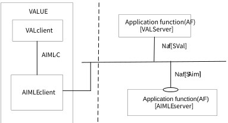
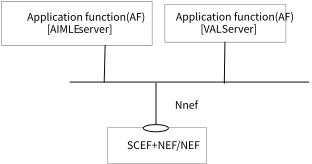
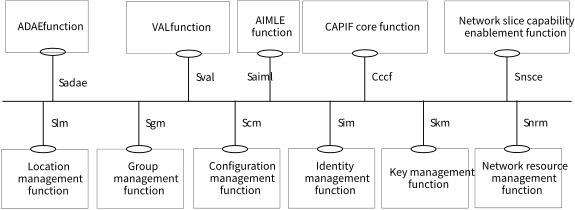
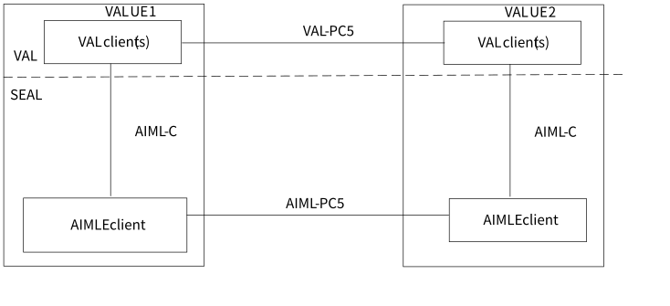
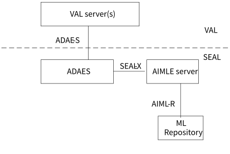

# 7 Application architecture for enabling AI/ML services

## 7.1 General

The functional architecture enhancements for the AIML enablement service are based on the generic functional model specified in clause 6.2 of 3GPP TS 23.434 \[7\]. The architecture enhancements are organized into functional entities to describe a functional architecture enhancement which addresses the support for AIML enablement aspects for vertical applications, as well as the representation for supporting ADAE analytics.

## 7.2 Application enablement architecture

### 7.2.1 On-Network AIML Enablement (AIMLE) Functional Architecture

Figure 7.2.1-1: On-network AIMLE functional model

Figure 7.2.1-1 illustrates the on-network functional model of AIML enablement. In the vertical application layer, the VAL client communicates with the VAL server over VAL-UU reference point. VAL-UU supports both unicast and multicast delivery modes. The AIML enablement functional entities on the UE and the server are grouped into AIMLE client(s) and AIML enablement server(s) respectively.

The AIMLE includes of a common set of services for comprehensive enablement of AIML functionality, including federated and distributed learning (e.g., FL client registration management, FL client discovery and selection), and reference points. The AIMLE services are offered to the vertical application layer (VAL).

NOTE: The set of common services will be updated based on the TR conclusions.

The AIML enablement client communicates with the AIMLE server(s) over the AIML-UU reference points. The AIMLE client provides functionality to the VAL client(s) over AIML-C reference point. The VAL server(s) communicate with the AIMLE server(s) over AIML-S reference points. The AIMLE servers communicate with the underlying 3GPP network systems using the respective 3GPP interfaces specified by the 3GPP network system. AIML-E reference point enables interactions between two AIMLE servers (e.g. central and edge AIMLE servers).

The AIMLE server interacts with the ML repository which serves as repository for ML model and ML participants over AIML-R.

#### 7.2.1.1 Service-based AIMLE architecture representation

Figure 7.2.1.1-1 exhibits the service-based interfaces for providing and consuming AIML enablement services. The AIMLE server could provide service to VAL server and AIML enablement client through interface SAiml.

Figure 7.2.1.1-1: Architecture for AIML enablement – Service based representation.

Figure 7.2.1.1-2 illustrates the service-based representation for utilization of the 5GS network services based on the 5GS SBA specified in 3GPP TS 23.501 \[5\].

Figure 7.2.1.1-2: Architecture for AIMLE utilizing the 5GS network services based on the 5GS SBA – Service based representation,

The AIML enablement server as well as ADAES is deployed as a SEAL server; hence enhancements to SEAL architecture (as specified in 3GPP TS 23.434 \[7\]) are needed to incorporate the AIML enablement service. Figure 7.2.1.1-3 illustrates the service-based representation including AIMLE server as part of the SEAL framework.

Figure 7.2.1.1-3: SEAL functional model representation using service-based interfaces and including AIMLE function.

### 7.2.2 Off-Network AIML Enablement Functional Architecture

Figure 7.2.2-1: Off-network AIML enablement functional model

Figure 7.2.2-1 illustrates the off-network (UE-to-UE) functional model of AIML enablement. In the vertical application layer, the VAL client communicates with a further VAL client over VAL-PC5 reference point. VAL-PC5 supports both unicast and multicast delivery modes. The UE1, if connected to the network via Uu reference point, can also act as a UE-to-network relay, to enable UE2 to access the VAL server(s) over the VAL-UU reference point.

The AIMLE client communicates with a further AIMLE client(s) over the AIML-PC5 reference points. The AIMLE client provides functionality to the VAL client(s) over AIML-C reference point. Such communication is performed for supporting local ML operations (training, distribution, inference) in a coordinated manner.

The off network functional architecture is similar to SEAL off-network architecture (as specified in 3GPP TS 23.434 \[7\]).

### 7.2.3 Architecture representation for supporting ADAE analytics

Figure 7.2.3-1: Architecture representation for supporting ADAE analytics.

Figure 7.2.3-1 illustrates the architecture representation of AIMLE when the AIML support capabilities serve ADAES to enhance its analytics services. Based on the VAL request to provide ML-enabled analytics, ADAES may consume AIMLE services (e.g., for ML model training for a given analytics ID) to derive analytics.

For the interaction between AIMLE server and ADAES, enhancements over SEAL-X interface will be needed, whereas for the interactions between VAL server and ADAES, the ADAE-S reference point may need to be enhanced to support ML-enabled analytics.

NOTE: The needed enhancements over ADAE-S and SEAL-X will be identified based on the concluded solutions which will be impacting these interfaces.

### 7.2.4 Functional Entities Description

#### 7.2.4.1 General

The AIMLE functional entities are described in the following subclauses.

#### 7.2.4.2 AIMLE client

The AIMLE client functional entity acts as the application client supporting AIML Enablement services. It interacts with the AIML Enablement server.

#### 7.2.4.3 AIMLE server

The AIMLE server functional entity provides AIML Enablement services (like ML model related assistance operations) supported within the vertical application layer. It interacts with the AIML Enablement client.

#### 7.2.4.4 ML repository

The ML repository is a logical entity which can serve as registry for the ML / FL members as well as a repository for the application layer ML models and ML model information. The ML repository can be accessed by other entities via the AIMLE server.

### 7.2.5 Reference Points Description

#### 7.2.5.1 General

The reference points for the functional model related to AIML enablement are described in the following subclauses.

#### 7.2.5.2 AIML-UU

The interactions related to AIML enablement functions between the AIML enablement client and AIML enablement server are supported by AIML-UU reference point. This reference point utilizes Uu reference point as described in 3GPP TS 23.401 \[8\] and 3GPP TS 23.501 \[5\].

#### 7.2.5.3 AIML-S

The interactions related to AIML enablement functions between the VAL server(s) and the AIML enablement server are supported by AIML-S reference point.

#### 7.2.5.4 AIML-C

The interactions related to AIML enablement functions between the VAL client(s) and the AIML enablement client within a VAL UE are supported by AIML-C reference point.

#### 7.2.5.5 AIML-R

The interactions related to AIML enablement functions between the AIML enablement server, and the ML repository are supported by AIML-R reference point.

#### 7.2.5.6 AIML-E

The interactions related to AIML enablement functions between AIML enablement servers (e.g., central and edge AIMLE servers).

#### 7.2.5.7 ADAE-S

The interactions related to application data analytics enablement functions between the VAL server(s) and the application data analytics enablement server are supported by the ADAE-S reference point. The specific ADAE server interactions corresponding to ADAE-S are described in 3GPP TS 23.436 \[4\].

#### 7.2.5.8 SEAL-X

The interactions between the AIMLE servers and other SEAL servers are generically referred to as SEAL‑X reference point. The specific SEAL server interactions corresponding to SEAL-X are described in 3GPP TS 23.434 \[7\].
