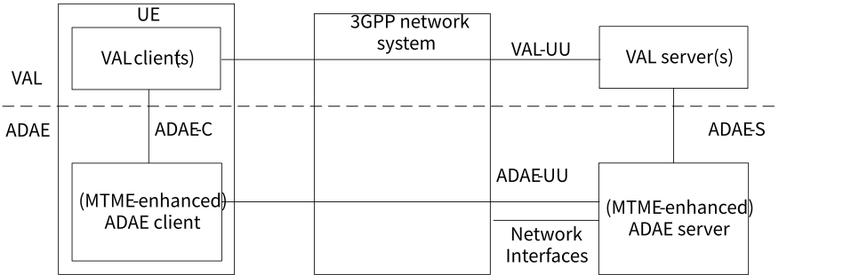
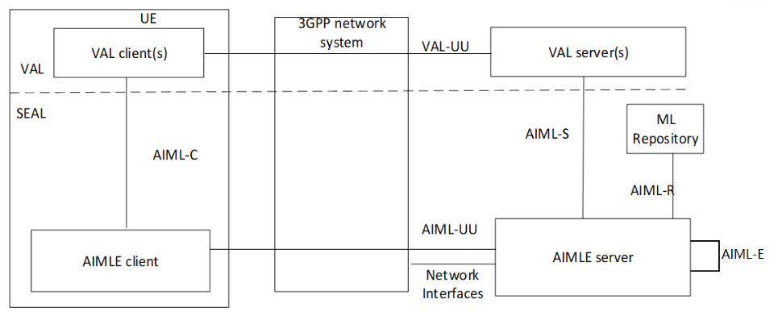

# 8.1 Solution #1: ADAE Functional Architecture Enhancement to Support Application Layer AI/ML Services

The following clauses specify the functional model of the ADAE with the ML Model Training and Management Enablement (MTME) function and the functional model of the AIML enablement service for supporting application layer AI/ML services.

## 8.1.2 Functional Architecture

### 8.1.2.1 General

The functional architecture enhancements for the ADAE with ML model training and management enablement function and AIML enablement service are based on the generic functional model specified in clause 6.2 of 3GPP TS 23.434 \[7\]. The architecture enhancements are organized into functional entities to describe a functional architecture enhancement which addresses the support for ML model training and management enablement function and AIML enablement aspects for vertical applications.

### 8.1.2.2 On-Network MTME-enhanced ADAE Functional Architecture

Figure 8.1.2.2-1: On-network MTME-enhanced ADAE functional model

Figure 8.1.2.2-1 illustrates the on-network functional model of ADAE with ML Model Training and Management Enablement (MTME) function. In the vertical application layer, the VAL client communicates with the VAL server over VAL-UU reference point. VAL-UU supports both unicast and multicast delivery modes. The ADAE functional entities with MTME function on the UE and the server are grouped into ADAE client(s) and ADAE server(s) respectively. The ADAE with MTME function consists of a common set of services (e.g., ML model provision, (MTME-enhanced) ADAE client registration management, (MTME-enhanced) ADAE client member management, training status estimation, ML model training execution) and reference points. The ADAE offers its services to the vertical application layer (VAL).

The ADAE client(s) communicates with the ADAE server(s) over the ADAE-UU reference points. The ADAE client(s) provides the service enabler layer support functions to the VAL client(s) over ADAE-C reference points. The VAL server(s) communicate with the ADAE server(s) over the ADAE-S reference points. The ADAE server(s) may communicate with the underlying 3GPP network systems using the respective 3GPP interfaces specified by the 3GPP network system.

### 8.1.2.3 On-Network AIML Enablement Layer Functional Architecture

Figure 8.1.2.3-1: On-network AIML enablement layer functional model

Figure 8.1.2.3-1 illustrates the on-network functional model of AIML enablement layer. In the vertical application layer, the VAL client communicates with the VAL server over VAL-UU reference point. VAL-UU supports both unicast and multicast delivery modes. The AIML enablement functional layer entities on the UE and the server are grouped into AIML enablement client(s) and AIML enablement server(s) respectively.

The AIML enablement layer includes of a common set of services for comprehensive enablement of AIML functionality, including federated and distributed learning (e.g., FL client registration management, FL client discovery and selection), and reference points. The AIML enablement services are offered to the vertical application layer (VAL).

The AIML enablement client communicates with the AIML enablement server(s) over the AIML-UU reference points. The AIML enablement client provides functionality to the VAL client(s) over AIML-C reference point. The VAL server(s) communicate with the AIML enablement server(s) over AIML-S reference points. The AIML enablement servers communicate with the underlying 3GPP network systems using the respective 3GPP interfaces specified by the 3GPP network system. AIML-E reference point enables interactions between two AIMLE servers (e.g. central and edge AIMLE servers).

### 8.1.2.4 Coexistence of MTME-enhanced ADAE and AIML enabler

MTME-enhanced ADAES function supports ML capabilities (i.e. model training and management) to the ADAE service so that enhanced ADAE server/client are enabled to generate analytics results for supported analytics IDs using ML-enhanced methods.

For supporting MTME capabilities, the MTME-enhanced ADAE service assumes co-location of necessary AIML Enablement with ADEAS (both as SEAL services), and their interactions are not detailed. As such, MTME-enhanced ADAE services and AIML enablement services are described in this document as complementary functions/ deployments.

NOTE: The normative phase will specify any interactions between ADAES and the AIML Enablement abstracted by MTME-enhanced ADAE.

## 8.1.3 Functional Entities Description

### 8.1.3.1 General

The ADAE functional entities with ML model training and management enablement function and AIML enablement layer function are described in the following subclauses.

### 8.1.3.2 ADAE client

The ADAE client functional entity acts as the application client supporting ML model training and may supporting management of ML model training. It interacts with the ADAE server.

### 8.1.3.3 ADAE server

The ADAE server functional entity provides for management and execution of ML model training supported within the vertical application layer.

### 8.1.3.4 AIML Enablement client

The AIML enablement client functional entity acts as the application client supporting AIML services and performs client-side operations. It interacts with the AIML enablement server.

### 8.1.3.5 AIML Enablement server

The AIML enablement server functional entity provides services for comprehensive enablement of AIML functionality (e.g., federated and distributed learning).

## 8.1.4 Reference Points Description

### 8.1.4.1 General

The reference points for the functional model for management and execution of ML model training and AIML enablement layer functions are described in the following subclauses.

### 8.1.4.2 ADAE-UU

The interactions related to ML model training and management functions between the ADAE client and ADAE server are supported by ADAE-UU reference point. This reference point utilizes Uu reference point as described in 3GPP TS 23.401 \[8\] and 3GPP TS 23.501 \[5\].

ADAE-UU reference point is used for VAL service signalling for VAL service data management of the VAL service.

### 8.1.4.3 ADAE-S

The interactions related to ML model training and management functions between the VAL server(s) and the ADAE server are supported by ADAE-S reference point.

### 8.1.4.4 ADAE-C

The interactions related to ML model training and management functions between the VAL client(s) and the ADAE client within a VAL UE are supported by ADAE-C reference point.

### 8.1.4.5 AIML-UU

The interactions related to AIML enablement layer functions between the AIML enablement client and AIML enablement server are supported by AIML-UU reference point. This reference point utilizes Uu reference point as described in 3GPP TS 23.401 \[8\] and 3GPP TS 23.501 \[5\].

### 8.1.4.6 AIML-S

The interactions related to AIML enablement layer functions between the VAL server(s) and the AIML enablement server are supported by AIML-S reference point.

### 8.1.4.7 AIML-C

The interactions related to AIML enablement layer functions between the VAL client(s) and the AIML enablement client within a VAL UE are supported by AIML-C reference point.

### 8.1.4.8 AIML-E

The interactions related to AIML enablement functions between different AIML enablement servers are supported by AIML-E reference point (e.g. central and edge AIMLE servers).

## 8.1.5 Architecture Impacts

The application enabler layer architecture impacts are the following:

\- Enhance ADAE to consume AIML enablement services for ML-based analytics.

\- On-network AIML enablement layer functional model is introduced to support application layer AI/ML services.

## 8.1.6 Corresponding APIs

This solution impacts AIMLE and ADAE APIs.

ADAE:

\- ADAE API is enhanced, including enhancement of ADAE-UU, ADAE-S, and ADAE-C reference points.

AIMLE:

\- New AIMLE API is introduced, including AIML-UU, AIML-S, and AIML-C reference points.

## 8.1.7 Solution evaluation

This solution addresses Key Issue #1 and introduces AIML enablement layer functional model, the AIML enablement service for supporting application layer AI / ML services and enhance ADAE to consume AIML enablement services for ML-based analytics. The content in Solution#1 can be selected and add to clause 7, for example, the main content about On-Network AIML enablement layer functional architecture introduced in clause 8.1.2.3 has been added to clause 7.2.1. This solution doesn't introduce any dependency to 3GPP network systems.
