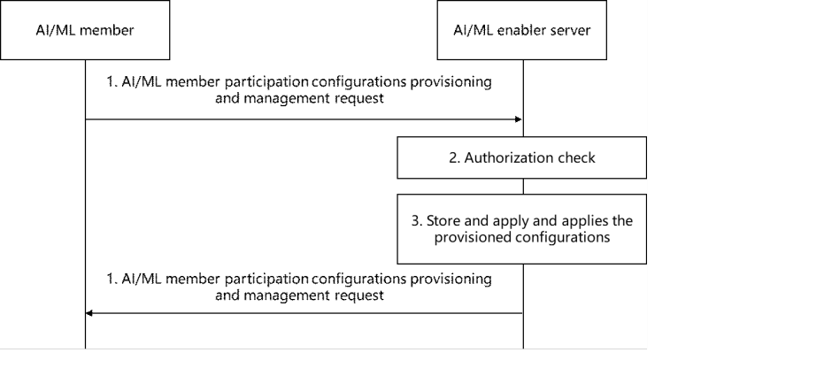

# 8.10 Solution #10: AI/ML member participation configurations provisioning and management

## 8.10.1 General

The following clauses specify procedures, information flows and APIs for Key issue #7 to provision the AI/ML member participation configurations for the AI/ML Enabler services.

Assumptions:

\- AI/ML member (e.g., AI/ML Enabler Client) is registered on the AI/ML Enabler Server to participate in the AI/ML operations (e.g., ML model training).

NOTE: The AI/ML member configurations provisioning service operation can be a part of the ML client config provisioning procedure defined in clause 8.3.2.

## 8.10.2 Procedures

### 8.10.2.1 AI/ML member participation configurations provisioning and management

Figure 8.10.2.1-1: AI/ML member participation configurations provisioning and management procedure

1\. The AI/ML member (e.g. AI/ML Client) sends an AI/ML member participation configurations provisioning and management request as defined in clause 8.10.3.1.

2\. Upon receiving the request, the AIML Enablementserver performs an authorization check of the AI/ML member.

3\. If the AI/ML member is authorised, the AIML EnablementServer stores the AI/ML member configurations in the ML repository and applies the provisioned configurations to ongoing and further the AI/ML operations (e.g., ML model training).

4\. AIML EnablementServer provides the response to the AI/ML member with a status via AI/ML member participation configurations provisioning and management response defined in clause 8.10.3.2.

NOTE: The service operation defined in clause 8.10.2.1 can be utilized for AI/ML member participation configurations management (i.e., update/delete) functionality.

## 8.10.3 Information flows

### 8.10.3.1 AI/ML member participation configurations provisioning and management request

Table 8.10.3.1-1 describes the information flow from the AI/ML member to the AI/ML Enabler server as a request for the AI/ML member participation configurations provisioning and management.

Table 8.10.3.1-1: AI/ML member participation configurations provisioning and management request

<table>
<colgroup>
<col style="width: 33%" />
<col style="width: 16%" />
<col style="width: 50%" />
</colgroup>
<tbody>
<tr class="odd">
<td>Information element</td>
<td>Status</td>
<td>Description</td>
</tr>
<tr class="even">
<td>Requester Identity</td>
<td>
M

(NOTE)
</td>
<td>The identity of the AI/ML member performing the request.</td>
</tr>
<tr class="odd">
<td>List of configurations</td>
<td>M</td>
<td>Identify the list of configurations.</td>
</tr>
<tr class="even">
<td>&gt; List of VAL service ID(s)</td>
<td>M</td>
<td>Identify the list of VAL service IDs for which the configurations are applicable.</td>
</tr>
<tr class="odd">
<td>&gt; List of time-schedule configurations</td>
<td>O</td>
<td>Provides the list of time-schedule configurations, e.g., the AI/ML member is (not) available to participate in the AI/ML operations in the given time slot(s) and/or day(s) of the week.</td>
</tr>
<tr class="even">
<td>&gt; List of location-based configurations</td>
<td>O</td>
<td>Provides the list of location-based configurations, e.g., the AI/ML member is (not) available to participate in the AI/ML operations in the given locations represented by coordinates, civic addresses, network areas, or VAL service area ID.</td>
</tr>
<tr class="odd">
<td>&gt; Mode of member participation</td>
<td>O</td>
<td>Indicates the AI/ML member availability for the participation based on the modes like training (e.g., FL, DML, ML, and/or Split Learning), aggregator, coordinator and/or inference.</td>
</tr>
<tr class="even">
<td>&gt; Service exposure level</td>
<td>O</td>
<td>Indicates level of service exposed by the AI/ML member for the corresponding VAL service ID e.g., premium resource usage, limited resource usage, raw data, processed data.</td>
</tr>
<tr class="odd">
<td colspan="3">NOTE: This information element shall not be updated in the AI/ML member participation configurations management request.</td>
</tr>
</tbody>
</table>

NOTE 1: In Table 8.10.3.1-1, the configurations identify the conditions and criteria, when satisfied the AI/ML member can participate in the AI/ML operations initiated by VAL service(s).

NOTE 2: The additional AI/ML member participation configurations are to be specified in the normative phase if needed.

### 8.10.3.2 AI/ML member participation configurations provisioning and management response

Table 8.10.3.2-1 describes the information flow from the AI/ML Enabler server to the AI/ML member as a response for the AI/ML member participation configurations provisioning and management.

Table 8.10.3.2-1: AI/ML member participation configurations provisioning and management response

|                     |        |                                              |
|---------------------|--------|----------------------------------------------|
| Information element | Status | Description                                  |
| Result              | M      | Indicates success or failure of the request. |

## 8.10.4 Architecture Impacts

This solution is based on the architecture in clause 7 with added functionality for the AIML Enablement Client Configuration Provisioning and Management.

## 8.10.5 Corresponding APIs

This clause provides a summary on the corresponding API for solution #10.

\- AIML Enablement Client Configuration Provisioning and Management service operations are a part of AIMLE Client Registration API (request/response model; API provider: AIMLE server; known consumer: AIMLE Client).

## 8.10.6 Solution evaluation

This solution addresses Key Issue #7 and introduces the capability for the AIMLE Client to provision the participation configurations that include time and spatial conditions, supported ML modes and roles, etc. This solution is ML mode agnostic (i.e., applicable for registration and configuration provisioning for FL, DML, ML, Transfer and/or Split Learnings) and important for scenarios (e.g., Solution #6) where the availability of AIMLE Clients changes (e.g., due to VAL UE mobility, network conditions).

This solution addresses KI #3 for the FL member participation configurations provisioning and management.

This solution can be considered as a candidate for normative work and doesn't introduce any dependency to existing 3GPP network functionality.
