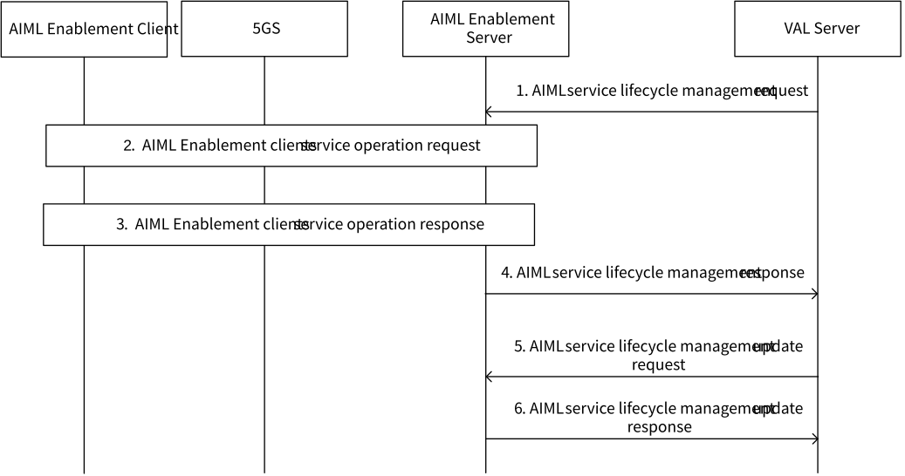

# 8.11 Solution #11: AIML service lifecycle management procedure

## 8.11.1 General

The following clauses specify procedures, information flows and APIs for Key issue #1 to enable the AIML service lifecycle management procedure.

The AIML service opeation is a interaction between VAL server (e.g., AIML server) and AIML client for the AIML service. The VAL server uses the AIML enabler layer to support the AIML service lifecycle management for the AIML service like FL, TL, SL.

Pre-conditions:

1\. The AI/ML Enablement client send the AI/ML Enablement client registration request to the AIML Enablement server.

## 8.11.2 AIML service lifecycle management procedure

Figure 8.11.2-1: AIML service lifecycle management procedure

1\. The VAL server sends AIML service lifecycle management request to the AIML Enablement server. The request contains AIML service operation ID, AIML client ID, AIML clients group ID, AIML service operation mode like start, pause, continue, and finish. AIML service operation ID can represent both the process ID and service operation (e.g. model training) to identify the AIML service.

2\. The AIML Enablement server sends the AIML Enablement client service operation request to the AIML Enablement client(s). The request contains AIML client ID AIML service operation mode. The service operation mode start/continue indicates the trigger to initiate the AIML service operation (e.g. model training). The AIML service operation mode pause and finish indicates the stop and end of the AIML service (e.g. model training) respectively.

3\. The AIML Enablement client sends a response indicating the success or failure of the AIML Enablement client service operation response.

NOTE: The step 2, and 3 can reuse procedures from solution \#17 and solution \#22

4\. The AIML Enablement server provides the AIML service lifecycle management response to the VAL server. The message includes AIML service operation ID and the status of the AIML service operation.

5\. The VAL server sends AIML service lifecycle management update request to the AIML Enablement server with the AIML service operation ID and update information.

6\. The AIML Enablement server receives the request and performs steps 2 and step 3 The AIML Enablement server provides the AIML service lifecycle management update response to the VAL server. The message includes the result of the update and the AIML service operation ID.

## 8.11.3 Architecture Impacts

The solution is based on the functional architecture described in clause 7 and it has no architecture impacts.

## 8.11.4 Corresponding APIs

This subclause provides a summary on the corresponding API for solution #11.

\- AIML service lifecycle management request API (request/response model; API provider: AIMLE server; known consumer: AIML consumer (like VAL server); corresponding to step 1 and step 4 of clause 8.11.2).

\- AIML Enablement client service operation request API (request/response model; API provider: AIMLE server; known consumer: AIML consumer (like AIML client); corresponding to step 2 and step 3 of clause 8.11.2).

\- AIML service lifecycle management update request API (request/response model; API provider: AIMLE server; known consumer: AIML consumer (like VAL server); corresponding to step 5 and step 6 of clause 8.11.2).

## 8.11.5 Solution evaluation

This solution addresses Key Issue #1(bullet #2 - Whether and how the above architecture enhancement and related functions supporting the management/execution of AI/ML lifecycle operations, bullet #3 - Whether and how the architecture enhancement and related functions leveraging the existing 5GC capabilities and assistance for the application layer AI/ML services) to support the AIML services lifecycle capability. This solution is feasible and doesn't introduce any dependency to 3GPP network systems.

This solution provides the capability for the VAL server to enable lifecycle management for the underlying services like model training (like solution #22 for model training). For example, if the VAL server wants to pause the model training then it can use this solution to pause the model training via the service operation mode - pause. Similarly, if VAL server wants to resume the model training again, the VAL server can use the service operation mode – continue. Another example is that large models take huge amount of time for model training(e.g. in days) and this may lead to the failure in model training due to various factors like UE is not available. In order to handle such cases, the VAL server may want to pause/stop the training and can perform (re)selection. Based on the AIML service status(like whether the service is paused or finished), the VAL server can manage the AIML service via the AIML enabler server. Such AIML service operation mode exposure brings flexibility for the VAL server to manage its AIML service lifecycle based on its requirements and application logic.
