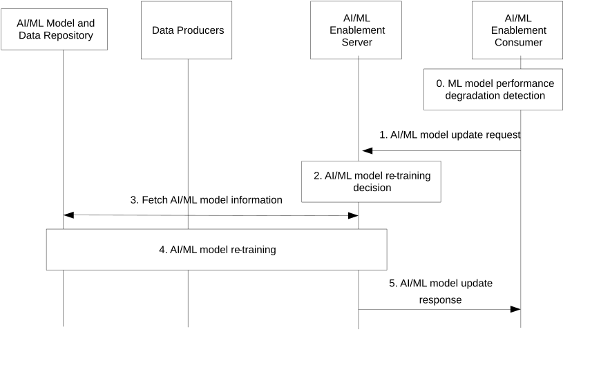
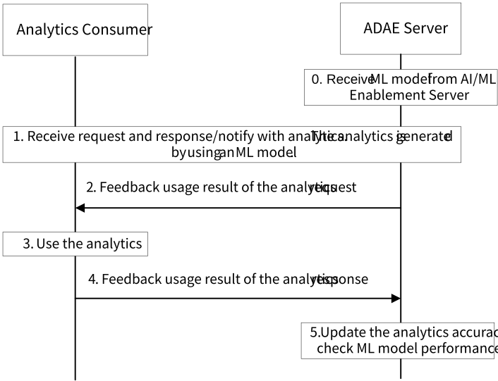

# 8.12 Solution #12: AI/ML model lifecycle management

## 8.12.1 Solution Description on AI/ML Model Lifecycle Management

This solution addresses Key Issues #1 and #6. The solution provides a procedure to support AI/ML model lifecycle management for ML model re-training and update when model performance degradation is observed by AI/ML Enablement. The solution also supports using an existing model to re-train the model using Transfer Learning. Additionally, if the degraded model is related to other models due to e.g., Transfer Learning, the AI/ML Enablement may trigger the update of those related models as well.

Figure 8.12.1-1 depicts the procedure where the AI/ML Enablement capability can trigger model update upon detecting model performance degradation.

Pre-conditions:

1\. The AI/ML Enablement Server has provided a ML model to the AI/ML Enablement Consumer.

2\. The AI/ML consumer may indicate to the AI/ML Enablement Server that the performance degradation will be detected by the consumer based on its local configuration.

Figure 8.12.1-1: Support for AI/ML model lifecycle management

0\. The AI/ML Enablement Consumer detects a performance degradation of the AI/ML model.

1\. The AI/ML Enablement Consumer sends an AI/ML model update request to the AI/ML Enablement Server that includes the ID of the model

2\. The AI/ML Enablement Server determines whether an update of the AI/ML model is required.

3\. The AI/ML Enablement Server fetches the ML model information from the ML Model and Data Repository. The AI/ML Enablement Server may also perform ML model discovery to determine whether an existing ML model stored by the ML Model and Data Repository can be used to train the new model (e.g., using Transfer Learning).

The AI/ML Enablement Server can also discover models that are related due to Transfer Learning or the use of the same training data, to identify additional models that may require an update.

4\. The AI/ML Enablement Server performs ML model re-training, which corresponds to the ML model training procedure as described in other solutions in this TR.

If the degraded model is linked to other models (e.g., due to Transfer Learning, or the same training data has been used), the AI/ML Enablement Server may trigger the re-training and update of those related models as well.

5\. The AI/ML Enablement Server provides the updated ML model to the AI/ML Enablement Consumer either by sending it directly, or by providing information to retrieve it from the ML Model and Data Repository.

## 8.12.2 Consumer-based ML Model Performance Degradation Detection

Figure 8.12.2-1: Consumer-based ML Model Performance Degradation Detection

This procedure corresponds to the step 0b in clause 8.12.1.

0\. An ADAE Server, as an AI/ML Enablement Consumer, receives trained ML model (or ML model information) from the AI/ML Enablement Server.

1\. The ADAE Server receives request from consumer for analytics, generates analytics by using the ML model provided by AI/ML Enablement Server, and responses/notifies to the consumer with the required analytics.

2\. The ADAE Server requests the consumer to feedback usage result of the analytics.

3\. The consumer uses the analytics for its operations and collects operation results. Performance degradation may be found from the operation results. The performance degradation may cause by e.g., insufficient analytics accuracy, or the current analytics cannot fulfill the changed conditions at the consumer.

4\. The consumer feedbacks the usage result of the analytics to the ADAE Server.

5\. The ADAE Server updates the analytics accuracy based on feedback information from the consumer, and checks the performance of the ML model, which is used to generate the analytics, e.g., performance degradation of the ML model.

NOTE: The capability of ADAES to detect model performance degradation will be revisited during normative phase.

If the AI/ML Enablement Consumer is e.g. VAL Server, similar procedure as shown in Figure 8.12.2-1 be performed for detecting of ML Model performance, by replacing "analytics" with e.g., "operation instructions".

## 8.12.2 Architecture Impacts

The application enabler layer architecture impacts are the following:

\- AI/ML Enablement Server is introduced to support AI/ML model lifecycle management.

\- AI/ML Enablement Consumer is introduced to consume AI/ML Enablement Server services.

\- AI/ML Enablement Consumer is introduced to detect ML model performance degradation.

\- The ML Model and Data Repository is introduced to store the ML models and training data.

## 8.12.3 Corresponding APIs

Table 8.12.3-1 details the ML model performance degradation notification IEs.

Table 8.12.3-1: AI/ML model update request

| Information element                 | Status | Description                                                                                                                                                        |
|-------------------------------------|--------|--------------------------------------------------------------------------------------------------------------------------------------------------------------------|
| AI/ML Enablement Consumer Identity  | M      | The identity of the AI/ML Enablement Consumer sending the notification.                                                                                            |
| AI/ML model ID                      | M      | Provides the ID of AI/ML model for which the performance degradation has been detected.                                                                            |
| Performance degradation information | O      | Provides details about the detected performance degradation, such as the time, instances, or information on the degraded metrics (e.g. accuracy, recall, F1score). |
| AI/ML model information             | O      | Information on where the AI/ML is stored, such as the repository endpoint or ID.                                                                                   |

The ML model information retrieval process is similar to the one described in solution 5, where the model ID is provided in the request.

Table 8.12.3-2 details the ML model update IEs.

Table 8.12.3-2: AI/ML model update response

<table>
<colgroup>
<col style="width: 33%" />
<col style="width: 16%" />
<col style="width: 50%" />
</colgroup>
<thead>
<tr class="header">
<th>Information element</th>
<th>Status</th>
<th>Description</th>
</tr>
</thead>
<tbody>
<tr class="odd">
<td>Model update indication</td>
<td>M</td>
<td>Indicates whether the model has been updated</td>
</tr>
<tr class="even">
<td>AI/ML model ID</td>
<td>M</td>
<td>Provides the ID of the updated AI/ML model</td>
</tr>
<tr class="odd">
<td>AI/ML model</td>
<td>
O

(NOTE)
</td>
<td>Provides the updated AI/ML model</td>
</tr>
<tr class="even">
<td>AI/ML model information</td>
<td>
O

(NOTE)
</td>
<td>Provides the information of the ML model and data repository, from which the AI/ML model can be retrieved, such as the repository endpoint or ID.</td>
</tr>
<tr class="odd">
<td colspan="3">NOTE: At least one of these information elements shall be provided.</td>
</tr>
</tbody>
</table>

This subclause also provides a summary on the corresponding API for solution #12.

\- Feedback usage result of analytics API (request-response or subscribe-notify model; API provider: Analytics Consumer; known consumers: VAL Server, ADAE Server; corresponding to steps 2 and 4 in clause 8.12.2).

## 8.12.4 Solution evaluation

This solution addresses Key Issues #1 and #6, and details the procedures for AI/ML model lifecycle management to detect performance degradation and trigger AI/ML model update. The solution also supports scenarios of Transfer Learning, by triggering proactive updates to related models if needed. This solution is feasible and doesn’t introduce any dependency to the 3GPP network systems.
