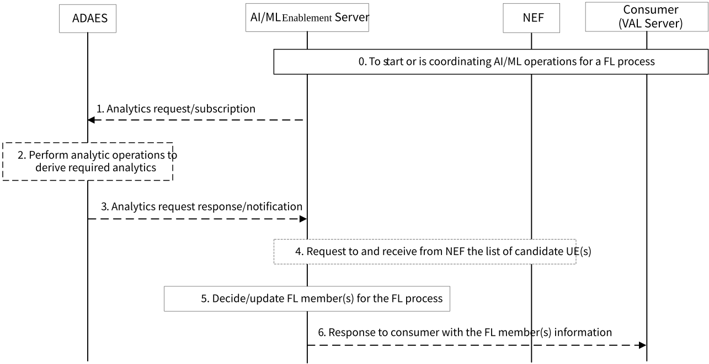

# 8.13 Solution #13: Analytics and Assistance Information Collection for Supporting FL Member (Re)Selection with the ADAES capabilities

## 8.13.1 General

The following clauses specify procedures, information flows and APIs for Key Issues #1 and #3 to support AI/ML Enablement Server interact with ADAES and NEF for analytics and assistance information to support FL member (re)selection in the VAL server driven and the AI/ML Enablement server driven FL members (re)selection scenarios.

Pre-conditions:

\- FL member (e.g., AI/ML Enablement Client) is registered on the AI/ML Enablement Server to participate in the AI/ML Enablement operations (e.g., ML model training).

## 8.13.2 Procedure on Analytics/Assistance Information Collection for FL member (re)selection with the ADAES capabilities

Figure 8.13.2-1: Analytics/Assistance information collection procedure for FL member (re)selection

0\. The consumer (e.g. VAL server) may request AI/ML Enablement Server to start assisting the VAL server for the FL member (re)selection or request the AI/ML Enablement Server to coordinate the AI/ML operations for member (re)selection in a FL process. The AI/ML Enablement Server may decide that analytics for analytics is needed.

1\. The AI/ML Enablement Server may retrieve information from ADAES, by sending analytics (update) request to ADAE server (e.g., UE-to-UE application performance analytics).

NOTE: Detail analytics from ADAES needed will be discussed during the normative phase.

2\. The ADAES performs analytics relevant operations to generate the analytics.

3\. The ADAES provides response/notifications to the AI/ML Enablement Server with the required analytics.

4\. The AI/ML Enablement Server may retrieve assistance information on FL member (re)selection from NEF, by invoking the Nnef_MemberUESelectionAssistance_Subscribe service operation as defined in clause 5.2.6.32.2 of 3GPP TS 23.502 \[6\]. The subscription request may contain Member UE filtering criteria and a (update) UE list (which are registered as AI/ML Enablement Clients on the AI/ML Enablement Server).

After deriving (updating) list of candidate UE(s), the NEF notifies the AI/ML Enablement Server with the (derived/updated) list of candidate UE(s) by invoking the Nnef_MemberUESelectionAssistance_Notify service operation as defined in clause 5.2.6.32.4 of 3GPP TS 23.502 \[6\].

5\. The AI/ML Enablement Server decides/updates the FL member list for the FL process based on the collected analytics and/or assistance information and may also according to the AI/ML member selection policies introduced in clause 8.14.

6\. If request in step 0, the AI/ML Enablement Server responses to the consumer with the FL member(s) information.

The steps 1-3 and 4 can be performed simultaneously, sequentially, or alternately. For example, if new analytics keeps generated at the ADAES during the FL process, the steps 2-5 may repeat until the end of the FL process. If the analytics request from the AI/ML Enablement Server update dynamically during the FL process, the steps 1-5 may repeat until the end of the FL process.

## 8.13.3 Architecture Impacts

This solution is based on the architecture described in clause 7. The application enabler layer architecture impacts are the following:

\- Interactions between AI/ML Enablement Server and ADAES are introduced to support AI/ML Enablement Server requests/subscribes analytics from ADAES.

\- Interactions between AI/ML Enablement Server and NEF are introduced to support AI/ML Enablement Server requests assistance information on FL member (re)selection from NEF.

\- AI/ML Enablement Server service is introduced to support decides/updates FL member list.

## 8.13.4 Corresponding APIs

None.

## 8.13.5 Solution evaluation

This solution addresses Key Issues #1 (open issue 3), \#2 (open issues 2 and 4), and \#3 (open issue 1), and introduces the interactions between AI/ML Enablement Server with ADAES for analytics and with NEF for assistance information. This solution provides architecture enhancement for leveraging the existing ADAE services and 5GC capabilities for the application layer AI/ML services, for example the procedure for analytics and assistance information collection can be used to support ML model training and inference (e.g., FL member (re)selection).
