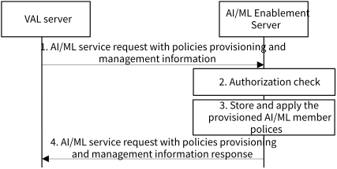

# 8.14 Solution #14: AI/ML policies provisioning and management

## 8.14.1 General

The following clauses specify procedures, information flows and APIs for Key issue#7 to provision and manage the AI/ML policies for the AI/ML Enablement services.

The AI/ML data transfer policies allow the VAL server to provide requirements for the AI/ML data (e.g., the current status of the trained ML model) from the de-selected to the selected client. The VAL server may have a network QoS requirements for AI/ML data transfer to use Background Data Transfer to save cost for the AI/ML data transfer.

The AI/ML data transfer policies can be used for both time-sensitive and non-time-sensitive AI/ML data transfer. For example:

\- VAL server performs the time-sensitive learning that should be completed as soon as possible. The VAL server can request the AI/ML Enablement server to configure a temporary AI/ML data transfer session with QoS during AI/ML member re-selection procedure, in order to transfer the current trained data within the minimal time.

\- The VAL server performs the non-time-sensitive learning and would like to reduce the cost of the AI/ML operation. The VAL server can request the AI/ML Enablement server to use background data transfer with lowest costs as BDT policy guidance.

## 8.14.2 Procedures

### 8.14.2.1 AI/ML policies provisioning and management

Figure 8.14.2-1: AI/ML policies provisioning and management procedure

1\. The VAL server sends an AI/ML service request with policies provisioning and management information as defined in clause 8.A.3.1.

2\. Upon receiving the request, the AI/ML Enablement Server performs an authorization check of the VAL server.

3\. If the VAL server is authorised, the AI/ML Enablement Server stores the AI/ML policies and applies the provisioned policies to ongoing and further the AI/ML operations (e.g., ML model training). The AI/ML application QoS adjustment policies are applied for the selected AI/ML members as per the member selection and re-selection policy after obtaining the identifiers of the AI/ML members that are selected as a result of the enforcement of the policy. The AI/ML Enablement server can use the SEALDD or the NEF services (AFSessionWithQoS) to configure the QoS. When the AI/ML members are de-selected, the QoS adjustment is reversed as they no longer participate in the AI/ML operation.

4\. AI/ML Enablement Server provides the response to the VAL server with a status via AI/ML member selection policies provisioning and management response defined in clause 8.14.3.2.

NOTE: The service operation defined in clause 8.14.2.1 can be utilized for AI/ML member selection policies management (i.e., update/delete) functionality.

## 8.14.3 Information flows

### 8.14.3.1 AI/ML service request with policies provisioning and management information

Table 8.14.3.1-1 describes the information flow from the VAL server to the AI/ML Enablement Server as a request that contains the AI/ML policies provisioning and management information.

Table 8.14.3.1-1: AI/ML policies provisioning and management request

<table>
<colgroup>
<col style="width: 33%" />
<col style="width: 16%" />
<col style="width: 50%" />
</colgroup>
<tbody>
<tr class="odd">
<td>Information element</td>
<td>Status</td>
<td>Description</td>
</tr>
<tr class="even">
<td>Requester Identity</td>
<td>M</td>
<td>The identity of the VAL server performing the request.</td>
</tr>
<tr class="odd">
<td>VAL service ID</td>
<td>M</td>
<td>Identify the VAL service ID.</td>
</tr>
<tr class="even">
<td>List of member selection and re-selection polices</td>
<td>
O

(NOTE)
</td>
<td>Identifies the list of member selection and re-selection policies, e.g., the AI/ML member shall be re-selected when the PLR is above the given value or leaves the certain area. See details in Table 8.14.3.1-2.</td>
</tr>
<tr class="odd">
<td>List of AI/ML traffic QoS adjustment policies</td>
<td>
O

(NOTE)
</td>
<td>Identifies the list of QoS adjustment policies, e.g., the AI/ML traffic QoS shall be adjusted when the conditions are met. See details in Table 8.14.3.1-3.</td>
</tr>
<tr class="even">
<td>AI/ML data transfer policy for AI/ML member re-selection</td>
<td>
O

(NOTE)
</td>
<td>Identifies the AI/ML data transfer policy that shall be applied for the AI/ML data transfer from de-selected to the selected AI/ML member during the re-selection procedure. See details in Table 8.14.3.1-4.</td>
</tr>
<tr class="odd">
<td colspan="3">NOTE: At least one of these IEs shall be provided.</td>
</tr>
</tbody>
</table>

NOTE: The additional AI/ML policies can be specified in the normative phase.

Table 8.14.3.1-2: Member selection and re-selection policy

<table>
<colgroup>
<col style="width: 33%" />
<col style="width: 16%" />
<col style="width: 50%" />
</colgroup>
<tbody>
<tr class="odd">
<td>Information element</td>
<td>Status</td>
<td>Description</td>
</tr>
<tr class="even">
<td>Policy ID</td>
<td>M</td>
<td>The identity of the policy.</td>
</tr>
<tr class="odd">
<td>Action</td>
<td>M</td>
<td>Represents the policy action, e.g., select member, not select member, or re-select member.</td>
</tr>
<tr class="even">
<td>List of AI/ML traffic QoS conditions</td>
<td>
O

(NOTE)
</td>
<td>Provides the list of AI/ML traffic QoS conditions associated with the Action, e.g., AI/ML traffic QoS parameter(s) (e.g., bitrate, jitter, latency, PLR, connection sustainability) with the corresponding threshold(s) and threshold matching direction(s) (e.g., above, below or crossed).</td>
</tr>
<tr class="odd">
<td>List of AI/ML member mobility conditions</td>
<td>
O

(NOTE)
</td>
<td>Provides the list of mobility conditions for the AI/ML member associated with the Action, e.g., low mobility, high mobility, stationary.</td>
</tr>
<tr class="even">
<td>List of AI/ML member participation conditions</td>
<td>
O

(NOTE)
</td>
<td>Provides the list of the AI/ML member participation conditions associated with the Action. The AI/ML member participation configurations provided by the AI/ML members, as in Table 8.10.3.1-1, are matched with the provided conditions detailed in Table 8.14.3.1-5 for member selection and re-selection.</td>
</tr>
<tr class="odd">
<td colspan="3">NOTE: At least one of these IEs shall be provided.</td>
</tr>
</tbody>
</table>

Table 8.14.3.1-3: AI/ML traffic QoS adjustment policy

|                                               |        |                                                                                                                                                                                                                                                                                              |
|-----------------------------------------------|--------|----------------------------------------------------------------------------------------------------------------------------------------------------------------------------------------------------------------------------------------------------------------------------------------------|
| Information element                           | Status | Description                                                                                                                                                                                                                                                                                  |
| Policy ID                                     | M      | The identity of the policy.                                                                                                                                                                                                                                                                  |
| Action                                        | M      | Represents the policy action, e.g., adjust AIML traffic QoS.                                                                                                                                                                                                                                 |
| List of the required AI/ML traffic QoS values | M      | Represents the required QoS values that shall be fulfilled when the conditions are met.                                                                                                                                                                                                      |
| List of AI/ML traffic QoS conditions          | M      | Provides the list of AI/ML traffic QoS conditions associated with the Action, e.g., AI/ML traffic QoS parameter(s) (e.g., bitrate, jitter, latency, PLR, connection sustainability) with the corresponding threshold(s) and threshold matching direction(s) (e.g., above, below or crossed). |

Table 8.14.3.1-4: AI/ML data transfer policy

<table>
<colgroup>
<col style="width: 33%" />
<col style="width: 16%" />
<col style="width: 50%" />
</colgroup>
<thead>
<tr class="header">
<th>Information element</th>
<th>Status</th>
<th>Description</th>
</tr>
</thead>
<tbody>
<tr class="odd">
<td>Policy ID</td>
<td>M</td>
<td>The identity of the policy.</td>
</tr>
<tr class="even">
<td>Action</td>
<td>M</td>
<td>Represents the policy action, e.g., initiate background AI/ML data transfer or configure a temporary AI/ML data transfer with QoS during AI/ML member re-selection procedure.</td>
</tr>
<tr class="odd">
<td>List of the required AI/ML traffic QoS values</td>
<td>
O

(NOTE)
</td>
<td>Represents the required network QoS values that shall be enforced for the AI/ML data transfer with QoS. This IE is applicable for the "configure a temporary AI/ML data transfer with QoS".</td>
</tr>
<tr class="even">
<td>Background data transmission details and policy guidance</td>
<td>
O

(NOTE)
</td>
<td>Provides the background data transmission details and policy guidance as described in clause 14.3.2.58 of 3GPP TS 23.434 [7]. This IE is applicable for the "initiate background AI/ML data transfer" action.</td>
</tr>
<tr class="odd">
<td colspan="3">NOTE: Only one of these information elements shall be provided.</td>
</tr>
</tbody>
</table>

NOTE: The AI/ML data transfer policies can be used for e.g., AI/ML model distribution and transfer. In detail, for example, the model transfer process mentioned in step 2 of Solution \#5 can consider using AI/ML data transfer policies. The AI/ML data transfer policies can also be used by the solutions for KI #5 on in-time transfer of AI/ML models.

Table 8.14.3.1-5: List of AI/ML member participation conditions

| **Information element**             | **Status** | **Description**                                                                                                                                                                                                                                               |
|-------------------------------------|------------|---------------------------------------------------------------------------------------------------------------------------------------------------------------------------------------------------------------------------------------------------------------|
| List of conditions                  | M          | List of conditions for AI/ML member selection and re-selection.                                                                                                                                                                                               |
| \>VAL service ID                    | O          | The VAL service ID required to be supported by the AI/ML member.                                                                                                                                                                                              |
| \>List of time-schedule conditions  | O          | Provides the required list of time-schedule conditions, e.g., the AI/ML member is required to be available to participate in the AI/ML operations in the given time slot(s) and/or day(s) of the week.                                                        |
| \>List of location-based conditions | O          | Provides the required list of location-based conditions, e.g., the AI/ML member is required to be available to participate in the AI/ML operations in the given locations represented by coordinates, civic addresses, network areas, or VAL service area ID. |
| \>Mode of member participation      | O          | Indicates the required AI/ML member availability for the participation based on the modes like training (e.g., FL, DML, ML, and/or Split Learning), aggregator, coordinator and/or inference.                                                                 |
| \>Service exposure level            | O          | Indicates required level of service exposed by the AI/ML member for the corresponding VAL service ID e.g., premium resource usage, limited resource usage, raw data, processed data.                                                                          |

### 8.14.3.2 AI/ML service response with policies provisioning and management information

Table 8.14.3.2-1 describes the information flow from the AI/ML Enablement Server to the VAL server as a response that contains the AI/ML policies provisioning and management result.

Table 8.14.3.2-1: AI/ML member selection policies provisioning and management response

|                     |        |                                             |
|---------------------|--------|---------------------------------------------|
| Information element | Status | Description                                 |
| Result              | M      | Indicates success or failure of the request |

## 8.14.4 Architecture Impacts

This solution is based on the architecture in clause 7 with added functionality for the AIML Policy Provisioning and Management.

## 8.14.5 Corresponding APIs

This clause provides a summary on the corresponding API for solution #14.

\- AIML Policies Provisioning and Management service operations can be a part of AIMLE Client Discovery and Selection API (request/response model; API provider: AIMLE server; known consumer: VAL server and/or AIMLE Client).

## 8.14.6 Solution evaluation

This solution addresses Key Issue #7 and introduces the capability for the VAL server and/or AIMLE Client to provision and manage the AI/ML policies for AIMLE Client selection and re-selection, data transfer. This solution is ML mode agnostic (i.e., applicable for FL, DML, ML, Transfer and/or Split Learnings) and important for scenarios where the availability of AIMLE Clients changes (e.g., due to VAL UE mobility, network QoS).

This solution can be considered as a candidate for normative work and doesn't introduce any dependency to exisiting 3GPP network functionality
