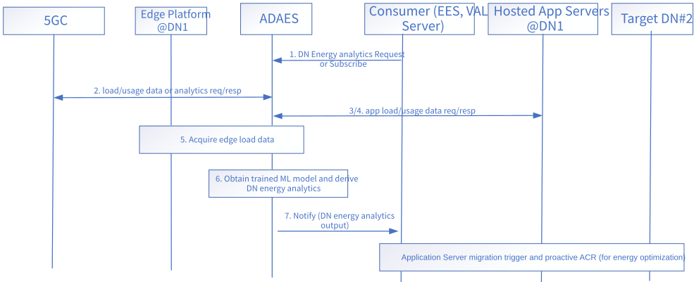

# 8.15 Solution #15: ADAES support for AI-enabled DN Energy Analytics

## 8.15.1 Solution description

In the edge scenarios, the energy consumption for EDN can be due to the EES/EAS vCPU usage, the API invocations (for edges services produced or consumed by the EDGE platform) and other energy consumptions (e.g HW/NFVI layer). Some of this part can be fixed; however, lots of the processing is analogous to the application services which require edge computing services for the communication of application traffic over 5GS. So, by knowing the predicted/expected application service consumption and impact to the edge platform for a given area and time would be useful for triggering actions to maintain energy consumption low while not sacrificing the agreed application service performance (based on the SLAs).

This solution introduces a logical functionality at the ADAES to provide analytics on the DN energy consumption /efficiency. The DN energy analytics is performed per DNN/ DNAI and may be used to trigger the application server migration to different cloud. The analytics are based on NWDAF analytics and UPF/DN measurements on user plane load as well as edge/app side measurements on the energy consumption.

NOTE 1: When applicable, the solution reuses existing capabilities related to Energy Efficiency by SA2 and SA5.

Figure 8.15.1-1 illustrates the high-level procedure for this solution.

Figure 8.15.1-1: Procedure for DN Energy Analytics

1\. The Consumer (e.g., VAL server, EAS) requests ADAES to perform analytics on the DN Energy Consumption/Efficiency for one or more DNs/EDNs, Event ID= “DN energy analytics”, for a given DN service area (or subarea) and a given time window.

2\. ADAES authorizes the request and initiates the collection of network usage data from the underlying 3GPP network; and in particular for the corresponding UPFs/DNAIs.

3\. ADAES may also request from the EAS /VAL servers hosted at the target DN, expected application service load and traffic schedules for the ongoing or future sessions within the area.

4\. ADAES receives from the EAS /VAL servers hosted at the target DN, expected application service load and traffic schedules as requested. Such data include traffic schedule report for the VAL Server.

5\. ADAES may also obtain edge load/usage data which are internal to the edge platform (e.g., present at an edge database).

NOTE 2: How the collected data are used to calculate energy efficiency metric is up to implementation.

6\. ADAES obtains the corresponding trained ML model (or uses MTME functionality to get trained model output) and performs analytics to derive the predicted energy consumption at the target area and time horizon. The analytics outputs can be the predicted energy consumption / efficiency for the given DNN/DNAI.

NOTE 3: The interaction between ADAES and AIML Enablement Server for the ML model training re-uses Solution #4.

7\. ADAES sends the analytics output data to the consumer.

NOTE 4: How Energy analytics is exposed to VAL server will be explored in normative phase.

Following step 7, the consumer can use these analytics as input to trigger pro-actively, for example:

\- an application server migration to a different edge cloud or to a centralized cloud as a way of reducing the energy consumption for the edge (if consumption is expected to be very high (e.g. higher than a pre-configured threshold)).

\- an application server offboarding and the instantiation of a new server at the target edge/centralized cloud to minimize energy consumption of the edge platform (taking into account the system wide energy efficiency).

## 8.15.2 Architecture Impacts

The architecture impacts are mainly the enhancement of ADAES to support an additional analytics service for DN energy analytics.

## 8.15.3 Corresponding APIs

This subclause provides a summary on the corresponding API for solution #15.

\- DN Energy Analytics API (request-response or subscribe-notify model; API provider: ADAES; known consumers: VAL server, EES; corresponding to step 1 and 7)

\- Energy-related Data Collection APIs:

\- Load / Usage data API (request-response or subscribe-notify model; API provider: UPF, known consumer: ADAES; corresponding to step 2)

\- Load / Usage analytics API (request-response or subscribe-notify model; API provider: NWDAF; known consumer: ADAES; corresponding to step 2)

\- Edge Load Data API (request-response model; API provider: EDN/EAS; known consumer: ADAES; corresponding to step 5)

NOTE: Further elaboration on the corresponding APIs for this solution will be provided at the normative phase in 3GPP TS 23.436 \[4\].

## 8.15.4 Solution evaluation

This solution addresses Key Issue #2 and introduces a new ML-enabled analytics capability to support ML-enabled DN energy analytics. This solution is re-using Solution #2 for the interaction with AIML enablement server, and mainly enhances ADAES. This solution is feasible and doesn't introduce any dependency to 3GPP network systems.

NOTE: Alignment with SA2 may be needed on the energy efficiency metric calculation based on the outcomes of EnergyServ study.
