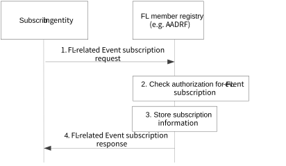
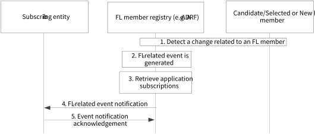

# 8.16 Solution #16: Support for FL event notifications

## 8.16.1 Solution description

This solution enables a subscriber/consumer (who can be the coordinator FL server or API invoker entity) for subscribing for AI/ML model related events and getting notified on changes on the availability of the FL members which are to be used for ML model training.

This solution consists of the following procedures 1) the subscription for the FL related events in clause 8.16.1.1 and 2) the event notification procedure in clause 8.16.1.2. Also, clause 8.16.1.3 describes a list of the events.

This solution enables a FL member registry (e.g., A-ADRF) to support the subscription for events related to FL members by a subscriber and its notification in case of changes. This solution assumes that such FL members have previously registered to this registry their availability and capabilities.

NOTE: The subscribing entity in this solution can be the VAL server or any other enabler server with MTME capability (e.g., AIML enablement server) which requires to be notified on the FL related events.

### 8.16.1.1 Procedure on subscription for FL related events

This procedure describes the subscription for events related to FL member availability.

Pre-conditions:

1\. The subscribing entity has the authorization to subscribe for the FL-related events.

Figure 8.16.1.1-1: Procedure for FL-related event subscription

1\. The subscribing entity sends an event subscription request to the FL member registry in order to receive notification of events related to the AI/ML model lifecycle changes and in particular the availability of FL member for a target service or area or UEs.

2\. Upon receiving the event subscription request from the subscribing entity, the FL member Registry checks for the relevant authorization for the event subscription.

3\. If the authorization is successful, the FL member Registry stores the subscription information.

4\. The FL member Registry sends an event subscription response indicating successful operation.

### 8.16.1.2 Procedure on FL related event notification

This procedure describes the event notification procedure for the FL member availability. This can be triggered based on a change at the availability / capabilities of the candidate or selected FL members.

Pre-conditions:

1\. The subscription procedure is performed by the subscribing entity.

2\. The candidate/selected or new FL member has registered to the FL member registry based on Solution \#9.

Figure 8.16.1.2-1: Procedure for FL-related event notifications

1\. The FL member Registry detects a change related to the availability of a Candidate or Selected FL member, who has already registered at the FL member registry. This detection can be in form of a trigger from the candidate /selected FL member or a new registration of a new FL member at the registry as discussed in Solution #9.

2\. The FL member Registry generates events to be consumed by the subscribing entity(s), based on the trigger notification, or based on a received registration from a new FL member (based on Solution #9).

3\. For the generated event, the FL member Registry retrieves the list of corresponding subscriptions.4. The FL member Registry sends FL-related event notifications to all the subscribing entity(s) that have subscribed for the event matching the criteria. If a notification reception information is available as part of the subscribing entity event subscription, then the notification reception information is used by the FL member Registry to send event notifications to the subscribing entity.

### 8.16.1.3 List of FL-related Events

A list (not exhaustive) of the FL related events is provided in Table 8.16.1.3-1.

Table 8.16.1.3-1: List of FL related events

|                                                       |                                                                                                                                                                                                                                                                                                 |
|-------------------------------------------------------|-------------------------------------------------------------------------------------------------------------------------------------------------------------------------------------------------------------------------------------------------------------------------------------------------|
| Events                                                | Events Description                                                                                                                                                                                                                                                                              |
| Availability/Unavailability of candidate FL member(s) | The event type relates to the availability or unavailability indication of a candidate FL member or a set of members, which can be a registered entity as a candidate FL server or FL client. Such availability can be for a given service area, or VAL UE, or for a given ML model ID/profile. |
| Availability changes of selected FL member            | The event type relates to the availability change of a selected FL member, which can be a selected entity as a FL server or FL client. Such availability change can be for a given service area, or VAL UE, or for a given ML model ID/profile.                                                 |
| FL service API update                                 | The event relates to the API update related to the FL service. This can be due to the relocation of an FL member to a different DN/EDN, and the need to provide the updated northbound API.                                                                                                     |
| Monitoring FL member load                             | This event relates to the monitoring of the computational load for the requested FL member. Such load can be the estimated (based on measurements) or expected/predicted.                                                                                                                       |
| Monitoring FL member energy                           | This event relates to the monitoring of the energy consumption for the requested FL member. Such energy consumption can be the estimated (based on measurements) or expected/predicted.                                                                                                         |
| FL model monitoring info                              | Time schedule and latency for the FL training. Latency considering the target latency, i.e., when the FL model training shall be completed.                                                                                                                                                     |
| System related events                                 | Alarm events providing fault information for the FL service.                                                                                                                                                                                                                                    |
| Performance related events                            | Events related to system load conditions.                                                                                                                                                                                                                                                       |

## 8.16.2 Architecture Impacts

The application enabler layer architecture impacts are the following:

\- An FL member Registry is introduced for enabling the registration of candidate FL members.

NOTE 1: FL member Registry can be within A-ADRF in scenarios where AIML enablement co-exists with ADAES.

NOTE 2: FL member Registry and the ML model repository can be co-located based on the deployment.

## 8.16.3 Corresponding APIs

This subclause provides a summary on the corresponding API for solution #16.

\- FL event Subscription API (request-response model; API provider: FL member registry; known consumers: VAL server, AIML enablement server, API invoker; corresponding to clause 8.16.1.1).

\- FL event Notify API (subscribe-notify model; API provider: FL member registry; known consumers: VAL server, AIML enablement server, API invoker; corresponding to clause 8.16.1.2).

## 8.16.4 Solution evaluation

This solution addresses Key Issue #3 and introduces the capability to support FL event notifications for FL members (or a group of FL members). Such FL members can be VAL UEs or VAL servers which are candidate to be used in ML operations. This solution is important for scenarios where the availability of candidate FL members changes (e.g. due to VAL UE mobility or energy status).

This solution is closely coupled to Solution #9 and requires that the FL member has previously registered to the FL member repository based on solution #9. This solution is feasible and doesn't introduce any dependency to 3GPP network systems.

NOTE: For the detection of a change in a FL member as in step 1 of clause 8.16.1.2, the FL member may indicate it indirectly via utilizing AIMLE server (based on Solution #9 in-direct registration of the FL members). Such in-direct detection will be further explored in normative phase.
