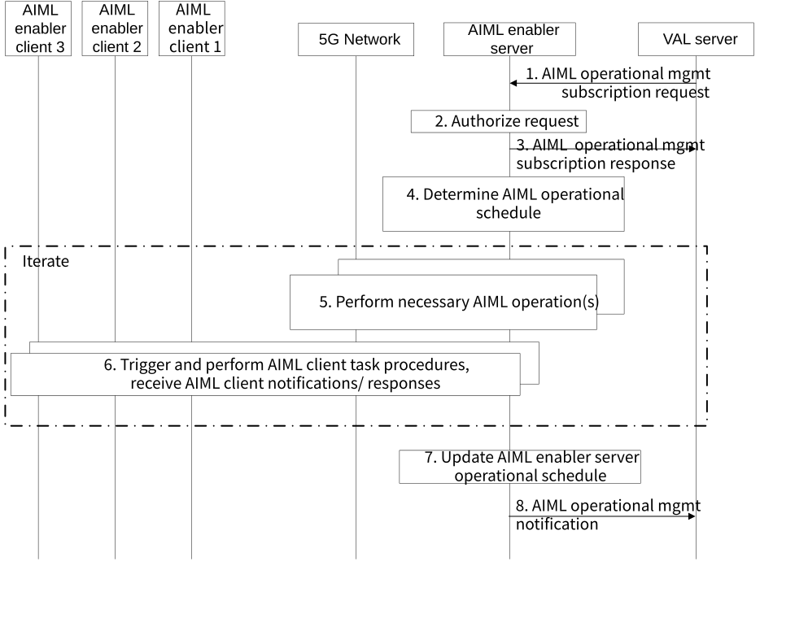

# 8.17 Solution #17: AIML operational management

## 8.17.1 Solution description

The following clauses specify procedures, information flows, and APIs for Key Issue #3 to support AIML operational management.

### 8.17.1.1 AIML operational management procedure

This clause describes the overall AIML operational management procedure which can be used by VAL Servers to offload single or multi-step processing to the AIML enablement layer, e.g., single request resulting in AIML Enablement server performing FL client selection followed by UE local data collection monitoring and providing notification only at completion. The procedure also allows VAL Servers to indicate specific optimization goals and targets for the overall processing. While greatest offloading gains can be obtained for FL tasks, other (non-FL) AIML operations can be initiated by the AIML Enablement Server as part of this procedure.

Assumptions:

1\. The proposed solution is based on client-server architecture for AIML operations.

Figure 8.17.1-1: AIML operational management procedure

1\. A VAL server sends an AIML operational management subscription request to an AIML enabler server to schedule AIML enablement operations. AIML operations can consist of data collection, data preparation, exploratory data analysis (EDA), AIML training, and AIML inference. AIML operations can also consist of participation in split AIML or transfer learning operations. The request includes the parameters listed in Table 8.17.3-1.

2\. The AIML enablement server validates the operational management subscription request and verifies the security credentials provided in the request. The AIML enablement server further performs authentication and authorization checks to determine if the requestor is able to schedule AIML operations. If authorized, the AIML enablement server creates an AIML operational management context with the provided information in the request and assigns an AIML operational management identifier.

3\. The AIML enablement server sends an AIML operational management subscription response that includes the status to the operational management request and the assigned AIML operational management identifier.

4\. The AIML enablement server uses the information in the AIML operational management profile and other information provided in step 1 to determine the set of AIML operations (which it needs to perform itself) and of AIML tasks (e.g., for AIML enabler clients).

> NOTE 1: The set of AIML operations to be performed at the AIML enabler server, together with the set of AIML operations and AIML tasks determined based on the step 1 request is termed “AIML operational schedule” for ease of description. How the “AIML operational schedule” is implemented by the AIML enabler is up to implementation.
>
> NOTE 2: “AIML task” is a generic term for AIML processing performed based on AIML enabler server requests (e.g. by AIML enabler clients). Examples of “AIML task” include triggering AIML enabler client to download an ML model and/or model parameters, triggering data collection, etc.

5\. Based on the AIML operational schedule, the AIML enablement server performs necessary operations. For example, it may perform AIML enablement client selection, AIML model management, etc. This step reuses procedures described in other solutions for each corresponding AIML operation. As part of this step, the AIML enablement server can also subscribe to analytics related to UE mobility, QoS, communication session information, from the 5GS NEF, NWDAF, SEAL services for monitoring.

6\. The AIML enablement server sends requests to the determined AIML enablement clients and is notified of task completion. This step is further detailed in clause 8.17.1.2.

> If operational optimization assistance information has been included in the step 1 request, the AIML enablement server can use 5GS support to provide optimizations, e.g. use of 3GPP TS 23.434 clause 14.3.12 for network parameters configuration, use of 3GPP TS 23.434 clause 14.3.10 for setup of QoS session, use of 3GPP TS 23.434 clause 14.3.3.3 for resource management, use of 3GPP TS 23.434 clause 14.3.5.3.2 for QoS provisioning and management, use 3GPP TS 23.502 clause 4.15.6.3 to configure the expected UE behavior parameters required for the optimization mode.

7\. For AIML operational management requests that resulted in multiple AIML operations and/or requests sent to the AIML enabler clients, the AIML enablement server may update the operational schedule based on the received notifications, operational schedule and local policies. For incomplete// disrupted AIML tasks, the AIML enabler server may determine to perform actions such as changing the selected AIML enablement client, modifying AIML task parameters, etc.

8\. The AIML enablement server sends an AIML operational management notification to the VAL server as listed in Table 8.17.3-3.

### 8.17.1.2 AIML enablement client task triggering

This clause describes how several different procedures can be used iteratively in the AIML Enablement layer to perform AIML operational management, as described in clause 8.17.1 step 6.

AIML enablement clients may be triggered by the AIML Enablement Server to perform AIML enablement operations as follows:

a\. Monitor data operations:

\- See solution #21: AIML data management procedure, steps 4-8.

b\. Download ML model and/or ML model parameters:

\- See push model information request/ response in clause 8.17.4. The AIML Enablement Server uses creates the request in Table 8.17.4-4 including the AIML model to be pushed and the necessary identifiers and sends it to the AIML client. The AIML client provides the response in Table 8.17.4-5.

c\. Provide ML model training capability evaluation.

\- See clause 8.18.2 steps 3-5.

d\. Perform model training.

\- See solution #22: HFL training, steps 4-7

\- See solution #18: Supporting VFL, steps 6-7

e\. Monitor training round.

See training monitoring request/ response in clause 8.17.4. The AIML Enablement Server uses creates the request in Table 8.17.4-6 to request the AIML Enablement client to monitor training rounds and provide training monitoring notifications.

## 8.17.2 Architecture Impacts

This solution assumes an architecture as detailed in clauses 7.2.1 or 7.2.3. There are no further impacts to the architecture based on this solution.

## 8.17.3 Corresponding AIML-S APIs

Table 8.1**7**.3-1 shows the request for the AIML operational management procedure from VAL Server to the AIML Enablement Server.

Table 8.17.3-1: Request for AIML operational management procedure

<table>
<colgroup>
<col style="width: 32%" />
<col style="width: 13%" />
<col style="width: 53%" />
</colgroup>
<tbody>
<tr class="odd">
<td>Information element</td>
<td>Status</td>
<td>Description</td>
</tr>
<tr class="even">
<td>Requestor identifier</td>
<td>M</td>
<td>The identifier of the requestor.</td>
</tr>
<tr class="odd">
<td>Security credentials</td>
<td>M</td>
<td>Security credentials to authenticate and authorize the requestor.</td>
</tr>
<tr class="even">
<td>Application identifier</td>
<td>O</td>
<td>An identifier for the AIML application</td>
</tr>
<tr class="odd">
<td>AIML operational management description</td>
<td>M</td>
<td>Information used to determine the AIML enabler operations to be performed. The parameter may provide a discrete list of AIML operations being requested to be managed by the AIML enablement server. AIML operations can be data collection, data preparation, exploratory data analysis (EDA), AIML training, AIML inference, and participation in split AIML or transfer learning operations.</td>
</tr>
<tr class="even">
<td>AIML operational management profile</td>
<td>M</td>
<td>Information provided to the AIML enablement server to manage the AIML operational management request, e.g.: ML model parameters, Training requirements, Dataset requirements</td>
</tr>
<tr class="odd">
<td>AIML client selection criteria</td>
<td>M</td>
<td>
Criteria use to select AIML clients that may be selected for AIML tasks, including location, connectivity schedule, etc. The AIML server can also use the selection criteria to maintain a AIML client pool to assist with performing the AIML task, e.g. due to inability to complete the AIML task as a result of disruptions in the UE or the network.

The selection criteria may be used to specify an AIML client list pre-selected by the requestor.
</td>
</tr>
<tr class="even">
<td>Minimum number of AIML clients</td>
<td>M</td>
<td>A minimum number of AIML enablement clients required to participate in the AIML operation.</td>
</tr>
<tr class="odd">
<td>Operational requirement information</td>
<td>O</td>
<td>Provides AIML service optimization assistance information. This includes an operational goal e.g. max convergence time.</td>
</tr>
<tr class="even">
<td>Scheduling criteria</td>
<td>O</td>
<td>Criteria to determine the AIML operational schedule. For example, data collection may require that AIML enablement clients collect data during certain times. An expiration time of the management request may be included</td>
</tr>
<tr class="odd">
<td>Notification criteria</td>
<td>O</td>
<td>A configuration for the frequency of notifications to the requestor and may be time-based and/or event based. Events may consist of AIML task completion, AIML task percentage completion, error conditions, and other events that may occur during AIML operation.</td>
</tr>
</tbody>
</table>

NOTE: The AIML operation management API is to be restricted from duplicating any other single AIML-S API available, e.g. restricted from triggering only a FL/ML training operation.

Table 8.17.3-2 shows the response for the AIML operational management procedure. The response is sent by the AIML Enablement Server to the VAL Server.

Table 8.17.3-2: Response for AIML operational management procedure

|                     |        |                                                                           |
|---------------------|--------|---------------------------------------------------------------------------|
| Information element | Status | Description                                                               |
| Status              | M      | The status for the request: success or fail.                              |
| Request identifier  | M      | An identifier to associate with the management request and notifications. |

Table 8.17.3-3 shows the notification for the AIML operational management procedure. The notification is sent by the AIML Enablement Server to the VAL Server.

Table 8.17.3-3: Notification for AIML operational management procedure

|                                |        |                                                                                                                             |
|--------------------------------|--------|-----------------------------------------------------------------------------------------------------------------------------|
| Information element            | Status | Description                                                                                                                 |
| Request identifier             | M      | Identifier of the corresponding management request.                                                                         |
| Completion status              | M      | Completion percentage of the management request.                                                                            |
| Result                         | M      | The result of the current AIML task: success or failure.                                                                    |
| AIML management request status | O      | Information related to the status of the management request completion, e.g. statistics, list of AIML enabler clients, etc. |
| Operational result             | O      | Provides indication of goals achieved, if the request included “Operational assistance information”                         |

## 8.17.4 Corresponding AIML-UU APIs

NOTE 1: For all the APIs in this clause, additional IEs are to be specified in the normative phase.

Table 8.17.4-1 describes information elements for UE local data collection monitor request.

Table 8.17.4-1: UE local data collection monitor request

| **Information element**                 | **Status** | **Description**                                                                    |
|-----------------------------------------|------------|------------------------------------------------------------------------------------|
| VAL service ID                          | O          | Identity of the VAL service for which data collection at the UE is being triggered |
| VAL Server ID                           | M          | Identify the VAL server for which the data collection applies                      |
| Data collection requirement information | M          | Provides information about the data collection requirements                        |

Table 8.17.4-2 describes information elements for local data collection monitor response.

Table 8.17.4-2: UE local data collection monitor response

| **Information element** | **Status** | **Description**                              |
|-------------------------|------------|----------------------------------------------|
| Result                  | M          | Indicates success or failure of the request. |

Table 8.17.4-3 describes information elements for UE local data collection monitor notification.

Table 8.17.4-3: UE local data collection monitor notification

<table>
<colgroup>
<col style="width: 33%" />
<col style="width: 16%" />
<col style="width: 50%" />
</colgroup>
<thead>
<tr class="header">
<th><strong>Information element</strong></th>
<th><blockquote>

<strong>Status</strong>

</blockquote></th>
<th><blockquote>

<strong>Description</strong>

</blockquote></th>
</tr>
</thead>
<tbody>
<tr class="odd">
<td>Result</td>
<td><blockquote>

M

</blockquote></td>
<td>Indicates end of data collection processing and success or failure of the procedure.</td>
</tr>
</tbody>
</table>

NOTE 2: The UE local data collection monitor notification can be a step 1 event for the clause 8.16.1.2 procedure for FL-related event notifications.

Table 8.17.4-4 describes information elements for the Push model information request from the AIML Enablement Server to the AIML Enablement Client.

Table 8.17.4-4: Push model information request

| **Information element** | **Status** | **Description**                                                                                                                                                                      |
|-------------------------|------------|--------------------------------------------------------------------------------------------------------------------------------------------------------------------------------------|
| VAL service ID          | O          | Identity of the VAL service for which the model applies                                                                                                                              |
| VAL Server Id           | M          | Identify the VAL server for which the model applies                                                                                                                                  |
| AIML model information  | M          | Information related to the AIML model and model parameters. It can include an URI of where the model can be downloaded from, the model software module, the AIML model profile, etc. |

Table 8.17.4-5 describes information elements for the Push model information response from the AIML Enablement Client to the AIML Enablement Server.

Table 8.17.4-5: Push model information response

| **Information element** | **Status** | **Description**                              |
|-------------------------|------------|----------------------------------------------|
| Result                  | M          | Indicates success or failure of the request. |

Table 8.17.4-6 describes information elements for training monitoring request.

Table 8.17.4-6: Training monitoring request

| **Information element**       | **Status** | **Description**                                                                               |
|-------------------------------|------------|-----------------------------------------------------------------------------------------------|
| VAL service ID                | O          | Identity of the VAL service for which data collection at the UE is being triggered            |
| VAL Server ID                 | M          | Identify the VAL server for which the model applies                                           |
| ML model                      | M          | Provides information about the ML model to be training to be monitored, e.g. model identifier |
| Training data requirements    | O          | Provides requirements for the training data to be used, e.g. min number of data samples.      |
| Training entity requirements. | O          | Provides requirements for determining the training entity to be used, e.g. list of FL members |

Table 8.17.4-7 describes information elements for training monitoring response.

Table 8.17.4-7: Training monitoring response

| **Information element** | **Status** | **Description**                              |
|-------------------------|------------|----------------------------------------------|
| Result                  | M          | Indicates success or failure of the request. |

Table 8.17.4-8 describes information elements for training monitoring notification.

Table 8.17.4-8: Training monitoring notification

<table>
<colgroup>
<col style="width: 33%" />
<col style="width: 16%" />
<col style="width: 50%" />
</colgroup>
<thead>
<tr class="header">
<th><strong>Information element</strong></th>
<th><blockquote>

<strong>Status</strong>

</blockquote></th>
<th><blockquote>

<strong>Description</strong>

</blockquote></th>
</tr>
</thead>
<tbody>
<tr class="odd">
<td>Result</td>
<td><blockquote>

M

</blockquote></td>
<td>Indicates end of training round and success or failure of the procedure.</td>
</tr>
<tr class="even">
<td>Completion status information</td>
<td><blockquote>

O

</blockquote></td>
<td>Provides information about the status of the training task, e.g. completion percentage.</td>
</tr>
</tbody>
</table>

NOTE 3: The training monitor notification can be a step 1 event for the clause 8.16.1.2 procedure for FL-related event notifications.

## 8.17.5 Solution evaluation

The solution for operational management provides a mechanism for the VAL layer to offload processing and/or monitoring of AIML operations to the AIML layer. This solution allows AIML enablement layer to provide significant value to VAL applications which require support with overall optimization of the AIML workflow and/or offload of associated monitoring, scheduling, etc. of individual operations,

The overall functionality of the AIML operational management procedure can be also triggered using multiple individual APIs (e.g., VFL training in solution #18, data management in solution #21) if the VAL layer performs the AIML management on its own.

NOTE: The AIML operation management API is to be restricted from duplicating any other single AIML-S API available, e.g., restricted from triggering only a FL/ML training operation.
