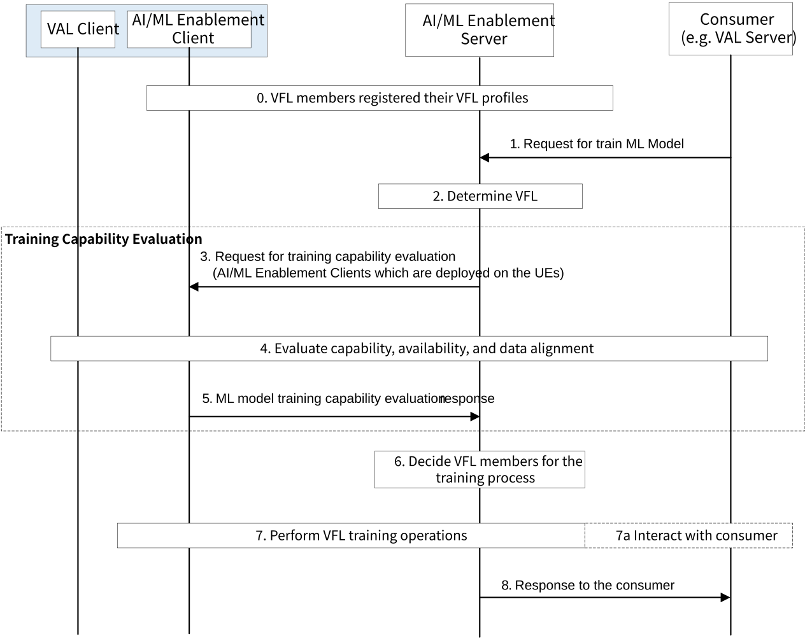

# 8.18 Solution #18: Supporting VFL in Enablement Layer

## 8.18.1 Solution description

The following clauses specify procedures, information flows and APIs for KI #4 to support VFL among Application Layer multiple UEs.

Pre-conditions:

\- VFL member (e.g., AI/ML Enablement Client which is deployed to an UE) has dataset or can access to data sources or is able to collect data from data producers for the AI/ML operations.

Figure 8.18.1-1: Procedure for supporting VFL in Enablement Layer

0\. VFL members (AI/ML Enablement Clients which are deployed on UEs) registered their VFL profile to the AI/ML Enablement Server (or A-ADRF). The VFL members may update their status or information in their VFL profile to the AI/ML Enablement Server (or A-ADRF).

1\. Consumer (e.g. VAL Server) sends request to the AI/ML Enablement Server for train ML model. The consumer includes an indication for vertical federated learning and other VFL requirements such as ML models, required VFL operation features, data samples requirements, VFL members requirements.

2\. After receiving the request from the consumer, the AI/ML Enablement Server determines that VFL training between domains is needed based on request from the consumer (if the request on VFL been provided in step 1) or local configuration (according to the requirements from the consumer on the AI/ML operations).

3\. The AI/ML Enablement Server gets VFL members information and sends ML model training capability evaluation request to the VFL members (AI/ML Enablement Clients which are deployed on UEs). The request message may include e.g. test task, requirements on available time for support VFL operations, ML model, required features of the dataset from the UE, available data sources, domains of the datasets at the UE.

4\. The VFL members evaluate their capability and availability to join the VFL training process. The VFL members (AI/ML Enablement Clients which are deployed on UEs) run the test task contained in the request in step 5a and judge whether it will join the VFL process. As part of the test task, data alignment between the datasets of the different domains are determined. The VAL server may also provide data labels for the data alignment.

NOTE 1: The procedures for data collection from UE need to take user consent into account.

5\. The VFL members (AI/ML Enablement Clients which are deployed on UEs) send response to the AI/ML Enablement Server. The response message includes the decision on whether to join the VFL training process or not, with the reason if not join or with test result if join.

6\. The AI/ML Enablement Server determines the VFL members for this VFL training process based on the information received in step 5 and parameters received in step 1. The criteria used by the AI/ML Enablement Server include:

\- Available data and minimum number of data samples for the same sample among the VFL members.

\- Feature alignment of the sample/datasets with data labels among the VFL members.

\- Available time of the VFL members for support the VFL training operations.

\- Capability and minimum number of the VFL members for the VFL training operations.

\- AIML model information for the VFL members and for the AI/ML Enablement Server.

NOTE 2: How the above parameters be used will be discussed during the normative phase.

7\. The AI/ML Enablement Server coordinates the selected VFL members to perform VFL training operations for the VFL process using the parameters received in step 1. During VFL training, the VFL members send the AI/ML Enablement Server intermediate results, and the AI/ML Enablement Server sends the VFL members gradients to update the model parameters maintained by each VFL member.

7a. The AI/ML Enablement Server may report to the consumer with the intermediate training status. The consumer may adjust its request on the ML model.

8\. The AI/ML Enablement Server sends response to the consumer. The response message may contain trained ML model.

## 8.18.2 Architecture Impacts

This solution is based on the architecture described in clause 7. The application enabler layer architecture impacts are the following:

\- Interactions between AIMLE Server, AIMLE Client, and consumer (e.g. VAL Server) are introduced to support evaluate the capability and availability of VFL members to join VFL training process, and for data alignment.

## 8.18.3 Corresponding APIs

This subclause provides a summary on the corresponding API for solution #18.

\- AIMLE Register API (request-response model; API provider: AIMLE Server or ML Repository; known consumers: AIMLE Client) to support AIMLE Client registers its VFL profile.

\- AIMLE ML Model Training Capability Evaluation API (request-response model; API provider: AIMLE Client; known consumers: AIMLE Server) to support AIMLE Server to request AIMLE Client for ML model training capability evaluation.

## 8.18.4 Solution evaluation

This solution addresses Key Issue #4 and introduces procedures, information flows and APIs to support VFL among VAL UEs. The produce introduced in this solution can be used to evaluate the capability and availability of VFL member to join a VFL training process, and for sample and feature alignment for VFL. This solution is feasible and doesn't introduce any dependency to 3GPP network systems.
