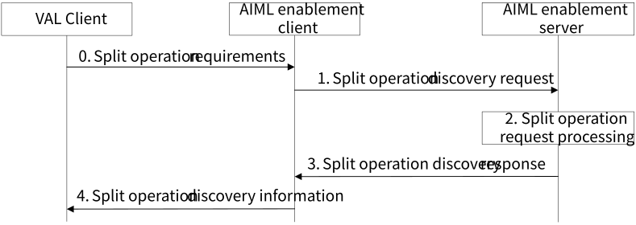
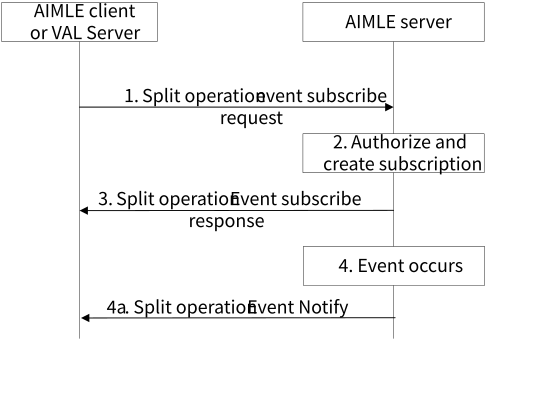
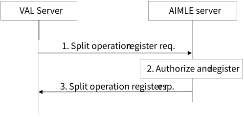
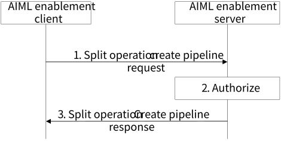

# 8.19 Solution #19: Support for AIML operation splitting

## 8.19.1 Solution description

This solution is for Key Issue #5 and addresses AIML operation splitting management and configuration.

In this solution, the term "split operation pipeline" is used to represent distributed compute nodes configured sequentially. Data can be provided at the entry point of the pipeline, and sequentialy processed through each node of the pipeline. Figure 8.19.1-1 illustrates an example of a split operation pipeline for AIML.

Figure 8.19.1-1: Example of a split operation pipeline

This solution introduces the discovery of an AIML split operation pipeline for performing inference via the AIML enablement layer and addresses aspects related to consumption of the pipeline’s inference results.

In the procedure, an AIML VAL application of a UE requires support of the network to perform AIML inference that cannot be performed locally on the UE. The AIML VAL client interacts with the AIML enablement client to provide information needed to discover or establish (e.g., create, configure) split AIML operation pipeline in the network, obtain information about the split AIML operation pipeline, and use the split AIML operation pipeline.

## 8.19.2 Procedure for AIML operation splitting discovery

Pre-conditions:

\- AIML inference models are available in the ML model repository or A-ADRF;

\- the AIML enablement server is aware of or can discover compute nodes available for performing AIML inference using available models;

Figure 8.19.2-1: Support for Split AIML operation discovery

0\. An AIML VAL client needs support from the network for performing split AIML operation. The AIML VAL client provides split operation requirements to the AIML enablement client. The requirement may include information about inference stages (e.g., number, order, etc.), information about the trained AIML models (e.g., identifiers, versions, etc.) to be used at each stage, information about the planned usage of the AIML split operation (e.g., predicted inputs frequency/size, requested output frequency / size, etc.).

NOTE 1: Split operation requirements may be further defined in the normative phase.

1\. The AIML enablement client requests split AIML operation discovery to the AIML enablement server; the request may be based on a VAL client requirement(s). The split operation request may include information in Table 8.19.4.2-1.

2\. Upon receiving the request, the AIML enablement server validates if the requestor is authorized to request discovery of split AIML operation. If the requestor is authorized, the AIML enablement server may determine if an existing AIML split operation pipeline is available and satisfies the request parameters. If an existing AIML split operation pipeline is available, the AIML enablement server may proceed to step 3.

> If no AIML split operation pipeline satisfies the request parameters, the AIML enablement server:
>
> \- determines if an AIML split operation pipeline can be created. The determination for AIML split operation pipeline creation may be based on availability of ML inference models in a ML model repository/A-ADRF and may be based on determination of available inference nodes (e.g., VAL server(s), NWDAF(s), etc.) to execute such ML inference models.

NOTE 2: the AIML enablement server may discover available inference nodes if it has that capability.

NOTE 3: inference nodes may register with the AIML enablement server and indicate their capabilities for AIML split operation.

> \- request or notify the determined inference nodes of their enrolment in the AIML split operation pipeline instance as specified in clause 8.19.2.1; the request or notification may include configuration information.
>
> \- create a AIML split operation profile if needed. The AIML split operation profile may contain information about the AIML split operation pipeline nodes, configuration and expected usage.

3\. The AIML enablement server sends a split operation response to the AIML enablement client. If the AIML enablement server has determined AIML split operation profile (s) (e.g., existing, or newly formed), the response includes the AIML split operation profile(s). Otherwise, the response may include a failure and reason for failure.

4\. Upon receiving a response including AIML split operation profile(s), the AIML enablement client may store the AIML split operation profile(s) and provide the discovered split operation information (e.g., endpoints) to the VAL client.

The VAL client may use the provided information to access the AIML split operation pipeline.

If the VAL client is a data provider to the pipeline (e.g., if the VAL client participates in the pipeline), the VAL client may use the split operation discovery information to send data (e.g., intermediate inference data) towards the AIML split operation pipeline head node.

If the VAL client is a data consumer of the AIML split operation inference results from the pipeline (e.g., if the VAL client is a consumer of the pipeline final inference), the VAL client may use the split operation discovery information to request results or subscribe to results from the pipeline tail node.

### 8.19.2.1 Procedure for subscribe-notify for split operation pipeline events

Figure 8.19.2.1-1: Split operation pipeline event subscription

1\. The requestor (e.g., AIML enablement client or VAL server) sends a request to subscribe to split operation pipeline events to the AIML enablement server. The request includes requestor identifier, security credentials, events for which the requestor is subscribing, expiration time and pipeline identifier.

2\. Upon receiving the request, the AIML enablement server validates if the requestor is authorized to subscribe for split operation events. If the requestor is authorized, the AIML enablement server creates the subscription and subscription identity.

3\. The AIML enablement server sends subscription response message to the requestor indicating success or failure of the request. In case of success, the response includes the subscription identity and may include an expiration time; to maintain the subscription, the requestor shall send a subscription update request before the expiration time, otherwise the split operation subscription expires. In case of failure, the response includes the failure indication and cause.

4\. The AIML enablement server detects event(s) for which the requestor is subscribed, that is, the AIML enablement client is either added to the pipeline or removed from the pipeline, a new pipeline is added, an existing pipeline is modified (e.g., stages, AIML model, etc.) or deleted. The AIML enablement server sends notification message (4a) to the requestor indicating the event. The notification includes a pipeline identifier or AIML split operation profile dependent on the associated event.

NOTE 1: More Split Operation events may be determined in the normative phase.

NOTE 2: Events that apply to the AIMLE client, to the VAL Server or to both will be determined in the normative phase.

### 8.19.2.2 Procedure for VAL server AIML split operation registration

Figure 8.19.2.2-1: Split operation pipeline registration

1\. The VAL server sends a split operation register request to the AIMLE server; the registration indicates the split operation capabilities of the VAL server. The request includes the VAL server AIML split operation profile and an expiration time. The AIML split operation profile may include the VAL server identifier and information about split operation pipeline(s) managed by the VAL server. The split operation pipeline information may include inference stages information (e.g., number, order, etc.), information about the trained AIML models (e.g., identifiers, versions, etc.) to be used at each stage, information about the planned usage of the AIML split operation pipeline (e.g., inputs frequency/size, requested output frequency / size, etc.).

NOTE: AIML split operation profile may be further defined in the normative phase.

2\. Upon receiving the request, the AIMLE server validates if the requestor is authorized to register for AIML split operation. If the requestor is authorized, the AIMLE server stores the AIML split operation profile.

3\. The AIMLE server sends a split operation register response to the requestor. If the AIMLE server has authorized the registration, the response may include an updated expiration time; to maintain the registration, the requestor shall send a registration update request before the expiration time, otherwise the split operation registration expires. If the request was not authorized, the response includes a failure indication and a reason.

### 8.19.2.3 Procedure for client creating pipeline

Figure 8.19.2.3-1 illustrates the procedure for AIML enablement client to create the pipeline based on the discovered nodes. The AIML enablement client has received list of nodes from the AIML enablement server as specified in the clause 8.19.2. Based on the AIML model, split points and discovered nodes, the AIML enabler client (along with application client) selects the list of nodes to be added for the pipeline.

Pre-condition:

1\) The AIML enablement client has received list of nodes from the AIML enablement server as specified in the clause 8.19.2.

Figure 8.19.2.3-1: Split operation creation and announcement from client

1\. The AIML enablement client sends a request to create split operation pipeline to the AIML enablement server. The request includes requestor identifier, security credentials, information about the trained AIML models (e.g., identifiers, versions, etc.) to be used at each stage, information about the planned usage of the AIML split operation (e.g., predicted inputs frequency/size, requested output frequency/size, etc.) and AIML split operation profile including nodes to be included in the split operation pipeline.

2\. Upon receiving the request, the AIML enablement server validates if the requestor is authorized to create split operation pipeline. If the requestor is authorized, the AIML enablement server creates the pipeline.

3\. The AIML enablement server sends a split operation create pipeline response message to the AIML enablement client indicating success or failure of the request.

NOTE: Procedures in clause 8.19.2.2 and 8.19.2.3 can be consider to merge during normative phase.

## 8.19.3 Architecture Impacts

The solution architecture impacts are:

\- The AIML Enablement Server and AIML Enablement Client are introduced to support split operation discovery.

## 8.19.4 Corresponding APIs

### 8.19.4.1 API Overview

This clause provides a summary on the corresponding API for solution #19.

\- Discover AIML split operation profiles API (request/response model: API provider: AIMLE Server, known consumers: AIMLE Client, corresponding to step 1 to 3 of clause 8.19.2).

\- Discover AIML split operation API (request/response model: API provider: AIMLE Client, known consumers: VAL Client, corresponding to step 0 and 4 of clause 8.19.2).

\- Discover AIML split operation profiles API (subscribe/notify model: API provider: AIMLE Server, known consumers: AIMLE Client or VAL server, corresponding to step 1 to 4a of clause 8.19.2.1).

\- Register AIML split operation profiles API (request/response model: API provider: AIMLE Server, known consumers: Val Server, corresponding to step 1 to 3 of clause 8.19.2.2).

\- Create AIML split operation pipeline (request/response model: API provider: AIMLE Server, known consumers: AIMLE Client, corresponding to step 1 to 3 of clause 8.19.2.3)

### 8.19.4.2 Information flows

Table 8.19.4.2-1 shows the request sent by a AIML enablement client to the AIML enablement server for split operation discovery request.

Table 8.19.4.2-1: Split operation discovery request

|                               |        |                                                                                                                                     |
|-------------------------------|--------|-------------------------------------------------------------------------------------------------------------------------------------|
| Information element           | Status | Description                                                                                                                         |
| Requestor identifier          | M      | The identity of the requestor (e.g., VAL client ID, AIML client ID, UE identifier)                                                  |
| Security credentials          | M      | The security credentials of the requestor.                                                                                          |
| Split operation requirements  | M      | Split operation requirements                                                                                                        |
| \> pipeline stage information | M      | Information about the pipeline stages (e.g., number, order, etc.)                                                                   |
| \> model information          | M      | Information about the AIML models to be used in each stage (e.g., identifiers, versions, etc.)                                      |
| \> usage information          | O      | Information about the planned usage of the AIML split operation pipeline (e.g., inputs frequency/size, output frequency/size, etc.) |

Table 8.19**.**4.2-2 shows the response sent by sent by the AIML enablement server to the AIML enablement client for split operation discovery response.

Table 8.19.4.2-2: Split operation discovery response

|                                                                   |        |                                                                                                                          |
|-------------------------------------------------------------------|--------|--------------------------------------------------------------------------------------------------------------------------|
| Information element                                               | Status | Description                                                                                                              |
| Successful response                                               | O      | Indicates that the discovery request was successful.                                                                     |
| \>list of nodes (NOTE)                                            | O      | List of all discovered nodes                                                                                             |
| \>List of AIML split operation profiles (NOTE)                    | O      | The list of AIML split operation profiles.                                                                               |
| \>\>pipeline identifier                                           | M      | Identifier of the split operation pipeline                                                                               |
| \>\>pipeline head endpoint                                        | M      | Endpoint of the pipeline head node (e.g., for providing inference data).                                                 |
| \>\>pipeline tail endpoint                                        | M      | Endpoint of the pipeline head node (e.g., for obtaining inference results).                                              |
| \>\>pipeline expected usage                                       | O      | Information about usage of the AIML split operation pipeline (e.g., inputs frequency/size, output frequency/size, etc.). |
| \>\>pipeline model information                                    | M      | Information about the AIML models used in each stage (e.g., identifiers, versions, etc.).                                |
| \>\>pipeline stage information                                    | M      | Information about each stage of the pipeline (e.g., number, order, etc.).                                                |
| Failure response                                                  | O      | Indicates that the discovery request failed.                                                                             |
| \>Failure cause                                                   | O      | Indicates the failure cause.                                                                                             |
| NOTE: Any one of the IE shall be present for successful response. |        |                                                                                                                          |

Table 8.19**.**4.2-3 shows the request sent by a AIML enablement client to the AIML enablement server to subscribe for split operation events.

Table 8.19.4.2-3: Split operation event subscription request

| Information element  | Status | Description                                                                                                       |
|----------------------|--------|-------------------------------------------------------------------------------------------------------------------|
| Requestor identifier | M      | The identity of the requestor (e.g., VAL client ID, AIML client ID, UE identifier).                               |
| Security credentials | M      | The security credentials of the requestor.                                                                        |
| Subscribed events    | M      | Indicates the list of subscribed split operation events (e.g., pipeline created, modified, removed).              |
| pipeline identifier  | O      | Identifier of the split operation pipeline if the requestor is subscribing to a specific pipeline related events. |
| Expiration Time      | O      | Proposed expiration time for the subscription.                                                                    |

Table 8.19**.**4.2-4 shows the response sent by the AIML enablement server to the AIML enablement client for Split operation event subscription response.

Table 8.19.4.2-4: Split operation event subscription response

<table>
<colgroup>
<col style="width: 33%" />
<col style="width: 16%" />
<col style="width: 50%" />
</colgroup>
<thead>
<tr class="header">
<th>Information element</th>
<th>Status</th>
<th>Description</th>
</tr>
</thead>
<tbody>
<tr class="odd">
<td>Successful response</td>
<td>O</td>
<td>Indicates that the subscription request was successful.</td>
</tr>
<tr class="even">
<td>&gt;Subscription identifier</td>
<td>O</td>
<td>Identifier of the subscription.</td>
</tr>
<tr class="odd">
<td>&gt;Expiration time</td>
<td>O</td>
<td>
Indicates the expiration time of the subscription.

To maintain an active registration, a subscription update is required before the expiration time.
</td>
</tr>
<tr class="even">
<td>Failure response</td>
<td>O</td>
<td>Indicates that the subscription request failed.</td>
</tr>
<tr class="odd">
<td>&gt;Failure cause</td>
<td>O</td>
<td>Indicates the failure cause.</td>
</tr>
</tbody>
</table>

Table 8.19**.**4.2-5 shows the notification sent by the AIML enablement server to the AIML enablement client to notify the client about pipeline events.

Table 8.19.4.2-5: Split operation event notification

| Information element          | Status | Description                                                                        |
|------------------------------|--------|------------------------------------------------------------------------------------|
| Event                        | M      | Indicates the detected split operation event.                                      |
| AIML split operation profile | O      | The AIML split operation profile associated with the event (see Table 8.19.4.2-2). |

Table 8.19**.**4.2-6 shows the request sent by a VAL server to the AIML enablement server to register for AIML split operation.

Table 8.19.4.2-6: Split operation registration request

| Information element          | Status | Description                                                              |
|------------------------------|--------|--------------------------------------------------------------------------|
| Requestor identifier         | M      | The identity of the requestor (e.g., VAL server)                         |
| Security credentials         | M      | The security credentials of the requestor.                               |
| AIML split operation profile | M      | The AIML split operation profile of the VAL server (see Table 8.19.4-2). |
| Expiration Time              | O      | Proposed expiration time for the registration.                           |

Table 8.19**.**4.2-7 shows the response sent by an AIML enablement server to a VAL server for the AIML split operation registration.

Table 8.19.4.2-7: Split operation registration response

<table>
<colgroup>
<col style="width: 34%" />
<col style="width: 11%" />
<col style="width: 53%" />
</colgroup>
<thead>
<tr class="header">
<th>Information element</th>
<th>Status</th>
<th>Description</th>
</tr>
</thead>
<tbody>
<tr class="odd">
<td>Successful response</td>
<td>O</td>
<td>Indicates that the registration request was successful.</td>
</tr>
<tr class="even">
<td>&gt;Expiration time</td>
<td>O</td>
<td>
Indicates the expiration time of the registration.

To maintain an active registration, a subscription update is required before the expiration time.
</td>
</tr>
<tr class="odd">
<td>Failure response</td>
<td>O</td>
<td>Indicates that the registration request failed.</td>
</tr>
<tr class="even">
<td>&gt;Cause</td>
<td>O</td>
<td>Indicates the cause of registration request failure</td>
</tr>
</tbody>
</table>

Table 8.19**.**4-8 shows the request sent by a AIML enablement client to the AIML enablement server to create split operation pipeline.

Table 8.19.4-8: Create split operation pipeline request

| Information element       | Status | Description                                                                                                                         |
|---------------------------|--------|-------------------------------------------------------------------------------------------------------------------------------------|
| Requestor identifier      | M      | The identity of the requestor (e.g., VAL client ID, AIML client ID, UE identifier)                                                  |
| Security credentials      | M      | The security credentials of the requestor.                                                                                          |
| model information         | M      | Information about the AIML models to be used in each stage (e.g., identifiers, versions, etc.)                                      |
| usage information         | O      | Information about the planned usage of the AIML split operation pipeline (e.g., inputs frequency/size, output frequency/size, etc.) |
| Pipeline information      | O      | The information about the split AIML split operation pipeline.                                                                      |
| \>pipeline identifier     | M      | Identifier of the split operation pipeline                                                                                          |
| \>pipeline head endpoint  | M      | Endpoint of the pipeline head node (e.g., for providing inference data).                                                            |
| \>pipeline tail endpoint  | M      | Endpoint of the pipeline head node (e.g., for obtaining inference results).                                                         |
| \>pipeline expected usage | O      | Information about usage of the AIML split operation pipeline (e.g., inputs frequency/size, output frequency/size, etc.)             |
| \>notification target     | O      | Endpoint information where the result of the split operation is sent by the nodes.                                                  |

Table 8.19**.**4-9 shows the response sent by sent by the AIML enablement server to the AIML enablement client for create split operation pipeline response.

Table 8.19.4-9: Create split operation pipeline response

| Information element            | Status | Description                                                                |
|--------------------------------|--------|----------------------------------------------------------------------------|
| Successful response            | O      | Indicates that the create split operation pipeline request was successful. |
| \>AIML split operation profile | M      | The AIML split operation profiles of the created pipeline.                 |
| Failure response               | O      | Indicates that the create split operation pipeline request failed.         |
| \>Failure cause                | O      | Indicates the failure cause.                                               |

## 8.19.5 Solution evaluation

The proposed solution addresses Key Issue #5 for AIML operation splitting management and configuration.

The solution introduces a procedure for enabling discovery of AIML split operation pipelines based on VAL client requirements, procedures for subscribing to split operation events notifications at the AIMLE client and VAL server, a procedure for registering AIML split operation pipelines by the VAL server, and a procedure for creating split operation pipeline by AIML enablement client.

The solution allows a VAL client to consume results from a discovered split operation pipeline, to produce intermediate inference results into a discovered split operation pipeline or both.

The solution is based on the AIML enablement layer architecture, including an AIML enablement client and AIML enablement server.
