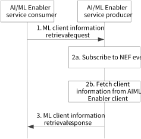

# 8.2 Solution #2: ML client information retrieval

## 8.2.1 General

The following clauses specify procedures, information flows and APIs for Key issue X to enable the selection of ML clients.

Assumptions:

1\. The proposed solution is based on the AIML Enabler service producer/consumer architecture. The service producer can be a standalone new entity like an AIML Enabler server or collocated with a SEAL entity like an ADAE server or part of the ADAE server. The AIML Enabler service consumer could be VAL servers, VAL UE, or any other entities that consume the AIML Enabler services.

2\. The proposed solution assumes distributed clients in ML. E.g., Federated Learning.

## 8.2.2 Procedures

Figure 8.2.2-1: ML client information retrieval procedure

1\. The AIML Enabler service consumer (e.g., VAL server) sends the ML client information retrieval request to the AIML enabler service producer. The request may contain identities to identify the ML service, some filtering criteria to filter for the selection of UEs like battery level, UE velocity, etc.

2a-2b. Upon receiving the request, the AIML enabler service producer may subscribe to the procedure defined in clause 4.15.13 of 3GPP TS 23.502 \[6\]. It also fetches client information from the AIML enabler client.

3\. The AIML enabler service producer processes the NEF response and AIML client response and provides the response to consumer. The response may contain the list of client identifiers as per the selection criteria mentioned in the filter.

NOTE 1: The step 2b can reuse steps 3-4 of solution #6 (or use separate interaction) which can be further worked out in the normative stage.

NOTE 2: The harmonization of terms like AIML service producer / consumer will be confirmed based on the agreed AIMLAPP architecture in clause 7 during normative work.

## 8.2.3 Architecture Impacts

The current solution is based on the service producer and consumer model, where the service producer and consumer could be AIML enabler server and client. The architecture based on AIML enabler client/server is described in clause 7. The AIML enabler service producer is AIML Enablement server, and AIML enabler service consumer is VAL server. The solution does not introduce any architecture impacts.

## 8.2.4 Corresponding APIs

This subclause provides a summary on the corresponding API for solution #2.

\- ML client information retrieval API (request / response model; API provider: AIMLE server; known consumer: VAL server; corresponding to step 1and step 3 of clause 8.2.2.1).

## 8.2.5 Solution evaluation

This solution addresses Key Issue #3(bullet #2 - Identify procedures for supporting FL at the application enablement layer, including FL entity discovery, registration, communication, reporting) and Key Issue #7(bullet #1 - How to support the AI/ML for member selection and re-selection (e.g., policies).). This enables the VAL server to request the AIML enabler server to find out the potential clients for its AIML service like FL based on the filtering criteria.

This solution is feasible and doesn't introduce any dependency to 3GPP network systems. The solution can be merged with other solution #6 and solution #7.

The proposed solution in clause 6.2.2 (hereafter referred to as the evaluated solution) provides a solution for assumption # 2 of solution # 6 because the result of step 3 of the evaluated solution can be provided as one of the input - a list of AIML client IDs in the request message(step 1) of the solution # 6. Also, step 1 of the evaluated solution can merge with step 4 of solution #6 where the filtering criteria can be a complementary or additional factor to find the potential clients.

Step 1 of the evaluated solution can merge with step 1 of solution #7 because solution #7 includes discovery criteria in step 1 and the evaluated solution includes filtering criteria in step 1, which is similar in functionality as both provides criteria to discover the clients. Step 3 of solution #7 provides a list of AIML clients, which is the same as the result of step 3 of the evaluated solution. Therefore, the solutions can merge to enhance and support the discovery mechanism.
