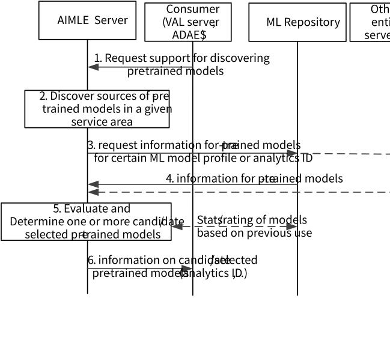

# 8.20 Solution #20: AIML Enabler support for Transfer Learning

This solution addresses Key Issue #6 on transfer learning enablement.

In this study, AIML enablement can be used for two types of ML tasks:

\- ADAE analytics tasks (so, the training of the model is bound to a certain analytics ID).

\- VAL related tasks (so, the VAL server/client are AI/ML enhanced applications which require from the AIML enablement to provide support in ML operations e.g. ML model training).

For both types of ML tasks, the solution aims to provide support for Transfer Learning (TL) by discovering and selecting the base models to be used for similar tasks as pre-trained models.

## 8.20.1 Solution description

Figure 8.20.1-1 illustrates the procedure where the TL enablement is performed based on the request for either an ML task from VAL layer or for an analytics task from ADAES. Such TL enablement allows the consumer to discover the similar ML models to be used as base models for the TL, as well as to support the selection of the best model to be used as pre-trained model.

Pre-conditions:

1\. Consumer is connected to AIML Enablement Server.

Figure 8.20.1-1 Procedure for TL enablement

1\. The consumer (VAL server or ADAES) sends a request to the AIML Enablement Server to provide support for discovering and selecting the appropriate pre-trained model for a given ML task (for analytics ID \#x or for a certain ML model profile).

2\. AIML Enablement Server discovers the ML repository or directly the possible MTME functionalities which can provide a pre-trained model for this request. Such entities can be VAL servers or other ADAES or other AIML Enablement Servers from the same or other platforms.

3\. The AIMLE Server sends a request message to receive information on the pre-trained models available in the given task based on step 1. This request message is sent to the ML repository or directly to the sources of the base models.

4\. The AIMLE Server receives based on the request, the information on the available pre-trained models together with context information to assist the selection.

5\. The AIMLE Server evaluates with the support of the ML model repository, whether the pre-trained models are applicable to the analytics ID or model profile using certain criteria. This can be assisted using data/stats from previous utilization of these models for the certain ML task.

Based on the evaluation (which can be based on the rating), the AIML Enablement Server determines one or more pre-trained models to be used for the analytics ID or model profile.

NOTE: In this step, the AIMLE Server may rate or set a weight to the pre-trained model or the source of the model. For example, this rate can be for the applicability to a certain analytics ID (\<analytics ID \#x, rate 90%\>).

6\. The AIMLE Server sends to the Consumer the information for the selected pre-trained models (ID, profile, address to download) and the trained models themselves. Also, this may include the rating/weight for the pre-trained model if the ADAES needs to decide among a list of them.

## 8.20.2 Architecture Impacts

The application enabler layer architecture impacts are the following:

\- AIMLE server is introduced with a capability to provide support for TL enablement (discovery and selection of models to be used as pre-trained models for a certain task).

\- An ML registry/repository needs to be defined for serving a database for the pre-trained models and the model info.

## 8.20.3 Corresponding APIs

This subclause provides a summary on the corresponding API for solution #20.

\- Discover pre-trained model info API (request / response model; API provider: AIMLE Server; known consumers: VAL server or ADAES; corresponding to step 1 and 6 of clause 8.20.1.1).

\- Fetch pre-trained model info API (request / response model; API provider: ML model registry, known consumer: AIMLE server; corresponding to step 3 and 4 of clause 8.20.1.1).

## 8.20.4 Solution evaluation

This solution addresses Key Issue #6 and introduces the capability to support TL enablement at AIML enablement server by supporting the discovery and selection of models to be used as pre-trained models for an ML task related to either ADAE analytics or a VAL request. This solution is necessary if TL is employed, since the consumer needs to be aware on the applicability/similarity of a certain model to be used as a base for another ML task.

NOTE: How other solutions (e.g., Solution #5) can be re-used for the discovery aspects, will be considered at the normative phase.

This solution is feasible and doesn't introduce any dependency to 3GPP network systems.
