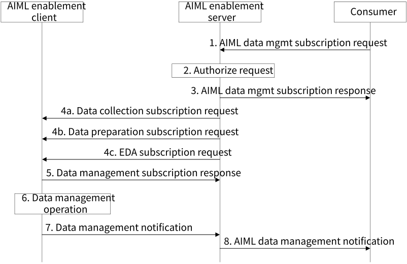

# 8.21 Solution #21: AIML data management procedure

## 8.21.1 Solution description

The following clauses specify procedures, information flows, and APIs for Key Issue #3 to support AIML data management. In this context, the term ”data management” (for AIML) refers to one of the following: data collection, data preparation, and exploratory data analysis.

Data collection is the process of obtaining raw data, whether internally or externally of AIML enablement client, for use in AIML operation. Data preparation is the process of processing raw data into a format suitable for AIML operations (e.g. training, inferencing). Exploratory data analysis (EDA) is the process of analyzing data for general patterns and to obtain statistical properties of the data without having direct access to the data. Since federated learning preserves data privacy, an AIML consumer (e.g. VAL server) utilizes EDA requests to gain an understanding of the data, e.g. to obtain data distributions and data ranges, detect anomalies and outliers, determine relationships between/among features, and other statistical properties.

Figure 8.21.1-1: Procedure for supporting AIML data management.

1\. A consumer (e.g., VAL server) makes a request for data management subscription. The request includes a management type indicator (e.g., data collection, data preparation, exploratory data analysis), data management requirements, and a list of AIML enablement clients.

The following is provided for data collection: dataset and data producer requirements, sample collection requirements, the time period for which data collection is valid, the location for data collection, etc.

The following is provided for data preparation: a dataset identifier and data preparation requirements.

The following is provided for exploratory data analysis: a dataset identifier, a list of features for statistical analysis, indication for outlier and anomaly reporting, policy for univariate/multivariate analysis, and EDA output formats.

2\. The AIML enablement server authorizes the request.

3\. The AIML enablement server sends a data management subscription response to the consumer with a status of the request.

4\. The AIML enablement server sends data management subscription requests to AIML enablement clients. The request can be for data collection (step 4a), data preparation (step 4b), or exploratory data analysis (step 4c). The request includes the information from the request in step 1.

NOTE: Data collection can reuse A-DCCF procedures

5\. The AIML enablement client sends a data management subscription response with a status of accept or reject.

6\. The AIML enablement client performs the operations necessary to trigger data management at the UE, e.g. from VAL clients. For data collection, the AIML enablement client performs data collection subscription as described in procedures in 3GPP TS 23.436. If data is to be collected from the UE, SA4 EVEX mechanism can be reused as described in 3GPP TS 26.531. For data preparation and exploratory data analysis, the AIML enablement client performs the operation locally.

7\. After completing the data management task, the AIML enablement client sends a notification to the AIML enablement server. If necessary, the AIML enablement server may repeat step 4 to complete the data operation.

The following is provided for data collection: a dataset identifier, the number of collected samples, the time period and location for which data collection was collected, and a timestamp.

The following is provided for data preparation: the dataset identifier, a report of data preparation outputs, a list of errors detected during data preparation, and a timestamp.

The following is provided for exploratory data analysis: the dataset identifier, statistical output for each feature in the dataset, a report of detected outliers and anomalies, feature correlation information from univariate/multivariate analysis, and a timestamp.

Based on the received notifications and the data management requirements specified by the consumer, the AIML enablement server determines if the data management operations need to be repeated and if the data management subscription request needs to be updated. For example, if the number of collected data samples is not enough, steps 4 to7 can be repeated to collect more data samples from the existing data producers or new data producers, or the AIML enabler server can update the data collection requirements in the data collection subscription request to increase the frequency of data reporting.

8\. The AIML enablement server receives and aggregates data management notifications from the AIML enablement clients and sends a notification to the consumer including a status and the aggregated outputs from the data operations.

## 8.21.2 Architecture Impacts

This solution is based on client-server architecture as described by clause 7.2.

## 8.21.3 Corresponding APIs

Table 8.21.3-1 describes the API for the data management subscription request.

Table 8.21.3-1: AIML data management subscription request

<table>
<colgroup>
<col style="width: 33%" />
<col style="width: 16%" />
<col style="width: 50%" />
</colgroup>
<thead>
<tr class="header">
<th>Information element</th>
<th>Status</th>
<th>Description</th>
</tr>
</thead>
<tbody>
<tr class="odd">
<td>AI/ML Enablement Consumer Identity</td>
<td>M</td>
<td>The identity of the AI/ML Enablement Consumer sending the subscription request.</td>
</tr>
<tr class="even">
<td>Data management type</td>
<td>M</td>
<td>An indicator showing what data management type is being requested: data collection, data preparation, exploratory data analysis.</td>
</tr>
<tr class="odd">
<td>Data management requirements</td>
<td>M</td>
<td>Requirements for the data management request:</td>
</tr>
<tr class="even">
<td>&gt;Data collection requirements</td>
<td>
O

(NOTE)
</td>
<td>Requirements include dataset and data producer requirements, sample collection requirements, required data format, required data features, required data reporting frequency, the time period for which data collection is valid, and the location for data collection.</td>
</tr>
<tr class="odd">
<td>&gt;Data preparation requirements</td>
<td>
O

(NOTE)
</td>
<td>Requirements include: a dataset identifier, features list, data format, missing value handling, outlier handling, and feature engineering.</td>
</tr>
<tr class="even">
<td>&gt;Exploratory data analysis requirements</td>
<td>
O

(NOTE)
</td>
<td>Requirements include: a dataset identifier, a list of features for statistical analysis, indication for outlier and anomaly reporting, policy for univariate/multivariate analysis, and EDA output formats.</td>
</tr>
<tr class="odd">
<td>AIML enablement client list</td>
<td>M</td>
<td>A list of AIML enablement clients for which data management should be performed.</td>
</tr>
<tr class="even">
<td colspan="3">NOTE: At least one of the information elements shall be provided.</td>
</tr>
</tbody>
</table>

NOTE: In the normative phase, it is to be determined whether for data collection operation, this request is to be implemented as data collection subscription request defined in ADAE (3GPP TS 23.436, Table 8.2.4.4-1).

Table 8.21.3-2 describes the API for the data management subscription response.

Table 8.21.3-2: AIML data management subscription response

<table>
<colgroup>
<col style="width: 33%" />
<col style="width: 16%" />
<col style="width: 50%" />
</colgroup>
<thead>
<tr class="header">
<th>Information element</th>
<th>Status</th>
<th>Description</th>
</tr>
</thead>
<tbody>
<tr class="odd">
<td>Status</td>
<td>M</td>
<td>The status for the data management operation</td>
</tr>
<tr class="even">
<td>Data collection outputs</td>
<td>
O

(NOTE)
</td>
<td>Provides outputs for data collection: dataset identifier, number of collected samples, timestamp and location of data collection.</td>
</tr>
<tr class="odd">
<td>Data preparation outputs</td>
<td>
O

(NOTE)
</td>
<td>Provides outputs for data preparation: dataset identifier, data preparation report for each feature, and error list.</td>
</tr>
<tr class="even">
<td>Exploratory data analysis outputs</td>
<td>
O

(NOTE)
</td>
<td>Provides outputs for exploratory data analysis: dataset identifier, statistical outputs for each feature, outlier and anomaly detection report, and feature correlation information.</td>
</tr>
<tr class="odd">
<td>Timestamp</td>
<td>O</td>
<td>Timestamp of the data management operation</td>
</tr>
<tr class="even">
<td colspan="3">NOTE: At least one of the information elements shall be provided.</td>
</tr>
</tbody>
</table>

## 8.21.4 Solution evaluation

This solution addresses key issue #3 as one or more data management (e.g., data collection, data preparation, and exploratory data analysis) steps are preconditions to any type of ML training.

The data management solution provides a mechanism for the VAL layer to offload managing and monitoring of AIML data operations to the AIML layer. This solution allows AIML enablement layer to provide value to VAL applications by managing data operations. For each of the data operations, the AIML enablement server may communicate with AIML enablement clients for multiple iterations until completion. This solution is feasible and does not introduce any dependency to the 3GPP network system.
