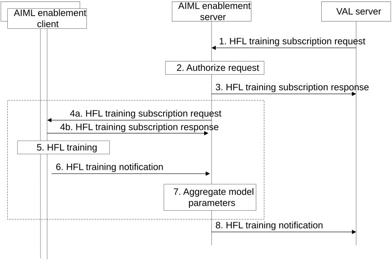

# 8.22 Solution #22: Horizontal Federated Learning training

## 8.22.1 Solution description

The following clauses specify procedures, information flows, and APIs for Key Issue #3 to support horizontal federated learning training procedure.

Figure 8.22.1-1: Procedure for HFL training

1\. A VAL server makes a HFL training subscription request. The request includes: AIML model and model parameters, a model parameter aggregation function, dataset requirements (e.g. list of features, number of data samples), a list of AIML clients as FL members to perform the training (or an AIML client set identifier), number of training rounds, number of AIML clients per round, notification settings. The AIML model and model parameters, dataset requirements, and a list of AIML clients (or an AIML client set identifier) are required to enable HFL training or inferencing. The number of AIML clients and number of training rounds may be included to trigger multiple rounds of training.

2\. The AIML enablement server authorizes the request.

3\. The AIML enablement server sends a subscription response to the consumer with a status of the request and a training identifier to track the training status.

4\. The AIML enablement server sends a HFL training request to each of the AIML enablement clients identified as FL members. The HFL training request includes AIML model and model parameters, number of data samples for the training, optional operational scheduling information. Each AIML enablement client provides a response and, if is not able to perform the local training, the procedure skips to step 6.

5\. Each AIML enablement client performs local training using the configured AIML model and model parameters and local data for the specified number of samples according to the operational schedule. If the AIML enablement client is not able to perform the local training, the procedure skips to step 6.

6\. Upon training completion or due to errors in operation, each AIML enablement client sends a HFL training notification to the AIML enablement server. The notification includes a status of the request, the updated model parameters, information about the training data such as age and size, the elapse time of the training, errors that were encountered during training, and a timestamp.

7\. If the AIML enablement server is capable, the AIML enablement server uses the model parameter aggregation function received in step 1 to perform aggregation of the model parameters from all the AIML enablement clients and then it updates the global model parameters. Steps 4 to 7 may be repeated for the configured number of training rounds. If the AIML enablement server is not capable of performing model parameter aggregation, the procedure skips to step 8.

8\. The AIML enablement server sends a HFL training notification to the VAL server, based on the notification settings configured in step 1. The notification includes updated model parameters (either aggregated model parameters for the global model or individual model parameters from the client models), elapse time(s) of model training, and a list of errors encountered during training. For HFL inferencing, ML model outputs are provided instead of ML model parameters.

## 8.22.2 Architecture Impacts

This solution is based on client-server architecture as described by clause 7.2.

## 8.22.3 Corresponding APIs

Table 8.22.3-1 describes the API for Horizontal FL training subscription request.

Table 8.22.3-1: Horizontal FL training subscription request

| Information element              | Status | Description                                                                                                                         |
|----------------------------------|--------|-------------------------------------------------------------------------------------------------------------------------------------|
| VAL server ID                    | M      | The VAL server identifier.                                                                                                          |
| AIML model and model parameters  | M      | Information about the AIML model and model parameters to use for HFL training/inferencing.                                          |
| AIML enablement client list      | M      | A list of AIML enablement clients required for HFL training/inferencing.                                                            |
| Dataset requirements             | O      | Requirements for dataset required for HFL training/inferencing.                                                                     |
| Number training rounds           | O      | Number of training rounds for HFL training                                                                                          |
| Number of AIML clients per round | O      | Minimum number of AIML clients required for each training round                                                                     |
| Notification settings            | O      | Settings for how often to send notifications providing status of HFL training. For example, periodic, event-based, upon completion. |

Table 8.22.3-2 describes the API for Horizontal FL training subscription response.

Table 8.22.3-2: Horizontal FL training subscription response

| Information element | Status | Description                             |
|---------------------|--------|-----------------------------------------|
| Status              | M      | The status for the subscription request |
| Subscription ID     | M      | An identifier for the subscription      |

Table 8.22.3-3 describes the API for Horizontal FL training subscription response.

Table 8.22.3-3: Horizontal FL training notify

<table>
<colgroup>
<col style="width: 33%" />
<col style="width: 16%" />
<col style="width: 50%" />
</colgroup>
<thead>
<tr class="header">
<th>Information element</th>
<th>Status</th>
<th>Description</th>
</tr>
</thead>
<tbody>
<tr class="odd">
<td>Status</td>
<td>M</td>
<td>Status for the request</td>
</tr>
<tr class="even">
<td>ML model parameters</td>
<td>
O

(NOTE)
</td>
<td>Updated model parameters from training</td>
</tr>
<tr class="odd">
<td>ML model outputs</td>
<td>
O

(NOTE)
</td>
<td>ML model outputs from inferencing</td>
</tr>
<tr class="even">
<td>Training elapse time</td>
<td>O</td>
<td>Total elapse time of the training</td>
</tr>
<tr class="odd">
<td>Error list</td>
<td>O</td>
<td>A list of errors encountered during training</td>
</tr>
<tr class="even">
<td>Timestamp</td>
<td>O</td>
<td>A timestamp for the notification</td>
</tr>
<tr class="odd">
<td colspan="3">NOTE: At least one of the information elements shall be provided.</td>
</tr>
</tbody>
</table>

NOTE: Whether to include Training elapse time and Error list will be discussed during normative phase

## 8.22.4 Solution evaluation

This solution addresses key issues 3, 5, and 6. The solution can be used for both Horizontal FL training and inferencing as well as in split and transfer learning scenarios.

The solution is different than solutions for Vertical FL, since HFL clients train with the same model and update the HFL server with model parameters. The HFL server aggregates the model parameters and sends the updated model parameters to HFL clients for the next round of training.

Since training is repetitive, the AIML enablement server can offer significant benefits to VAL applications by offloading the management and monitoring of horizontal FL training. This solution is feasible and does not introduce any dependency to the 3GPP network system.
