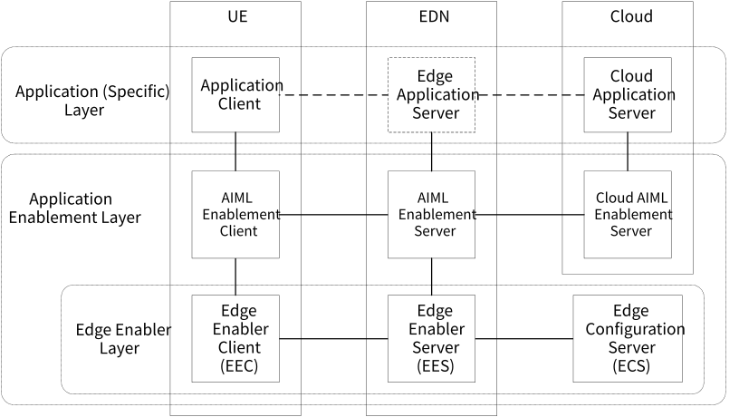
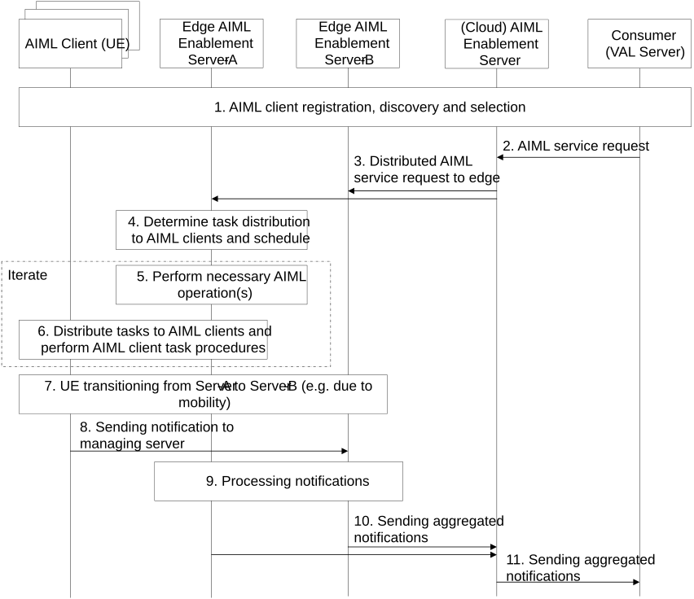

# 8.23 Solution #23: AIML services in edge

## 8.23.1 Solution description

The solution addresses Key Issue #1 to enhance the architecutre and related functions to support application layer AI/ML services in edge computing scenarios. The solution also addressed Key Issue #5 to support AIML operation management splitting in edge computing scenairos.

Figure 8.23.1-1 Example deployment in edge scenario

AI/ML enablement server can be deployed to the EDN to support the management of AI/ML operations performed by AIML clients spread across multiple edge service areas where each AIML enablement server on the edge manages the AIML clients in its service area. Service functions provided by the edge enabler layer can be leveraged where an AIML enablement server on the edge functions as an EAS.

Figure 8.23.1-2. Distribution of AIML service requests

1\. AIML enablement client registration, discovery, and selection are performed between the AIML enablement servers, clients and the consumer (e.g., VAL server) as described in Solution #6 to #8. Each edge AIML enablement server aggregates the information of AIML (enablement) clients within its service area and sends the aggregated information to the cloud AIML enablement server, which is then shared with the consumer.

2\. A consumer (e.g., VAL server) sends a request for AIML service. The request specifies what AIML operations need to be performed and the corresponding requirements. The request can be the operational management request in step 1 of Solution #17.

3\. The request requires AIML clients from multiple edge service areas to be completed. The cloud AIML enablement server processes the request and distributes the request to each of the edge AIML enablement servers. The cloud AIML enablement server can split the request according to the client information obtained in step 1. For example, the consumer requires an operational management request to be performed by a certain number of FL members. The request is distributed to multiple edge AIML enablement servers, each managing the FL clients within its service area. The total number of FL clients adds up to the required number.

4\. Each edge AIML enablement server processes the request from the cloud AIML enablement server and determines the request distribution in operations for each AIML client within its service area (similar to step 4 of Solution #17). The edge AIML enablement server can assist the AIML clients with split learning functions. For example, the edge AIML enablement server identifies that an AIML client does not have enough capacity to store a ML model to be used in a required inference operation, the edge AIML enablement server can split the ML model and the corresponding operations between itself and the AIML client so that the client only needs to store a portion of the model (similar to steps 2 to 4 in Solution #19). The edge AIML enablement server can also identify another endpoint (e.g., another AIML client, an edge server) within its service area for performing split learning.

5\. The edge AIML enablement server performs necessary operations as described in step 5 of Solution #17. For example, the edge AIML enablement server can coordinate the endpoints (including itself) which participate in split learning.

6\. The edge AIML enablement server distributes the request to each of the AIML clients in its service area, and each AIML client performs the required AIML operations while being managed by the edge AIML enablement server (as described in step 6 of Solution #17). The edge AIML enablement server monitors the status and progress of operations involving the AIML clients.

7\. The UE associated with an AIML client moves to a new location that is associated with a new edge AIML enablement server. For example, an AIML client is previously managed by edge AIML enablement server-A, and after the transition, it is managed by edge AIML enablement server-B. The transition triggers the application context relocation (ACR) procedure as specified in 3GPP TS 23.558. Particularly, the application context consists of AIML enablement layer context which includes context information of the AIML operations performed by the AIML client, such as the status or progress of the request, outputs of the operations, context information of the operations or outputs, etc.

8\. The AIML client sends a notification to the edge AIML enablement server (similar to step 6 of Solution #17). The notification includes information of the AIML operations performed by the client, such as an indicator of completion of request, outputs/results of the individual operations, context information of the outputs/results (e.g., applicability of the results, location of data sources).

9\. The edge AIML enablement server processes the received notifications from AIML clients. If the client has undergone a transition event, the edge AIML enablement server determines whether the information in the client’s notification should be linked to or forwarded to the previous edge AIML enablement server associated with the client. For example, the AIML client is assigned, by the edge AIML enablement server-A, to perform split learning with another endpoint in the same service area. The AIML client generates intermediate results which need to be sent to the other endpoint to complete the operation. When the UE associated with the AIML client moves to another area (associated with edge AIML enablement server-B), the AIML client is no longer able to access the other endpoint, in which case the edge AIML enablement server-B can assist the AIML client to forward the intermediate results to the other endpoint, or to identify a new endpoint to collaborate with the AIML client on the split learning request.

10\. The edge AIML enablement server aggregates notifications received from the AIML clients within its service area and sends the aggregated notification to the cloud AIML enablement server.

11 The cloud AIML enablement server further aggregates the notifications received from the edge AIML enablement servers and sends a notification to the consumer.

## 8.23.2 Architecture Impacts

The application enabler layer architecture impacts are the following:

\- AIMLE Server is enhanced to support the distribution of AI/ML service request in edge data networks.

\- AIMLE Server is enhanced to support the aggregation of AI/ML service notifications from the edge data networks.

NOTE: A reference point between AIMLE Servers is assumed to be defined to support the interaction between Cloud AIMLE Server and Edge AIMLE Server or between two Edge AIMLE Servers.

## 8.23.3 Corresponding AIML-S APIs

The step 2 AIML service request is one of several AIML-S messages described in other solutions and enhanced to provide parameters used by the Cloud AIML Enablement Server to determine how to distribute the request to edge, e.g.: identifiers of the required Edge AIML Enablement Servers, AIML operational management description that is specific to the Cloud AIML Enablement Server or the Edge AIML Enablement Servers, indicator of requiring AIML processing continuity support and the corresponding policies, etc. These parameters enhance other APIs such as:

\- The AIML operational management procedure API in Table 8.17.3-1.

\- The AIML service lifecycle management request in step 1 of Figure 8.11.2-1 (Solution #11).

\- The ML model training/inference request in step 4 of Figure 8.4.1-1 (Solution #4).

## 8.23.4 Corresponding AIML-UU APIs

The step 8 AIML service notification is one of several AIML-UU messages described in other solutions, such as:

\- The AIML client notifications/responses in step 6 of Figure 8.17.1-1 (Solution #17).

\- The AIML Enablement clients service operation response in step 3 of Figure 8.11.2-1 (Solution #11).

## 8.23.5 Solution evaluation

This solution leverages other solutions (e.g., AIML operational management procedure) to describe enhancements for Cloud AIML Enablement Servers APIs. The parameters provided by the enhanced APIs are used to determine how to distribute the request to the edge.

This solution can be further complemented by solutions for discovery and selection of the Edge AIML Servers to be targets of AIML service distribution.
