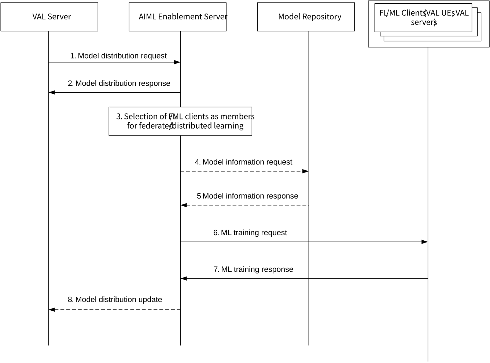

# 8.24 Solution #24: Dynamic ML model distribution

## 8.24.1 Solution description

This solution is for Key Issue #3 and addresses AIML model distribution dynamically, to the selected FL/ML clients where in the list of FL/ML clients that participate in the federated or distributed learning can potentially change over a period of time and more frequently based on the member selection information provided by the VAL server to the AIML enablement server. Figure 8.24.1-1 illustrates the support of distributed and federated machine learning for the VAL servers by dynamically selecting the machine learning clients and distributing the machine learning model information to the selected machine learning (FL/ML) clients for model training. The AIML enablement server selects the member FL/ML clients dynamically and distribute the model to selected FL/ML clients on behalf of VAL server. The FL/ML client selection could be based on member selection information / criteria shared by the VAL server.

Figure 8.24.1-1: AIML model distribution procedure

1\. The VAL server sends Model distribution request to AIML enablement server, requesting to assist in its model training, that is, to monitor and select the FL/ML clients for federated/distributed machine learning, and distribute the machine learning model information to the selected FL/ML clients to initiate the machine learning model training on the selected FL/ML clients. This request consists of member selection related information, ML model information, indication of whether to receive notification whenever the list of FL/ML members changes, time period of when to distribute the model and when to train the model etc.

2\. The AIML enablement server checks whether the VAL server is authorized to perform the request and sends the Model distribution response indicating success or failure of the request.

3\. The AIML enablement server starts monitoring to identify and select the list of potential FL/ML clients that can participate in the federated/distributed learning. The AIML enablement server, based on the member selection information received in step 1, may utilize the core network capabilities or SEAL location management service for example, to identify the list of VAL UEs in particular area of interest or may use the new FL/ML client registration to identify the potential FL/ML clients. The AIML enablement server continuously monitors for the potential FL/ML clients matching the member selection information as specified in the clause 8.6.1.2.

4\. If the ML model information is not available with the AIML enablement server, it requests the corresponding information to the model repository by sending the ML information request to the model repository. This request consists of the identifier of the ML model whose information is requested.

5\. The model repository sends the ML model information response which consists the information related to the ML model. This information may include the ML model file or URL from where the ML model file can be fetched and other information related to the ML model (e.g., state of the model (in training, trained), validity period for distribution and training of the model).

6\. The AIML enablement server distributes the model to all the selected FL/ML member clients based on step 3 by sending the ML training request which consists of the ML model information such as ML model identifier, ML model file or URL of ML model file, whether to start or stop training on the model, validity period for training the model.

7\. The FL/ML clients sends the staus of whether they accept the ML training request or not by sending the ML training response which indicates success or failure.

8\. The AIML enablement server updates the VAL server about the set of FL/ML members selected for training the model based on the confirmations received from FL/ML clients as in step 7, by sending the Model distribution update request to the VAL server containing the set of new FL/ML clients selected, complete list of FL/ML clients selected and the model information.

## 8.24.2 Architecture Impacts

The application enabler layer architecture impacts are the following:

\- AIML Enablement server is introduced to provide support the dynamic distribution of ML model to the AIML members selected for federated/distributed learning.

## 8.24.3 Corresponding APIs

Table 8.24.3-1 shows the details of the model distribution request sent by VAL server to an AIML enablement server.

Table 8.24.3-1: Model distribution request

<table>
<colgroup>
<col style="width: 33%" />
<col style="width: 16%" />
<col style="width: 50%" />
</colgroup>
<thead>
<tr class="header">
<th>Information element</th>
<th>Status</th>
<th>Description</th>
</tr>
</thead>
<tbody>
<tr class="odd">
<td>Member selection information</td>
<td>M</td>
<td>Information related to selection of the FL/ML clients. This could include the member selection criteria / filter information like list of ML/FL clients to select the members from (e.g. area of interest, new FL/ML client registration etc).</td>
</tr>
<tr class="even">
<td>ML model information</td>
<td>M</td>
<td>Information related to machine learning model that has to be distributed to the selected FL/ML clients. This information consists of model identifier, ML model file, address (e.g., a URL or an FQDN) of the ML model file and model repository information related to the ML model.</td>
</tr>
<tr class="odd">
<td>Time of distribution</td>
<td>O</td>
<td>Information related to the time or time period when the model can be distributed to FL/ML clients and/or when the model can be trained. This could include various information like date and time, day of week, schedule (combination of date, time and day of week, periodicity), etc.</td>
</tr>
<tr class="even">
<td>Members update notification</td>
<td>O</td>
<td>Indicates whether requestor needs to be notified whenever there is update related to new FL/ML clients selected, model distributed and start of model training on the selected FL/ML clients.</td>
</tr>
<tr class="odd">
<td>List of FL/ML clients</td>
<td>O</td>
<td>List of FL/ML member clients which are currently participating in federated/distributed learning.</td>
</tr>
<tr class="even">
<td>Notification Target URI</td>
<td>
O

(NOTE)
</td>
<td>Target URI where the VAL server wishes to receive the notifications whenever the list of FL/ML clients selected changes.</td>
</tr>
<tr class="odd">
<td colspan="3">NOTE: This IE shall be present if the Members update notification IE is present and is set to true.</td>
</tr>
</tbody>
</table>

Table 8.24.3-2 shows the details of the model distribution response from AIML enablement server to the VAL server.

Table 8.24.3-2: Model distribution response

<table>
<colgroup>
<col style="width: 33%" />
<col style="width: 16%" />
<col style="width: 50%" />
</colgroup>
<thead>
<tr class="header">
<th>Information element</th>
<th>Status</th>
<th>Description</th>
</tr>
</thead>
<tbody>
<tr class="odd">
<td>Success response</td>
<td>
O

(NOTE)
</td>
<td>Indicates that the model distribution request was successful</td>
</tr>
<tr class="even">
<td>Failure response</td>
<td>
O

(NOTE)
</td>
<td>Indicates that the model distribution request was failure</td>
</tr>
<tr class="odd">
<td>&gt; Cause</td>
<td>M</td>
<td>Reason for the failure</td>
</tr>
<tr class="even">
<td colspan="3">NOTE : At least one of these information elements shall be present</td>
</tr>
</tbody>
</table>

Table 8.24.3-3 shows the details of the model information request from the AIML enablement server to the model repository function.

Table 8.24.3-3: Model information request

| Information element | Status | Description                                                              |
|---------------------|--------|--------------------------------------------------------------------------|
| Model identifier    | M      | Identifier of the machine learning model whose information is requested. |

Table 8.24.3-4 shows the details of the model information response from the model repository function to the AIML enablement server.

Table 8.24.3-4: Model information response

<table>
<colgroup>
<col style="width: 33%" />
<col style="width: 16%" />
<col style="width: 50%" />
</colgroup>
<thead>
<tr class="header">
<th>Information element</th>
<th>Status</th>
<th>Description</th>
</tr>
</thead>
<tbody>
<tr class="odd">
<td>Model identifier</td>
<td>M</td>
<td>Identifier of the machine learning model whose information is requested.</td>
</tr>
<tr class="even">
<td>ML model file</td>
<td>
O

(NOTE)
</td>
<td>Contents of the ML model.</td>
</tr>
<tr class="odd">
<td>ML model location</td>
<td>
O

(NOTE)
</td>
<td>Address information (e.g., a URL or an FQDN) of the model file.</td>
</tr>
<tr class="even">
<td>ML Model information</td>
<td>O</td>
<td>Additional information related to the model like state (in training, trained), spatial validity, validity period for distribution and training of the model etc</td>
</tr>
<tr class="odd">
<td colspan="3">NOTE: At least one of these information elements shall be present</td>
</tr>
</tbody>
</table>

Table 8.24.3-5 shows the details of the ML training request from the AIML enablement server to the FL/ML client.

Table 8.24.3-5: ML training request

<table>
<colgroup>
<col style="width: 33%" />
<col style="width: 16%" />
<col style="width: 50%" />
</colgroup>
<thead>
<tr class="header">
<th>Information element</th>
<th>Status</th>
<th>Description</th>
</tr>
</thead>
<tbody>
<tr class="odd">
<td>Model identifier</td>
<td>M</td>
<td>Identifier of the machine learning model whose information is requested.</td>
</tr>
<tr class="even">
<td>ML model file</td>
<td>
O

(NOTE)
</td>
<td>Contents of the ML model.</td>
</tr>
<tr class="odd">
<td>ML model location</td>
<td>
O

(NOTE)
</td>
<td>Address information (e.g., a URL or an FQDN) of the model file.</td>
</tr>
<tr class="even">
<td>ML Model information</td>
<td>O</td>
<td>Additional information related to the model like state (in training, trained), spatial validity, validity period for distribution and training of the model etc</td>
</tr>
<tr class="odd">
<td colspan="3">NOTE: At least one of these information elements shall be present</td>
</tr>
</tbody>
</table>

Table 8.24.3-6 shows the details of the ML training response from the FL/ML client to the AIML enablement server.

Table 8.24.3-6: ML training response

<table>
<colgroup>
<col style="width: 33%" />
<col style="width: 16%" />
<col style="width: 50%" />
</colgroup>
<thead>
<tr class="header">
<th>Information element</th>
<th>Status</th>
<th>Description</th>
</tr>
</thead>
<tbody>
<tr class="odd">
<td>Success response</td>
<td>
O

(NOTE)
</td>
<td>Indicates that the ML training request was successful</td>
</tr>
<tr class="even">
<td>Failure response</td>
<td>
O

(NOTE)
</td>
<td>Indicates that the ML training request was failure</td>
</tr>
<tr class="odd">
<td>&gt; Cause</td>
<td>M</td>
<td>Reason for the failure</td>
</tr>
<tr class="even">
<td colspan="3">NOTE: At least one of these information elements shall be present</td>
</tr>
</tbody>
</table>

Table 8.24.3-7 shows the details of the Model distribution update from the AIML enablement server to the VAL server.

Table 8.24.3-7: ML model distribution update

<table>
<colgroup>
<col style="width: 33%" />
<col style="width: 16%" />
<col style="width: 50%" />
</colgroup>
<thead>
<tr class="header">
<th>Information element</th>
<th>Status</th>
<th>Description</th>
</tr>
</thead>
<tbody>
<tr class="odd">
<td>List of ML/FL clients added</td>
<td>
O

(NOTE)
</td>
<td>Set of new ML/FL clients that are selected for model training.</td>
</tr>
<tr class="even">
<td>Complete list of ML/FL clients</td>
<td>
O

(NOTE)
</td>
<td>Total set of ML/FL clients that are currently participating in model training.</td>
</tr>
<tr class="odd">
<td>Model Information</td>
<td>M</td>
<td>Machine learning model information related to the list of ML/FL clients. Indicates the model that is distributed and which is currently being trained by the ML/FL Clients.</td>
</tr>
<tr class="even">
<td colspan="3">NOTE: At least one of these information elements shall be present</td>
</tr>
</tbody>
</table>

## 8.24.4 Solution evaluation

This solution addresses the Key issue #3, by introducing the procedure to dynamically distribute the model and the related information to the AI/ML members selected for federated/distributed learning. This solution is significant for scenarios where the availability of the potential FL members changes over a period of time and hence the AIML model needs to be distributed to these dynamically changing member clients. For the selection of the AIML clients this solution can leverage the procedure as defined in the clause 8.6.1.1. Steps 4 and 5 which are related to fetching the model information from the model repository can leverage the procedure as defined in clause 8.5.3.

NOTE: How other solutions can be re-used for the member selection and fetching model information, will be considered at the normative phase.
