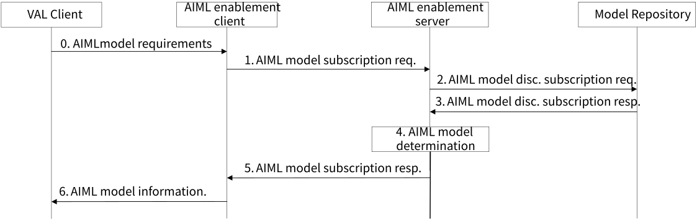
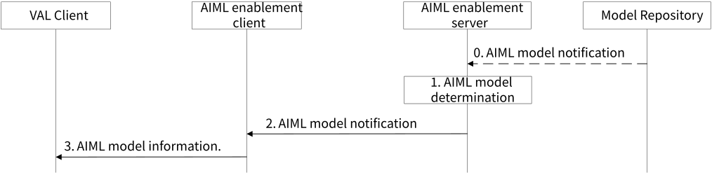

# 8.25 Solution #25: Support for AIML model distribution

## 8.25.1 Solution description

This solution is for Key Issue #5 and addresses AIML model distribution (e.g., transfer) management and configuration; the solution also addresses Key Issue #3 (open issue #5) on distribution of the model information to FL members.

A UE may need to switch an AIML model adaptively based on task and environment variations \[10\]. Since AIML models are diverse and the UE has limited storage (e.g., cannot store all possible AIML models), it can be determined that a UE may benefit from AIML model distribution from a network endpoint. In other words. an AIML model can be distributed from a NW endpoint to a UE when the UE needs it to adapt to the changed AIML tasks and environments.

The AIML enablement layer can provide AIML distribution capabilities as described in this solution.

## 8.25.2 Procedures

### 8.25.2.1 Subscription for AIML model updates

This solution assumes that AIML models are stored in the Model Repository, and each AIML model is associated with information identifying and describing the characteristics of the AIML model, this information is called the AIML model profile in this solution.

NOTE 1: The AIML model profile definition and cardinality proposed in this solution may be further defined in the normative phase.

The AIML profile includes information about an AIML model, such as a model identifier that uniquely identifies the model, a model type (e.g., information about the model purpose), a model version (e.g., a version number or revision number), a model URI (e.g., an identifier for accessing the model as a resource in the Model Repository). and other model discovery/selection characteristics (e.g., such as the model size, input and output requirements, performance, etc.), the model associated VAL client or server identifier(s) if the model is associated with VAL clients or servers. Other information such as validity criteria may identify characteristics related to the usage of the AIML model, for example a validity area if a model has been trained specifically for an area, or a time of day if a model should be used during a specific period of time.

Pre-conditions:

\- AIML models (e.g., trained models) required by the VAL Client are available in the Model Repository with their respective AIML model profile.

Figure 8.25.2.1-1: Subscription for AIML model updates procedure

0\. An AIML VAL client needs support for obtaining AIML models. The AIML VAL client provides AIML model requirements to the AIML enablement client. The requirement includes a VAL client identifier and may include AIML model(s) information (e.g., identifier, version, discovery characteristics, validity criteria, etc.). The VAL client requirements may be used to identify an AIML model profile in the subsequent steps.

NOTE 2: AIML model requirements may be further defined in the normative phase.

1\. The AIML enablement client requests an AIML model subscription to the AIML enablement server; the request includes the VAL client requirements, the UE identifier, the AIML enablement client identifier, and the VAL client identifier.

2\. The AIML enablement server verifies that the AIML enablement client is authorized to subscribe for AIML model updates. If the AIML enablement client is authorized, the AIML enablement server creates a subscription based on the received information for the subscribing AIML enablement client. The AIML enablement server sends an AIML model discovery subscription request to the Model Repository; the request includes the information received from the AIML enablement client in step 1.

NOTE 3: The AIML model discovery may also be performed using a request/response communication model.

3\. The Model Repository creates a subscription for AIML model updates based on the information received for the subscribing AIML enablement server. The AIML repository identifies AIML model profile(s) according to the information provided in the request and sends an AIML model subscription response to the AIML enablement server. The response includes subscription information (e.g., identifier, expiration time, etc.) and includes AIML model profiles if any were identified based on the request parameters. The response may include multiple AIML model profiles that meet the requested parameters.

4\. The AIML enablement server determines AIML model profile(s) to provide to the AIML enablement client. The AIML enablement server may obtain information from the 5GC (e.g., UE location) or the AIML enablement client (e.g., supported AIML models, capabilities) to determine the AIML model profile(s) that may be provided to the UE. The AIML model profile determination may be based on the AIML model information and validity criteria included in the AIML model profile(s). If multiple AIML model profiles are determined, the AIML enablement server may provide the valid AIML model profiles to the UE or select one valid AIML model profile based on the policy in the AIML model requirements.

5\. The AIML enablement server sends an AIML model subscription response to the AIML enablement client; the response includes subscription information (e.g., identifier, expiration time, etc.) and includes AIML model profile(s) determined in step 4.

6\. The AIML enablement client may store (e.g., cache) the received AIML model profile(s). If more than one AIML model profile was received, the AIML enablement client may determine an AIML model profile based on the current UE context (e.g., location, resources, configuration, etc.). The AIML enablement client uses the URI of the AIML model context to obtain the AIML model from the Model Repository and provides information about the obtained AIML model to the VAL client.

### 8.25.2.2 Notification for AIML model updates

Pre-conditions:

\- The AIML enabler client has successfully subscribed for AIML models updates with the AIML enabler server.

\- The AIML enable server has successfully subscribed for AIML models updates with the Model Repository.

Figure 8.25.2.2-1: Notification for AIML model updates procedure

0\. The Model Repository sends a notification for AIML model update to the AIML enablement server. This step may happen if new AIML model(s) are added to the Model Repository, or if existing AIML model(s) from the Model Repository are deleted or updated and if the affected model(s) match the AIML enablement server subscription parameters.

1\. The AIML enablement server detects a change that may require an AIML model update based on the AIML enablement client subscription. The detection may be based on information received from the Model Repository (e.g., model update) or information received from the 5GC (e.g., location update) or information received from the AIML enablement client (e.g., capability update). The AIML enablement server determines AIML model profile(s) to provide to the AIML enablement client based on the update information.

2\. The AIML enablement server sends an AIML model notification to the AIML enablement client; the notification includes AIML model profile(s) determined in step 1.

3\. The AIML enablement client may store (e.g., cache) the received AIML model profile(s). If more than one AIML model profile was received, the AIML enablement client may determine an AIML model profile based on the current UE context (e.g., location, resources, configuration, etc.). If a new AIML model was determined based on the notification, the AIML enablement client uses the URI of the AIML model context to obtain the AIML model from the Model Repository and provides information about the newly obtained AIML model to the VAL client.

## 8.25.3 Architecture Impacts

The solution architecture impacts are:

\- The AIML Enablement Server and AIML Enablement Client are introduced to support AIML model distribution.

\- The Model Repository is introduced to store the AIML models.

## 8.25.4 Corresponding APIs

### 8.25.4.1 API Overview

This clause provides a summary on the corresponding API for solution #25.

\- Discover AIML model profiles API (subscribe/notify model: API provider: AIMLE Server, known consumers: AIMLE client, corresponding to step 1, 4 and 5 of clause 8.25.2.1).

\- Discover AIML models API (subscribe/notify model: API provider: AIMLE Client, known consumers: VAL client, corresponding to step 0 and 6 of clause 8.25.2.1).

\- Discover AIML models profiles API (subscribe/notify model: API provider: Model Repository, known consumers: AIMLE server, corresponding to step 2 and 3 of clause 8.25.2.1).

## 8.25.5 Solution evaluation

The proposed solution addresses Key Issue #5 for AIML model distribution. The solution introduces the subscribe/notify procedures for AIML model discovery.

The solution allows a VAL client to discover, be notified ans obtain AIML model(s) that may be provided by the AIMLE server; the discovered models may be used for performing inference or training.

The solution is based on the AIML enablement layer architecture, including an AIML enablement client, an AIML enablement server and a Model Repository.
