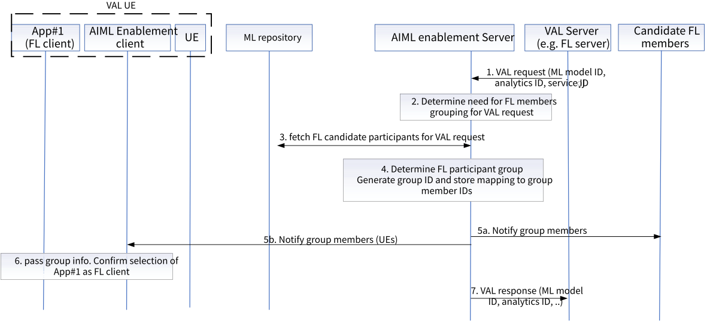

# 8.26 Solution #26: Support for FL member grouping

This solution addresses Key Issue #3 on FL member grouping.

The mechanism proposed in this solution is to enable the group management of the entities serving as FL clients at the application enablement layer. Such group management is about the creation, monitoring and update of the groups based on the AI/ML operations, which are based on 1) the analytics event/service by ADAES or 2) the VAL requirement for FL support services.

## 8.26.1 Solution description

The requirement for grouping the FL members by the VAL server (indirectly) or by the AIML enablement server (acting as consumer) is applicable to a specific VAL request or ML model ID or analytics event/ID.

Figure 8.26.1-1 illustrates the procedure for supporting the FL member grouping.

Pre-conditions:

1\. VAL server is connected to AIML Enablement Server

2\. The candidate/selected FL member has registered to the FL member registry based on Solution #9.

Figure 8.26.1-1 FL member grouping procedure

1\. The VAL server sends a request to the AIML Enablement server for supporting an FL process. Such request may include the ML model ID, the list of target UEs, the data requirements, the ML training or inference job description, the list of candidate FL members (if known) or the list of selected FL participants (if the VAL server is the FL aggregator) etc.

2\. The AIMLE server, based on the request, determines the need for creating a group consisting of the needed FL members for a given ML task (i.e., an ML model training/inference job ID). The FL aggregator can be either the VAL server or the AIMLE server himself, based on the request.

3\. The AIMLE server sends a request and fetches the FL candidate or available FL members for the given ML task (i.e., an ML model training/inference job ID. This can be fetched by a FL member registry/repository e.g., ML repository.

4\. The AIMLE server determines the group by configuring the group based on the selected FL members by the FL server/aggregator. The criteria for determining the group members can be the capabilities of the FL participants, or whether the candidate participants are fixed or mobile nodes and their availabilities, the proximity of the participants among them.

NOTE: For the group creation and management, SEAL GMS can be re-used.

5\. The AIMLE server notifies the candidate FL members (including AIMLE client if the candidate is VAL UEs) about the group ID and the group member identities for the ML model ID / analytics ID (based on the request in step 1. Such notification may include a training job ID or a correlation ID or an FL process ID.

6\. For VAL client UEs selected as FL members, the AIMLE client passes the FL group subscription information to the VAL client and may also request its consent/confirmation.

7\. The AIMLE server sends a response to the VAL request indicating the group creation and the group information.

## 8.26.2 Architecture Impacts

The application enabler layer architecture impacts are the following:

\- AIML enablement server is introduced to provide support for triggering the grouping FL members.

\- An FL member registry (which can be part of ML repository) needs to be enhanced to maintain and update group identity for an FL member group.

NOTE: Whether FL member registry will be part of the ML repository will be confirmed based on the agreed AIMLAPP architecture in clause 7.

## 8.26.3 Corresponding APIs

This subclause provides a summary on the corresponding API for solution \#26.

\- FL Group Management API (request / response model; API provider: AIMLE server; known consumer: VAL server; corresponding to step 3 of clause 8.26.1.1).

\- Fetch FL member / group API (request / response model; API provider: ML repository; known consumer: AIMLE server; corresponding to step 3 of clause 8.26.1.1).

## 8.26.4 Solution evaluation

This solution addresses Key Issue #3 and introduces the capability to support FL member grouping. This solution requires Sol \#9 as pre-condition since the candidate FL members needs to be registered at the FL member repository.

This solution is feasible and doesn't introduce any dependency to 3GPP network systems.

NOTE: The role of FL member registry and whether this is deployed as part of ML repository will be confirmed based on the AIMLAPP architecture selection.
